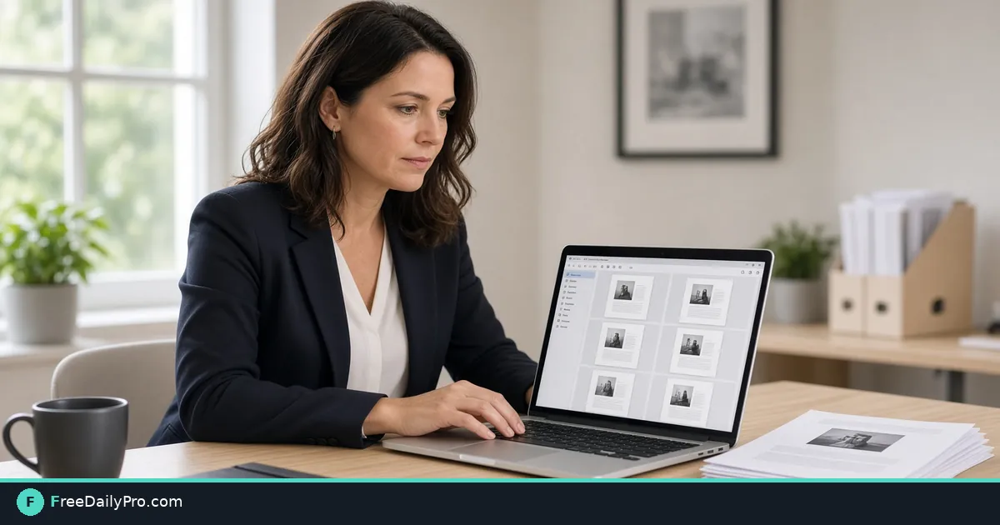

*Export each page as a clear image when the portal wants pictures, not a multi-page file*

[FreeDailyPro.com](https://www.freedailypro.com) -- Some systems will not accept a multi-page PDF. A chat thread wants one picture per message. A slide deck needs a diagram that still lives only as page 4 of a client packet. When that happens, converting pages to JPG is faster than re-drawing anything. This guide uses [PDF to JPG](https://www.freedailypro.com/tool/pdf-to-jpg) for that narrow job.

## Why PDF-to-image shows up in real work

Client portals for insurance, travel reimbursements, and school forms often list "JPG or PNG only." Messaging apps compress PDFs poorly or block them. Designers drop a single page into Figma or PowerPoint as a flat visual. Support teams screenshot endlessly when a clean page export would look sharper.

Say you manage a three-person studio. You receive a 9-page PDF of signed scope pages and need pages 2 and 7 as images for a kickoff deck by 4 p.m. You do not need to rebuild the whole document—you need faithful page images with readable type.

## What to prepare before you convert

- The source PDF with pages you can open on a large screen.
- A short list of page numbers you actually need (not always every page).
- Destination rules: max file size per image, color vs grayscale preference, and whether the chat will re-compress again.
- Related tools if the job expands: [Compress PDF](https://www.freedailypro.com/tool/compress-pdf) before conversion when the source is huge, [Compress Image](https://www.freedailypro.com/tool/compress-image) after export when a single JPG is still heavy, and [Image to PDF](https://www.freedailypro.com/tool/image-to-pdf) if you must reassemble selected images later.

Browse [PDF tools](https://www.freedailypro.com/category/pdf-tools) only after you know whether you need images or a lighter PDF. Among 200+ professional tools, pdf-to-jpg is the direct step here. File tools include 10 trial usages a day—export the packet once with the right pages instead of re-uploading after every glance.

## Numbered workflow for a slide-ready export

1. Open the PDF and confirm which pages matter. Note "p.2 diagram, p.7 signature block" on paper.
2. If the file is over your usual portal limit already, run one sensible pass on [Compress PDF](https://www.freedailypro.com/tool/compress-pdf) first so conversion is not fighting a 40 MB scan.
3. Open [PDF to JPG](https://www.freedailypro.com/tool/pdf-to-jpg) and upload the file. Follow live labels for range or whole-document options.
4. Download the images and open each needed page full-screen. Check that text is not soft and that crop edges are not cut.
5. Rename clearly: `scope-p02-diagram.jpg`, `scope-p07-sign.jpg`. Avoid `image (12).jpg` forever.
6. If a single JPG is still too large for chat, compress that file only with [Compress Image](https://www.freedailypro.com/tool/compress-image).
7. Drop the images into the deck or upload to the portal. Keep the original PDF as the system of record.

## Worked example: nine-page scope, two images

Source: `Acme-scope-signed.pdf`, 9 pages, 6.2 MB. You need page 2 (timeline chart) and page 7 (signature). You convert the full PDF or a selected range depending on what the live tool offers, then keep only those two JPGs. Page 2 exports near 1.1 MB; page 7 near 900 KB. Chat allows 1 MB attachments, so you compress page 2 once to about 720 KB. The deck looks sharp on a projector; the PDF remains in the contract folder untouched.

Success condition: recipients see readable type without downloading a full packet they never asked for.

## Edge cases that surprise people

**Image-only scans.** A photographed PDF may already be soft. Conversion will not invent sharpness. Re-capture with a better scan if text fails OCR or readability.

**Very tall pages.** Some pages become extremely tall JPGs. Preview on phone and desktop before you promise "one image per page" in a feed that crops previews.

**Color logos on white.** JPG compression can introduce mild banding. If a logo must stay crisp for print, test quality settings and keep a PNG path only when the tool and workflow support it.

**Password-protected PDFs.** Unlock or use an allowed export path first. Do not fight conversion on a locked file.

**Need a PDF again later.** If someone asks for a short PDF of only the two pages, rebuild with [Image to PDF](https://www.freedailypro.com/tool/image-to-pdf) from the cleaned images rather than re-sending private pages they should not see.

## Common mistakes

- Exporting all 40 pages when two would do, then flooding Downloads.
- Sending the first export without zooming into small type.
- Compressing five times until signatures look plastic.
- Using screenshots of the PDF viewer (UI chrome included) instead of a real page export.
- Losing the link between image filenames and the source PDF version date.

## Honest limits

PDF to JPG rasterizes pages. It is not a vector export, not an editor for changing contract text, and not a redaction tool. Sensitive content on a page remains visible in the image—remove or redact in a dedicated step before you share widely. FreeDailyPro runs browser-based tools with 10 trial usages a day on file workflows; plan batches when a whole team converts packets after a signing day.

If you only needed a smaller PDF, compress or split instead of multiplying image files.

## FAQ for page images

**Will every page become a separate file?** Follow the live tool output. Many workflows produce one image per page—name them in order immediately.

**Is JPG always better than PNG here?** JPG is smaller for photo-like scans. Choose based on portal rules and visual tolerance for compression.

**Can I use this for print at 300 dpi?** Check the resolution the export actually produces. For critical print, verify dimensions in an image tool before you plate anything.

**What if one page is sideways?** Fix orientation with a rotate step on the PDF first so every export stands upright.

## Closing next step

Pick one PDF you must partially share this week. Convert only the pages you need with [PDF to JPG](https://www.freedailypro.com/tool/pdf-to-jpg), rename them, and place them in the deck or portal. If a page looks soft or oversized, note page number, source file size, and the exact limit you hit when you contact FreeDailyPro through the [contact page](https://www.freedailypro.com/contact).
