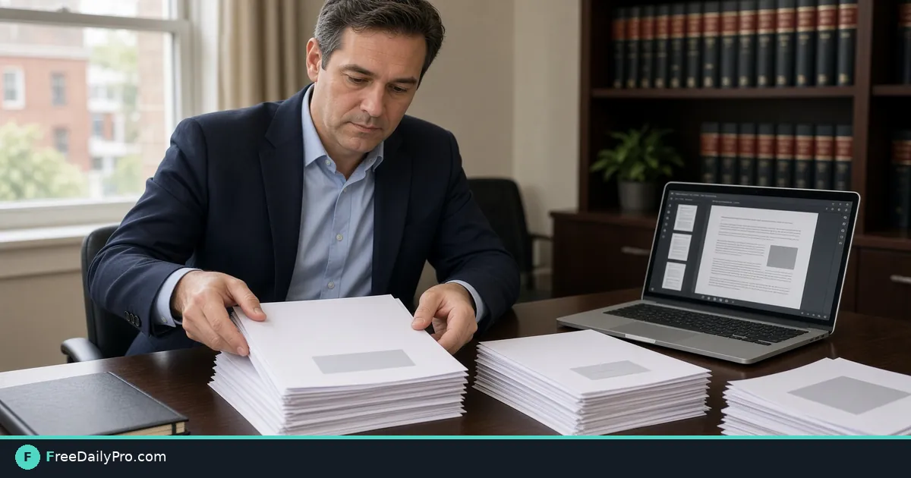

*Combine cover letter, contract, and exhibits into a single packet you can attach once*

[FreeDailyPro.com](https://www.freedailypro.com) -- Five separate attachments force the client to rebuild your deal in their head. Most portals want one file. [Merge PDF](https://www.freedailypro.com/tool/merge-pdf) turns ordered parts into a single packet when page order is deliberate, not accidental.

The clip below shows combining several PDFs into one file.

{{youtube 0FjbjU4eDVw | Merge multiple PDFs in order}}

## Assembly order is the product

Treat the packet like a short book: cover, body, exhibits. A freelance designer might ship `01-cover.pdf`, `02-sow.pdf`, `03-schedule.pdf`. Merge in that sequence. Download order from email is not a sequence.

Legal intake often needs the engagement letter first, signed terms second, and an ID scan last. Wrong order looks careless even when every page is correct. Write the order on a sticky note before you open the tool.

## Before you click merge

Confirm each part opens and stands upright on screen. Delete junk pages with [Split PDF](https://www.freedailypro.com/tool/split-pdf) first. Note the portal MB limit for later. Only after the packet is correct, consider [PDF Password](https://www.freedailypro.com/tool/pdf-password) if policy requires protection.

Browse [PDF tools](https://www.freedailypro.com/category/pdf-tools) when you need a neighboring step. File tools include 10 trial usages a day—line up parts once so each merge counts.

## Seven practical steps

1. Rename sources with numeric prefixes on disk.
2. Open Merge PDF and add files in reading order.
3. Run the merge and download the result.
4. Check total pages equals the sum of parts.
5. Click each section break on a large screen.
6. If over the size cap, run [Compress PDF](https://www.freedailypro.com/tool/compress-pdf) once and re-check signatures.
7. Name `Client-Project-packet-DATE.pdf` and archive the parts beside it.

## Worked packet

SOW 3 pages + rate card 1 + schedule 2 = 6 pages at 4.8 MB. Portal cap is 5 MB. No compress needed. The client opens one attachment and finds the schedule after the SOW without hunting through a zip of loose files.

A second matter: 14 pages of terms plus a 2-page insurance cert. Merge to 16 pages. Page count check fails because one "part" was already a prior merge with duplicates. Split clean, renumber, merge again. Ten extra minutes beats a client reading two copies of page 3.

## Odd files and edge cases

Landscape slides mixed with letter pages can look odd in preview. Bookmarks may drop on merge. Encrypted parts must be unlocked first. Nested "already merged" stacks hide old exhibits—split them clean before rebuild.

Photo exhibits should be PDF pages first, then merged, so order stays visible. Scanned packs that start mid-sentence on page 1 usually mean someone split badly earlier; fix the parts before you merge.

## Mistakes that create support tickets

Merging in the order files finished downloading. Forgetting the cover as page 1. Emailing both the loose parts and the merge without labeling the authority file. Compressing until signatures smear. Uploading `final-final2.pdf` with no date.

## Limits

Merge concatenates pages. It does not rewrite legal text or validate wet-ink rules. Among 200+ professional tools, this one is assembly.

## FAQ

**Reorder after merge?** Prefer re-merge from numbered parts.

**Page numbers?** Add in a separate step when required.

**Partial update?** Replace one part, re-merge, do not edit a mystery stack by hand.

**Password first or merge first?** Merge the correct open parts, then password if policy demands.

## Naming that survives handoff

`Client-Acme-MSA-packet-2026-10-27.pdf` tells a stranger what the file is. `scan.pdf` does not. Put the client code first if your firm sorts by client. Put the date in ISO form so lexical sort matches time sort.

When a second packet ships the same day, add `-v2` or a time suffix. Never overwrite the only uploaded copy in the portal without archiving the prior bytes.

## Exhibit discipline

Exhibits grow. Label them in the merge order the contract references ("Exhibit A", "Exhibit B") even if filenames differ. A one-line index page at the front can list exhibits if the portal allows an extra page—otherwise put the map in your cover email.

If one exhibit is a 40 MB photo log, keep it out of the main contract merge. Send the contract packet under the limit, then the photo log as a labeled second file only when policy allows two uploads.

## Parallel work without chaos

Two people should not merge different stacks for the same matter. Assign one assembler. Others drop numbered parts into a folder. The assembler merges once after a freeze time. Chat threads full of "I already merged" versions are how wrong exhibits ship.

## Verification beyond page count

Search the merged PDF for the client legal name. Confirm the last page is the intended signature block. Open on a phone to catch tiny type that looked fine on a 27-inch monitor. Spot-check a middle exhibit so you did not drop it between cover and terms.

## When merge is the wrong first step

If pages are still being redlined, merge creates churn. Finish text, then assemble. If orientation is wrong, rotate first. If secrets must leave, redact or split before the external packet exists.

## Archive layout

Keep a simple matter folder:

- `parts/` with numbered sources
- `Acme-MSA-packet-2026-10-27.pdf` as the authority file
- `notes.txt` with page total, MB size, who merged, and portal confirmation id

That layout survives staff changes better than a desktop full of `merge-try3.pdf`.

## Client portal confirmations

After upload, download the portal’s stored copy when the system allows. Confirm page count matches your local merge. Portals occasionally re-encode files; a quick check prevents “we never got page 6” disputes six weeks later.

## Color vs grayscale scans

Color photo exhibits inflate size after merge. If color is not required, convert those parts to grayscale before merge, then compress if still needed. Do not assume merge alone reduces weight.

## Signature page placement

Many reviewers jump to the end. Keep the primary signature page last unless a form requires wet-ink first. Consistency across matters trains your clients and your own team.

## Mini case: late exhibit

An exhibit arrives after you already merged. Do not insert by guesswork mid-file unless you have a reliable organize path. Safer path: add the exhibit as a new numbered part and re-merge from parts. Five minutes of re-merge beats a corrupted page order that nobody can explain later.

## Closing next step

Number tomorrow’s parts on disk, merge once with [Merge PDF](https://www.freedailypro.com/tool/merge-pdf), and verify page count before send.

What packet order still confuses your clients? Tell us on the [contact page](https://www.freedailypro.com/contact).
