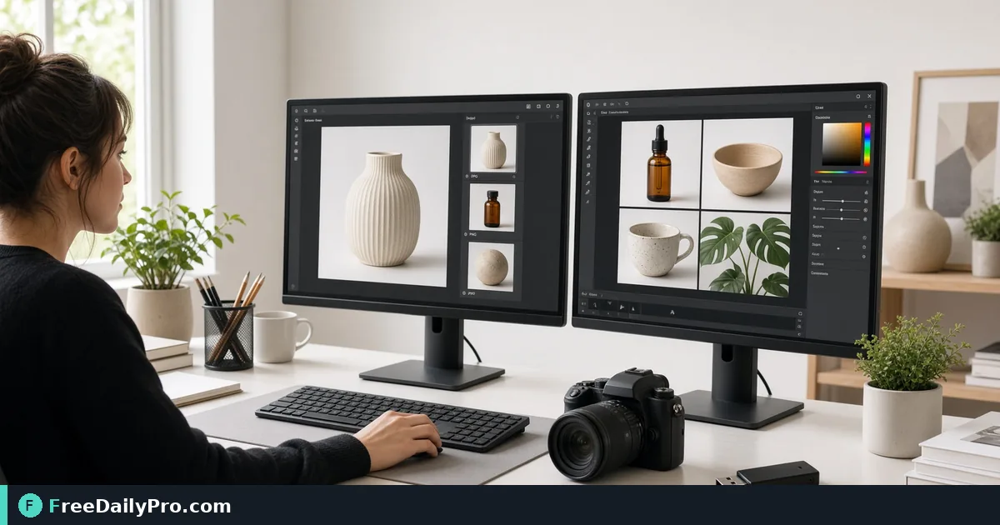

*Switch JPG, PNG, WebP, and GIF to the format each platform actually accepts*

[FreeDailyPro.com](https://www.freedailypro.com) -- A marketplace that only wants JPG will reject your transparent PNG without a useful error. [Convert Image](https://www.freedailypro.com/tool/convert-image) turns one format into another so the upload dialog stops arguing with your camera roll.

The clip below shows converting between common image formats.

{{youtube vHFSmxgaxAU | Convert image formats JPG PNG WebP}}

## Match the destination, not your favorite format

Product sites, CMS fields, email editors, and print vendors each document allowed types. Read the requirement once. Convert toward that type. Do not invent a multi-format bundle unless the client asked for one.

PNG keeps sharp edges and transparency for logos. JPG suits photos where small size matters. WebP often wins on modern web performance when the platform supports it. GIF is for simple animation—not for high-detail photos.

## Quality and size in one pipeline

Convert first when the format is wrong. Then, if the file is still heavy, use [Compress Image](https://www.freedailypro.com/tool/compress-image) toward the MB cap. If dimensions are wrong, [Resize Crop](https://www.freedailypro.com/tool/resize-crop) to the exact pixel box before or after convert depending on whether the platform checks format first. For dozens of SKUs, [Bulk Image](https://www.freedailypro.com/tool/bulk-image) saves repetition—still spot-check three outputs.

Category: [image tools](https://www.freedailypro.com/category/image-tools). File workflows include 10 trial usages a day—queue your conversions with a checklist.

## Steps that survive launch week

1. Note the required format and max dimensions from the destination docs.
2. Open Convert Image with a real product photo, not a random desktop screenshot.
3. Pick the target format and run the conversion.
4. Open the result and check edges, colors, and transparency.
5. Resize or compress only if the destination still rejects size.
6. Name files with SKU and format: sku-blue-hero.jpg.
7. Archive originals in a masters folder; never overwrite the only RAW or master PNG.

## Worked listing example

A shop has PNG masters with soft shadows on white. The marketplace wants JPG under 2 MB and 2000 px on the long side. You convert PNG to JPG, resize to 2000 px, compress to about 1.2 MB, and upload. Listing goes live. A second channel accepts WebP—you convert from the same master, not from the already-crushed JPG, to avoid double generation loss.

## Transparency and backgrounds

Flattening a logo onto white by accident destroys a dark-theme site. When you convert PNG to JPG, expect a solid background. If you need transparency later, keep the PNG master. Preview on both light and dark gray to see fringing.

## Color shifts to watch

Wide-gamut phone photos can look dull after convert in some viewers. Soft-proof on the device your customer uses. For brand colors in flat graphics, prefer PNG or carefully tuned exports over aggressive JPG.

## Common mistakes

Converting from an already tiny JPG to PNG expecting magic detail to return—it will not. Uploading HEIC straight from iPhone when the form wants JPG. Running ten convert cycles on the same derivative. Forgetting that animated GIF to JPG keeps one frame only unless you planned that.

## Limits

Convert Image changes container and encoding. It does not fix blurry focus, bad lighting, or trademark issues in the photo. FreeDailyPro offers it among 200+ professional tools for browser-based image work.

## FAQ

**SVG?** Vector paths are a different tool path than raster convert.

**CMYK print?** Confirm with the printer; many online converters target RGB web formats.

**Batch?** Use bulk tools when the same settings apply to every file; still sample outputs.

## Masters vs derivatives

Keep a masters folder that never gets overwritten. Derivatives are disposable. If a marketplace changes rules next quarter, you reconvert from masters, not from last season's crushed JPG.

## Email and CMS quirks

Some email builders re-encode images and bloat them again. Supply the format they document, then test a send to yourself. CMS plugins may strip WebP—have JPG fallbacks ready.

## Mini case: app icon pipeline

A designer ships PNG with transparency for iOS and needs a solid JPG for a legacy admin panel. One convert from the master PNG produces the JPG; the PNG remains for the store listing. Two uploads, one master, no arguments.

## Naming for teams

sku-color-angle-format.ext beats finalfinal2.webp. When three people upload, clear names stop overwrites.

## Platform requirement table (build your own)

Keep a living note: platform name, allowed formats, max MB, max pixels, notes. Update it when an upload fails. Convert Image is fast; hunting undocumented rules is slow. Share the table with anyone who uploads for your brand.

## Photography intake

Shoot for masters in the highest quality your camera allows, then convert down. Do not shoot already-small JPGs for every channel. One good master supports JPG, WebP, and resized derivatives without reshooting.

## White background rules

Many marketplaces demand pure white. Conversion does not remove gray studio paper. Fix background before convert, or pair with a background-removal step when policy allows, then convert to the required format.

## Version labels in filenames

sku-v3-web.jpg and sku-v3-print.png can coexist. When marketing asks "which file is live," the name answers. Convert outputs should inherit version labels from masters.

## When convert is the wrong first step

If the image is the wrong subject, convert will not help. If the crop is wrong, resize-crop first. If the file is huge but already correct format, compress first. Order operations by the actual rejection reason in the upload UI.

## QA sampling plan

For a 50-image catalog, convert all, then fully inspect five random outputs plus any hero image. Check color, crop, and file size. Full manual review of fifty is rare; structured sampling catches systematic mistakes.

## Delivery to clients

When a client asks for "all formats," deliver a zip of derivatives plus a readme line listing format and intended use. Convert Image creates the files; the readme prevents them from uploading the print PNG to a 200 KB web slot.

## Closing next step

Convert one real upload-blocked image with [Convert Image](https://www.freedailypro.com/tool/convert-image) to the format the form lists, then retry the upload.

Which platform still rejects your files—marketplace, CMS, or email? Note it on the [contact page](https://www.freedailypro.com/contact).
