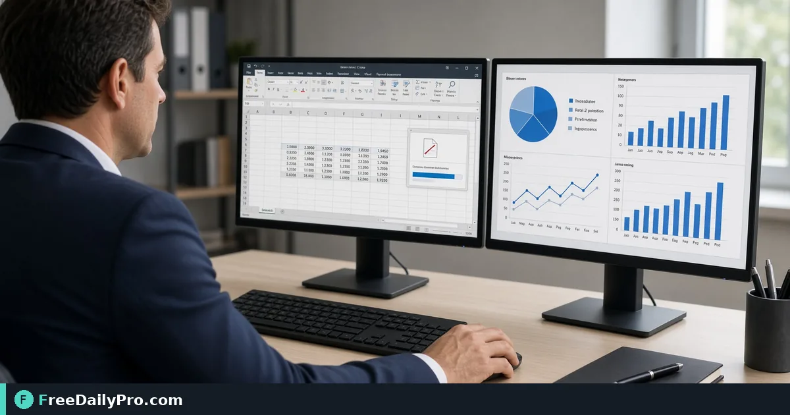

*Publish spreadsheet snapshots that fit letter pages*

[FreeDailyPro.com](https://www.freedailypro.com) -- A 14-column finance sheet that leadership wants as a readable PDF. [Excel to PDF](https://www.freedailypro.com/tool/excel-to-pdf) keeps the critical pass in your browser among FreeDailyPro's 200+ professional tools.

The clip below shows Excel to PDF in action on a realistic task.

{{youtube uHlSx5_uZ6o | How to Convert Excel Spreadsheet to}}

## When Excel to PDF is the right tool

This guide focuses on one primary job for excel to pdf: export a table that does not cut columns on letter paper. The scenario is concrete: a 14-column finance sheet that leadership wants as a readable pdf. When this excel to pdf job fails, people usually skipped a written success line and trusted a familiar filename instead.

With excel to pdf, success means you can point to a finished file or number and say what changed. Practical anchors in this guide sit around 14, 3, and 2 as anchors you can adapt for excel to pdf—not marketing fluff.

## Before you open the page

Write a one-line definition of done for excel to pdf before you click anything. Line up the source files or values excel to pdf expects, then start the run. Write down the destination rules that can reject a excel to pdf export. Keep secondary tools ready only if excel to pdf hits a real blocker: [PDF Password](https://www.freedailypro.com/tool/pdf-password), [Add Page Numbers](https://www.freedailypro.com/tool/add-page-numbers), [Compress PDF](https://www.freedailypro.com/tool/compress-pdf).

Open the category [pdf tools](https://www.freedailypro.com/category/pdf-tools) when a neighboring step is required after Excel to PDF. Stage inputs offline so each excel to pdf run earns its place under the daily trial cap for file work..

## Practical sequence

1. Restate the excel to pdf outcome in one plain sentence before settings.
2. Open [excel to pdf](https://www.freedailypro.com/tool/excel-to-pdf) and follow live field labels on that page.
3. Feed excel to pdf production inputs—not demo placeholders you will forget to replace.
4. Run the main excel to pdf action once, then check the success line immediately.
5. If a secondary tool is required for excel to pdf, open it only for the blocker you actually hit.
6. Label the excel to pdf output so a stranger on your team knows what it is.
7. Verify excel to pdf output beyond the green success toast.
8. Archive sources beside the excel to pdf export for the inevitable "what shipped?" question.

## Concrete scenario

Starting point for this excel to pdf case shaped by 14. Intermediate constraint shaped by 3. Target shaped by 2. After one careful excel to pdf pass, the output matches the success line closely enough to ship. Make the excel to pdf workflow transferable in one short checklist.

A single controlled adjustment after a excel to pdf miss teaches the team faster. That is how excel to pdf stays reliable under deadline pressure.

## Watch-outs

Two excel to pdf outputs named `download (1)` is how wrong packets ship. Rename immediately.

Odd inputs (partial files, mixed orientations, incomplete rows) confuse operators more than the excel to pdf UI. Inspect inputs before blaming the tool.

Locale and formatting issues can shift meaning after excel to pdf even when the UI reported success.

Some destinations re-encode excel to pdf exports—download the stored copy when a portal allows and re-check.

## Mistakes

- Chaining five tools when excel to pdf alone would finish the job.
- Overwriting the only master input while exporting from excel to pdf.
- Ignoring size/format/length caps until the final excel to pdf click fails.
- Sending both draft and final excel to pdf outputs without labeling the authority file.
- Skipping the success line and only eyeballing the excel to pdf result.
- Leaving sample data in a excel to pdf run that later gets sent as real.

## Boundaries

Excel to PDF performs the job described on its tool page. The excel to pdf tool completes its stated job; it is not a substitute for licensed professional advice. FreeDailyPro's 200+ professional tools list includes excel to pdf for this job.

## FAQ

**Pipeline?** Start and often end on excel to pdf; expand only with evidence.

**Second try?** Allowed after a written change note for excel to pdf.

**Platforms?** Integrate excel to pdf-like steps after the manual truth is clear.

## After you export

Name excel to pdf outputs like `client-or-project-excel-to-pdf-DATE.ext` (adapt extension). Jot a one-line note next to the excel to pdf file: success line, operator, and key settings—future you will not remember the hallway chat.

If multiple people share a folder, only numbered excel to pdf finals are client-facing. Drafts get a `draft-` prefix. That habit matters more than any single click.

## Checks

Define "good" before opening excel to pdf (portal accepts file, row count matches, duration under target, colors match tokens—pick what fits). Skip shipping excel to pdf work you cannot verify on purpose.

Open the excel to pdf export once on a second device or clean profile. Many failures only appear off the creating machine.

## Case study

A team faced exactly this shape of problem: a 14-column finance sheet that leadership wants as a readable PDF. They wrote a success line, ran excel to pdf, verified with their numeric anchors, and only then notified stakeholders. Last month's "good enough" excel to pdf file taught them the expensive lesson.

The difference was not a secret setting. It was treating excel to pdf like a checklist step instead of a last-second miracle.

## Collaboration tips around Excel to PDF

Freeze inputs, announce the freeze, then use excel to pdf.

The ticket owns policy; excel to pdf owns the mechanical step.

On heavy excel to pdf days, prepare files first—file tools include 10 trial usages a day..

Teach excel to pdf by watching verification, not by stealing the mouse.

Evidence beats vibes: capture excel to pdf settings and a hash or row count.

Assume excel to pdf destinations drift; re-read their docs on a schedule.

## Closing next step

Close the loop on excel to pdf with a labeled final in the matter folder. Open [excel to pdf](https://www.freedailypro.com/tool/excel-to-pdf) to start.

Which success line do you want as a template for Excel to PDF on your projects? Tell us about your excel to pdf case on the [contact page](https://www.freedailypro.com/contact).
