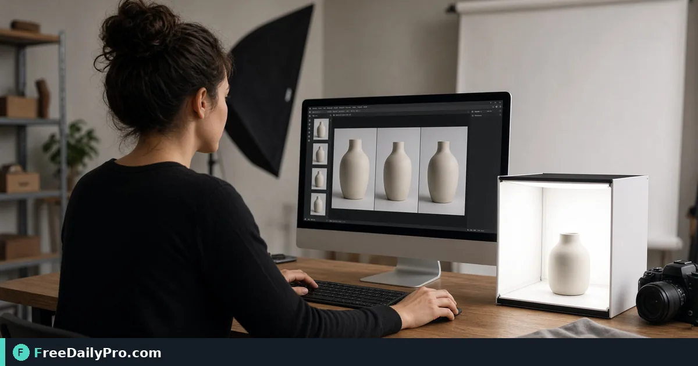

*Correct orientation before clients see the listing*

[FreeDailyPro.com](https://www.freedailypro.com) -- Phone photos of a storefront that arrived sideways and mirrored. [Flip & Rotate Image](https://www.freedailypro.com/tool/flip-rotate-image) is the browser step that turns a messy handoff into a checked result you can send.

The clip below shows Flip & Rotate Image in action on a realistic task.

{{youtube U7b1g2XugT8 | How to Flip & Rotate Images Online}}

## Why teams reach for Flip & Rotate Image

This guide focuses on one primary job for flip rotate image: rotate and flip before the listing goes live. The scenario is concrete: phone photos of a storefront that arrived sideways and mirrored. The expensive miss with flip rotate image is shipping a hopeful file without a one-line definition of done.

With flip rotate image, success means you can point to a finished file or number and say what changed. Practical anchors in this guide sit around 8, 90, and 2 as anchors you can adapt for flip rotate image—not marketing fluff.

## What to prepare first

Write a one-line definition of done for flip rotate image before you click anything. Put the correct sources for flip rotate image in one folder or note before clicking. Write down the destination rules that can reject a flip rotate image export. Keep secondary tools ready only if flip rotate image hits a real blocker: [Compress Image](https://www.freedailypro.com/tool/compress-image), [Resize & Crop](https://www.freedailypro.com/tool/resize-crop), [Convert Image](https://www.freedailypro.com/tool/convert-image).

Open the category [image tools](https://www.freedailypro.com/category/image-tools) when a neighboring step is required after Flip & Rotate Image. If flip rotate image processes files, count each deliberate attempt against the 10 trial usages a day allowance..

## Steps on Flip & Rotate Image

1. Restate the flip rotate image outcome in one plain sentence before settings.
2. Open [flip rotate image](https://www.freedailypro.com/tool/flip-rotate-image) and follow live field labels on that page.
3. Feed flip rotate image production inputs—not demo placeholders you will forget to replace.
4. Treat the first full flip rotate image output as a candidate, then prove it against the goal.
5. If a secondary tool is required for flip rotate image, open it only for the blocker you actually hit.
6. Save the flip rotate image result with a date and purpose in the filename.
7. Inspect the flip rotate image output with zoom, sampling, or a recount—whatever fits the medium.
8. Bag the flip rotate image run so a second person can reconstruct it.

## Worked numbers

Starting point for this flip rotate image case shaped by 8. Intermediate constraint shaped by 90. Target shaped by 2. After one careful flip rotate image pass, the output matches the success line closely enough to ship. Hand off flip rotate image with a checklist, not a hallway summary.

Keep a mini log for flip rotate image: attempt, change, result. That method stops flip rotate image from feeling like magic or mystery.

## Edge cases

Odd inputs (partial files, mixed orientations, incomplete rows) confuse operators more than the flip rotate image UI. Inspect inputs before blaming the tool.

Locale and formatting issues can shift meaning after flip rotate image even when the UI reported success.

Some destinations re-encode flip rotate image exports—download the stored copy when a portal allows and re-check.

Two flip rotate image outputs named `download (1)` is how wrong packets ship. Rename immediately.

## Mistakes that waste a day

- Skipping the success line and only eyeballing the flip rotate image result.
- Leaving sample data in a flip rotate image run that later gets sent as real.
- Chaining five tools when flip rotate image alone would finish the job.
- Overwriting the only master input while exporting from flip rotate image.
- Ignoring size/format/length caps until the final flip rotate image click fails.
- Sending both draft and final flip rotate image outputs without labeling the authority file.

## Limits

Flip & Rotate Image performs the job described on its tool page. flip rotate image will not invent missing source data or approve regulated decisions for you. Operators use FreeDailyPro's 200+ professional tools; flip rotate image covers this slice.

## FAQ

**Pipeline?** Start and often end on flip rotate image; expand only with evidence.

**Retry policy?** Fix inputs, then one more flip rotate image run—do not spam.

**Bots?** They multiply mistakes if flip rotate image is not understood.

## Handoff and naming

Name flip rotate image outputs like `client-or-project-flip-rotate-image-DATE.ext` (adapt extension). Write three tokens beside the flip rotate image output: done-means-X, operator, settings hash or summary.

If multiple people share a folder, only numbered flip rotate image finals are client-facing. Drafts get a `draft-` prefix. That habit matters more than any single click.

## Quality bar

Define "good" before opening flip rotate image (portal accepts file, row count matches, duration under target, colors match tokens—pick what fits). Testable beats vague for every flip rotate image handoff.

Open the flip rotate image export once on a second device or clean profile. Many failures only appear off the creating machine.

## Mini case

A team faced exactly this shape of problem: phone photos of a storefront that arrived sideways and mirrored. They wrote a success line, ran flip rotate image, verified with their numeric anchors, and only then notified stakeholders. Last month's "good enough" flip rotate image file taught them the expensive lesson.

The difference was not a secret setting. It was treating flip rotate image like a checklist step instead of a last-second miracle.

## Operational notes for Flip & Rotate Image

flip rotate image loves stable inputs; unstable sources create dueling PDFs and sheets.

Put the destination rule in the ticket; flip rotate image executes while the ticket holds the rule.

Draft offline first for flip rotate image, then spend a trial usage only on a real export..

Have learners narrate the flip rotate image check out loud once.

Log flip rotate image anomalies with timestamps so patterns appear across days.

Calendar a quarterly review of flip rotate image destinations and acceptance tests.

## Closing next step

Practice flip rotate image once on production-like data, not only on toys. Open [flip rotate image](https://www.freedailypro.com/tool/flip-rotate-image) to start.

What volume do you process weekly with Flip & Rotate Image-like steps? File it on the [contact page](https://www.freedailypro.com/contact) tagged mentally as flip rotate image.
