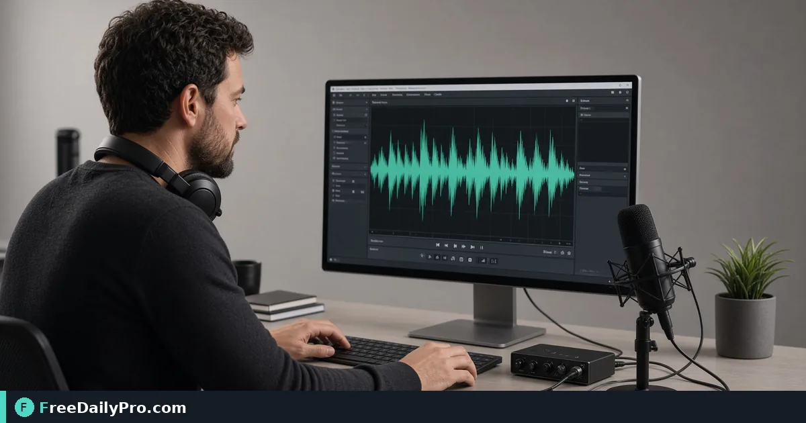

*Lower bitrate deliberately so voice still sounds clear*

[FreeDailyPro.com](https://www.freedailypro.com) -- Operators in course uploads keep repeating consonants smear at too-low bitrate. [Audio Compressor](https://www.freedailypro.com/tool/audio-compressor) is the browser step for 28-minute interview under 25 MB course portal cap, aimed at instructors who need under cap and intelligible on phone speakers.

The clip below shows Audio Compressor on a realistic task for 28-minute interview under 25 MB course portal cap.

{{youtube PNMa1yxUO7A | How to Compress Audio Files Online – Red}}

## Why Audio Compressor is the right lever for 28-minute interview under 25 MB course portal cap

This guide covers one primary job for audio-compressor: 28-minute interview under 25 MB course portal cap. The audience is instructors. When audio-compressor output disappoints, re-check whether the goal stayed "under cap and intelligible on phone speakers" and whether anchors near 28, 25, and 12 (MB) were entered correctly. The failure mode to refuse is consonants smear at too-low bitrate.

Success with Audio Compressor means you can defend a finished artifact: under cap and intelligible on phone speakers. Practical anchors for this course uploads case sit around 28, 25, and 12 (MB). If those anchors are missing, stop before spending a trial usage on half-ready inputs for 28-minute interview under 25 MB course portal cap.

## Stage inputs before opening Audio Compressor

Write a one-line done definition for audio-compressor that matches under cap and intelligible on phone speakers. Stage every material Audio Compressor will consume for 28-minute interview under 25 MB course portal cap. Note destination rules that can reject a audio-compressor export in course uploads.

Keep neighbor tools only for real blockers after Audio Compressor: [Extract Audio](https://www.freedailypro.com/tool/extract-audio), [Audio Trimmer](https://www.freedailypro.com/tool/audio-trimmer), [Audio Converter](https://www.freedailypro.com/tool/audio-converter). Browse [audio tools](https://www.freedailypro.com/category/audio-tools) when a related step is required after the audio-compressor pass for 28-minute interview under 25 MB course portal cap. Queue audio-compressor runs so each trial usage hits ready inputs for 28-minute interview under 25 MB course portal cap. Among FreeDailyPro's 200+ professional tools, one verified course uploads packet for 28-minute interview under 25 MB course portal cap beats a stack of unfocused tabs chasing under cap and intelligible on phone speakers.

## Steps on Audio Compressor for 28-minute interview under 25 MB course portal cap

1. Write the done line for this course uploads ticket: under cap and intelligible on phone speakers.
2. Stage inputs for the concrete job: 28-minute interview under 25 MB course portal cap.
3. Open Audio Compressor at https://www.freedailypro.com/tool/audio-compressor for this course uploads pass only.
4. Enter production values with anchors near 28, 25, and 12 (MB) for 28-minute interview under 25 MB course portal cap.
5. Run once; confirm you did not hit consonants smear at too-low bitrate on the audio-compressor output.
6. Export or copy with a name that includes `audio-compressor` and today's date for instructors covering 28-minute interview under 25 MB course portal cap.
7. Spot-check the way instructors will receive this course uploads packet (second device or clean profile if relevant).
8. Archive settings so a teammate can repeat the audio-compressor path for 28-minute interview under 25 MB course portal cap next week without chat archaeology.

## Recheck cadence for course uploads using audio-compressor

After any process change in course uploads, re-run one golden case through [Audio Compressor](https://www.freedailypro.com/tool/audio-compressor) aimed at 28-minute interview under 25 MB course portal cap. Golden cases beat memory for audio-compressor when instructors rotate on 28-minute interview under 25 MB course portal cap.

Teach a teammate by having them complete 28-minute interview under 25 MB course portal cap while you only watch for skipped verification of under cap and intelligible on phone speakers. Teaching works when they can explain under cap and intelligible on phone speakers and name consonants smear at too-low bitrate without reading your notes about anchors near 28, 25, and 12 (MB).

## Inputs that look fine but break audio-compressor on 28-minute interview under 25 MB course portal cap

- Values for Audio Compressor copied from chat with hidden characters that shift anchors near 28, 25, and 12 (MB) during 28-minute interview under 25 MB course portal cap.
- Files named generically (download, IMG_####) with no `audio-compressor` tag for the course uploads packet about 28-minute interview under 25 MB course portal cap.
- Mixing demo placeholders with production rows in the same audio-compressor session for 28-minute interview under 25 MB course portal cap.
- Assuming last week's portal cap still applies to today's audio-compressor export toward under cap and intelligible on phone speakers.
- Using the wrong unit or as-of date so consonants smear at too-low bitrate becomes invisible until instructors reject the handoff for 28-minute interview under 25 MB course portal cap.

Clean those before blaming Audio Compressor. Most audio-compressor rework in course uploads starts upstream of the FreeDailyPro page when the job is 28-minute interview under 25 MB course portal cap.

## Communication template after audio-compressor for 28-minute interview under 25 MB course portal cap

Subject: Audio Compressor result for [project] on [date] covering 28-minute interview under 25 MB course portal cap

Body: Goal was under cap and intelligible on phone speakers. Inputs used anchors 28, 25, and 12 (MB). Known risk avoided: consonants smear at too-low bitrate. File name includes `audio-compressor`. Please confirm within one business day if instructors standards need a second pass on this course uploads packet for 28-minute interview under 25 MB course portal cap.

Short messages prevent reread loops when course uploads packets for 28-minute interview under 25 MB course portal cap move between people after Audio Compressor.

## Worked numbers for this audio-compressor case (28-minute interview under 25 MB course portal cap)

The primary job is 28-minute interview under 25 MB course portal cap. Anchors near 28, 25, and 12 (MB) shape the first pass for instructors. After one careful Audio Compressor run aimed at under cap and intelligible on phone speakers, the output should be close enough to ship if consonants smear at too-low bitrate was blocked. Document the audio-compressor settings so coverage works when someone who owns course uploads is out.

On a weak audio-compressor pass that still shows signs of consonants smear at too-low bitrate, change a single factor tied to 28, 25, and 12 (MB) and re-run so you know what fixed it. That method keeps Audio Compressor from feeling like guesswork for instructors on 28-minute interview under 25 MB course portal cap.

## Edge cases in course uploads for Audio Compressor

- Destinations may re-encode audio-compressor exports for 28-minute interview under 25 MB course portal cap—download the stored copy when a portal allows and re-check under cap and intelligible on phone speakers.
- Two Audio Compressor outputs named download (1) is how wrong packets ship for instructors; rename immediately with `audio-compressor` in the filename for 28-minute interview under 25 MB course portal cap.
- Odd inputs confuse operators more than the Audio Compressor UI when anchors near 28, 25, and 12 (MB) were mistyped for 28-minute interview under 25 MB course portal cap.
- Locale, units, or formatting can shift meaning after audio-compressor even when the UI reported success toward under cap and intelligible on phone speakers in course uploads.
- Policy for instructors still applies after a technical success on 28-minute interview under 25 MB course portal cap in course uploads.

## Mistakes that waste a day on Audio Compressor for 28-minute interview under 25 MB course portal cap

- Skipping the success line (under cap and intelligible on phone speakers) and only eyeballing the audio-compressor result for 28-minute interview under 25 MB course portal cap.
- Leaving sample data in a Audio Compressor run that later gets sent as real to instructors in course uploads.
- Chaining five tools when Audio Compressor alone would finish 28-minute interview under 25 MB course portal cap.
- Overwriting the only master input while exporting from audio-compressor during 28-minute interview under 25 MB course portal cap.
- Ignoring size, format, or length caps until the final Audio Compressor click fails against under cap and intelligible on phone speakers.
- Ignoring the known failure mode for this path: consonants smear at too-low bitrate.

## Limits of Audio Compressor in course uploads

Audio Compressor performs the job described on its tool page for course uploads, especially 28-minute interview under 25 MB course portal cap. The live page does what the controls show—nothing mystical beyond that for under cap and intelligible on phone speakers on 28-minute interview under 25 MB course portal cap. FreeDailyPro places audio-compressor among 200+ professional tools beside related utilities in audio tools when instructors need a follow-on step after 28-minute interview under 25 MB course portal cap.

## FAQ for Audio Compressor (28-minute interview under 25 MB course portal cap)

**What is the primary job this guide covers for audio-compressor?** 28-minute interview under 25 MB course portal cap.

**What does success look like for instructors?** under cap and intelligible on phone speakers.

**What failure mode should be refused on Audio Compressor?** consonants smear at too-low bitrate.

**Which anchors should be written before the first click on audio-compressor?** 28, 25, and 12 (MB) for the job 28-minute interview under 25 MB course portal cap.

**Who is the audience for the export?** instructors in course uploads.

**What if the live page looks different?** Follow the live FreeDailyPro controls on Audio Compressor; this article is a workflow for 28-minute interview under 25 MB course portal cap, not a frozen screenshot.

**Can verification be skipped for a quick audio-compressor run?** No—course uploads packets fail when consonants smear at too-low bitrate slips through for 28-minute interview under 25 MB course portal cap.

**When should a second tool open after Audio Compressor?** Only after a real check fails for 28-minute interview under 25 MB course portal cap; then consider [Extract Audio](https://www.freedailypro.com/tool/extract-audio), [Audio Trimmer](https://www.freedailypro.com/tool/audio-trimmer), [Audio Converter](https://www.freedailypro.com/tool/audio-converter).

## Handoff and naming for audio-compressor on 28-minute interview under 25 MB course portal cap

Name Audio Compressor outputs like `client-or-project-audio-compressor-YYYY-MM-DD.ext` for the job 28-minute interview under 25 MB course portal cap (adapt extension). Put goal (under cap and intelligible on phone speakers), operator, and settings in the ticket that links the audio-compressor file so instructors can audit anchors near 28, 25, and 12 (MB). That legend prevents replay confusion next month when someone reopens the course uploads packet for 28-minute interview under 25 MB course portal cap.

Open the audio-compressor export once on a second device or clean profile before you declare under cap and intelligible on phone speakers done for 28-minute interview under 25 MB course portal cap. Next week a teammate should re-run the same Audio Compressor path for 28-minute interview under 25 MB course portal cap without a chat archaeology session about consonants smear at too-low bitrate.

## Quality bar for Audio Compressor on 28-minute interview under 25 MB course portal cap

A success line for audio-compressor must be observable: under cap and intelligible on phone speakers on the concrete job 28-minute interview under 25 MB course portal cap. Poetic goals do not survive audit in course uploads for instructors. Store success and failure lines on a card named for Audio Compressor, including the refuse list item consonants smear at too-low bitrate and anchors 28, 25, and 12 (MB).

With 200+ professional tools on FreeDailyPro, finish the course uploads packet for 28-minute interview under 25 MB course portal cap before exploring neighbors. Resist tool tourism after Audio Compressor; open a second utility only after the primary audio-compressor export fails a real check against under cap and intelligible on phone speakers for 28-minute interview under 25 MB course portal cap.

## Mini case in course uploads using Audio Compressor

Scenario: 28-minute interview under 25 MB course portal cap. The operator opens Audio Compressor, writes anchors near 28, 25, and 12 (MB) on a sticky note, and commits to under cap and intelligible on phone speakers before the first click. They refuse consonants smear at too-low bitrate, export with `audio-compressor` in the filename, and send the short handoff template to instructors. Result for this course uploads loop: one closed packet instead of three re-exports around 28-minute interview under 25 MB course portal cap.

## When to stop and when to continue with Audio Compressor

Stop when the live tool page cannot perform a required specialist step for 28-minute interview under 25 MB course portal cap—do not invent features for audio-compressor in course uploads. Continue when inputs are clean, anchors near 28, 25, and 12 (MB) are written, and under cap and intelligible on phone speakers is still the target for instructors on 28-minute interview under 25 MB course portal cap. Extra tools are for blockers on 28-minute interview under 25 MB course portal cap, not entertainment; keep the Audio Compressor path short.

## Pairing without scope creep after Audio Compressor

Do not chain five utilities for curiosity after finishing 28-minute interview under 25 MB course portal cap on Audio Compressor—chain two only when a portal rejects the first export aimed at under cap and intelligible on phone speakers. Neighbors such as [Extract Audio](https://www.freedailypro.com/tool/extract-audio), [Audio Trimmer](https://www.freedailypro.com/tool/audio-trimmer), [Audio Converter](https://www.freedailypro.com/tool/audio-converter) exist to unblock course uploads, not to decorate the ticket. A tool-specific card for audio-compressor that lists consonants smear at too-low bitrate and 28, 25, and 12 (MB) beats a generic ops checklist every time for instructors on 28-minute interview under 25 MB course portal cap.

## Field notes specific to audio-compressor

Camera-roll or generic download filenames hide intent; rename before the serious Audio Compressor pass for 28-minute interview under 25 MB course portal cap. Trust only the controls on the live audio-compressor page for course uploads; do not invent hidden modes that "should" exist for under cap and intelligible on phone speakers. Generic SOPs miss sharp edges like consonants smear at too-low bitrate; keep a one-page card for Audio Compressor alone with anchors 28, 25, and 12 (MB) and the job line 28-minute interview under 25 MB course portal cap.

Policy for instructors still applies after technical success on audio-compressor for 28-minute interview under 25 MB course portal cap. Locale and unit mistakes around 28, 25, and 12 (MB) remain the top silent errors for Audio Compressor when the work is 28-minute interview under 25 MB course portal cap in course uploads.

## Closing next step for Audio Compressor

Run one real case through Audio Compressor with production inputs for 28-minute interview under 25 MB course portal cap, not placeholders. Finish against the written success line (under cap and intelligible on phone speakers) for instructors—not a hopeful glance at a filename from audio-compressor. Audio Compressor is a workflow utility on your inputs in course uploads; verification against consonants smear at too-low bitrate is what makes the packet for 28-minute interview under 25 MB course portal cap shippable.

Questions about applying Audio Compressor to 28-minute interview under 25 MB course portal cap for instructors in course uploads? Contact FreeDailyPro through the site contact options and include your tool (audio-compressor), goal (under cap and intelligible on phone speakers), anchors (28, 25, and 12 (MB)), and what failed (consonants smear at too-low bitrate).
