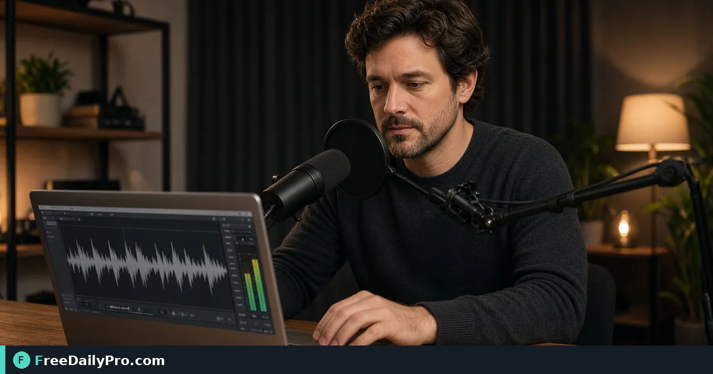

*Normalize volume so listeners stop riding the volume knob*

[FreeDailyPro.com](https://www.freedailypro.com) -- Before sign-off in podcast production, refuse chapter two shouts over chapter one. [Audio Normalizer](https://www.freedailypro.com/tool/audio-normalizer) is the browser step for three remote interviews into one 42-minute episode, aimed at podcasters who need even levels on earbuds and phone speakers.

The clip below shows Audio Normalizer on a realistic task for three remote interviews into one 42-minute episode.

{{youtube WG-hQcqm-as | How to Normalize Audio Volume Online – E}}

## Why Audio Normalizer is the right lever for three remote interviews into one 42-minute episode

This guide covers one primary job for audio-normalizer: three remote interviews into one 42-minute episode. The audience is podcasters. When audio-normalizer output disappoints, re-check whether the goal stayed "even levels on earbuds and phone speakers" and whether anchors near 3, 42, and 2 (minutes) were entered correctly. The failure mode to refuse is chapter two shouts over chapter one.

Success with Audio Normalizer means you can defend a finished artifact: even levels on earbuds and phone speakers. Practical anchors for this podcast production case sit around 3, 42, and 2 (minutes). If those anchors are missing, stop before spending a trial usage on half-ready inputs for three remote interviews into one 42-minute episode.

## Steps on Audio Normalizer for three remote interviews into one 42-minute episode

1. Write the done line for this podcast production ticket: even levels on earbuds and phone speakers.
2. Stage inputs for the concrete job: three remote interviews into one 42-minute episode.
3. Open Audio Normalizer at https://www.freedailypro.com/tool/audio-normalizer for this podcast production pass only.
4. Enter production values with anchors near 3, 42, and 2 (minutes) for three remote interviews into one 42-minute episode.
5. Run once; confirm you did not hit chapter two shouts over chapter one on the audio-normalizer output.
6. Export or copy with a name that includes `audio-normalizer` and today's date for podcasters covering three remote interviews into one 42-minute episode.
7. Spot-check the way podcasters will receive this podcast production packet (second device or clean profile if relevant).
8. Archive settings so a teammate can repeat the audio-normalizer path for three remote interviews into one 42-minute episode next week without chat archaeology.

## Worked numbers for this audio-normalizer case (three remote interviews into one 42-minute episode)

The primary job is three remote interviews into one 42-minute episode. Anchors near 3, 42, and 2 (minutes) shape the first pass for podcasters. After one careful Audio Normalizer run aimed at even levels on earbuds and phone speakers, the output should be close enough to ship if chapter two shouts over chapter one was blocked. Document the audio-normalizer settings so coverage works when someone who owns podcast production is out.

On a weak audio-normalizer pass that still shows signs of chapter two shouts over chapter one, change a single factor tied to 3, 42, and 2 (minutes) and re-run so you know what fixed it. That method keeps Audio Normalizer from feeling like guesswork for podcasters on three remote interviews into one 42-minute episode.

## Stage inputs before opening Audio Normalizer

Write a one-line done definition for audio-normalizer that matches even levels on earbuds and phone speakers. Stage every material Audio Normalizer will consume for three remote interviews into one 42-minute episode. Note destination rules that can reject a audio-normalizer export in podcast production.

Keep neighbor tools only for real blockers after Audio Normalizer: [Extract Audio](https://www.freedailypro.com/tool/extract-audio), [Audio Trimmer](https://www.freedailypro.com/tool/audio-trimmer), [Audio Converter](https://www.freedailypro.com/tool/audio-converter). Browse [audio tools](https://www.freedailypro.com/category/audio-tools) when a related step is required after the audio-normalizer pass for three remote interviews into one 42-minute episode. Queue audio-normalizer runs so each trial usage hits ready inputs for three remote interviews into one 42-minute episode. Among FreeDailyPro's 200+ professional tools, one verified podcast production packet for three remote interviews into one 42-minute episode beats a stack of unfocused tabs chasing even levels on earbuds and phone speakers.

## Inputs that look fine but break audio-normalizer on three remote interviews into one 42-minute episode

- Values for Audio Normalizer copied from chat with hidden characters that shift anchors near 3, 42, and 2 (minutes) during three remote interviews into one 42-minute episode.
- Files named generically (download, IMG_####) with no `audio-normalizer` tag for the podcast production packet about three remote interviews into one 42-minute episode.
- Mixing demo placeholders with production rows in the same audio-normalizer session for three remote interviews into one 42-minute episode.
- Assuming last week's portal cap still applies to today's audio-normalizer export toward even levels on earbuds and phone speakers.
- Using the wrong unit or as-of date so chapter two shouts over chapter one becomes invisible until podcasters reject the handoff for three remote interviews into one 42-minute episode.

Clean those before blaming Audio Normalizer. Most audio-normalizer rework in podcast production starts upstream of the FreeDailyPro page when the job is three remote interviews into one 42-minute episode.

## Edge cases in podcast production for Audio Normalizer

- Destinations may re-encode audio-normalizer exports for three remote interviews into one 42-minute episode—download the stored copy when a portal allows and re-check even levels on earbuds and phone speakers.
- Two Audio Normalizer outputs named download (1) is how wrong packets ship for podcasters; rename immediately with `audio-normalizer` in the filename for three remote interviews into one 42-minute episode.
- Odd inputs confuse operators more than the Audio Normalizer UI when anchors near 3, 42, and 2 (minutes) were mistyped for three remote interviews into one 42-minute episode.
- Locale, units, or formatting can shift meaning after audio-normalizer even when the UI reported success toward even levels on earbuds and phone speakers in podcast production.
- Policy for podcasters still applies after a technical success on three remote interviews into one 42-minute episode in podcast production.

## Mistakes that waste a day on Audio Normalizer for three remote interviews into one 42-minute episode

- Skipping the success line (even levels on earbuds and phone speakers) and only eyeballing the audio-normalizer result for three remote interviews into one 42-minute episode.
- Leaving sample data in a Audio Normalizer run that later gets sent as real to podcasters in podcast production.
- Chaining five tools when Audio Normalizer alone would finish three remote interviews into one 42-minute episode.
- Overwriting the only master input while exporting from audio-normalizer during three remote interviews into one 42-minute episode.
- Ignoring size, format, or length caps until the final Audio Normalizer click fails against even levels on earbuds and phone speakers.
- Ignoring the known failure mode for this path: chapter two shouts over chapter one.

## Recheck cadence for podcast production using audio-normalizer

After any process change in podcast production, re-run one golden case through [Audio Normalizer](https://www.freedailypro.com/tool/audio-normalizer) aimed at three remote interviews into one 42-minute episode. Golden cases beat memory for audio-normalizer when podcasters rotate on three remote interviews into one 42-minute episode.

Teach a teammate by having them complete three remote interviews into one 42-minute episode while you only watch for skipped verification of even levels on earbuds and phone speakers. Teaching works when they can explain even levels on earbuds and phone speakers and name chapter two shouts over chapter one without reading your notes about anchors near 3, 42, and 2 (minutes).

## Communication template after audio-normalizer for three remote interviews into one 42-minute episode

Subject: Audio Normalizer result for [project] on [date] covering three remote interviews into one 42-minute episode

Body: Goal was even levels on earbuds and phone speakers. Inputs used anchors 3, 42, and 2 (minutes). Known risk avoided: chapter two shouts over chapter one. File name includes `audio-normalizer`. Please confirm within one business day if podcasters standards need a second pass on this podcast production packet for three remote interviews into one 42-minute episode.

Short messages prevent reread loops when podcast production packets for three remote interviews into one 42-minute episode move between people after Audio Normalizer.

## Handoff and naming for audio-normalizer on three remote interviews into one 42-minute episode

Name Audio Normalizer outputs like `client-or-project-audio-normalizer-YYYY-MM-DD.ext` for the job three remote interviews into one 42-minute episode (adapt extension). Put goal (even levels on earbuds and phone speakers), operator, and settings in the ticket that links the audio-normalizer file so podcasters can audit anchors near 3, 42, and 2 (minutes). That legend prevents replay confusion next month when someone reopens the podcast production packet for three remote interviews into one 42-minute episode.

Open the audio-normalizer export once on a second device or clean profile before you declare even levels on earbuds and phone speakers done for three remote interviews into one 42-minute episode. Next week a teammate should re-run the same Audio Normalizer path for three remote interviews into one 42-minute episode without a chat archaeology session about chapter two shouts over chapter one.

## FAQ for Audio Normalizer (three remote interviews into one 42-minute episode)

**What is the primary job this guide covers for audio-normalizer?** three remote interviews into one 42-minute episode.

**What does success look like for podcasters?** even levels on earbuds and phone speakers.

**What failure mode should be refused on Audio Normalizer?** chapter two shouts over chapter one.

**Which anchors should be written before the first click on audio-normalizer?** 3, 42, and 2 (minutes) for the job three remote interviews into one 42-minute episode.

**Who is the audience for the export?** podcasters in podcast production.

**What if the live page looks different?** Follow the live FreeDailyPro controls on Audio Normalizer; this article is a workflow for three remote interviews into one 42-minute episode, not a frozen screenshot.

**Can verification be skipped for a quick audio-normalizer run?** No—podcast production packets fail when chapter two shouts over chapter one slips through for three remote interviews into one 42-minute episode.

**When should a second tool open after Audio Normalizer?** Only after a real check fails for three remote interviews into one 42-minute episode; then consider [Extract Audio](https://www.freedailypro.com/tool/extract-audio), [Audio Trimmer](https://www.freedailypro.com/tool/audio-trimmer), [Audio Converter](https://www.freedailypro.com/tool/audio-converter).

## Quality bar for Audio Normalizer on three remote interviews into one 42-minute episode

A success line for audio-normalizer must be observable: even levels on earbuds and phone speakers on the concrete job three remote interviews into one 42-minute episode. Poetic goals do not survive audit in podcast production for podcasters. Store success and failure lines on a card named for Audio Normalizer, including the refuse list item chapter two shouts over chapter one and anchors 3, 42, and 2 (minutes).

With 200+ professional tools on FreeDailyPro, finish the podcast production packet for three remote interviews into one 42-minute episode before exploring neighbors. Resist tool tourism after Audio Normalizer; open a second utility only after the primary audio-normalizer export fails a real check against even levels on earbuds and phone speakers for three remote interviews into one 42-minute episode.

## Mini case in podcast production using Audio Normalizer

Scenario: three remote interviews into one 42-minute episode. The operator opens Audio Normalizer, writes anchors near 3, 42, and 2 (minutes) on a sticky note, and commits to even levels on earbuds and phone speakers before the first click. They refuse chapter two shouts over chapter one, export with `audio-normalizer` in the filename, and send the short handoff template to podcasters. Result for this podcast production loop: one closed packet instead of three re-exports around three remote interviews into one 42-minute episode.

## Limits of Audio Normalizer in podcast production

Audio Normalizer performs the job described on its tool page for podcast production, especially three remote interviews into one 42-minute episode. The live page does what the controls show—nothing mystical beyond that for even levels on earbuds and phone speakers on three remote interviews into one 42-minute episode. FreeDailyPro places audio-normalizer among 200+ professional tools beside related utilities in audio tools when podcasters need a follow-on step after three remote interviews into one 42-minute episode.

## Pairing without scope creep after Audio Normalizer

Do not chain five utilities for curiosity after finishing three remote interviews into one 42-minute episode on Audio Normalizer—chain two only when a portal rejects the first export aimed at even levels on earbuds and phone speakers. Neighbors such as [Extract Audio](https://www.freedailypro.com/tool/extract-audio), [Audio Trimmer](https://www.freedailypro.com/tool/audio-trimmer), [Audio Converter](https://www.freedailypro.com/tool/audio-converter) exist to unblock podcast production, not to decorate the ticket. A tool-specific card for audio-normalizer that lists chapter two shouts over chapter one and 3, 42, and 2 (minutes) beats a generic ops checklist every time for podcasters on three remote interviews into one 42-minute episode.

## Field notes specific to audio-normalizer

Camera-roll or generic download filenames hide intent; rename before the serious Audio Normalizer pass for three remote interviews into one 42-minute episode. Trust only the controls on the live audio-normalizer page for podcast production; do not invent hidden modes that "should" exist for even levels on earbuds and phone speakers. Generic SOPs miss sharp edges like chapter two shouts over chapter one; keep a one-page card for Audio Normalizer alone with anchors 3, 42, and 2 (minutes) and the job line three remote interviews into one 42-minute episode.

Policy for podcasters still applies after technical success on audio-normalizer for three remote interviews into one 42-minute episode. Locale and unit mistakes around 3, 42, and 2 (minutes) remain the top silent errors for Audio Normalizer when the work is three remote interviews into one 42-minute episode in podcast production.

## When to stop and when to continue with Audio Normalizer

Stop when the live tool page cannot perform a required specialist step for three remote interviews into one 42-minute episode—do not invent features for audio-normalizer in podcast production. Continue when inputs are clean, anchors near 3, 42, and 2 (minutes) are written, and even levels on earbuds and phone speakers is still the target for podcasters on three remote interviews into one 42-minute episode. Extra tools are for blockers on three remote interviews into one 42-minute episode, not entertainment; keep the Audio Normalizer path short.

## Closing next step for Audio Normalizer

Run one real case through Audio Normalizer with production inputs for three remote interviews into one 42-minute episode, not placeholders. Finish against the written success line (even levels on earbuds and phone speakers) for podcasters—not a hopeful glance at a filename from audio-normalizer. Audio Normalizer is a workflow utility on your inputs in podcast production; verification against chapter two shouts over chapter one is what makes the packet for three remote interviews into one 42-minute episode shippable.

Questions about applying Audio Normalizer to three remote interviews into one 42-minute episode for podcasters in podcast production? Contact FreeDailyPro through the site contact options and include your tool (audio-normalizer), goal (even levels on earbuds and phone speakers), anchors (3, 42, and 2 (minutes)), and what failed (chapter two shouts over chapter one).
