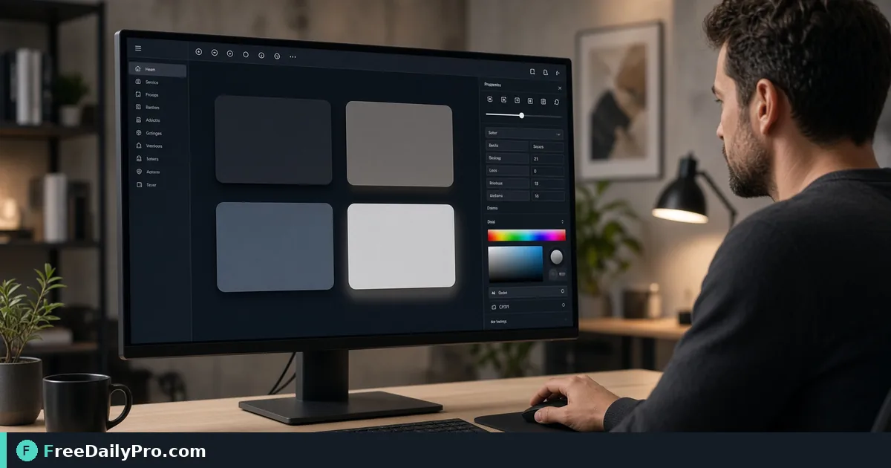

*Tune offset blur and color with live preview then paste CSS*

[FreeDailyPro.com](https://www.freedailypro.com) -- Paperwork around UI elevation fails when operators accept harsh pure black shadows on cards. [Box Shadow Generator](https://www.freedailypro.com/tool/box-shadow-generator) is the step that turns that mess into a checked result for soft 8px 24px card shadow and tighter dropdown token, built for product designers among FreeDailyPro's 200+ professional tools.

The clip below walks through Box Shadow Generator on a realistic task that matches soft 8px 24px card shadow and tighter dropdown token for case 13.

{{youtube A1SRVXhvtfE | How to Generate CSS Box Shadow Online Li}}

## Why Box Shadow Generator belongs in this UI elevation path

This article trains one job only for box-shadow-generator (guide 13): soft 8px 24px card shadow and tighter dropdown token. Readers are product designers. When box-shadow-generator output looks wrong, first re-check whether the goal was "two elevation tokens on light and dark" and whether inputs used anchors near 8, 24, and 2 (px). The failure mode to refuse on pass 13 is harsh pure black shadows on cards.

Success on Box Shadow Generator means a finished artifact you can defend in UI elevation: two elevation tokens on light and dark. Practical anchors for this case sit around 8, 24, and 2 (px). If those anchors are missing for soft 8px 24px card shadow and tighter dropdown token, stop before you burn a trial usage on half-ready data for box-shadow-generator.

## What to stage before opening Box Shadow Generator

Write a one-line done definition for box-shadow-generator that matches "two elevation tokens on light and dark" before guide step 13. Stage every input Box Shadow Generator will consume for soft 8px 24px card shadow and tighter dropdown token so the browser pass is intentional for product designers. Note any destination rules that can reject a box-shadow-generator export in UI elevation after case 13.

Keep neighbor tools only for real blockers after Box Shadow Generator on soft 8px 24px card shadow and tighter dropdown token: [Color Converter](https://www.freedailypro.com/tool/color-converter), [Gradient Generator](https://www.freedailypro.com/tool/gradient-generator), [Favicon Generator](https://www.freedailypro.com/tool/favicon-generator). Browse the [design tools](https://www.freedailypro.com/category/design-tools) category when a related step is required after the box-shadow-generator pass for two elevation tokens on light and dark. Queue box-shadow-generator runs so each of the 10 trial usages hits ready inputs for soft 8px 24px card shadow and tighter dropdown token rather than placeholders.

## Steps on Box Shadow Generator for case 13

1. Define the done line for this UI elevation run of box-shadow-generator: two elevation tokens on light and dark.
2. Collect inputs for the job on Box Shadow Generator: soft 8px 24px card shadow and tighter dropdown token.
3. Load Box Shadow Generator at https://www.freedailypro.com/tool/box-shadow-generator for product designers.
4. Type production values with anchors near 8, 24, and 2 (px) for soft 8px 24px card shadow and tighter dropdown token.
5. Apply once; confirm you did not hit harsh pure black shadows on cards on the box-shadow-generator output.
6. Download or copy with a name that includes `box-shadow-generator` and today's date for case 13.
7. Inspect the way product designers will receive the UI elevation packet (second device if relevant).
8. Store settings so a teammate can repeat the box-shadow-generator path for soft 8px 24px card shadow and tighter dropdown token next week.

## Recheck cadence for UI elevation on box-shadow-generator

After any process change in UI elevation, re-run one golden case through [Box Shadow Generator](https://www.freedailypro.com/tool/box-shadow-generator) for soft 8px 24px card shadow and tighter dropdown token (label it golden-13). Golden cases for box-shadow-generator beat memory when product designers rotate on this workflow. Teach a teammate by having them complete soft 8px 24px card shadow and tighter dropdown token while you only watch for skipped verification of "two elevation tokens on light and dark" on box-shadow-generator.

Store the golden-13 inputs next to the box-shadow-generator export so next month's operator can prove two elevation tokens on light and dark without guessing anchors near 8, 24, and 2 (px).

## Inputs that look fine but break box-shadow-generator

- Values for Box Shadow Generator copied from chat with hidden characters that shift 8, 24, and 2 (px) on case 13.
- Files named generically (download, IMG_####) with no `box-shadow-generator` or project tag for soft 8px 24px card shadow and tighter dropdown token.
- Mixing demo placeholders with production rows in the same box-shadow-generator session aimed at two elevation tokens on light and dark.
- Assuming last week's portal cap still applies to today's box-shadow-generator export for product designers.
- Using the wrong unit or as-of date so harsh pure black shadows on cards becomes invisible until handoff in UI elevation.

Clean those before blaming Box Shadow Generator. Most box-shadow-generator rework in UI elevation for soft 8px 24px card shadow and tighter dropdown token starts upstream of the FreeDailyPro page on guide 13.

## Communication template after a box-shadow-generator run

Subject: Box Shadow Generator result for [project] on [date] — case 13

Body: Goal was two elevation tokens on light and dark. Inputs used anchors 8, 24, and 2 (px). Known risk avoided: harsh pure black shadows on cards. File name includes `box-shadow-generator`. Please confirm within one business day if product designers standards need a second pass on soft 8px 24px card shadow and tighter dropdown token.

Short messages prevent reread loops when UI elevation packets from Box Shadow Generator move between people on case 13.

## Worked numbers for this box-shadow-generator case

The primary job for guide 13 is soft 8px 24px card shadow and tighter dropdown token. Anchors near 8, 24, and 2 (px) shape the first pass on Box Shadow Generator. After one careful Box Shadow Generator run aimed at two elevation tokens on light and dark, the output should be close enough to ship if harsh pure black shadows on cards was blocked for product designers. Document the box-shadow-generator settings so coverage works when someone who owns UI elevation is out next week.

On a weak box-shadow-generator pass that still shows signs of harsh pure black shadows on cards, change a single factor tied to 8, 24, and 2 (px) and re-run so you know what fixed it for soft 8px 24px card shadow and tighter dropdown token. That method keeps Box Shadow Generator from feeling like guesswork for product designers on case 13.

## Edge cases in UI elevation for Box Shadow Generator

- Destinations may re-encode box-shadow-generator exports for soft 8px 24px card shadow and tighter dropdown token—download the stored copy when a portal allows and re-check two elevation tokens on light and dark on case 13.
- Two Box Shadow Generator outputs named download (1) is how wrong packets ship; rename with `box-shadow-generator` immediately for product designers.
- Odd inputs confuse operators more than the Box Shadow Generator UI; inspect anchors (8, 24, and 2 (px)) before blaming the tool on soft 8px 24px card shadow and tighter dropdown token.
- Locale, units, or formatting can shift meaning after box-shadow-generator even when the UI reported success toward two elevation tokens on light and dark in UI elevation.
- Policy for product designers still applies after a technical success on box-shadow-generator for case 13.

## Mistakes that waste a day on Box Shadow Generator

- Skipping the success line (two elevation tokens on light and dark) and only eyeballing the box-shadow-generator result for soft 8px 24px card shadow and tighter dropdown token on case 13.
- Leaving sample data in a Box Shadow Generator run that later gets sent as real to product designers in UI elevation.
- Chaining five tools when Box Shadow Generator alone would finish: soft 8px 24px card shadow and tighter dropdown token.
- Overwriting the only master input while exporting from box-shadow-generator during soft 8px 24px card shadow and tighter dropdown token.
- Ignoring size, format, or length caps until the final Box Shadow Generator click fails against two elevation tokens on light and dark.
- Ignoring the known failure mode for this box-shadow-generator path: harsh pure black shadows on cards.

## Limits of Box Shadow Generator

Box Shadow Generator performs the job described on its tool page for UI elevation, especially soft 8px 24px card shadow and tighter dropdown token in guide 13. The live page does what the controls show—nothing mystical beyond that for two elevation tokens on light and dark. FreeDailyPro places box-shadow-generator among 200+ professional tools beside related utilities in design tools when product designers need a follow-on step after harsh pure black shadows on cards is blocked.

## FAQ for Box Shadow Generator (case 13)

**What is the primary job this guide covers for box-shadow-generator?** soft 8px 24px card shadow and tighter dropdown token.
**What does success look like for product designers?** two elevation tokens on light and dark.
**What failure mode should I refuse on Box Shadow Generator?** harsh pure black shadows on cards.
**Which anchors should I write down first for soft 8px 24px card shadow and tighter dropdown token?** 8, 24, and 2 (px).
**Who is the audience for the box-shadow-generator export?** product designers working in UI elevation.
**What if the live page looks different for Box Shadow Generator?** Follow the live FreeDailyPro controls; this article is a workflow for soft 8px 24px card shadow and tighter dropdown token, not a frozen screenshot of case 13.
**Can I skip verification for a simple box-shadow-generator run?** No—UI elevation packets fail when harsh pure black shadows on cards slips through on soft 8px 24px card shadow and tighter dropdown token.
**When should I open a second tool after Box Shadow Generator?** Only after Box Shadow Generator fails a real check for soft 8px 24px card shadow and tighter dropdown token, then consider [Color Converter](https://www.freedailypro.com/tool/color-converter), [Gradient Generator](https://www.freedailypro.com/tool/gradient-generator), [Favicon Generator](https://www.freedailypro.com/tool/favicon-generator).

## Handoff and naming for box-shadow-generator

Name Box Shadow Generator outputs like `client-or-project-box-shadow-generator-YYYY-MM-DD.ext` (adapt extension) for soft 8px 24px card shadow and tighter dropdown token. Put goal (two elevation tokens on light and dark), operator, and settings in the ticket that links the box-shadow-generator file so product designers can audit anchors near 8, 24, and 2 (px) for case 13. That legend prevents replay confusion next month when someone reopens the UI elevation packet about harsh pure black shadows on cards.

Open the box-shadow-generator export once on a second device or clean profile before you declare two elevation tokens on light and dark done for soft 8px 24px card shadow and tighter dropdown token. Next week a teammate should re-run the same Box Shadow Generator path for soft 8px 24px card shadow and tighter dropdown token without a chat archaeology session on case 13.

## Quality bar for Box Shadow Generator

A success line for box-shadow-generator must be observable: two elevation tokens on light and dark on the concrete job soft 8px 24px card shadow and tighter dropdown token (guide 13). Poetic goals do not survive audit in UI elevation for product designers. Store success and failure lines on a card named for Box Shadow Generator—include harsh pure black shadows on cards as the explicit refuse list and anchors 8, 24, and 2 (px).

With 200+ professional tools on FreeDailyPro, finish the UI elevation packet for soft 8px 24px card shadow and tighter dropdown token before exploring neighbors after Box Shadow Generator. Resist tool tourism; open a second utility only after the primary box-shadow-generator export fails a real check against two elevation tokens on light and dark on case 13.

## Mini case in UI elevation using Box Shadow Generator

Scenario 13: soft 8px 24px card shadow and tighter dropdown token. Operator opens Box Shadow Generator, uses anchors near 8, 24, and 2 (px), and writes "two elevation tokens on light and dark" on a sticky note before the first click. They refuse harsh pure black shadows on cards, export with `box-shadow-generator` in the filename, and send the short handoff template to product designers. Result: one closed loop for UI elevation instead of three re-exports around soft 8px 24px card shadow and tighter dropdown token.

## When to stop and when to continue with Box Shadow Generator

Stop when the live tool page cannot perform a required specialist step for soft 8px 24px card shadow and tighter dropdown token—do not invent features for box-shadow-generator in UI elevation on case 13. Continue when inputs are clean, anchors (8, 24, and 2 (px)) are written, and "two elevation tokens on light and dark" is still the target for product designers. Extra tools are for blockers in UI elevation, not entertainment; keep the Box Shadow Generator path short for soft 8px 24px card shadow and tighter dropdown token.

## Pairing without scope creep after Box Shadow Generator

Do not chain five utilities for curiosity after Box Shadow Generator finishes soft 8px 24px card shadow and tighter dropdown token—chain two only when a portal rejects the first export aimed at two elevation tokens on light and dark. Neighbors such as [Color Converter](https://www.freedailypro.com/tool/color-converter), [Gradient Generator](https://www.freedailypro.com/tool/gradient-generator), [Favicon Generator](https://www.freedailypro.com/tool/favicon-generator) exist to unblock UI elevation, not to decorate the ticket for product designers. A tool-specific card for box-shadow-generator that lists harsh pure black shadows on cards and 8, 24, and 2 (px) beats a generic ops checklist every time on case 13.

## Field notes specific to box-shadow-generator

Camera-roll or generic download filenames hide intent; rename before the serious Box Shadow Generator pass for soft 8px 24px card shadow and tighter dropdown token on case 13. Trust only the controls on the live box-shadow-generator page for UI elevation; do not invent hidden modes that "should" exist for two elevation tokens on light and dark. Generic SOPs miss sharp edges like harsh pure black shadows on cards; keep a one-page card for Box Shadow Generator alone with anchors 8, 24, and 2 (px) and the job line soft 8px 24px card shadow and tighter dropdown token.

Policy for product designers still applies after technical success on box-shadow-generator for soft 8px 24px card shadow and tighter dropdown token. Locale and unit mistakes around 8, 24, and 2 (px) remain the top silent errors for Box Shadow Generator when the work is soft 8px 24px card shadow and tighter dropdown token in UI elevation on case 13.

## Closing next step for Box Shadow Generator

Run one real case through Box Shadow Generator with production inputs for soft 8px 24px card shadow and tighter dropdown token, not placeholders for case 13. Finish against the written success line (two elevation tokens on light and dark)—not a hopeful glance at a filename from box-shadow-generator. Open [Box Shadow Generator](https://www.freedailypro.com/tool/box-shadow-generator) when you are ready to execute soft 8px 24px card shadow and tighter dropdown token for product designers in UI elevation.

Which part of the Box Shadow Generator workflow for soft 8px 24px card shadow and tighter dropdown token still feels unclear for your team? We read box-shadow-generator feedback on the [contact page](https://www.freedailypro.com/contact).
