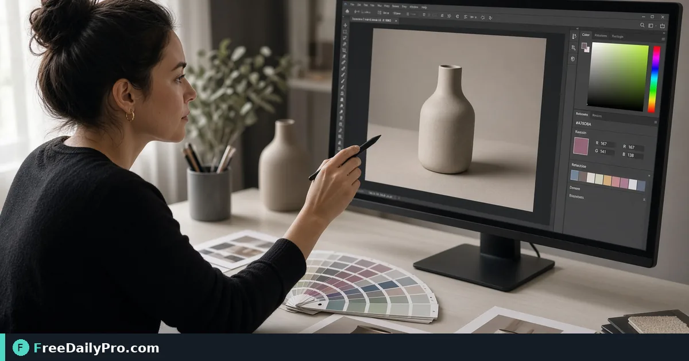

*Click pixel regions to capture hex values for design handoff*

[FreeDailyPro.com](https://www.freedailypro.com) -- A quiet failure in brand matching often starts with sampling a shadow as brand fill. [Color Picker Image](https://www.freedailypro.com/tool/color-picker-image) is the step that turns that mess into a checked result for match packaging panel red from client photo, built for designers among FreeDailyPro's 200+ professional tools.

The clip below walks through Color Picker Image on a realistic task that matches match packaging panel red from client photo for case 24.

{{youtube njX53TSw5mA | How to Pick Any Color from an Image Onli}}

## Why Color Picker Image belongs in this brand matching path

This article trains one job only for color-picker-image (guide 24): match packaging panel red from client photo. Readers are designers. When color-picker-image output looks wrong, first re-check whether the goal was "hex values logged in design ticket" and whether inputs used anchors near 1, 2, and 3 (hex). The failure mode to refuse on pass 24 is sampling a shadow as brand fill.

Success on Color Picker Image means a finished artifact you can defend in brand matching: hex values logged in design ticket. Practical anchors for this case sit around 1, 2, and 3 (hex). If those anchors are missing for match packaging panel red from client photo, stop before you burn a trial usage on half-ready data for color-picker-image.

## What to stage before opening Color Picker Image

Write a one-line done definition for color-picker-image that matches "hex values logged in design ticket" before guide step 24. Stage every input Color Picker Image will consume for match packaging panel red from client photo so the browser pass is intentional for designers. Note any destination rules that can reject a color-picker-image export in brand matching after case 24.

Keep neighbor tools only for real blockers after Color Picker Image on match packaging panel red from client photo: [Color Converter](https://www.freedailypro.com/tool/color-converter), [Gradient Generator](https://www.freedailypro.com/tool/gradient-generator), [Favicon Generator](https://www.freedailypro.com/tool/favicon-generator). Browse the [design tools](https://www.freedailypro.com/category/design-tools) category when a related step is required after the color-picker-image pass for hex values logged in design ticket. Queue color-picker-image runs so each of the 10 trial usages hits ready inputs for match packaging panel red from client photo rather than placeholders.

## Steps on Color Picker Image for case 24

1. Clarify the done line for this brand matching run of color-picker-image: hex values logged in design ticket.
2. Prepare inputs for the job on Color Picker Image: match packaging panel red from client photo.
3. Visit Color Picker Image at https://www.freedailypro.com/tool/color-picker-image for designers.
4. Supply production values with anchors near 1, 2, and 3 (hex) for match packaging panel red from client photo.
5. Complete once; confirm you did not hit sampling a shadow as brand fill on the color-picker-image output.
6. Name or copy with a name that includes `color-picker-image` and today's date for case 24.
7. Review the way designers will receive the brand matching packet (second device if relevant).
8. File settings so a teammate can repeat the color-picker-image path for match packaging panel red from client photo next week.

## Recheck cadence for brand matching on color-picker-image

After any process change in brand matching, re-run one golden case through [Color Picker Image](https://www.freedailypro.com/tool/color-picker-image) for match packaging panel red from client photo (label it golden-24). Golden cases for color-picker-image beat memory when designers rotate on this workflow. Teach a teammate by having them complete match packaging panel red from client photo while you only watch for skipped verification of "hex values logged in design ticket" on color-picker-image.

Store the golden-24 inputs next to the color-picker-image export so next month's operator can prove hex values logged in design ticket without guessing anchors near 1, 2, and 3 (hex).

## Inputs that look fine but break color-picker-image

- Values for Color Picker Image copied from chat with hidden characters that shift 1, 2, and 3 (hex) on case 24.
- Files named generically (download, IMG_####) with no `color-picker-image` or project tag for match packaging panel red from client photo.
- Mixing demo placeholders with production rows in the same color-picker-image session aimed at hex values logged in design ticket.
- Assuming last week's portal cap still applies to today's color-picker-image export for designers.
- Using the wrong unit or as-of date so sampling a shadow as brand fill becomes invisible until handoff in brand matching.

Clean those before blaming Color Picker Image. Most color-picker-image rework in brand matching for match packaging panel red from client photo starts upstream of the FreeDailyPro page on guide 24.

## Communication template after a color-picker-image run

Subject: Color Picker Image result for [project] on [date] — case 24

Body: Goal was hex values logged in design ticket. Inputs used anchors 1, 2, and 3 (hex). Known risk avoided: sampling a shadow as brand fill. File name includes `color-picker-image`. Please confirm within one business day if designers standards need a second pass on match packaging panel red from client photo.

Short messages prevent reread loops when brand matching packets from Color Picker Image move between people on case 24.

## Worked numbers for this color-picker-image case

The primary job for guide 24 is match packaging panel red from client photo. Anchors near 1, 2, and 3 (hex) shape the first pass on Color Picker Image. After one careful Color Picker Image run aimed at hex values logged in design ticket, the output should be close enough to ship if sampling a shadow as brand fill was blocked for designers. Document the color-picker-image settings so coverage works when someone who owns brand matching is out next week.

On a weak color-picker-image pass that still shows signs of sampling a shadow as brand fill, change a single factor tied to 1, 2, and 3 (hex) and re-run so you know what fixed it for match packaging panel red from client photo. That method keeps Color Picker Image from feeling like guesswork for designers on case 24.

## Edge cases in brand matching for Color Picker Image

- Destinations may re-encode color-picker-image exports for match packaging panel red from client photo—download the stored copy when a portal allows and re-check hex values logged in design ticket on case 24.
- Two Color Picker Image outputs named download (1) is how wrong packets ship; rename with `color-picker-image` immediately for designers.
- Odd inputs confuse operators more than the Color Picker Image UI; inspect anchors (1, 2, and 3 (hex)) before blaming the tool on match packaging panel red from client photo.
- Locale, units, or formatting can shift meaning after color-picker-image even when the UI reported success toward hex values logged in design ticket in brand matching.
- Policy for designers still applies after a technical success on color-picker-image for case 24.

## Mistakes that waste a day on Color Picker Image

- Skipping the success line (hex values logged in design ticket) and only eyeballing the color-picker-image result for match packaging panel red from client photo on case 24.
- Leaving sample data in a Color Picker Image run that later gets sent as real to designers in brand matching.
- Chaining five tools when Color Picker Image alone would finish: match packaging panel red from client photo.
- Overwriting the only master input while exporting from color-picker-image during match packaging panel red from client photo.
- Ignoring size, format, or length caps until the final Color Picker Image click fails against hex values logged in design ticket.
- Ignoring the known failure mode for this color-picker-image path: sampling a shadow as brand fill.

## Limits of Color Picker Image

Color Picker Image performs the job described on its tool page for brand matching, especially match packaging panel red from client photo in guide 24. The live page does what the controls show—nothing mystical beyond that for hex values logged in design ticket. FreeDailyPro places color-picker-image among 200+ professional tools beside related utilities in design tools when designers need a follow-on step after sampling a shadow as brand fill is blocked.

## FAQ for Color Picker Image (case 24)

**What is the primary job this guide covers for color-picker-image?** match packaging panel red from client photo.
**What does success look like for designers?** hex values logged in design ticket.
**What failure mode should I refuse on Color Picker Image?** sampling a shadow as brand fill.
**Which anchors should I write down first for match packaging panel red from client photo?** 1, 2, and 3 (hex).
**Who is the audience for the color-picker-image export?** designers working in brand matching.
**What if the live page looks different for Color Picker Image?** Follow the live FreeDailyPro controls; this article is a workflow for match packaging panel red from client photo, not a frozen screenshot of case 24.
**Can I skip verification for a simple color-picker-image run?** No—brand matching packets fail when sampling a shadow as brand fill slips through on match packaging panel red from client photo.
**When should I open a second tool after Color Picker Image?** Only after Color Picker Image fails a real check for match packaging panel red from client photo, then consider [Color Converter](https://www.freedailypro.com/tool/color-converter), [Gradient Generator](https://www.freedailypro.com/tool/gradient-generator), [Favicon Generator](https://www.freedailypro.com/tool/favicon-generator).

## Handoff and naming for color-picker-image

Name Color Picker Image outputs like `client-or-project-color-picker-image-YYYY-MM-DD.ext` (adapt extension) for match packaging panel red from client photo. Put goal (hex values logged in design ticket), operator, and settings in the ticket that links the color-picker-image file so designers can audit anchors near 1, 2, and 3 (hex) for case 24. That legend prevents replay confusion next month when someone reopens the brand matching packet about sampling a shadow as brand fill.

Open the color-picker-image export once on a second device or clean profile before you declare hex values logged in design ticket done for match packaging panel red from client photo. Next week a teammate should re-run the same Color Picker Image path for match packaging panel red from client photo without a chat archaeology session on case 24.

## Quality bar for Color Picker Image

A success line for color-picker-image must be observable: hex values logged in design ticket on the concrete job match packaging panel red from client photo (guide 24). Poetic goals do not survive audit in brand matching for designers. Store success and failure lines on a card named for Color Picker Image—include sampling a shadow as brand fill as the explicit refuse list and anchors 1, 2, and 3 (hex).

With 200+ professional tools on FreeDailyPro, finish the brand matching packet for match packaging panel red from client photo before exploring neighbors after Color Picker Image. Resist tool tourism; open a second utility only after the primary color-picker-image export fails a real check against hex values logged in design ticket on case 24.

## Mini case in brand matching using Color Picker Image

Scenario 24: match packaging panel red from client photo. Operator opens Color Picker Image, uses anchors near 1, 2, and 3 (hex), and writes "hex values logged in design ticket" on a sticky note before the first click. They refuse sampling a shadow as brand fill, export with `color-picker-image` in the filename, and send the short handoff template to designers. Result: one closed loop for brand matching instead of three re-exports around match packaging panel red from client photo.

## When to stop and when to continue with Color Picker Image

Stop when the live tool page cannot perform a required specialist step for match packaging panel red from client photo—do not invent features for color-picker-image in brand matching on case 24. Continue when inputs are clean, anchors (1, 2, and 3 (hex)) are written, and "hex values logged in design ticket" is still the target for designers. Extra tools are for blockers in brand matching, not entertainment; keep the Color Picker Image path short for match packaging panel red from client photo.

## Pairing without scope creep after Color Picker Image

Do not chain five utilities for curiosity after Color Picker Image finishes match packaging panel red from client photo—chain two only when a portal rejects the first export aimed at hex values logged in design ticket. Neighbors such as [Color Converter](https://www.freedailypro.com/tool/color-converter), [Gradient Generator](https://www.freedailypro.com/tool/gradient-generator), [Favicon Generator](https://www.freedailypro.com/tool/favicon-generator) exist to unblock brand matching, not to decorate the ticket for designers. A tool-specific card for color-picker-image that lists sampling a shadow as brand fill and 1, 2, and 3 (hex) beats a generic ops checklist every time on case 24.

## Field notes specific to color-picker-image

Camera-roll or generic download filenames hide intent; rename before the serious Color Picker Image pass for match packaging panel red from client photo on case 24. Trust only the controls on the live color-picker-image page for brand matching; do not invent hidden modes that "should" exist for hex values logged in design ticket. Generic SOPs miss sharp edges like sampling a shadow as brand fill; keep a one-page card for Color Picker Image alone with anchors 1, 2, and 3 (hex) and the job line match packaging panel red from client photo.

Policy for designers still applies after technical success on color-picker-image for match packaging panel red from client photo. Locale and unit mistakes around 1, 2, and 3 (hex) remain the top silent errors for Color Picker Image when the work is match packaging panel red from client photo in brand matching on case 24.

## Closing next step for Color Picker Image

Run one real case through Color Picker Image with production inputs for match packaging panel red from client photo, not placeholders for case 24. Finish against the written success line (hex values logged in design ticket)—not a hopeful glance at a filename from color-picker-image. Open [Color Picker Image](https://www.freedailypro.com/tool/color-picker-image) when you are ready to execute match packaging panel red from client photo for designers in brand matching.

Which part of the Color Picker Image workflow for match packaging panel red from client photo still feels unclear for your team? We read color-picker-image feedback on the [contact page](https://www.freedailypro.com/contact).
