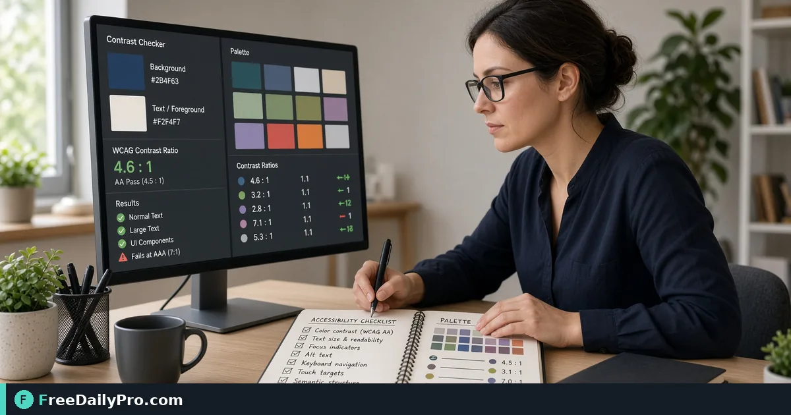

*Test foreground and background pairs against WCAG AA and AAA*

[FreeDailyPro.com](https://www.freedailypro.com) -- When accessibility QA packets bounce, the root is often light gray text on white in production. [Contrast Checker](https://www.freedailypro.com/tool/contrast-checker) is the step that turns that mess into a checked result for body text and button labels pass AA on brand colors, built for designers among FreeDailyPro's 200+ professional tools.

The clip below walks through Contrast Checker on a realistic task that matches body text and button labels pass AA on brand colors for case 28.

{{youtube PQPgG-NnfcM | How to Check Color Contrast WCAG AA AAA }}

## Why Contrast Checker belongs in this accessibility QA path

This article trains one job only for contrast-checker (guide 28): body text and button labels pass AA on brand colors. Readers are designers. When contrast-checker output looks wrong, first re-check whether the goal was "documented ratios for text and large text" and whether inputs used anchors near 4. The failure mode to refuse on pass 28 is light gray text on white in production.

Success on Contrast Checker means a finished artifact you can defend in accessibility QA: documented ratios for text and large text. Practical anchors for this case sit around 4. If those anchors are missing for body text and button labels pass AA on brand colors, stop before you burn a trial usage on half-ready data for contrast-checker.

## What to stage before opening Contrast Checker

Write a one-line done definition for contrast-checker that matches "documented ratios for text and large text" before guide step 28. Stage every input Contrast Checker will consume for body text and button labels pass AA on brand colors so the browser pass is intentional for designers. Note any destination rules that can reject a contrast-checker export in accessibility QA after case 28.

Keep neighbor tools only for real blockers after Contrast Checker on body text and button labels pass AA on brand colors: [Color Converter](https://www.freedailypro.com/tool/color-converter), [Gradient Generator](https://www.freedailypro.com/tool/gradient-generator), [Favicon Generator](https://www.freedailypro.com/tool/favicon-generator). Browse the [design tools](https://www.freedailypro.com/category/design-tools) category when a related step is required after the contrast-checker pass for documented ratios for text and large text. Queue contrast-checker runs so each of the 10 trial usages hits ready inputs for body text and button labels pass AA on brand colors rather than placeholders.

## Steps on Contrast Checker for case 28

1. Define the done line for this accessibility QA run of contrast-checker: documented ratios for text and large text.
2. Collect inputs for the job on Contrast Checker: body text and button labels pass AA on brand colors.
3. Load Contrast Checker at https://www.freedailypro.com/tool/contrast-checker for designers.
4. Type production values with anchors near 4 for body text and button labels pass AA on brand colors.
5. Apply once; confirm you did not hit light gray text on white in production on the contrast-checker output.
6. Download or copy with a name that includes `contrast-checker` and today's date for case 28.
7. Inspect the way designers will receive the accessibility QA packet (second device if relevant).
8. Store settings so a teammate can repeat the contrast-checker path for body text and button labels pass AA on brand colors next week.

## Recheck cadence for accessibility QA on contrast-checker

After any process change in accessibility QA, re-run one golden case through [Contrast Checker](https://www.freedailypro.com/tool/contrast-checker) for body text and button labels pass AA on brand colors (label it golden-28). Golden cases for contrast-checker beat memory when designers rotate on this workflow. Teach a teammate by having them complete body text and button labels pass AA on brand colors while you only watch for skipped verification of "documented ratios for text and large text" on contrast-checker.

Store the golden-28 inputs next to the contrast-checker export so next month's operator can prove documented ratios for text and large text without guessing anchors near 4.

## Inputs that look fine but break contrast-checker

- Values for Contrast Checker copied from chat with hidden characters that shift 4 on case 28.
- Files named generically (download, IMG_####) with no `contrast-checker` or project tag for body text and button labels pass AA on brand colors.
- Mixing demo placeholders with production rows in the same contrast-checker session aimed at documented ratios for text and large text.
- Assuming last week's portal cap still applies to today's contrast-checker export for designers.
- Using the wrong unit or as-of date so light gray text on white in production becomes invisible until handoff in accessibility QA.

Clean those before blaming Contrast Checker. Most contrast-checker rework in accessibility QA for body text and button labels pass AA on brand colors starts upstream of the FreeDailyPro page on guide 28.

## Communication template after a contrast-checker run

Subject: Contrast Checker result for [project] on [date] — case 28

Body: Goal was documented ratios for text and large text. Inputs used anchors 4. Known risk avoided: light gray text on white in production. File name includes `contrast-checker`. Please confirm within one business day if designers standards need a second pass on body text and button labels pass AA on brand colors.

Short messages prevent reread loops when accessibility QA packets from Contrast Checker move between people on case 28.

## Worked numbers for this contrast-checker case

The primary job for guide 28 is body text and button labels pass AA on brand colors. Anchors near 4 shape the first pass on Contrast Checker. After one careful Contrast Checker run aimed at documented ratios for text and large text, the output should be close enough to ship if light gray text on white in production was blocked for designers. Document the contrast-checker settings so coverage works when someone who owns accessibility QA is out next week.

On a weak contrast-checker pass that still shows signs of light gray text on white in production, change a single factor tied to 4 and re-run so you know what fixed it for body text and button labels pass AA on brand colors. That method keeps Contrast Checker from feeling like guesswork for designers on case 28.

## Edge cases in accessibility QA for Contrast Checker

- Destinations may re-encode contrast-checker exports for body text and button labels pass AA on brand colors—download the stored copy when a portal allows and re-check documented ratios for text and large text on case 28.
- Two Contrast Checker outputs named download (1) is how wrong packets ship; rename with `contrast-checker` immediately for designers.
- Odd inputs confuse operators more than the Contrast Checker UI; inspect anchors (4) before blaming the tool on body text and button labels pass AA on brand colors.
- Locale, units, or formatting can shift meaning after contrast-checker even when the UI reported success toward documented ratios for text and large text in accessibility QA.
- Policy for designers still applies after a technical success on contrast-checker for case 28.

## Mistakes that waste a day on Contrast Checker

- Skipping the success line (documented ratios for text and large text) and only eyeballing the contrast-checker result for body text and button labels pass AA on brand colors on case 28.
- Leaving sample data in a Contrast Checker run that later gets sent as real to designers in accessibility QA.
- Chaining five tools when Contrast Checker alone would finish: body text and button labels pass AA on brand colors.
- Overwriting the only master input while exporting from contrast-checker during body text and button labels pass AA on brand colors.
- Ignoring size, format, or length caps until the final Contrast Checker click fails against documented ratios for text and large text.
- Ignoring the known failure mode for this contrast-checker path: light gray text on white in production.

## Limits of Contrast Checker

Contrast Checker performs the job described on its tool page for accessibility QA, especially body text and button labels pass AA on brand colors in guide 28. The live page does what the controls show—nothing mystical beyond that for documented ratios for text and large text. FreeDailyPro places contrast-checker among 200+ professional tools beside related utilities in design tools when designers need a follow-on step after light gray text on white in production is blocked.

## FAQ for Contrast Checker (case 28)

**What is the primary job this guide covers for contrast-checker?** body text and button labels pass AA on brand colors.
**What does success look like for designers?** documented ratios for text and large text.
**What failure mode should I refuse on Contrast Checker?** light gray text on white in production.
**Which anchors should I write down first for body text and button labels pass AA on brand colors?** 4.
**Who is the audience for the contrast-checker export?** designers working in accessibility QA.
**What if the live page looks different for Contrast Checker?** Follow the live FreeDailyPro controls; this article is a workflow for body text and button labels pass AA on brand colors, not a frozen screenshot of case 28.
**Can I skip verification for a simple contrast-checker run?** No—accessibility QA packets fail when light gray text on white in production slips through on body text and button labels pass AA on brand colors.
**When should I open a second tool after Contrast Checker?** Only after Contrast Checker fails a real check for body text and button labels pass AA on brand colors, then consider [Color Converter](https://www.freedailypro.com/tool/color-converter), [Gradient Generator](https://www.freedailypro.com/tool/gradient-generator), [Favicon Generator](https://www.freedailypro.com/tool/favicon-generator).

## Handoff and naming for contrast-checker

Name Contrast Checker outputs like `client-or-project-contrast-checker-YYYY-MM-DD.ext` (adapt extension) for body text and button labels pass AA on brand colors. Put goal (documented ratios for text and large text), operator, and settings in the ticket that links the contrast-checker file so designers can audit anchors near 4 for case 28. That legend prevents replay confusion next month when someone reopens the accessibility QA packet about light gray text on white in production.

Open the contrast-checker export once on a second device or clean profile before you declare documented ratios for text and large text done for body text and button labels pass AA on brand colors. Next week a teammate should re-run the same Contrast Checker path for body text and button labels pass AA on brand colors without a chat archaeology session on case 28.

## Quality bar for Contrast Checker

A success line for contrast-checker must be observable: documented ratios for text and large text on the concrete job body text and button labels pass AA on brand colors (guide 28). Poetic goals do not survive audit in accessibility QA for designers. Store success and failure lines on a card named for Contrast Checker—include light gray text on white in production as the explicit refuse list and anchors 4.

With 200+ professional tools on FreeDailyPro, finish the accessibility QA packet for body text and button labels pass AA on brand colors before exploring neighbors after Contrast Checker. Resist tool tourism; open a second utility only after the primary contrast-checker export fails a real check against documented ratios for text and large text on case 28.

## Mini case in accessibility QA using Contrast Checker

Scenario 28: body text and button labels pass AA on brand colors. Operator opens Contrast Checker, uses anchors near 4, and writes "documented ratios for text and large text" on a sticky note before the first click. They refuse light gray text on white in production, export with `contrast-checker` in the filename, and send the short handoff template to designers. Result: one closed loop for accessibility QA instead of three re-exports around body text and button labels pass AA on brand colors.

## When to stop and when to continue with Contrast Checker

Stop when the live tool page cannot perform a required specialist step for body text and button labels pass AA on brand colors—do not invent features for contrast-checker in accessibility QA on case 28. Continue when inputs are clean, anchors (4) are written, and "documented ratios for text and large text" is still the target for designers. Extra tools are for blockers in accessibility QA, not entertainment; keep the Contrast Checker path short for body text and button labels pass AA on brand colors.

## Pairing without scope creep after Contrast Checker

Do not chain five utilities for curiosity after Contrast Checker finishes body text and button labels pass AA on brand colors—chain two only when a portal rejects the first export aimed at documented ratios for text and large text. Neighbors such as [Color Converter](https://www.freedailypro.com/tool/color-converter), [Gradient Generator](https://www.freedailypro.com/tool/gradient-generator), [Favicon Generator](https://www.freedailypro.com/tool/favicon-generator) exist to unblock accessibility QA, not to decorate the ticket for designers. A tool-specific card for contrast-checker that lists light gray text on white in production and 4 beats a generic ops checklist every time on case 28.

## Field notes specific to contrast-checker

Camera-roll or generic download filenames hide intent; rename before the serious Contrast Checker pass for body text and button labels pass AA on brand colors on case 28. Trust only the controls on the live contrast-checker page for accessibility QA; do not invent hidden modes that "should" exist for documented ratios for text and large text. Generic SOPs miss sharp edges like light gray text on white in production; keep a one-page card for Contrast Checker alone with anchors 4 and the job line body text and button labels pass AA on brand colors.

Policy for designers still applies after technical success on contrast-checker for body text and button labels pass AA on brand colors. Locale and unit mistakes around 4 remain the top silent errors for Contrast Checker when the work is body text and button labels pass AA on brand colors in accessibility QA on case 28.

## Closing next step for Contrast Checker

Run one real case through Contrast Checker with production inputs for body text and button labels pass AA on brand colors, not placeholders for case 28. Finish against the written success line (documented ratios for text and large text)—not a hopeful glance at a filename from contrast-checker. Open [Contrast Checker](https://www.freedailypro.com/tool/contrast-checker) when you are ready to execute body text and button labels pass AA on brand colors for designers in accessibility QA.

Which part of the Contrast Checker workflow for body text and button labels pass AA on brand colors still feels unclear for your team? We read contrast-checker feedback on the [contact page](https://www.freedailypro.com/contact).
