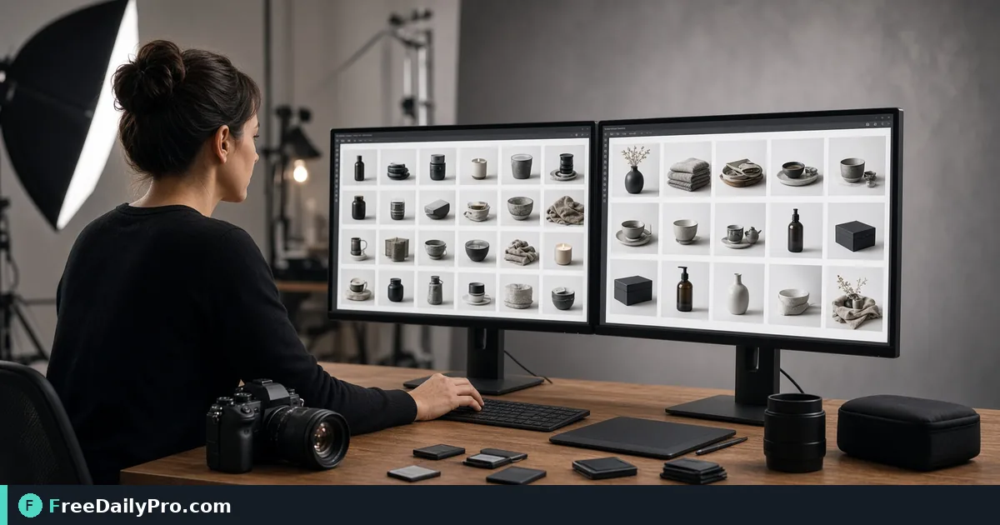

*Process a folder of product photos with the same rules once*

[FreeDailyPro.com](https://www.freedailypro.com) -- Before sign-off in ecommerce catalogs, refuse wrong max-edge on entire batch. [Bulk Image](https://www.freedailypro.com/tool/bulk-image) is the browser step for 80 product shots to 1200px web derivatives, aimed at catalog managers who need pilot of 3 then full folder clean.

The clip below shows Bulk Image on a realistic task for 80 product shots to 1200px web derivatives.

{{youtube KcN1A1BAUqk | How to Batch Process Multiple Images Onl}}

## Why Bulk Image is the right lever for 80 product shots to 1200px web derivatives

This guide covers one primary job for bulk-image: 80 product shots to 1200px web derivatives. The audience is catalog managers. When bulk-image output disappoints, re-check whether the goal stayed "pilot of 3 then full folder clean" and whether anchors near 80, 1200, and 3 (images) were entered correctly. The failure mode to refuse is wrong max-edge on entire batch.

Success with Bulk Image means you can defend a finished artifact: pilot of 3 then full folder clean. Practical anchors for this ecommerce catalogs case sit around 80, 1200, and 3 (images). If those anchors are missing, stop before spending a trial usage on half-ready inputs for 80 product shots to 1200px web derivatives.

## Stage inputs before opening Bulk Image

Write a one-line done definition for bulk-image that matches pilot of 3 then full folder clean. Stage every material Bulk Image will consume for 80 product shots to 1200px web derivatives. Note destination rules that can reject a bulk-image export in ecommerce catalogs.

Keep neighbor tools only for real blockers after Bulk Image: [Compress Image](https://www.freedailypro.com/tool/compress-image), [Resize Crop](https://www.freedailypro.com/tool/resize-crop), [Convert Image](https://www.freedailypro.com/tool/convert-image). Browse [image tools](https://www.freedailypro.com/category/image-tools) when a related step is required after the bulk-image pass for 80 product shots to 1200px web derivatives. Queue bulk-image runs so each trial usage hits ready inputs for 80 product shots to 1200px web derivatives. Among FreeDailyPro's 200+ professional tools, one verified ecommerce catalogs packet for 80 product shots to 1200px web derivatives beats a stack of unfocused tabs chasing pilot of 3 then full folder clean.

## Worked numbers for this bulk-image case (80 product shots to 1200px web derivatives)

The primary job is 80 product shots to 1200px web derivatives. Anchors near 80, 1200, and 3 (images) shape the first pass for catalog managers. After one careful Bulk Image run aimed at pilot of 3 then full folder clean, the output should be close enough to ship if wrong max-edge on entire batch was blocked. Document the bulk-image settings so coverage works when someone who owns ecommerce catalogs is out.

On a weak bulk-image pass that still shows signs of wrong max-edge on entire batch, change a single factor tied to 80, 1200, and 3 (images) and re-run so you know what fixed it. That method keeps Bulk Image from feeling like guesswork for catalog managers on 80 product shots to 1200px web derivatives.

## Steps on Bulk Image for 80 product shots to 1200px web derivatives

1. Write the done line for this ecommerce catalogs ticket: pilot of 3 then full folder clean.
2. Stage inputs for the concrete job: 80 product shots to 1200px web derivatives.
3. Open Bulk Image at https://www.freedailypro.com/tool/bulk-image for this ecommerce catalogs pass only.
4. Enter production values with anchors near 80, 1200, and 3 (images) for 80 product shots to 1200px web derivatives.
5. Run once; confirm you did not hit wrong max-edge on entire batch on the bulk-image output.
6. Export or copy with a name that includes `bulk-image` and today's date for catalog managers covering 80 product shots to 1200px web derivatives.
7. Spot-check the way catalog managers will receive this ecommerce catalogs packet (second device or clean profile if relevant).
8. Archive settings so a teammate can repeat the bulk-image path for 80 product shots to 1200px web derivatives next week without chat archaeology.

## Communication template after bulk-image for 80 product shots to 1200px web derivatives

Subject: Bulk Image result for [project] on [date] covering 80 product shots to 1200px web derivatives

Body: Goal was pilot of 3 then full folder clean. Inputs used anchors 80, 1200, and 3 (images). Known risk avoided: wrong max-edge on entire batch. File name includes `bulk-image`. Please confirm within one business day if catalog managers standards need a second pass on this ecommerce catalogs packet for 80 product shots to 1200px web derivatives.

Short messages prevent reread loops when ecommerce catalogs packets for 80 product shots to 1200px web derivatives move between people after Bulk Image.

## Inputs that look fine but break bulk-image on 80 product shots to 1200px web derivatives

- Values for Bulk Image copied from chat with hidden characters that shift anchors near 80, 1200, and 3 (images) during 80 product shots to 1200px web derivatives.
- Files named generically (download, IMG_####) with no `bulk-image` tag for the ecommerce catalogs packet about 80 product shots to 1200px web derivatives.
- Mixing demo placeholders with production rows in the same bulk-image session for 80 product shots to 1200px web derivatives.
- Assuming last week's portal cap still applies to today's bulk-image export toward pilot of 3 then full folder clean.
- Using the wrong unit or as-of date so wrong max-edge on entire batch becomes invisible until catalog managers reject the handoff for 80 product shots to 1200px web derivatives.

Clean those before blaming Bulk Image. Most bulk-image rework in ecommerce catalogs starts upstream of the FreeDailyPro page when the job is 80 product shots to 1200px web derivatives.

## Edge cases in ecommerce catalogs for Bulk Image

- Destinations may re-encode bulk-image exports for 80 product shots to 1200px web derivatives—download the stored copy when a portal allows and re-check pilot of 3 then full folder clean.
- Two Bulk Image outputs named download (1) is how wrong packets ship for catalog managers; rename immediately with `bulk-image` in the filename for 80 product shots to 1200px web derivatives.
- Odd inputs confuse operators more than the Bulk Image UI when anchors near 80, 1200, and 3 (images) were mistyped for 80 product shots to 1200px web derivatives.
- Locale, units, or formatting can shift meaning after bulk-image even when the UI reported success toward pilot of 3 then full folder clean in ecommerce catalogs.
- Policy for catalog managers still applies after a technical success on 80 product shots to 1200px web derivatives in ecommerce catalogs.

## Mistakes that waste a day on Bulk Image for 80 product shots to 1200px web derivatives

- Skipping the success line (pilot of 3 then full folder clean) and only eyeballing the bulk-image result for 80 product shots to 1200px web derivatives.
- Leaving sample data in a Bulk Image run that later gets sent as real to catalog managers in ecommerce catalogs.
- Chaining five tools when Bulk Image alone would finish 80 product shots to 1200px web derivatives.
- Overwriting the only master input while exporting from bulk-image during 80 product shots to 1200px web derivatives.
- Ignoring size, format, or length caps until the final Bulk Image click fails against pilot of 3 then full folder clean.
- Ignoring the known failure mode for this path: wrong max-edge on entire batch.

## Handoff and naming for bulk-image on 80 product shots to 1200px web derivatives

Name Bulk Image outputs like `client-or-project-bulk-image-YYYY-MM-DD.ext` for the job 80 product shots to 1200px web derivatives (adapt extension). Put goal (pilot of 3 then full folder clean), operator, and settings in the ticket that links the bulk-image file so catalog managers can audit anchors near 80, 1200, and 3 (images). That legend prevents replay confusion next month when someone reopens the ecommerce catalogs packet for 80 product shots to 1200px web derivatives.

Open the bulk-image export once on a second device or clean profile before you declare pilot of 3 then full folder clean done for 80 product shots to 1200px web derivatives. Next week a teammate should re-run the same Bulk Image path for 80 product shots to 1200px web derivatives without a chat archaeology session about wrong max-edge on entire batch.

## Recheck cadence for ecommerce catalogs using bulk-image

After any process change in ecommerce catalogs, re-run one golden case through [Bulk Image](https://www.freedailypro.com/tool/bulk-image) aimed at 80 product shots to 1200px web derivatives. Golden cases beat memory for bulk-image when catalog managers rotate on 80 product shots to 1200px web derivatives.

Teach a teammate by having them complete 80 product shots to 1200px web derivatives while you only watch for skipped verification of pilot of 3 then full folder clean. Teaching works when they can explain pilot of 3 then full folder clean and name wrong max-edge on entire batch without reading your notes about anchors near 80, 1200, and 3 (images).

## Quality bar for Bulk Image on 80 product shots to 1200px web derivatives

A success line for bulk-image must be observable: pilot of 3 then full folder clean on the concrete job 80 product shots to 1200px web derivatives. Poetic goals do not survive audit in ecommerce catalogs for catalog managers. Store success and failure lines on a card named for Bulk Image, including the refuse list item wrong max-edge on entire batch and anchors 80, 1200, and 3 (images).

With 200+ professional tools on FreeDailyPro, finish the ecommerce catalogs packet for 80 product shots to 1200px web derivatives before exploring neighbors. Resist tool tourism after Bulk Image; open a second utility only after the primary bulk-image export fails a real check against pilot of 3 then full folder clean for 80 product shots to 1200px web derivatives.

## FAQ for Bulk Image (80 product shots to 1200px web derivatives)

**What is the primary job this guide covers for bulk-image?** 80 product shots to 1200px web derivatives.

**What does success look like for catalog managers?** pilot of 3 then full folder clean.

**What failure mode should be refused on Bulk Image?** wrong max-edge on entire batch.

**Which anchors should be written before the first click on bulk-image?** 80, 1200, and 3 (images) for the job 80 product shots to 1200px web derivatives.

**Who is the audience for the export?** catalog managers in ecommerce catalogs.

**What if the live page looks different?** Follow the live FreeDailyPro controls on Bulk Image; this article is a workflow for 80 product shots to 1200px web derivatives, not a frozen screenshot.

**Can verification be skipped for a quick bulk-image run?** No—ecommerce catalogs packets fail when wrong max-edge on entire batch slips through for 80 product shots to 1200px web derivatives.

**When should a second tool open after Bulk Image?** Only after a real check fails for 80 product shots to 1200px web derivatives; then consider [Compress Image](https://www.freedailypro.com/tool/compress-image), [Resize Crop](https://www.freedailypro.com/tool/resize-crop), [Convert Image](https://www.freedailypro.com/tool/convert-image).

## Mini case in ecommerce catalogs using Bulk Image

Scenario: 80 product shots to 1200px web derivatives. The operator opens Bulk Image, writes anchors near 80, 1200, and 3 (images) on a sticky note, and commits to pilot of 3 then full folder clean before the first click. They refuse wrong max-edge on entire batch, export with `bulk-image` in the filename, and send the short handoff template to catalog managers. Result for this ecommerce catalogs loop: one closed packet instead of three re-exports around 80 product shots to 1200px web derivatives.

## When to stop and when to continue with Bulk Image

Stop when the live tool page cannot perform a required specialist step for 80 product shots to 1200px web derivatives—do not invent features for bulk-image in ecommerce catalogs. Continue when inputs are clean, anchors near 80, 1200, and 3 (images) are written, and pilot of 3 then full folder clean is still the target for catalog managers on 80 product shots to 1200px web derivatives. Extra tools are for blockers on 80 product shots to 1200px web derivatives, not entertainment; keep the Bulk Image path short.

## Limits of Bulk Image in ecommerce catalogs

Bulk Image performs the job described on its tool page for ecommerce catalogs, especially 80 product shots to 1200px web derivatives. The live page does what the controls show—nothing mystical beyond that for pilot of 3 then full folder clean on 80 product shots to 1200px web derivatives. FreeDailyPro places bulk-image among 200+ professional tools beside related utilities in image tools when catalog managers need a follow-on step after 80 product shots to 1200px web derivatives.

## Field notes specific to bulk-image

Camera-roll or generic download filenames hide intent; rename before the serious Bulk Image pass for 80 product shots to 1200px web derivatives. Trust only the controls on the live bulk-image page for ecommerce catalogs; do not invent hidden modes that "should" exist for pilot of 3 then full folder clean. Generic SOPs miss sharp edges like wrong max-edge on entire batch; keep a one-page card for Bulk Image alone with anchors 80, 1200, and 3 (images) and the job line 80 product shots to 1200px web derivatives.

Policy for catalog managers still applies after technical success on bulk-image for 80 product shots to 1200px web derivatives. Locale and unit mistakes around 80, 1200, and 3 (images) remain the top silent errors for Bulk Image when the work is 80 product shots to 1200px web derivatives in ecommerce catalogs.

## Pairing without scope creep after Bulk Image

Do not chain five utilities for curiosity after finishing 80 product shots to 1200px web derivatives on Bulk Image—chain two only when a portal rejects the first export aimed at pilot of 3 then full folder clean. Neighbors such as [Compress Image](https://www.freedailypro.com/tool/compress-image), [Resize Crop](https://www.freedailypro.com/tool/resize-crop), [Convert Image](https://www.freedailypro.com/tool/convert-image) exist to unblock ecommerce catalogs, not to decorate the ticket. A tool-specific card for bulk-image that lists wrong max-edge on entire batch and 80, 1200, and 3 (images) beats a generic ops checklist every time for catalog managers on 80 product shots to 1200px web derivatives.

## Closing next step for Bulk Image

Run one real case through Bulk Image with production inputs for 80 product shots to 1200px web derivatives, not placeholders. Finish against the written success line (pilot of 3 then full folder clean) for catalog managers—not a hopeful glance at a filename from bulk-image. Bulk Image is a workflow utility on your inputs in ecommerce catalogs; verification against wrong max-edge on entire batch is what makes the packet for 80 product shots to 1200px web derivatives shippable.

Questions about applying Bulk Image to 80 product shots to 1200px web derivatives for catalog managers in ecommerce catalogs? Contact FreeDailyPro through the site contact options and include your tool (bulk-image), goal (pilot of 3 then full folder clean), anchors (80, 1200, and 3 (images)), and what failed (wrong max-edge on entire batch).
