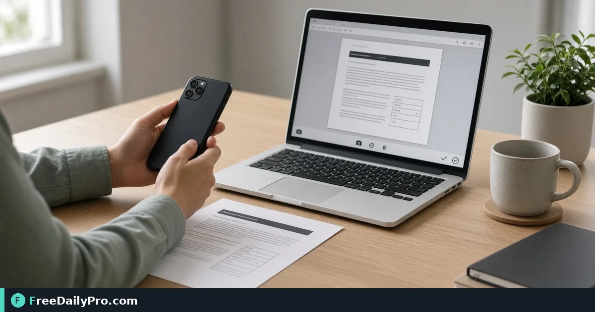

*Snap a browser webcam frame for IDs previews and temp avatars*

[FreeDailyPro.com](https://www.freedailypro.com) -- In remote onboarding, improvising often ends here: shooting into a bright window. [Camera Capture](https://www.freedailypro.com/tool/camera-capture) is the browser step for laptop headshot for onboarding form today, aimed at new hires who need sharp front-lit still accepted.

The clip below shows Camera Capture on a realistic task for laptop headshot for onboarding form today.

{{youtube qMZFDYLCLfg | How to Capture Webcam Photo Online | Fre}}

## Why Camera Capture is the right lever for laptop headshot for onboarding form today

This guide covers one primary job for camera-capture: laptop headshot for onboarding form today. The audience is new hires. When camera-capture output disappoints, re-check whether the goal stayed "sharp front-lit still accepted" and whether anchors near 1, 3, and 1 (frames) were entered correctly. The failure mode to refuse is shooting into a bright window.

Success with Camera Capture means you can defend a finished artifact: sharp front-lit still accepted. Practical anchors for this remote onboarding case sit around 1, 3, and 1 (frames). If those anchors are missing, stop before spending a trial usage on half-ready inputs for laptop headshot for onboarding form today.

## Stage inputs before opening Camera Capture

Write a one-line done definition for camera-capture that matches sharp front-lit still accepted. Stage every material Camera Capture will consume for laptop headshot for onboarding form today. Note destination rules that can reject a camera-capture export in remote onboarding.

Keep neighbor tools only for real blockers after Camera Capture: [Compress Image](https://www.freedailypro.com/tool/compress-image), [Resize Crop](https://www.freedailypro.com/tool/resize-crop), [Convert Image](https://www.freedailypro.com/tool/convert-image). Browse [image tools](https://www.freedailypro.com/category/image-tools) when a related step is required after the camera-capture pass for laptop headshot for onboarding form today. Queue camera-capture runs so each trial usage hits ready inputs for laptop headshot for onboarding form today. Among FreeDailyPro's 200+ professional tools, one verified remote onboarding packet for laptop headshot for onboarding form today beats a stack of unfocused tabs chasing sharp front-lit still accepted.

## Steps on Camera Capture for laptop headshot for onboarding form today

1. Write the done line for this remote onboarding ticket: sharp front-lit still accepted.
2. Stage inputs for the concrete job: laptop headshot for onboarding form today.
3. Open Camera Capture at https://www.freedailypro.com/tool/camera-capture for this remote onboarding pass only.
4. Enter production values with anchors near 1, 3, and 1 (frames) for laptop headshot for onboarding form today.
5. Run once; confirm you did not hit shooting into a bright window on the camera-capture output.
6. Export or copy with a name that includes `camera-capture` and today's date for new hires covering laptop headshot for onboarding form today.
7. Spot-check the way new hires will receive this remote onboarding packet (second device or clean profile if relevant).
8. Archive settings so a teammate can repeat the camera-capture path for laptop headshot for onboarding form today next week without chat archaeology.

## Recheck cadence for remote onboarding using camera-capture

After any process change in remote onboarding, re-run one golden case through [Camera Capture](https://www.freedailypro.com/tool/camera-capture) aimed at laptop headshot for onboarding form today. Golden cases beat memory for camera-capture when new hires rotate on laptop headshot for onboarding form today.

Teach a teammate by having them complete laptop headshot for onboarding form today while you only watch for skipped verification of sharp front-lit still accepted. Teaching works when they can explain sharp front-lit still accepted and name shooting into a bright window without reading your notes about anchors near 1, 3, and 1 (frames).

## Inputs that look fine but break camera-capture on laptop headshot for onboarding form today

- Values for Camera Capture copied from chat with hidden characters that shift anchors near 1, 3, and 1 (frames) during laptop headshot for onboarding form today.
- Files named generically (download, IMG_####) with no `camera-capture` tag for the remote onboarding packet about laptop headshot for onboarding form today.
- Mixing demo placeholders with production rows in the same camera-capture session for laptop headshot for onboarding form today.
- Assuming last week's portal cap still applies to today's camera-capture export toward sharp front-lit still accepted.
- Using the wrong unit or as-of date so shooting into a bright window becomes invisible until new hires reject the handoff for laptop headshot for onboarding form today.

Clean those before blaming Camera Capture. Most camera-capture rework in remote onboarding starts upstream of the FreeDailyPro page when the job is laptop headshot for onboarding form today.

## Communication template after camera-capture for laptop headshot for onboarding form today

Subject: Camera Capture result for [project] on [date] covering laptop headshot for onboarding form today

Body: Goal was sharp front-lit still accepted. Inputs used anchors 1, 3, and 1 (frames). Known risk avoided: shooting into a bright window. File name includes `camera-capture`. Please confirm within one business day if new hires standards need a second pass on this remote onboarding packet for laptop headshot for onboarding form today.

Short messages prevent reread loops when remote onboarding packets for laptop headshot for onboarding form today move between people after Camera Capture.

## Worked numbers for this camera-capture case (laptop headshot for onboarding form today)

The primary job is laptop headshot for onboarding form today. Anchors near 1, 3, and 1 (frames) shape the first pass for new hires. After one careful Camera Capture run aimed at sharp front-lit still accepted, the output should be close enough to ship if shooting into a bright window was blocked. Document the camera-capture settings so coverage works when someone who owns remote onboarding is out.

On a weak camera-capture pass that still shows signs of shooting into a bright window, change a single factor tied to 1, 3, and 1 (frames) and re-run so you know what fixed it. That method keeps Camera Capture from feeling like guesswork for new hires on laptop headshot for onboarding form today.

## Edge cases in remote onboarding for Camera Capture

- Destinations may re-encode camera-capture exports for laptop headshot for onboarding form today—download the stored copy when a portal allows and re-check sharp front-lit still accepted.
- Two Camera Capture outputs named download (1) is how wrong packets ship for new hires; rename immediately with `camera-capture` in the filename for laptop headshot for onboarding form today.
- Odd inputs confuse operators more than the Camera Capture UI when anchors near 1, 3, and 1 (frames) were mistyped for laptop headshot for onboarding form today.
- Locale, units, or formatting can shift meaning after camera-capture even when the UI reported success toward sharp front-lit still accepted in remote onboarding.
- Policy for new hires still applies after a technical success on laptop headshot for onboarding form today in remote onboarding.

## Mistakes that waste a day on Camera Capture for laptop headshot for onboarding form today

- Skipping the success line (sharp front-lit still accepted) and only eyeballing the camera-capture result for laptop headshot for onboarding form today.
- Leaving sample data in a Camera Capture run that later gets sent as real to new hires in remote onboarding.
- Chaining five tools when Camera Capture alone would finish laptop headshot for onboarding form today.
- Overwriting the only master input while exporting from camera-capture during laptop headshot for onboarding form today.
- Ignoring size, format, or length caps until the final Camera Capture click fails against sharp front-lit still accepted.
- Ignoring the known failure mode for this path: shooting into a bright window.

## Limits of Camera Capture in remote onboarding

Camera Capture performs the job described on its tool page for remote onboarding, especially laptop headshot for onboarding form today. The live page does what the controls show—nothing mystical beyond that for sharp front-lit still accepted on laptop headshot for onboarding form today. FreeDailyPro places camera-capture among 200+ professional tools beside related utilities in image tools when new hires need a follow-on step after laptop headshot for onboarding form today.

## FAQ for Camera Capture (laptop headshot for onboarding form today)

**What is the primary job this guide covers for camera-capture?** laptop headshot for onboarding form today.

**What does success look like for new hires?** sharp front-lit still accepted.

**What failure mode should be refused on Camera Capture?** shooting into a bright window.

**Which anchors should be written before the first click on camera-capture?** 1, 3, and 1 (frames) for the job laptop headshot for onboarding form today.

**Who is the audience for the export?** new hires in remote onboarding.

**What if the live page looks different?** Follow the live FreeDailyPro controls on Camera Capture; this article is a workflow for laptop headshot for onboarding form today, not a frozen screenshot.

**Can verification be skipped for a quick camera-capture run?** No—remote onboarding packets fail when shooting into a bright window slips through for laptop headshot for onboarding form today.

**When should a second tool open after Camera Capture?** Only after a real check fails for laptop headshot for onboarding form today; then consider [Compress Image](https://www.freedailypro.com/tool/compress-image), [Resize Crop](https://www.freedailypro.com/tool/resize-crop), [Convert Image](https://www.freedailypro.com/tool/convert-image).

## Handoff and naming for camera-capture on laptop headshot for onboarding form today

Name Camera Capture outputs like `client-or-project-camera-capture-YYYY-MM-DD.ext` for the job laptop headshot for onboarding form today (adapt extension). Put goal (sharp front-lit still accepted), operator, and settings in the ticket that links the camera-capture file so new hires can audit anchors near 1, 3, and 1 (frames). That legend prevents replay confusion next month when someone reopens the remote onboarding packet for laptop headshot for onboarding form today.

Open the camera-capture export once on a second device or clean profile before you declare sharp front-lit still accepted done for laptop headshot for onboarding form today. Next week a teammate should re-run the same Camera Capture path for laptop headshot for onboarding form today without a chat archaeology session about shooting into a bright window.

## Quality bar for Camera Capture on laptop headshot for onboarding form today

A success line for camera-capture must be observable: sharp front-lit still accepted on the concrete job laptop headshot for onboarding form today. Poetic goals do not survive audit in remote onboarding for new hires. Store success and failure lines on a card named for Camera Capture, including the refuse list item shooting into a bright window and anchors 1, 3, and 1 (frames).

With 200+ professional tools on FreeDailyPro, finish the remote onboarding packet for laptop headshot for onboarding form today before exploring neighbors. Resist tool tourism after Camera Capture; open a second utility only after the primary camera-capture export fails a real check against sharp front-lit still accepted for laptop headshot for onboarding form today.

## Mini case in remote onboarding using Camera Capture

Scenario: laptop headshot for onboarding form today. The operator opens Camera Capture, writes anchors near 1, 3, and 1 (frames) on a sticky note, and commits to sharp front-lit still accepted before the first click. They refuse shooting into a bright window, export with `camera-capture` in the filename, and send the short handoff template to new hires. Result for this remote onboarding loop: one closed packet instead of three re-exports around laptop headshot for onboarding form today.

## When to stop and when to continue with Camera Capture

Stop when the live tool page cannot perform a required specialist step for laptop headshot for onboarding form today—do not invent features for camera-capture in remote onboarding. Continue when inputs are clean, anchors near 1, 3, and 1 (frames) are written, and sharp front-lit still accepted is still the target for new hires on laptop headshot for onboarding form today. Extra tools are for blockers on laptop headshot for onboarding form today, not entertainment; keep the Camera Capture path short.

## Pairing without scope creep after Camera Capture

Do not chain five utilities for curiosity after finishing laptop headshot for onboarding form today on Camera Capture—chain two only when a portal rejects the first export aimed at sharp front-lit still accepted. Neighbors such as [Compress Image](https://www.freedailypro.com/tool/compress-image), [Resize Crop](https://www.freedailypro.com/tool/resize-crop), [Convert Image](https://www.freedailypro.com/tool/convert-image) exist to unblock remote onboarding, not to decorate the ticket. A tool-specific card for camera-capture that lists shooting into a bright window and 1, 3, and 1 (frames) beats a generic ops checklist every time for new hires on laptop headshot for onboarding form today.

## Field notes specific to camera-capture

Camera-roll or generic download filenames hide intent; rename before the serious Camera Capture pass for laptop headshot for onboarding form today. Trust only the controls on the live camera-capture page for remote onboarding; do not invent hidden modes that "should" exist for sharp front-lit still accepted. Generic SOPs miss sharp edges like shooting into a bright window; keep a one-page card for Camera Capture alone with anchors 1, 3, and 1 (frames) and the job line laptop headshot for onboarding form today.

Policy for new hires still applies after technical success on camera-capture for laptop headshot for onboarding form today. Locale and unit mistakes around 1, 3, and 1 (frames) remain the top silent errors for Camera Capture when the work is laptop headshot for onboarding form today in remote onboarding.

## Closing next step for Camera Capture

Run one real case through Camera Capture with production inputs for laptop headshot for onboarding form today, not placeholders. Finish against the written success line (sharp front-lit still accepted) for new hires—not a hopeful glance at a filename from camera-capture. Camera Capture is a workflow utility on your inputs in remote onboarding; verification against shooting into a bright window is what makes the packet for laptop headshot for onboarding form today shippable.

Questions about applying Camera Capture to laptop headshot for onboarding form today for new hires in remote onboarding? Contact FreeDailyPro through the site contact options and include your tool (camera-capture), goal (sharp front-lit still accepted), anchors (1, 3, and 1 (frames)), and what failed (shooting into a bright window).
