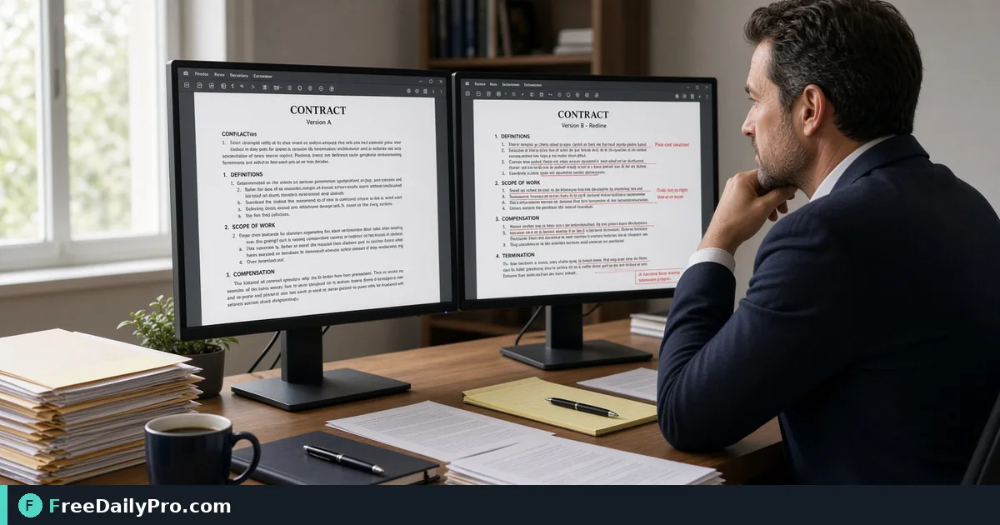

*Spot text and layout differences between document revisions*

[FreeDailyPro.com](https://www.freedailypro.com) -- Before sign-off in contract review, refuse sending v3 when v4 was approved. [Compare PDF](https://www.freedailypro.com/tool/compare-pdf) is the browser step for confirm only clause 12 changed between PDF A and B, aimed at legal ops who need diff summary on the send ticket.

The clip below shows Compare PDF on a realistic task for confirm only clause 12 changed between PDF A and B.

{{youtube f-QHfStX3Po | How to Compare Two PDF Files Online | Fr}}

## Why Compare PDF is the right lever for confirm only clause 12 changed between PDF A and B

This guide covers one primary job for compare-pdf: confirm only clause 12 changed between PDF A and B. The audience is legal ops. When compare-pdf output disappoints, re-check whether the goal stayed "diff summary on the send ticket" and whether anchors near 2, 12, and 1 (versions) were entered correctly. The failure mode to refuse is sending v3 when v4 was approved.

Success with Compare PDF means you can defend a finished artifact: diff summary on the send ticket. Practical anchors for this contract review case sit around 2, 12, and 1 (versions). If those anchors are missing, stop before spending a trial usage on half-ready inputs for confirm only clause 12 changed between PDF A and B.

## Stage inputs before opening Compare PDF

Write a one-line done definition for compare-pdf that matches diff summary on the send ticket. Stage every material Compare PDF will consume for confirm only clause 12 changed between PDF A and B. Note destination rules that can reject a compare-pdf export in contract review.

Keep neighbor tools only for real blockers after Compare PDF: [Merge PDF](https://www.freedailypro.com/tool/merge-pdf), [Split PDF](https://www.freedailypro.com/tool/split-pdf), [Compress PDF](https://www.freedailypro.com/tool/compress-pdf). Browse [pdf tools](https://www.freedailypro.com/category/pdf-tools) when a related step is required after the compare-pdf pass for confirm only clause 12 changed between PDF A and B. Queue compare-pdf runs so each trial usage hits ready inputs for confirm only clause 12 changed between PDF A and B. Among FreeDailyPro's 200+ professional tools, one verified contract review packet for confirm only clause 12 changed between PDF A and B beats a stack of unfocused tabs chasing diff summary on the send ticket.

## Steps on Compare PDF for confirm only clause 12 changed between PDF A and B

1. Write the done line for this contract review ticket: diff summary on the send ticket.
2. Stage inputs for the concrete job: confirm only clause 12 changed between PDF A and B.
3. Open Compare PDF at https://www.freedailypro.com/tool/compare-pdf for this contract review pass only.
4. Enter production values with anchors near 2, 12, and 1 (versions) for confirm only clause 12 changed between PDF A and B.
5. Run once; confirm you did not hit sending v3 when v4 was approved on the compare-pdf output.
6. Export or copy with a name that includes `compare-pdf` and today's date for legal ops covering confirm only clause 12 changed between PDF A and B.
7. Spot-check the way legal ops will receive this contract review packet (second device or clean profile if relevant).
8. Archive settings so a teammate can repeat the compare-pdf path for confirm only clause 12 changed between PDF A and B next week without chat archaeology.

## Recheck cadence for contract review using compare-pdf

After any process change in contract review, re-run one golden case through [Compare PDF](https://www.freedailypro.com/tool/compare-pdf) aimed at confirm only clause 12 changed between PDF A and B. Golden cases beat memory for compare-pdf when legal ops rotate on confirm only clause 12 changed between PDF A and B.

Teach a teammate by having them complete confirm only clause 12 changed between PDF A and B while you only watch for skipped verification of diff summary on the send ticket. Teaching works when they can explain diff summary on the send ticket and name sending v3 when v4 was approved without reading your notes about anchors near 2, 12, and 1 (versions).

## Inputs that look fine but break compare-pdf on confirm only clause 12 changed between PDF A and B

- Values for Compare PDF copied from chat with hidden characters that shift anchors near 2, 12, and 1 (versions) during confirm only clause 12 changed between PDF A and B.
- Files named generically (download, IMG_####) with no `compare-pdf` tag for the contract review packet about confirm only clause 12 changed between PDF A and B.
- Mixing demo placeholders with production rows in the same compare-pdf session for confirm only clause 12 changed between PDF A and B.
- Assuming last week's portal cap still applies to today's compare-pdf export toward diff summary on the send ticket.
- Using the wrong unit or as-of date so sending v3 when v4 was approved becomes invisible until legal ops reject the handoff for confirm only clause 12 changed between PDF A and B.

Clean those before blaming Compare PDF. Most compare-pdf rework in contract review starts upstream of the FreeDailyPro page when the job is confirm only clause 12 changed between PDF A and B.

## Communication template after compare-pdf for confirm only clause 12 changed between PDF A and B

Subject: Compare PDF result for [project] on [date] covering confirm only clause 12 changed between PDF A and B

Body: Goal was diff summary on the send ticket. Inputs used anchors 2, 12, and 1 (versions). Known risk avoided: sending v3 when v4 was approved. File name includes `compare-pdf`. Please confirm within one business day if legal ops standards need a second pass on this contract review packet for confirm only clause 12 changed between PDF A and B.

Short messages prevent reread loops when contract review packets for confirm only clause 12 changed between PDF A and B move between people after Compare PDF.

## Worked numbers for this compare-pdf case (confirm only clause 12 changed between PDF A and B)

The primary job is confirm only clause 12 changed between PDF A and B. Anchors near 2, 12, and 1 (versions) shape the first pass for legal ops. After one careful Compare PDF run aimed at diff summary on the send ticket, the output should be close enough to ship if sending v3 when v4 was approved was blocked. Document the compare-pdf settings so coverage works when someone who owns contract review is out.

On a weak compare-pdf pass that still shows signs of sending v3 when v4 was approved, change a single factor tied to 2, 12, and 1 (versions) and re-run so you know what fixed it. That method keeps Compare PDF from feeling like guesswork for legal ops on confirm only clause 12 changed between PDF A and B.

## Edge cases in contract review for Compare PDF

- Destinations may re-encode compare-pdf exports for confirm only clause 12 changed between PDF A and B—download the stored copy when a portal allows and re-check diff summary on the send ticket.
- Two Compare PDF outputs named download (1) is how wrong packets ship for legal ops; rename immediately with `compare-pdf` in the filename for confirm only clause 12 changed between PDF A and B.
- Odd inputs confuse operators more than the Compare PDF UI when anchors near 2, 12, and 1 (versions) were mistyped for confirm only clause 12 changed between PDF A and B.
- Locale, units, or formatting can shift meaning after compare-pdf even when the UI reported success toward diff summary on the send ticket in contract review.
- Policy for legal ops still applies after a technical success on confirm only clause 12 changed between PDF A and B in contract review.

## Mistakes that waste a day on Compare PDF for confirm only clause 12 changed between PDF A and B

- Skipping the success line (diff summary on the send ticket) and only eyeballing the compare-pdf result for confirm only clause 12 changed between PDF A and B.
- Leaving sample data in a Compare PDF run that later gets sent as real to legal ops in contract review.
- Chaining five tools when Compare PDF alone would finish confirm only clause 12 changed between PDF A and B.
- Overwriting the only master input while exporting from compare-pdf during confirm only clause 12 changed between PDF A and B.
- Ignoring size, format, or length caps until the final Compare PDF click fails against diff summary on the send ticket.
- Ignoring the known failure mode for this path: sending v3 when v4 was approved.

## Limits of Compare PDF in contract review

Compare PDF performs the job described on its tool page for contract review, especially confirm only clause 12 changed between PDF A and B. The live page does what the controls show—nothing mystical beyond that for diff summary on the send ticket on confirm only clause 12 changed between PDF A and B. FreeDailyPro places compare-pdf among 200+ professional tools beside related utilities in pdf tools when legal ops need a follow-on step after confirm only clause 12 changed between PDF A and B.

## FAQ for Compare PDF (confirm only clause 12 changed between PDF A and B)

**What is the primary job this guide covers for compare-pdf?** confirm only clause 12 changed between PDF A and B.

**What does success look like for legal ops?** diff summary on the send ticket.

**What failure mode should be refused on Compare PDF?** sending v3 when v4 was approved.

**Which anchors should be written before the first click on compare-pdf?** 2, 12, and 1 (versions) for the job confirm only clause 12 changed between PDF A and B.

**Who is the audience for the export?** legal ops in contract review.

**What if the live page looks different?** Follow the live FreeDailyPro controls on Compare PDF; this article is a workflow for confirm only clause 12 changed between PDF A and B, not a frozen screenshot.

**Can verification be skipped for a quick compare-pdf run?** No—contract review packets fail when sending v3 when v4 was approved slips through for confirm only clause 12 changed between PDF A and B.

**When should a second tool open after Compare PDF?** Only after a real check fails for confirm only clause 12 changed between PDF A and B; then consider [Merge PDF](https://www.freedailypro.com/tool/merge-pdf), [Split PDF](https://www.freedailypro.com/tool/split-pdf), [Compress PDF](https://www.freedailypro.com/tool/compress-pdf).

## Handoff and naming for compare-pdf on confirm only clause 12 changed between PDF A and B

Name Compare PDF outputs like `client-or-project-compare-pdf-YYYY-MM-DD.ext` for the job confirm only clause 12 changed between PDF A and B (adapt extension). Put goal (diff summary on the send ticket), operator, and settings in the ticket that links the compare-pdf file so legal ops can audit anchors near 2, 12, and 1 (versions). That legend prevents replay confusion next month when someone reopens the contract review packet for confirm only clause 12 changed between PDF A and B.

Open the compare-pdf export once on a second device or clean profile before you declare diff summary on the send ticket done for confirm only clause 12 changed between PDF A and B. Next week a teammate should re-run the same Compare PDF path for confirm only clause 12 changed between PDF A and B without a chat archaeology session about sending v3 when v4 was approved.

## Quality bar for Compare PDF on confirm only clause 12 changed between PDF A and B

A success line for compare-pdf must be observable: diff summary on the send ticket on the concrete job confirm only clause 12 changed between PDF A and B. Poetic goals do not survive audit in contract review for legal ops. Store success and failure lines on a card named for Compare PDF, including the refuse list item sending v3 when v4 was approved and anchors 2, 12, and 1 (versions).

With 200+ professional tools on FreeDailyPro, finish the contract review packet for confirm only clause 12 changed between PDF A and B before exploring neighbors. Resist tool tourism after Compare PDF; open a second utility only after the primary compare-pdf export fails a real check against diff summary on the send ticket for confirm only clause 12 changed between PDF A and B.

## Mini case in contract review using Compare PDF

Scenario: confirm only clause 12 changed between PDF A and B. The operator opens Compare PDF, writes anchors near 2, 12, and 1 (versions) on a sticky note, and commits to diff summary on the send ticket before the first click. They refuse sending v3 when v4 was approved, export with `compare-pdf` in the filename, and send the short handoff template to legal ops. Result for this contract review loop: one closed packet instead of three re-exports around confirm only clause 12 changed between PDF A and B.

## When to stop and when to continue with Compare PDF

Stop when the live tool page cannot perform a required specialist step for confirm only clause 12 changed between PDF A and B—do not invent features for compare-pdf in contract review. Continue when inputs are clean, anchors near 2, 12, and 1 (versions) are written, and diff summary on the send ticket is still the target for legal ops on confirm only clause 12 changed between PDF A and B. Extra tools are for blockers on confirm only clause 12 changed between PDF A and B, not entertainment; keep the Compare PDF path short.

## Pairing without scope creep after Compare PDF

Do not chain five utilities for curiosity after finishing confirm only clause 12 changed between PDF A and B on Compare PDF—chain two only when a portal rejects the first export aimed at diff summary on the send ticket. Neighbors such as [Merge PDF](https://www.freedailypro.com/tool/merge-pdf), [Split PDF](https://www.freedailypro.com/tool/split-pdf), [Compress PDF](https://www.freedailypro.com/tool/compress-pdf) exist to unblock contract review, not to decorate the ticket. A tool-specific card for compare-pdf that lists sending v3 when v4 was approved and 2, 12, and 1 (versions) beats a generic ops checklist every time for legal ops on confirm only clause 12 changed between PDF A and B.

## Field notes specific to compare-pdf

Camera-roll or generic download filenames hide intent; rename before the serious Compare PDF pass for confirm only clause 12 changed between PDF A and B. Trust only the controls on the live compare-pdf page for contract review; do not invent hidden modes that "should" exist for diff summary on the send ticket. Generic SOPs miss sharp edges like sending v3 when v4 was approved; keep a one-page card for Compare PDF alone with anchors 2, 12, and 1 (versions) and the job line confirm only clause 12 changed between PDF A and B.

Policy for legal ops still applies after technical success on compare-pdf for confirm only clause 12 changed between PDF A and B. Locale and unit mistakes around 2, 12, and 1 (versions) remain the top silent errors for Compare PDF when the work is confirm only clause 12 changed between PDF A and B in contract review.

## Closing next step for Compare PDF

Run one real case through Compare PDF with production inputs for confirm only clause 12 changed between PDF A and B, not placeholders. Finish against the written success line (diff summary on the send ticket) for legal ops—not a hopeful glance at a filename from compare-pdf. Compare PDF is a workflow utility on your inputs in contract review; verification against sending v3 when v4 was approved is what makes the packet for confirm only clause 12 changed between PDF A and B shippable.

Questions about applying Compare PDF to confirm only clause 12 changed between PDF A and B for legal ops in contract review? Contact FreeDailyPro through the site contact options and include your tool (compare-pdf), goal (diff summary on the send ticket), anchors (2, 12, and 1 (versions)), and what failed (sending v3 when v4 was approved).
