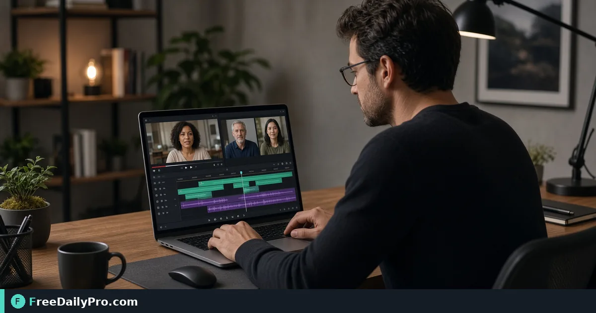

*A practical Merge Video workflow for video assembly*

[FreeDailyPro.com](https://www.freedailypro.com) -- Work around video assembly fails when operators accept sending three separate clips to a client. [Merge Video](https://www.freedailypro.com/tool/merge-video) is the step that turns that mess into a checked result for join three interview clips into one continuous MP4, built for content writers among FreeDailyPro's 200+ professional tools.

The clip below walks through Merge Video on a realistic task that matches join three interview clips into one continuous MP4 for case 3.

{{youtube -HjR7V5ceA0 | How to Merge Videos Online – Combine Multiple}}

## Why Merge Video belongs in this video assembly path

This article trains one job only for merge-video (guide 3): join three interview clips into one continuous MP4. Readers are content writers. When merge-video output looks wrong, first re-check whether the goal was "one seamless MP4 with clips in the right order" and whether inputs used anchors near 3 clips, MP4, order A-B-C. The failure mode to refuse on pass 3 is exporting three files instead of one reel.

Success on Merge Video means a finished artifact you can defend in video assembly: one seamless MP4 with clips in the right order. Practical anchors for this case sit around 3 clips, MP4, order A-B-C. If those anchors are missing for join three interview clips into one continuous MP4, stop before you burn a trial usage on half-ready data for merge-video.

## What to stage before opening Merge Video

Write a one-line done definition for merge-video that matches "one seamless MP4 with clips in the right order" before guide step 3. Stage every input Merge Video will consume for join three interview clips into one continuous MP4 so the browser pass is intentional for content writers. Note any destination rules that can reject a merge-video export in video assembly after case 3.

Keep neighbor tools only for real blockers after Merge Video on join three interview clips into one continuous MP4: [Compress Video](https://www.freedailypro.com/tool/compress-video), [Convert Video](https://www.freedailypro.com/tool/convert-video), [Trim Video](https://www.freedailypro.com/tool/trim-video). Browse the [video tools](https://www.freedailypro.com/category/video-tools) category when a related step is required after the merge-video pass for one seamless MP4 with clips in the right order. Queue merge-video runs so each of the 10 trial usages hits ready inputs for join three interview clips into one continuous MP4 rather than placeholders.

## Steps on Merge Video for case 3

1. Define the done line for this video assembly run of merge-video: one seamless MP4 with clips in the right order.
2. Collect inputs for the job on Merge Video: join three interview clips into one continuous MP4.
3. Load Merge Video at https://www.freedailypro.com/tool/merge-video for content writers.
4. Type production values with anchors near 3 clips, MP4, order A-B-C for join three interview clips into one continuous MP4.
5. Apply once; confirm you did not hit exporting three files instead of one reel on the merge-video output.
6. Download or copy with a name that includes `merge-video` and today's date for case 3.
7. Inspect the way content writers will receive the video assembly packet (second device if relevant).
8. Store settings so a teammate can repeat the merge-video path for join three interview clips into one continuous MP4 next week.

## Recheck cadence for video assembly on merge-video

After any process change in video assembly, re-run one golden case through [Merge Video](https://www.freedailypro.com/tool/merge-video) for join three interview clips into one continuous MP4 (label it golden-3-merge-video). Golden cases for merge-video beat memory when content writers rotate on this workflow. Teach a teammate by having them complete join three interview clips into one continuous MP4 while you only watch for skipped verification of "one seamless MP4 with clips in the right order" on merge-video.

Store the golden-3-merge-video inputs next to the merge-video export so next month's operator can prove one seamless MP4 with clips in the right order without guessing anchors near 3 clips, MP4, order A-B-C.

## Inputs that look fine but break merge-video

- Values for Merge Video copied from chat with hidden characters that shift 3 clips, MP4, order A-B-C on case 3.
- Files named generically (download, IMG_####) with no `merge-video` or project tag for join three interview clips into one continuous MP4.
- Mixing demo placeholders with production rows in the same merge-video session aimed at one seamless MP4 with clips in the right order.
- Assuming last week's portal cap still applies to today's merge-video export for content writers.
- Using the wrong unit or as-of date so exporting three files instead of one reel becomes invisible until handoff in video assembly.

Clean those before blaming Merge Video. Most merge-video rework in video assembly for join three interview clips into one continuous MP4 starts upstream of the FreeDailyPro page on guide 3.

## Communication template after a merge-video run

Subject: Merge Video result for [project] on [date] — case 3

Body: Goal was one seamless MP4 with clips in the right order. Inputs used anchors 3 clips, MP4, order A-B-C. Known risk avoided: exporting three files instead of one reel. File name includes `merge-video`. Please confirm within one business day if content writers standards need a second pass on join three interview clips into one continuous MP4.

Short messages prevent reread loops when video assembly packets from Merge Video move between people on case 3.

## Worked numbers for this merge-video case

The primary job for guide 3 is join three interview clips into one continuous MP4. Anchors near 3 clips, MP4, order A-B-C shape the first pass on Merge Video. After one careful Merge Video run aimed at one seamless MP4 with clips in the right order, the output should be close enough to ship if exporting three files instead of one reel was blocked for content writers. Document the merge-video settings so coverage works when someone who owns video assembly is out next week.

On a weak merge-video pass that still shows signs of exporting three files instead of one reel, change a single factor tied to 3 clips, MP4, order A-B-C and re-run so you know what fixed it for join three interview clips into one continuous MP4. That method keeps Merge Video from feeling like guesswork for content writers on case 3.

## Edge cases in video assembly for Merge Video

- Destinations may re-encode merge-video exports for join three interview clips into one continuous MP4—download the stored copy when a portal allows and re-check one seamless MP4 with clips in the right order on case 3.
- Two Merge Video outputs named download (1) is how wrong packets ship; rename with `merge-video` immediately for content writers.
- Odd inputs confuse operators more than the Merge Video UI; inspect anchors (3 clips, MP4, order A-B-C) before blaming the tool on join three interview clips into one continuous MP4.
- Locale, units, or formatting can shift meaning after merge-video even when the UI reported success toward one seamless MP4 with clips in the right order in video assembly.
- Policy for content writers still applies after a technical success on merge-video for case 3 in video assembly.

## Mistakes that waste a day on Merge Video

- Skipping the success line (one seamless MP4 with clips in the right order) and only eyeballing the merge-video result for join three interview clips into one continuous MP4 on case 3.
- Leaving sample data in a Merge Video run that later gets sent as real to content writers in video assembly.
- Chaining five tools when Merge Video alone would finish: join three interview clips into one continuous MP4.
- Overwriting the only master input while exporting from merge-video during join three interview clips into one continuous MP4.
- Ignoring size, format, or length caps until the final Merge Video click fails against one seamless MP4 with clips in the right order.
- Ignoring the known failure mode for this merge-video path: exporting three files instead of one reel.

## Limits of Merge Video

Merge Video performs the job described on its tool page for video assembly, especially join three interview clips into one continuous MP4 in guide 3. The live page does what the controls show—nothing mystical beyond that for one seamless MP4 with clips in the right order. FreeDailyPro places merge-video among 200+ professional tools beside related utilities in video tools when content writers need a follow-on step after exporting three files instead of one reel is blocked.

## FAQ for Merge Video (case 3)

**What is the primary job this guide covers for merge-video?** join three interview clips into one continuous MP4.
**What does success look like for content writers?** one seamless MP4 with clips in the right order.
**What failure mode should I refuse on Merge Video?** exporting three files instead of one reel.
**Which anchors should I write down first for join three interview clips into one continuous MP4?** 3 clips, MP4, order A-B-C.
**Who is the audience for the merge-video export?** content writers working in video assembly.
**What if the live page looks different for Merge Video?** Follow the live FreeDailyPro controls; this article is a workflow for join three interview clips into one continuous MP4, not a frozen screenshot of case 3.
**Can I skip verification for a simple merge-video run?** No—video assembly packets fail when exporting three files instead of one reel slips through on join three interview clips into one continuous MP4.
**When should I open a second tool after Merge Video?** Only after Merge Video fails a real check for join three interview clips into one continuous MP4, then consider [Compress Video](https://www.freedailypro.com/tool/compress-video), [Convert Video](https://www.freedailypro.com/tool/convert-video), [Trim Video](https://www.freedailypro.com/tool/trim-video).

## Handoff and naming for merge-video

Name Merge Video outputs like `client-or-project-merge-video-YYYY-MM-DD.ext` (adapt extension) for join three interview clips into one continuous MP4. Put goal (one seamless MP4 with clips in the right order), operator, and settings in the ticket that links the merge-video file so content writers can audit anchors near 3 clips, MP4, order A-B-C for case 3. That legend prevents replay confusion next month when someone reopens the video assembly packet about exporting three files instead of one reel.

Open the merge-video export once on a second device or clean profile before you declare one seamless MP4 with clips in the right order done for join three interview clips into one continuous MP4. Next week a teammate should re-run the same Merge Video path for join three interview clips into one continuous MP4 without a chat archaeology session on case 3.

## Quality bar for Merge Video

A success line for merge-video must be observable: one seamless MP4 with clips in the right order on the concrete job join three interview clips into one continuous MP4 (guide 3). Poetic goals do not survive audit in video assembly for content writers. Store success and failure lines on a card named for Merge Video—include exporting three files instead of one reel as the explicit refuse list and anchors 3 clips, MP4, order A-B-C.

With 200+ professional tools on FreeDailyPro, finish the video assembly packet for join three interview clips into one continuous MP4 before exploring neighbors after Merge Video. Resist tool tourism; open a second utility only after the primary merge-video export fails a real check against one seamless MP4 with clips in the right order on case 3.

## Mini case in video assembly using Merge Video

Scenario 3: join three interview clips into one continuous MP4. Operator opens Merge Video, uses anchors near 3 clips, MP4, order A-B-C, and writes "one seamless MP4 with clips in the right order" on a sticky note before the first click. They refuse exporting three files instead of one reel, export with `merge-video` in the filename, and send the short handoff template to content writers. Result: one closed loop for video assembly instead of three re-exports around join three interview clips into one continuous MP4.

## When to stop and when to continue with Merge Video

Stop when the live tool page cannot perform a required specialist step for join three interview clips into one continuous MP4—do not invent features for merge-video in video assembly on case 3. Continue when inputs are clean, anchors (3 clips, MP4, order A-B-C) are written, and "one seamless MP4 with clips in the right order" is still the target for content writers. Extra tools are for blockers in video assembly, not entertainment; keep the Merge Video path short for join three interview clips into one continuous MP4.

## Pairing without scope creep after Merge Video

Do not chain five utilities for curiosity after Merge Video finishes join three interview clips into one continuous MP4—chain two only when a portal rejects the first export aimed at one seamless MP4 with clips in the right order. Neighbors such as [Compress Video](https://www.freedailypro.com/tool/compress-video), [Convert Video](https://www.freedailypro.com/tool/convert-video), [Trim Video](https://www.freedailypro.com/tool/trim-video) exist to unblock video assembly, not to decorate the ticket for content writers. A tool-specific card for merge-video that lists exporting three files instead of one reel and 3 clips, MP4, order A-B-C beats a generic ops checklist every time on case 3.

## Field notes specific to merge-video

Camera-roll or generic download filenames hide intent; rename before the serious Merge Video pass for join three interview clips into one continuous MP4 on case 3. Trust only the controls on the live merge-video page for video assembly; do not invent hidden modes that "should" exist for one seamless MP4 with clips in the right order. Generic SOPs miss sharp edges like exporting three files instead of one reel; keep a one-page card for Merge Video alone with anchors 3 clips, MP4, order A-B-C and the job line join three interview clips into one continuous MP4.

Policy for content writers still applies after technical success on merge-video for join three interview clips into one continuous MP4. Locale and unit mistakes around 3 clips, MP4, order A-B-C remain the top silent errors for Merge Video when the work is join three interview clips into one continuous MP4 in video assembly on case 3.

## Closing next step for Merge Video

Run one real case through Merge Video with production inputs for join three interview clips into one continuous MP4, not placeholders for case 3. Finish against the written success line (one seamless MP4 with clips in the right order)—not a hopeful glance at a filename from merge-video. Open [Merge Video](https://www.freedailypro.com/tool/merge-video) when you are ready to execute join three interview clips into one continuous MP4 for content writers in video assembly.

Which part of the Merge Video workflow for join three interview clips into one continuous MP4 still feels unclear for your team? We read merge-video feedback on the [contact page](https://www.freedailypro.com/contact).
