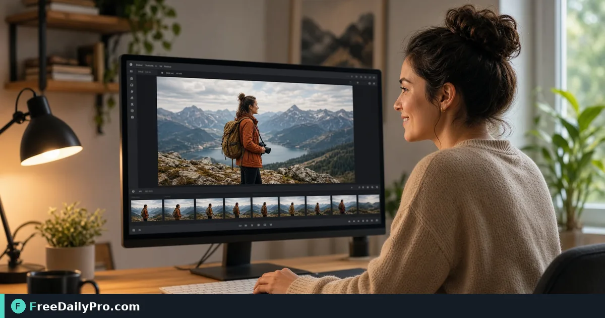

*A practical Thumbnail Gen workflow for video packaging*

[FreeDailyPro.com](https://www.freedailypro.com) -- Before anyone signs off on video packaging work, watch for a blurry pause frame as the public thumbnail. [Thumbnail Gen](https://www.freedailypro.com/tool/thumbnail-gen) is the step that turns that mess into a checked result for frame a YouTube thumbnail from a mid-video still, built for content writers among FreeDailyPro's 200+ professional tools.

The clip below walks through Thumbnail Gen on a realistic task that matches frame a YouTube thumbnail from a mid-video still for case 5.

{{youtube wGXvbaUKqQI | How to Generate Video Thumbnails Online \u2013 Frame}}

## Why Thumbnail Gen belongs in this video packaging path

This article trains one job only for thumbnail-gen (guide 5): frame a YouTube thumbnail from a mid-video still. Readers are content writers. When thumbnail-gen output looks wrong, first re-check whether the goal was "a sharp 1280x720 style still for the video card" and whether inputs used anchors near 1280x720 feel, mid-scene, face clear. The failure mode to refuse on pass 5 is using a random pause frame that is blurry.

Success on Thumbnail Gen means a finished artifact you can defend in video packaging: a sharp 1280x720 style still for the video card. Practical anchors for this case sit around 1280x720 feel, mid-scene, face clear. If those anchors are missing for frame a YouTube thumbnail from a mid-video still, stop before you burn a trial usage on half-ready data for thumbnail-gen.

## What to stage before opening Thumbnail Gen

Write a one-line done definition for thumbnail-gen that matches "a sharp 1280x720 style still for the video card" before guide step 5. Stage every input Thumbnail Gen will consume for frame a YouTube thumbnail from a mid-video still so the browser pass is intentional for content writers. Note any destination rules that can reject a thumbnail-gen export in video packaging after case 5.

Keep neighbor tools only for real blockers after Thumbnail Gen on frame a YouTube thumbnail from a mid-video still: [Compress Video](https://www.freedailypro.com/tool/compress-video), [Convert Video](https://www.freedailypro.com/tool/convert-video), [Trim Video](https://www.freedailypro.com/tool/trim-video). Browse the [video tools](https://www.freedailypro.com/category/video-tools) category when a related step is required after the thumbnail-gen pass for a sharp 1280x720 style still for the video card. Queue thumbnail-gen runs so each of the 10 trial usages hits ready inputs for frame a YouTube thumbnail from a mid-video still rather than placeholders.

## Steps on Thumbnail Gen for case 5

1. Pin the done line for this video packaging run of thumbnail-gen: a sharp 1280x720 style still for the video card.
2. Assemble inputs for the job on Thumbnail Gen: frame a YouTube thumbnail from a mid-video still.
3. Bring up Thumbnail Gen at https://www.freedailypro.com/tool/thumbnail-gen for content writers.
4. Key in production values with anchors near 1280x720 feel, mid-scene, face clear for frame a YouTube thumbnail from a mid-video still.
5. Trigger once; confirm you did not hit using a random pause frame that is blurry on the thumbnail-gen output.
6. Pull or copy with a name that includes `thumbnail-gen` and today's date for case 5.
7. Cross-check the way content writers will receive the video packaging packet (second device if relevant).
8. Retain settings so a teammate can repeat the thumbnail-gen path for frame a YouTube thumbnail from a mid-video still next week.

## Recheck cadence for video packaging on thumbnail-gen

After any process change in video packaging, re-run one golden case through [Thumbnail Gen](https://www.freedailypro.com/tool/thumbnail-gen) for frame a YouTube thumbnail from a mid-video still (label it golden-5-thumbnail-gen). Golden cases for thumbnail-gen beat memory when content writers rotate on this workflow. Teach a teammate by having them complete frame a YouTube thumbnail from a mid-video still while you only watch for skipped verification of "a sharp 1280x720 style still for the video card" on thumbnail-gen.

Store the golden-5-thumbnail-gen inputs next to the thumbnail-gen export so next month's operator can prove a sharp 1280x720 style still for the video card without guessing anchors near 1280x720 feel, mid-scene, face clear.

## Inputs that look fine but break thumbnail-gen

- Values for Thumbnail Gen copied from chat with hidden characters that shift 1280x720 feel, mid-scene, face clear on case 5.
- Files named generically (download, IMG_####) with no `thumbnail-gen` or project tag for frame a YouTube thumbnail from a mid-video still.
- Mixing demo placeholders with production rows in the same thumbnail-gen session aimed at a sharp 1280x720 style still for the video card.
- Assuming last week's portal cap still applies to today's thumbnail-gen export for content writers.
- Using the wrong unit or as-of date so using a random pause frame that is blurry becomes invisible until handoff in video packaging.

Clean those before blaming Thumbnail Gen. Most thumbnail-gen rework in video packaging for frame a YouTube thumbnail from a mid-video still starts upstream of the FreeDailyPro page on guide 5.

## Communication template after a thumbnail-gen run

Subject: Thumbnail Gen result for [project] on [date] — case 5

Body: Goal was a sharp 1280x720 style still for the video card. Inputs used anchors 1280x720 feel, mid-scene, face clear. Known risk avoided: using a random pause frame that is blurry. File name includes `thumbnail-gen`. Please confirm within one business day if content writers standards need a second pass on frame a YouTube thumbnail from a mid-video still.

Short messages prevent reread loops when video packaging packets from Thumbnail Gen move between people on case 5.

## Worked numbers for this thumbnail-gen case

The primary job for guide 5 is frame a YouTube thumbnail from a mid-video still. Anchors near 1280x720 feel, mid-scene, face clear shape the first pass on Thumbnail Gen. After one careful Thumbnail Gen run aimed at a sharp 1280x720 style still for the video card, the output should be close enough to ship if using a random pause frame that is blurry was blocked for content writers. Document the thumbnail-gen settings so coverage works when someone who owns video packaging is out next week.

On a weak thumbnail-gen pass that still shows signs of using a random pause frame that is blurry, change a single factor tied to 1280x720 feel, mid-scene, face clear and re-run so you know what fixed it for frame a YouTube thumbnail from a mid-video still. That method keeps Thumbnail Gen from feeling like guesswork for content writers on case 5.

## Edge cases in video packaging for Thumbnail Gen

- Destinations may re-encode thumbnail-gen exports for frame a YouTube thumbnail from a mid-video still—download the stored copy when a portal allows and re-check a sharp 1280x720 style still for the video card on case 5.
- Two Thumbnail Gen outputs named download (1) is how wrong packets ship; rename with `thumbnail-gen` immediately for content writers.
- Odd inputs confuse operators more than the Thumbnail Gen UI; inspect anchors (1280x720 feel, mid-scene, face clear) before blaming the tool on frame a YouTube thumbnail from a mid-video still.
- Locale, units, or formatting can shift meaning after thumbnail-gen even when the UI reported success toward a sharp 1280x720 style still for the video card in video packaging.
- Policy for content writers still applies after a technical success on thumbnail-gen for case 5 in video packaging.

## Mistakes that waste a day on Thumbnail Gen

- Skipping the success line (a sharp 1280x720 style still for the video card) and only eyeballing the thumbnail-gen result for frame a YouTube thumbnail from a mid-video still on case 5.
- Leaving sample data in a Thumbnail Gen run that later gets sent as real to content writers in video packaging.
- Chaining five tools when Thumbnail Gen alone would finish: frame a YouTube thumbnail from a mid-video still.
- Overwriting the only master input while exporting from thumbnail-gen during frame a YouTube thumbnail from a mid-video still.
- Ignoring size, format, or length caps until the final Thumbnail Gen click fails against a sharp 1280x720 style still for the video card.
- Ignoring the known failure mode for this thumbnail-gen path: using a random pause frame that is blurry.

## Limits of Thumbnail Gen

Thumbnail Gen performs the job described on its tool page for video packaging, especially frame a YouTube thumbnail from a mid-video still in guide 5. The live page does what the controls show—nothing mystical beyond that for a sharp 1280x720 style still for the video card. FreeDailyPro places thumbnail-gen among 200+ professional tools beside related utilities in video tools when content writers need a follow-on step after using a random pause frame that is blurry is blocked.

## FAQ for Thumbnail Gen (case 5)

**What is the primary job this guide covers for thumbnail-gen?** frame a YouTube thumbnail from a mid-video still.
**What does success look like for content writers?** a sharp 1280x720 style still for the video card.
**What failure mode should I refuse on Thumbnail Gen?** using a random pause frame that is blurry.
**Which anchors should I write down first for frame a YouTube thumbnail from a mid-video still?** 1280x720 feel, mid-scene, face clear.
**Who is the audience for the thumbnail-gen export?** content writers working in video packaging.
**What if the live page looks different for Thumbnail Gen?** Follow the live FreeDailyPro controls; this article is a workflow for frame a YouTube thumbnail from a mid-video still, not a frozen screenshot of case 5.
**Can I skip verification for a simple thumbnail-gen run?** No—video packaging packets fail when using a random pause frame that is blurry slips through on frame a YouTube thumbnail from a mid-video still.
**When should I open a second tool after Thumbnail Gen?** Only after Thumbnail Gen fails a real check for frame a YouTube thumbnail from a mid-video still, then consider [Compress Video](https://www.freedailypro.com/tool/compress-video), [Convert Video](https://www.freedailypro.com/tool/convert-video), [Trim Video](https://www.freedailypro.com/tool/trim-video).

## Handoff and naming for thumbnail-gen

Name Thumbnail Gen outputs like `client-or-project-thumbnail-gen-YYYY-MM-DD.ext` (adapt extension) for frame a YouTube thumbnail from a mid-video still. Put goal (a sharp 1280x720 style still for the video card), operator, and settings in the ticket that links the thumbnail-gen file so content writers can audit anchors near 1280x720 feel, mid-scene, face clear for case 5. That legend prevents replay confusion next month when someone reopens the video packaging packet about using a random pause frame that is blurry.

Open the thumbnail-gen export once on a second device or clean profile before you declare a sharp 1280x720 style still for the video card done for frame a YouTube thumbnail from a mid-video still. Next week a teammate should re-run the same Thumbnail Gen path for frame a YouTube thumbnail from a mid-video still without a chat archaeology session on case 5.

## Quality bar for Thumbnail Gen

A success line for thumbnail-gen must be observable: a sharp 1280x720 style still for the video card on the concrete job frame a YouTube thumbnail from a mid-video still (guide 5). Poetic goals do not survive audit in video packaging for content writers. Store success and failure lines on a card named for Thumbnail Gen—include using a random pause frame that is blurry as the explicit refuse list and anchors 1280x720 feel, mid-scene, face clear.

With 200+ professional tools on FreeDailyPro, finish the video packaging packet for frame a YouTube thumbnail from a mid-video still before exploring neighbors after Thumbnail Gen. Resist tool tourism; open a second utility only after the primary thumbnail-gen export fails a real check against a sharp 1280x720 style still for the video card on case 5.

## Mini case in video packaging using Thumbnail Gen

Scenario 5: frame a YouTube thumbnail from a mid-video still. Operator opens Thumbnail Gen, uses anchors near 1280x720 feel, mid-scene, face clear, and writes "a sharp 1280x720 style still for the video card" on a sticky note before the first click. They refuse using a random pause frame that is blurry, export with `thumbnail-gen` in the filename, and send the short handoff template to content writers. Result: one closed loop for video packaging instead of three re-exports around frame a YouTube thumbnail from a mid-video still.

## When to stop and when to continue with Thumbnail Gen

Stop when the live tool page cannot perform a required specialist step for frame a YouTube thumbnail from a mid-video still—do not invent features for thumbnail-gen in video packaging on case 5. Continue when inputs are clean, anchors (1280x720 feel, mid-scene, face clear) are written, and "a sharp 1280x720 style still for the video card" is still the target for content writers. Extra tools are for blockers in video packaging, not entertainment; keep the Thumbnail Gen path short for frame a YouTube thumbnail from a mid-video still.

## Pairing without scope creep after Thumbnail Gen

Do not chain five utilities for curiosity after Thumbnail Gen finishes frame a YouTube thumbnail from a mid-video still—chain two only when a portal rejects the first export aimed at a sharp 1280x720 style still for the video card. Neighbors such as [Compress Video](https://www.freedailypro.com/tool/compress-video), [Convert Video](https://www.freedailypro.com/tool/convert-video), [Trim Video](https://www.freedailypro.com/tool/trim-video) exist to unblock video packaging, not to decorate the ticket for content writers. A tool-specific card for thumbnail-gen that lists using a random pause frame that is blurry and 1280x720 feel, mid-scene, face clear beats a generic ops checklist every time on case 5.

## Field notes specific to thumbnail-gen

Camera-roll or generic download filenames hide intent; rename before the serious Thumbnail Gen pass for frame a YouTube thumbnail from a mid-video still on case 5. Trust only the controls on the live thumbnail-gen page for video packaging; do not invent hidden modes that "should" exist for a sharp 1280x720 style still for the video card. Generic SOPs miss sharp edges like using a random pause frame that is blurry; keep a one-page card for Thumbnail Gen alone with anchors 1280x720 feel, mid-scene, face clear and the job line frame a YouTube thumbnail from a mid-video still.

Policy for content writers still applies after technical success on thumbnail-gen for frame a YouTube thumbnail from a mid-video still. Locale and unit mistakes around 1280x720 feel, mid-scene, face clear remain the top silent errors for Thumbnail Gen when the work is frame a YouTube thumbnail from a mid-video still in video packaging on case 5.

## Closing next step for Thumbnail Gen

Run one real case through Thumbnail Gen with production inputs for frame a YouTube thumbnail from a mid-video still, not placeholders for case 5. Finish against the written success line (a sharp 1280x720 style still for the video card)—not a hopeful glance at a filename from thumbnail-gen. Open [Thumbnail Gen](https://www.freedailypro.com/tool/thumbnail-gen) when you are ready to execute frame a YouTube thumbnail from a mid-video still for content writers in video packaging.

Which part of the Thumbnail Gen workflow for frame a YouTube thumbnail from a mid-video still still feels unclear for your team? We read thumbnail-gen feedback on the [contact page](https://www.freedailypro.com/contact).
