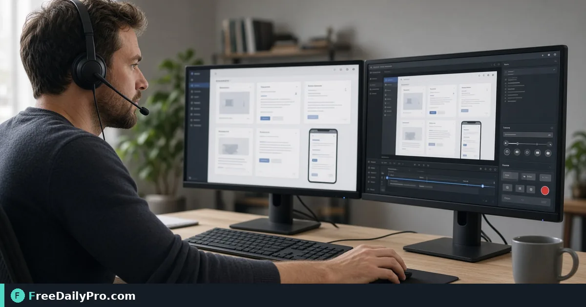

*A practical Screen Recorder workflow for support documentation*

[FreeDailyPro.com](https://www.freedailypro.com) -- The usual support documentation bottleneck is not talent—it is re-doing the same UI demo every ticket. [Screen Recorder](https://www.freedailypro.com/tool/screen-recorder) is the step that turns that mess into a checked result for capture a 4-minute UI walkthrough for support docs, built for developers among FreeDailyPro's 200+ professional tools.

The clip below walks through Screen Recorder on a realistic task that matches capture a 4-minute UI walkthrough for support docs for case 7.

{{youtube DEwAYXXSJ-c | How to Record Your Screen Online – Browser}}

## Why Screen Recorder belongs in this support documentation path

This article trains one job only for screen-recorder (guide 7): capture a 4-minute UI walkthrough for support docs. Readers are developers. When screen-recorder output looks wrong, first re-check whether the goal was "a clear 4-minute screen recording with cursor visible" and whether inputs used anchors near 4 min, 1080p-ish, cursor on. The failure mode to refuse on pass 7 is narrating live without a reusable recording.

Success on Screen Recorder means a finished artifact you can defend in support documentation: a clear 4-minute screen recording with cursor visible. Practical anchors for this case sit around 4 min, 1080p-ish, cursor on. If those anchors are missing for capture a 4-minute UI walkthrough for support docs, stop before you burn a trial usage on half-ready data for screen-recorder.

## What to stage before opening Screen Recorder

Write a one-line done definition for screen-recorder that matches "a clear 4-minute screen recording with cursor visible" before guide step 7. Stage every input Screen Recorder will consume for capture a 4-minute UI walkthrough for support docs so the browser pass is intentional for developers. Note any destination rules that can reject a screen-recorder export in support documentation after case 7.

Keep neighbor tools only for real blockers after Screen Recorder on capture a 4-minute UI walkthrough for support docs: [Compress Video](https://www.freedailypro.com/tool/compress-video), [Convert Video](https://www.freedailypro.com/tool/convert-video), [Trim Video](https://www.freedailypro.com/tool/trim-video). Browse the [video tools](https://www.freedailypro.com/category/video-tools) category when a related step is required after the screen-recorder pass for a clear 4-minute screen recording with cursor visible. Queue screen-recorder runs so each of the 10 trial usages hits ready inputs for capture a 4-minute UI walkthrough for support docs rather than placeholders.

## Steps on Screen Recorder for case 7

1. Write the done line for this support documentation run of screen-recorder: a clear 4-minute screen recording with cursor visible.
2. Gather inputs for the job on Screen Recorder: capture a 4-minute UI walkthrough for support docs.
3. Launch Screen Recorder at https://www.freedailypro.com/tool/screen-recorder for developers.
4. Fill production values with anchors near 4 min, 1080p-ish, cursor on for capture a 4-minute UI walkthrough for support docs.
5. Execute once; confirm you did not hit narrating live without a reusable recording on the screen-recorder output.
6. Save or copy with a name that includes `screen-recorder` and today's date for case 7.
7. Verify the way developers will receive the support documentation packet (second device if relevant).
8. Log settings so a teammate can repeat the screen-recorder path for capture a 4-minute UI walkthrough for support docs next week.

## Recheck cadence for support documentation on screen-recorder

After any process change in support documentation, re-run one golden case through [Screen Recorder](https://www.freedailypro.com/tool/screen-recorder) for capture a 4-minute UI walkthrough for support docs (label it golden-7-screen-recorder). Golden cases for screen-recorder beat memory when developers rotate on this workflow. Teach a teammate by having them complete capture a 4-minute UI walkthrough for support docs while you only watch for skipped verification of "a clear 4-minute screen recording with cursor visible" on screen-recorder.

Store the golden-7-screen-recorder inputs next to the screen-recorder export so next month's operator can prove a clear 4-minute screen recording with cursor visible without guessing anchors near 4 min, 1080p-ish, cursor on.

## Inputs that look fine but break screen-recorder

- Values for Screen Recorder copied from chat with hidden characters that shift 4 min, 1080p-ish, cursor on on case 7.
- Files named generically (download, IMG_####) with no `screen-recorder` or project tag for capture a 4-minute UI walkthrough for support docs.
- Mixing demo placeholders with production rows in the same screen-recorder session aimed at a clear 4-minute screen recording with cursor visible.
- Assuming last week's portal cap still applies to today's screen-recorder export for developers.
- Using the wrong unit or as-of date so narrating live without a reusable recording becomes invisible until handoff in support documentation.

Clean those before blaming Screen Recorder. Most screen-recorder rework in support documentation for capture a 4-minute UI walkthrough for support docs starts upstream of the FreeDailyPro page on guide 7.

## Communication template after a screen-recorder run

Subject: Screen Recorder result for [project] on [date] — case 7

Body: Goal was a clear 4-minute screen recording with cursor visible. Inputs used anchors 4 min, 1080p-ish, cursor on. Known risk avoided: narrating live without a reusable recording. File name includes `screen-recorder`. Please confirm within one business day if developers standards need a second pass on capture a 4-minute UI walkthrough for support docs.

Short messages prevent reread loops when support documentation packets from Screen Recorder move between people on case 7.

## Worked numbers for this screen-recorder case

The primary job for guide 7 is capture a 4-minute UI walkthrough for support docs. Anchors near 4 min, 1080p-ish, cursor on shape the first pass on Screen Recorder. After one careful Screen Recorder run aimed at a clear 4-minute screen recording with cursor visible, the output should be close enough to ship if narrating live without a reusable recording was blocked for developers. Document the screen-recorder settings so coverage works when someone who owns support documentation is out next week.

On a weak screen-recorder pass that still shows signs of narrating live without a reusable recording, change a single factor tied to 4 min, 1080p-ish, cursor on and re-run so you know what fixed it for capture a 4-minute UI walkthrough for support docs. That method keeps Screen Recorder from feeling like guesswork for developers on case 7.

## Edge cases in support documentation for Screen Recorder

- Destinations may re-encode screen-recorder exports for capture a 4-minute UI walkthrough for support docs—download the stored copy when a portal allows and re-check a clear 4-minute screen recording with cursor visible on case 7.
- Two Screen Recorder outputs named download (1) is how wrong packets ship; rename with `screen-recorder` immediately for developers.
- Odd inputs confuse operators more than the Screen Recorder UI; inspect anchors (4 min, 1080p-ish, cursor on) before blaming the tool on capture a 4-minute UI walkthrough for support docs.
- Locale, units, or formatting can shift meaning after screen-recorder even when the UI reported success toward a clear 4-minute screen recording with cursor visible in support documentation.
- Policy for developers still applies after a technical success on screen-recorder for case 7 in support documentation.

## Mistakes that waste a day on Screen Recorder

- Skipping the success line (a clear 4-minute screen recording with cursor visible) and only eyeballing the screen-recorder result for capture a 4-minute UI walkthrough for support docs on case 7.
- Leaving sample data in a Screen Recorder run that later gets sent as real to developers in support documentation.
- Chaining five tools when Screen Recorder alone would finish: capture a 4-minute UI walkthrough for support docs.
- Overwriting the only master input while exporting from screen-recorder during capture a 4-minute UI walkthrough for support docs.
- Ignoring size, format, or length caps until the final Screen Recorder click fails against a clear 4-minute screen recording with cursor visible.
- Ignoring the known failure mode for this screen-recorder path: narrating live without a reusable recording.

## Limits of Screen Recorder

Screen Recorder performs the job described on its tool page for support documentation, especially capture a 4-minute UI walkthrough for support docs in guide 7. The live page does what the controls show—nothing mystical beyond that for a clear 4-minute screen recording with cursor visible. FreeDailyPro places screen-recorder among 200+ professional tools beside related utilities in video tools when developers need a follow-on step after narrating live without a reusable recording is blocked.

## FAQ for Screen Recorder (case 7)

**What is the primary job this guide covers for screen-recorder?** capture a 4-minute UI walkthrough for support docs.
**What does success look like for developers?** a clear 4-minute screen recording with cursor visible.
**What failure mode should I refuse on Screen Recorder?** narrating live without a reusable recording.
**Which anchors should I write down first for capture a 4-minute UI walkthrough for support docs?** 4 min, 1080p-ish, cursor on.
**Who is the audience for the screen-recorder export?** developers working in support documentation.
**What if the live page looks different for Screen Recorder?** Follow the live FreeDailyPro controls; this article is a workflow for capture a 4-minute UI walkthrough for support docs, not a frozen screenshot of case 7.
**Can I skip verification for a simple screen-recorder run?** No—support documentation packets fail when narrating live without a reusable recording slips through on capture a 4-minute UI walkthrough for support docs.
**When should I open a second tool after Screen Recorder?** Only after Screen Recorder fails a real check for capture a 4-minute UI walkthrough for support docs, then consider [Compress Video](https://www.freedailypro.com/tool/compress-video), [Convert Video](https://www.freedailypro.com/tool/convert-video), [Trim Video](https://www.freedailypro.com/tool/trim-video).

## Handoff and naming for screen-recorder

Name Screen Recorder outputs like `client-or-project-screen-recorder-YYYY-MM-DD.ext` (adapt extension) for capture a 4-minute UI walkthrough for support docs. Put goal (a clear 4-minute screen recording with cursor visible), operator, and settings in the ticket that links the screen-recorder file so developers can audit anchors near 4 min, 1080p-ish, cursor on for case 7. That legend prevents replay confusion next month when someone reopens the support documentation packet about narrating live without a reusable recording.

Open the screen-recorder export once on a second device or clean profile before you declare a clear 4-minute screen recording with cursor visible done for capture a 4-minute UI walkthrough for support docs. Next week a teammate should re-run the same Screen Recorder path for capture a 4-minute UI walkthrough for support docs without a chat archaeology session on case 7.

## Quality bar for Screen Recorder

A success line for screen-recorder must be observable: a clear 4-minute screen recording with cursor visible on the concrete job capture a 4-minute UI walkthrough for support docs (guide 7). Poetic goals do not survive audit in support documentation for developers. Store success and failure lines on a card named for Screen Recorder—include narrating live without a reusable recording as the explicit refuse list and anchors 4 min, 1080p-ish, cursor on.

With 200+ professional tools on FreeDailyPro, finish the support documentation packet for capture a 4-minute UI walkthrough for support docs before exploring neighbors after Screen Recorder. Resist tool tourism; open a second utility only after the primary screen-recorder export fails a real check against a clear 4-minute screen recording with cursor visible on case 7.

## Mini case in support documentation using Screen Recorder

Scenario 7: capture a 4-minute UI walkthrough for support docs. Operator opens Screen Recorder, uses anchors near 4 min, 1080p-ish, cursor on, and writes "a clear 4-minute screen recording with cursor visible" on a sticky note before the first click. They refuse narrating live without a reusable recording, export with `screen-recorder` in the filename, and send the short handoff template to developers. Result: one closed loop for support documentation instead of three re-exports around capture a 4-minute UI walkthrough for support docs.

## When to stop and when to continue with Screen Recorder

Stop when the live tool page cannot perform a required specialist step for capture a 4-minute UI walkthrough for support docs—do not invent features for screen-recorder in support documentation on case 7. Continue when inputs are clean, anchors (4 min, 1080p-ish, cursor on) are written, and "a clear 4-minute screen recording with cursor visible" is still the target for developers. Extra tools are for blockers in support documentation, not entertainment; keep the Screen Recorder path short for capture a 4-minute UI walkthrough for support docs.

## Pairing without scope creep after Screen Recorder

Do not chain five utilities for curiosity after Screen Recorder finishes capture a 4-minute UI walkthrough for support docs—chain two only when a portal rejects the first export aimed at a clear 4-minute screen recording with cursor visible. Neighbors such as [Compress Video](https://www.freedailypro.com/tool/compress-video), [Convert Video](https://www.freedailypro.com/tool/convert-video), [Trim Video](https://www.freedailypro.com/tool/trim-video) exist to unblock support documentation, not to decorate the ticket for developers. A tool-specific card for screen-recorder that lists narrating live without a reusable recording and 4 min, 1080p-ish, cursor on beats a generic ops checklist every time on case 7.

## Field notes specific to screen-recorder

Camera-roll or generic download filenames hide intent; rename before the serious Screen Recorder pass for capture a 4-minute UI walkthrough for support docs on case 7. Trust only the controls on the live screen-recorder page for support documentation; do not invent hidden modes that "should" exist for a clear 4-minute screen recording with cursor visible. Generic SOPs miss sharp edges like narrating live without a reusable recording; keep a one-page card for Screen Recorder alone with anchors 4 min, 1080p-ish, cursor on and the job line capture a 4-minute UI walkthrough for support docs.

Policy for developers still applies after technical success on screen-recorder for capture a 4-minute UI walkthrough for support docs. Locale and unit mistakes around 4 min, 1080p-ish, cursor on remain the top silent errors for Screen Recorder when the work is capture a 4-minute UI walkthrough for support docs in support documentation on case 7.

## Closing next step for Screen Recorder

Run one real case through Screen Recorder with production inputs for capture a 4-minute UI walkthrough for support docs, not placeholders for case 7. Finish against the written success line (a clear 4-minute screen recording with cursor visible)—not a hopeful glance at a filename from screen-recorder. Open [Screen Recorder](https://www.freedailypro.com/tool/screen-recorder) when you are ready to execute capture a 4-minute UI walkthrough for support docs for developers in support documentation.

Which part of the Screen Recorder workflow for capture a 4-minute UI walkthrough for support docs still feels unclear for your team? We read screen-recorder feedback on the [contact page](https://www.freedailypro.com/contact).
