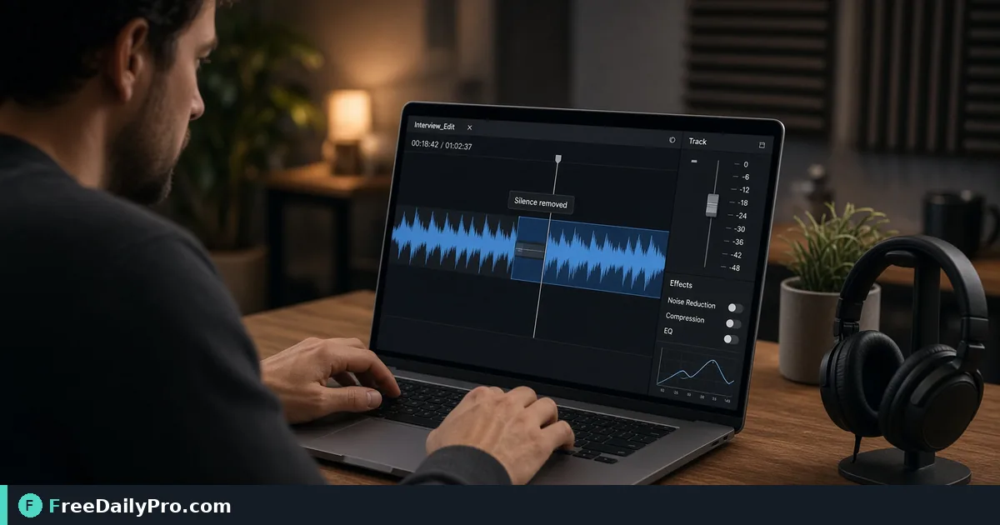

*A practical Silence Remover workflow for podcast prep*

[FreeDailyPro.com](https://www.freedailypro.com) -- When podcast prep packets bounce, the root is often a 28-minute file that feels like 18 minutes of talk. [Silence Remover](https://www.freedailypro.com/tool/silence-remover) is the step that turns that mess into a checked result for trim long silences from a 28-minute interview, built for content writers among FreeDailyPro's 200+ professional tools.

The clip below walks through Silence Remover on a realistic task that matches trim long silences from a 28-minute interview for case 8.

{{youtube z5CAZByzcc4 | How to Remove Silence from Audio Online –}}

## Why Silence Remover belongs in this podcast prep path

This article trains one job only for silence-remover (guide 8): trim long silences from a 28-minute interview. Readers are content writers. When silence-remover output looks wrong, first re-check whether the goal was "a tighter interview without awkward dead air" and whether inputs used anchors near 28 min source, silence threshold, tighter runtime. The failure mode to refuse on pass 8 is leaving 40 percent silence in the final cut.

Success on Silence Remover means a finished artifact you can defend in podcast prep: a tighter interview without awkward dead air. Practical anchors for this case sit around 28 min source, silence threshold, tighter runtime. If those anchors are missing for trim long silences from a 28-minute interview, stop before you burn a trial usage on half-ready data for silence-remover.

## What to stage before opening Silence Remover

Write a one-line done definition for silence-remover that matches "a tighter interview without awkward dead air" before guide step 8. Stage every input Silence Remover will consume for trim long silences from a 28-minute interview so the browser pass is intentional for content writers. Note any destination rules that can reject a silence-remover export in podcast prep after case 8.

Keep neighbor tools only for real blockers after Silence Remover on trim long silences from a 28-minute interview: [Extract Audio](https://www.freedailypro.com/tool/extract-audio), [Audio Trimmer](https://www.freedailypro.com/tool/audio-trimmer), [Audio Converter](https://www.freedailypro.com/tool/audio-converter). Browse the [audio tools](https://www.freedailypro.com/category/audio-tools) category when a related step is required after the silence-remover pass for a tighter interview without awkward dead air. Queue silence-remover runs so each of the 10 trial usages hits ready inputs for trim long silences from a 28-minute interview rather than placeholders.

## Steps on Silence Remover for case 8

1. Define the done line for this podcast prep run of silence-remover: a tighter interview without awkward dead air.
2. Collect inputs for the job on Silence Remover: trim long silences from a 28-minute interview.
3. Load Silence Remover at https://www.freedailypro.com/tool/silence-remover for content writers.
4. Type production values with anchors near 28 min source, silence threshold, tighter runtime for trim long silences from a 28-minute interview.
5. Apply once; confirm you did not hit leaving 40 percent silence in the final cut on the silence-remover output.
6. Download or copy with a name that includes `silence-remover` and today's date for case 8.
7. Inspect the way content writers will receive the podcast prep packet (second device if relevant).
8. Store settings so a teammate can repeat the silence-remover path for trim long silences from a 28-minute interview next week.

## Recheck cadence for podcast prep on silence-remover

After any process change in podcast prep, re-run one golden case through [Silence Remover](https://www.freedailypro.com/tool/silence-remover) for trim long silences from a 28-minute interview (label it golden-8-silence-remover). Golden cases for silence-remover beat memory when content writers rotate on this workflow. Teach a teammate by having them complete trim long silences from a 28-minute interview while you only watch for skipped verification of "a tighter interview without awkward dead air" on silence-remover.

Store the golden-8-silence-remover inputs next to the silence-remover export so next month's operator can prove a tighter interview without awkward dead air without guessing anchors near 28 min source, silence threshold, tighter runtime.

## Inputs that look fine but break silence-remover

- Values for Silence Remover copied from chat with hidden characters that shift 28 min source, silence threshold, tighter runtime on case 8.
- Files named generically (download, IMG_####) with no `silence-remover` or project tag for trim long silences from a 28-minute interview.
- Mixing demo placeholders with production rows in the same silence-remover session aimed at a tighter interview without awkward dead air.
- Assuming last week's portal cap still applies to today's silence-remover export for content writers.
- Using the wrong unit or as-of date so leaving 40 percent silence in the final cut becomes invisible until handoff in podcast prep.

Clean those before blaming Silence Remover. Most silence-remover rework in podcast prep for trim long silences from a 28-minute interview starts upstream of the FreeDailyPro page on guide 8.

## Communication template after a silence-remover run

Subject: Silence Remover result for [project] on [date] — case 8

Body: Goal was a tighter interview without awkward dead air. Inputs used anchors 28 min source, silence threshold, tighter runtime. Known risk avoided: leaving 40 percent silence in the final cut. File name includes `silence-remover`. Please confirm within one business day if content writers standards need a second pass on trim long silences from a 28-minute interview.

Short messages prevent reread loops when podcast prep packets from Silence Remover move between people on case 8.

## Worked numbers for this silence-remover case

The primary job for guide 8 is trim long silences from a 28-minute interview. Anchors near 28 min source, silence threshold, tighter runtime shape the first pass on Silence Remover. After one careful Silence Remover run aimed at a tighter interview without awkward dead air, the output should be close enough to ship if leaving 40 percent silence in the final cut was blocked for content writers. Document the silence-remover settings so coverage works when someone who owns podcast prep is out next week.

On a weak silence-remover pass that still shows signs of leaving 40 percent silence in the final cut, change a single factor tied to 28 min source, silence threshold, tighter runtime and re-run so you know what fixed it for trim long silences from a 28-minute interview. That method keeps Silence Remover from feeling like guesswork for content writers on case 8.

## Edge cases in podcast prep for Silence Remover

- Destinations may re-encode silence-remover exports for trim long silences from a 28-minute interview—download the stored copy when a portal allows and re-check a tighter interview without awkward dead air on case 8.
- Two Silence Remover outputs named download (1) is how wrong packets ship; rename with `silence-remover` immediately for content writers.
- Odd inputs confuse operators more than the Silence Remover UI; inspect anchors (28 min source, silence threshold, tighter runtime) before blaming the tool on trim long silences from a 28-minute interview.
- Locale, units, or formatting can shift meaning after silence-remover even when the UI reported success toward a tighter interview without awkward dead air in podcast prep.
- Policy for content writers still applies after a technical success on silence-remover for case 8 in podcast prep.

## Mistakes that waste a day on Silence Remover

- Skipping the success line (a tighter interview without awkward dead air) and only eyeballing the silence-remover result for trim long silences from a 28-minute interview on case 8.
- Leaving sample data in a Silence Remover run that later gets sent as real to content writers in podcast prep.
- Chaining five tools when Silence Remover alone would finish: trim long silences from a 28-minute interview.
- Overwriting the only master input while exporting from silence-remover during trim long silences from a 28-minute interview.
- Ignoring size, format, or length caps until the final Silence Remover click fails against a tighter interview without awkward dead air.
- Ignoring the known failure mode for this silence-remover path: leaving 40 percent silence in the final cut.

## Limits of Silence Remover

Silence Remover performs the job described on its tool page for podcast prep, especially trim long silences from a 28-minute interview in guide 8. The live page does what the controls show—nothing mystical beyond that for a tighter interview without awkward dead air. FreeDailyPro places silence-remover among 200+ professional tools beside related utilities in audio tools when content writers need a follow-on step after leaving 40 percent silence in the final cut is blocked.

## FAQ for Silence Remover (case 8)

**What is the primary job this guide covers for silence-remover?** trim long silences from a 28-minute interview.
**What does success look like for content writers?** a tighter interview without awkward dead air.
**What failure mode should I refuse on Silence Remover?** leaving 40 percent silence in the final cut.
**Which anchors should I write down first for trim long silences from a 28-minute interview?** 28 min source, silence threshold, tighter runtime.
**Who is the audience for the silence-remover export?** content writers working in podcast prep.
**What if the live page looks different for Silence Remover?** Follow the live FreeDailyPro controls; this article is a workflow for trim long silences from a 28-minute interview, not a frozen screenshot of case 8.
**Can I skip verification for a simple silence-remover run?** No—podcast prep packets fail when leaving 40 percent silence in the final cut slips through on trim long silences from a 28-minute interview.
**When should I open a second tool after Silence Remover?** Only after Silence Remover fails a real check for trim long silences from a 28-minute interview, then consider [Extract Audio](https://www.freedailypro.com/tool/extract-audio), [Audio Trimmer](https://www.freedailypro.com/tool/audio-trimmer), [Audio Converter](https://www.freedailypro.com/tool/audio-converter).

## Handoff and naming for silence-remover

Name Silence Remover outputs like `client-or-project-silence-remover-YYYY-MM-DD.ext` (adapt extension) for trim long silences from a 28-minute interview. Put goal (a tighter interview without awkward dead air), operator, and settings in the ticket that links the silence-remover file so content writers can audit anchors near 28 min source, silence threshold, tighter runtime for case 8. That legend prevents replay confusion next month when someone reopens the podcast prep packet about leaving 40 percent silence in the final cut.

Open the silence-remover export once on a second device or clean profile before you declare a tighter interview without awkward dead air done for trim long silences from a 28-minute interview. Next week a teammate should re-run the same Silence Remover path for trim long silences from a 28-minute interview without a chat archaeology session on case 8.

## Quality bar for Silence Remover

A success line for silence-remover must be observable: a tighter interview without awkward dead air on the concrete job trim long silences from a 28-minute interview (guide 8). Poetic goals do not survive audit in podcast prep for content writers. Store success and failure lines on a card named for Silence Remover—include leaving 40 percent silence in the final cut as the explicit refuse list and anchors 28 min source, silence threshold, tighter runtime.

With 200+ professional tools on FreeDailyPro, finish the podcast prep packet for trim long silences from a 28-minute interview before exploring neighbors after Silence Remover. Resist tool tourism; open a second utility only after the primary silence-remover export fails a real check against a tighter interview without awkward dead air on case 8.

## Mini case in podcast prep using Silence Remover

Scenario 8: trim long silences from a 28-minute interview. Operator opens Silence Remover, uses anchors near 28 min source, silence threshold, tighter runtime, and writes "a tighter interview without awkward dead air" on a sticky note before the first click. They refuse leaving 40 percent silence in the final cut, export with `silence-remover` in the filename, and send the short handoff template to content writers. Result: one closed loop for podcast prep instead of three re-exports around trim long silences from a 28-minute interview.

## When to stop and when to continue with Silence Remover

Stop when the live tool page cannot perform a required specialist step for trim long silences from a 28-minute interview—do not invent features for silence-remover in podcast prep on case 8. Continue when inputs are clean, anchors (28 min source, silence threshold, tighter runtime) are written, and "a tighter interview without awkward dead air" is still the target for content writers. Extra tools are for blockers in podcast prep, not entertainment; keep the Silence Remover path short for trim long silences from a 28-minute interview.

## Pairing without scope creep after Silence Remover

Do not chain five utilities for curiosity after Silence Remover finishes trim long silences from a 28-minute interview—chain two only when a portal rejects the first export aimed at a tighter interview without awkward dead air. Neighbors such as [Extract Audio](https://www.freedailypro.com/tool/extract-audio), [Audio Trimmer](https://www.freedailypro.com/tool/audio-trimmer), [Audio Converter](https://www.freedailypro.com/tool/audio-converter) exist to unblock podcast prep, not to decorate the ticket for content writers. A tool-specific card for silence-remover that lists leaving 40 percent silence in the final cut and 28 min source, silence threshold, tighter runtime beats a generic ops checklist every time on case 8.

## Field notes specific to silence-remover

Camera-roll or generic download filenames hide intent; rename before the serious Silence Remover pass for trim long silences from a 28-minute interview on case 8. Trust only the controls on the live silence-remover page for podcast prep; do not invent hidden modes that "should" exist for a tighter interview without awkward dead air. Generic SOPs miss sharp edges like leaving 40 percent silence in the final cut; keep a one-page card for Silence Remover alone with anchors 28 min source, silence threshold, tighter runtime and the job line trim long silences from a 28-minute interview.

Policy for content writers still applies after technical success on silence-remover for trim long silences from a 28-minute interview. Locale and unit mistakes around 28 min source, silence threshold, tighter runtime remain the top silent errors for Silence Remover when the work is trim long silences from a 28-minute interview in podcast prep on case 8.

## Closing next step for Silence Remover

Run one real case through Silence Remover with production inputs for trim long silences from a 28-minute interview, not placeholders for case 8. Finish against the written success line (a tighter interview without awkward dead air)—not a hopeful glance at a filename from silence-remover. Open [Silence Remover](https://www.freedailypro.com/tool/silence-remover) when you are ready to execute trim long silences from a 28-minute interview for content writers in podcast prep.

Which part of the Silence Remover workflow for trim long silences from a 28-minute interview still feels unclear for your team? We read silence-remover feedback on the [contact page](https://www.freedailypro.com/contact).
