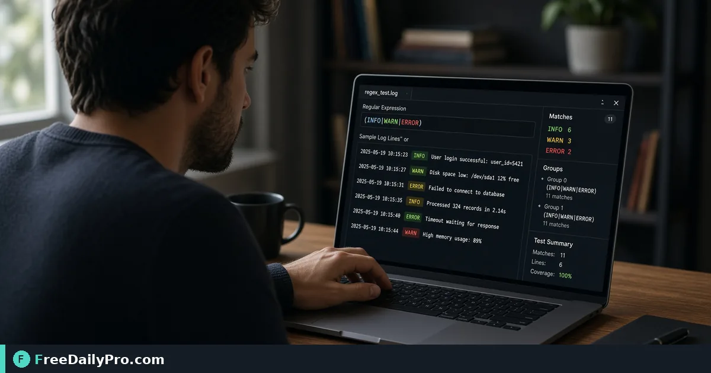

*A practical Regex Tester workflow for pattern QA*

[FreeDailyPro.com](https://www.freedailypro.com) -- The usual pattern QA bottleneck is not talent—it is production regex that nukes good rows. [Regex Tester](https://www.freedailypro.com/tool/regex-tester) is the step that turns that mess into a checked result for validate a regex for email-ish tokens in a log cleaner, built for developers among FreeDailyPro's 200+ professional tools.

The clip below walks through Regex Tester on a realistic task that matches validate a regex for email-ish tokens in a log cleaner for case 37.

{{youtube MbNCq9Bat5A | How to Test Regex Online – Live Match}}

## Why Regex Tester belongs in this pattern QA path

This article trains one job only for regex-tester (guide 37): validate a regex for email-ish tokens in a log cleaner. Readers are developers. When regex-tester output looks wrong, first re-check whether the goal was "a pattern that matches the sample lines you care about" and whether inputs used anchors near sample lines, pattern, match list. The failure mode to refuse on pass 37 is deploying an untested regex that deletes too much.

Success on Regex Tester means a finished artifact you can defend in pattern QA: a pattern that matches the sample lines you care about. Practical anchors for this case sit around sample lines, pattern, match list. If those anchors are missing for validate a regex for email-ish tokens in a log cleaner, stop before you burn a trial usage on half-ready data for regex-tester.

## What to stage before opening Regex Tester

Write a one-line done definition for regex-tester that matches "a pattern that matches the sample lines you care about" before guide step 37. Stage every input Regex Tester will consume for validate a regex for email-ish tokens in a log cleaner so the browser pass is intentional for developers. Note any destination rules that can reject a regex-tester export in pattern QA after case 37.

Keep neighbor tools only for real blockers after Regex Tester on validate a regex for email-ish tokens in a log cleaner: [Password Strength](https://www.freedailypro.com/tool/password-strength), [Base64](https://www.freedailypro.com/tool/base64), [URL Encoder](https://www.freedailypro.com/tool/url-encoder). Browse the [security tools](https://www.freedailypro.com/category/security-tools) category when a related step is required after the regex-tester pass for a pattern that matches the sample lines you care about. Queue regex-tester runs so each of the 10 trial usages hits ready inputs for validate a regex for email-ish tokens in a log cleaner rather than placeholders.

## Steps on Regex Tester for case 37

1. Write the done line for this pattern QA run of regex-tester: a pattern that matches the sample lines you care about.
2. Gather inputs for the job on Regex Tester: validate a regex for email-ish tokens in a log cleaner.
3. Launch Regex Tester at https://www.freedailypro.com/tool/regex-tester for developers.
4. Fill production values with anchors near sample lines, pattern, match list for validate a regex for email-ish tokens in a log cleaner.
5. Execute once; confirm you did not hit deploying an untested regex that deletes too much on the regex-tester output.
6. Save or copy with a name that includes `regex-tester` and today's date for case 37.
7. Verify the way developers will receive the pattern QA packet (second device if relevant).
8. Log settings so a teammate can repeat the regex-tester path for validate a regex for email-ish tokens in a log cleaner next week.

## Recheck cadence for pattern QA on regex-tester

After any process change in pattern QA, re-run one golden case through [Regex Tester](https://www.freedailypro.com/tool/regex-tester) for validate a regex for email-ish tokens in a log cleaner (label it golden-37-regex-tester). Golden cases for regex-tester beat memory when developers rotate on this workflow. Teach a teammate by having them complete validate a regex for email-ish tokens in a log cleaner while you only watch for skipped verification of "a pattern that matches the sample lines you care about" on regex-tester.

Store the golden-37-regex-tester inputs next to the regex-tester export so next month's operator can prove a pattern that matches the sample lines you care about without guessing anchors near sample lines, pattern, match list.

## Inputs that look fine but break regex-tester

- Values for Regex Tester copied from chat with hidden characters that shift sample lines, pattern, match list on case 37.
- Files named generically (download, IMG_####) with no `regex-tester` or project tag for validate a regex for email-ish tokens in a log cleaner.
- Mixing demo placeholders with production rows in the same regex-tester session aimed at a pattern that matches the sample lines you care about.
- Assuming last week's portal cap still applies to today's regex-tester export for developers.
- Using the wrong unit or as-of date so deploying an untested regex that deletes too much becomes invisible until handoff in pattern QA.

Clean those before blaming Regex Tester. Most regex-tester rework in pattern QA for validate a regex for email-ish tokens in a log cleaner starts upstream of the FreeDailyPro page on guide 37.

## Communication template after a regex-tester run

Subject: Regex Tester result for [project] on [date] — case 37

Body: Goal was a pattern that matches the sample lines you care about. Inputs used anchors sample lines, pattern, match list. Known risk avoided: deploying an untested regex that deletes too much. File name includes `regex-tester`. Please confirm within one business day if developers standards need a second pass on validate a regex for email-ish tokens in a log cleaner.

Short messages prevent reread loops when pattern QA packets from Regex Tester move between people on case 37.

## Worked numbers for this regex-tester case

The primary job for guide 37 is validate a regex for email-ish tokens in a log cleaner. Anchors near sample lines, pattern, match list shape the first pass on Regex Tester. After one careful Regex Tester run aimed at a pattern that matches the sample lines you care about, the output should be close enough to ship if deploying an untested regex that deletes too much was blocked for developers. Document the regex-tester settings so coverage works when someone who owns pattern QA is out next week.

On a weak regex-tester pass that still shows signs of deploying an untested regex that deletes too much, change a single factor tied to sample lines, pattern, match list and re-run so you know what fixed it for validate a regex for email-ish tokens in a log cleaner. That method keeps Regex Tester from feeling like guesswork for developers on case 37.

## Edge cases in pattern QA for Regex Tester

- Destinations may re-encode regex-tester exports for validate a regex for email-ish tokens in a log cleaner—download the stored copy when a portal allows and re-check a pattern that matches the sample lines you care about on case 37.
- Two Regex Tester outputs named download (1) is how wrong packets ship; rename with `regex-tester` immediately for developers.
- Odd inputs confuse operators more than the Regex Tester UI; inspect anchors (sample lines, pattern, match list) before blaming the tool on validate a regex for email-ish tokens in a log cleaner.
- Locale, units, or formatting can shift meaning after regex-tester even when the UI reported success toward a pattern that matches the sample lines you care about in pattern QA.
- Policy for developers still applies after a technical success on regex-tester for case 37 in pattern QA.

## Mistakes that waste a day on Regex Tester

- Skipping the success line (a pattern that matches the sample lines you care about) and only eyeballing the regex-tester result for validate a regex for email-ish tokens in a log cleaner on case 37.
- Leaving sample data in a Regex Tester run that later gets sent as real to developers in pattern QA.
- Chaining five tools when Regex Tester alone would finish: validate a regex for email-ish tokens in a log cleaner.
- Overwriting the only master input while exporting from regex-tester during validate a regex for email-ish tokens in a log cleaner.
- Ignoring size, format, or length caps until the final Regex Tester click fails against a pattern that matches the sample lines you care about.
- Ignoring the known failure mode for this regex-tester path: deploying an untested regex that deletes too much.

## Limits of Regex Tester

Regex Tester performs the job described on its tool page for pattern QA, especially validate a regex for email-ish tokens in a log cleaner in guide 37. The live page does what the controls show—nothing mystical beyond that for a pattern that matches the sample lines you care about. FreeDailyPro places regex-tester among 200+ professional tools beside related utilities in security tools when developers need a follow-on step after deploying an untested regex that deletes too much is blocked.

## FAQ for Regex Tester (case 37)

**What is the primary job this guide covers for regex-tester?** validate a regex for email-ish tokens in a log cleaner.
**What does success look like for developers?** a pattern that matches the sample lines you care about.
**What failure mode should I refuse on Regex Tester?** deploying an untested regex that deletes too much.
**Which anchors should I write down first for validate a regex for email-ish tokens in a log cleaner?** sample lines, pattern, match list.
**Who is the audience for the regex-tester export?** developers working in pattern QA.
**What if the live page looks different for Regex Tester?** Follow the live FreeDailyPro controls; this article is a workflow for validate a regex for email-ish tokens in a log cleaner, not a frozen screenshot of case 37.
**Can I skip verification for a simple regex-tester run?** No—pattern QA packets fail when deploying an untested regex that deletes too much slips through on validate a regex for email-ish tokens in a log cleaner.
**When should I open a second tool after Regex Tester?** Only after Regex Tester fails a real check for validate a regex for email-ish tokens in a log cleaner, then consider [Password Strength](https://www.freedailypro.com/tool/password-strength), [Base64](https://www.freedailypro.com/tool/base64), [URL Encoder](https://www.freedailypro.com/tool/url-encoder).

## Handoff and naming for regex-tester

Name Regex Tester outputs like `client-or-project-regex-tester-YYYY-MM-DD.ext` (adapt extension) for validate a regex for email-ish tokens in a log cleaner. Put goal (a pattern that matches the sample lines you care about), operator, and settings in the ticket that links the regex-tester file so developers can audit anchors near sample lines, pattern, match list for case 37. That legend prevents replay confusion next month when someone reopens the pattern QA packet about deploying an untested regex that deletes too much.

Open the regex-tester export once on a second device or clean profile before you declare a pattern that matches the sample lines you care about done for validate a regex for email-ish tokens in a log cleaner. Next week a teammate should re-run the same Regex Tester path for validate a regex for email-ish tokens in a log cleaner without a chat archaeology session on case 37.

## Quality bar for Regex Tester

A success line for regex-tester must be observable: a pattern that matches the sample lines you care about on the concrete job validate a regex for email-ish tokens in a log cleaner (guide 37). Poetic goals do not survive audit in pattern QA for developers. Store success and failure lines on a card named for Regex Tester—include deploying an untested regex that deletes too much as the explicit refuse list and anchors sample lines, pattern, match list.

With 200+ professional tools on FreeDailyPro, finish the pattern QA packet for validate a regex for email-ish tokens in a log cleaner before exploring neighbors after Regex Tester. Resist tool tourism; open a second utility only after the primary regex-tester export fails a real check against a pattern that matches the sample lines you care about on case 37.

## Mini case in pattern QA using Regex Tester

Scenario 37: validate a regex for email-ish tokens in a log cleaner. Operator opens Regex Tester, uses anchors near sample lines, pattern, match list, and writes "a pattern that matches the sample lines you care about" on a sticky note before the first click. They refuse deploying an untested regex that deletes too much, export with `regex-tester` in the filename, and send the short handoff template to developers. Result: one closed loop for pattern QA instead of three re-exports around validate a regex for email-ish tokens in a log cleaner.

## When to stop and when to continue with Regex Tester

Stop when the live tool page cannot perform a required specialist step for validate a regex for email-ish tokens in a log cleaner—do not invent features for regex-tester in pattern QA on case 37. Continue when inputs are clean, anchors (sample lines, pattern, match list) are written, and "a pattern that matches the sample lines you care about" is still the target for developers. Extra tools are for blockers in pattern QA, not entertainment; keep the Regex Tester path short for validate a regex for email-ish tokens in a log cleaner.

## Pairing without scope creep after Regex Tester

Do not chain five utilities for curiosity after Regex Tester finishes validate a regex for email-ish tokens in a log cleaner—chain two only when a portal rejects the first export aimed at a pattern that matches the sample lines you care about. Neighbors such as [Password Strength](https://www.freedailypro.com/tool/password-strength), [Base64](https://www.freedailypro.com/tool/base64), [URL Encoder](https://www.freedailypro.com/tool/url-encoder) exist to unblock pattern QA, not to decorate the ticket for developers. A tool-specific card for regex-tester that lists deploying an untested regex that deletes too much and sample lines, pattern, match list beats a generic ops checklist every time on case 37.

## Field notes specific to regex-tester

Camera-roll or generic download filenames hide intent; rename before the serious Regex Tester pass for validate a regex for email-ish tokens in a log cleaner on case 37. Trust only the controls on the live regex-tester page for pattern QA; do not invent hidden modes that "should" exist for a pattern that matches the sample lines you care about. Generic SOPs miss sharp edges like deploying an untested regex that deletes too much; keep a one-page card for Regex Tester alone with anchors sample lines, pattern, match list and the job line validate a regex for email-ish tokens in a log cleaner.

Policy for developers still applies after technical success on regex-tester for validate a regex for email-ish tokens in a log cleaner. Locale and unit mistakes around sample lines, pattern, match list remain the top silent errors for Regex Tester when the work is validate a regex for email-ish tokens in a log cleaner in pattern QA on case 37.

## Closing next step for Regex Tester

Run one real case through Regex Tester with production inputs for validate a regex for email-ish tokens in a log cleaner, not placeholders for case 37. Finish against the written success line (a pattern that matches the sample lines you care about)—not a hopeful glance at a filename from regex-tester. Open [Regex Tester](https://www.freedailypro.com/tool/regex-tester) when you are ready to execute validate a regex for email-ish tokens in a log cleaner for developers in pattern QA.

Which part of the Regex Tester workflow for validate a regex for email-ish tokens in a log cleaner still feels unclear for your team? We read regex-tester feedback on the [contact page](https://www.freedailypro.com/contact).
