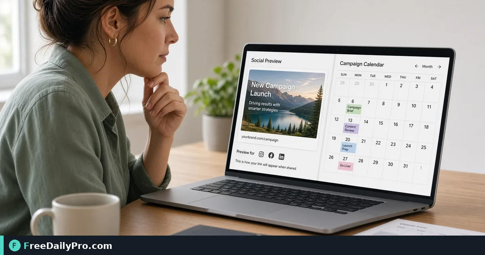

*A practical OG Preview workflow for social share QA*

[FreeDailyPro.com](https://www.freedailypro.com) -- A quiet failure in social share QA often starts with broken previews on campaign day. [OG Preview](https://www.freedailypro.com/tool/og-preview) is the step that turns that mess into a checked result for check Open Graph fields before a campaign share, built for marketing among FreeDailyPro's 200+ professional tools.

The clip below walks through OG Preview on a realistic task that matches check Open Graph fields before a campaign share for case 44.

{{youtube mC6zWTTMtv4 | How to Preview Open Graph & Twitter Cards}}

## Why OG Preview belongs in this social share QA path

This article trains one job only for og-preview (guide 44): check Open Graph fields before a campaign share. Readers are marketing. When og-preview output looks wrong, first re-check whether the goal was "title image and description that look right in preview" and whether inputs used anchors near title, image, description. The failure mode to refuse on pass 44 is shipping a share link with a missing OG image.

Success on OG Preview means a finished artifact you can defend in social share QA: title image and description that look right in preview. Practical anchors for this case sit around title, image, description. If those anchors are missing for check Open Graph fields before a campaign share, stop before you burn a trial usage on half-ready data for og-preview.

## What to stage before opening OG Preview

Write a one-line done definition for og-preview that matches "title image and description that look right in preview" before guide step 44. Stage every input OG Preview will consume for check Open Graph fields before a campaign share so the browser pass is intentional for marketing. Note any destination rules that can reject a og-preview export in social share QA after case 44.

Keep neighbor tools only for real blockers after OG Preview on check Open Graph fields before a campaign share: [Meta Tag Gen](https://www.freedailypro.com/tool/meta-tag-gen), [Keyword Density](https://www.freedailypro.com/tool/keyword-density), [Hashtag Generator](https://www.freedailypro.com/tool/hashtag-generator). Browse the [seo tools](https://www.freedailypro.com/category/seo-tools) category when a related step is required after the og-preview pass for title image and description that look right in preview. Queue og-preview runs so each of the 10 trial usages hits ready inputs for check Open Graph fields before a campaign share rather than placeholders.

## Steps on OG Preview for case 44

1. Clarify the done line for this social share QA run of og-preview: title image and description that look right in preview.
2. Prepare inputs for the job on OG Preview: check Open Graph fields before a campaign share.
3. Visit OG Preview at https://www.freedailypro.com/tool/og-preview for marketing.
4. Supply production values with anchors near title, image, description for check Open Graph fields before a campaign share.
5. Complete once; confirm you did not hit shipping a share link with a missing OG image on the og-preview output.
6. Name or copy with a name that includes `og-preview` and today's date for case 44.
7. Review the way marketing will receive the social share QA packet (second device if relevant).
8. File settings so a teammate can repeat the og-preview path for check Open Graph fields before a campaign share next week.

## Recheck cadence for social share QA on og-preview

After any process change in social share QA, re-run one golden case through [OG Preview](https://www.freedailypro.com/tool/og-preview) for check Open Graph fields before a campaign share (label it golden-44-og-preview). Golden cases for og-preview beat memory when marketing rotate on this workflow. Teach a teammate by having them complete check Open Graph fields before a campaign share while you only watch for skipped verification of "title image and description that look right in preview" on og-preview.

Store the golden-44-og-preview inputs next to the og-preview export so next month's operator can prove title image and description that look right in preview without guessing anchors near title, image, description.

## Inputs that look fine but break og-preview

- Values for OG Preview copied from chat with hidden characters that shift title, image, description on case 44.
- Files named generically (download, IMG_####) with no `og-preview` or project tag for check Open Graph fields before a campaign share.
- Mixing demo placeholders with production rows in the same og-preview session aimed at title image and description that look right in preview.
- Assuming last week's portal cap still applies to today's og-preview export for marketing.
- Using the wrong unit or as-of date so shipping a share link with a missing OG image becomes invisible until handoff in social share QA.

Clean those before blaming OG Preview. Most og-preview rework in social share QA for check Open Graph fields before a campaign share starts upstream of the FreeDailyPro page on guide 44.

## Communication template after a og-preview run

Subject: OG Preview result for [project] on [date] — case 44

Body: Goal was title image and description that look right in preview. Inputs used anchors title, image, description. Known risk avoided: shipping a share link with a missing OG image. File name includes `og-preview`. Please confirm within one business day if marketing standards need a second pass on check Open Graph fields before a campaign share.

Short messages prevent reread loops when social share QA packets from OG Preview move between people on case 44.

## Worked numbers for this og-preview case

The primary job for guide 44 is check Open Graph fields before a campaign share. Anchors near title, image, description shape the first pass on OG Preview. After one careful OG Preview run aimed at title image and description that look right in preview, the output should be close enough to ship if shipping a share link with a missing OG image was blocked for marketing. Document the og-preview settings so coverage works when someone who owns social share QA is out next week.

On a weak og-preview pass that still shows signs of shipping a share link with a missing OG image, change a single factor tied to title, image, description and re-run so you know what fixed it for check Open Graph fields before a campaign share. That method keeps OG Preview from feeling like guesswork for marketing on case 44.

## Edge cases in social share QA for OG Preview

- Destinations may re-encode og-preview exports for check Open Graph fields before a campaign share—download the stored copy when a portal allows and re-check title image and description that look right in preview on case 44.
- Two OG Preview outputs named download (1) is how wrong packets ship; rename with `og-preview` immediately for marketing.
- Odd inputs confuse operators more than the OG Preview UI; inspect anchors (title, image, description) before blaming the tool on check Open Graph fields before a campaign share.
- Locale, units, or formatting can shift meaning after og-preview even when the UI reported success toward title image and description that look right in preview in social share QA.
- Policy for marketing still applies after a technical success on og-preview for case 44 in social share QA.

## Mistakes that waste a day on OG Preview

- Skipping the success line (title image and description that look right in preview) and only eyeballing the og-preview result for check Open Graph fields before a campaign share on case 44.
- Leaving sample data in a OG Preview run that later gets sent as real to marketing in social share QA.
- Chaining five tools when OG Preview alone would finish: check Open Graph fields before a campaign share.
- Overwriting the only master input while exporting from og-preview during check Open Graph fields before a campaign share.
- Ignoring size, format, or length caps until the final OG Preview click fails against title image and description that look right in preview.
- Ignoring the known failure mode for this og-preview path: shipping a share link with a missing OG image.

## Limits of OG Preview

OG Preview performs the job described on its tool page for social share QA, especially check Open Graph fields before a campaign share in guide 44. The live page does what the controls show—nothing mystical beyond that for title image and description that look right in preview. FreeDailyPro places og-preview among 200+ professional tools beside related utilities in seo tools when marketing need a follow-on step after shipping a share link with a missing OG image is blocked.

## FAQ for OG Preview (case 44)

**What is the primary job this guide covers for og-preview?** check Open Graph fields before a campaign share.
**What does success look like for marketing?** title image and description that look right in preview.
**What failure mode should I refuse on OG Preview?** shipping a share link with a missing OG image.
**Which anchors should I write down first for check Open Graph fields before a campaign share?** title, image, description.
**Who is the audience for the og-preview export?** marketing working in social share QA.
**What if the live page looks different for OG Preview?** Follow the live FreeDailyPro controls; this article is a workflow for check Open Graph fields before a campaign share, not a frozen screenshot of case 44.
**Can I skip verification for a simple og-preview run?** No—social share QA packets fail when shipping a share link with a missing OG image slips through on check Open Graph fields before a campaign share.
**When should I open a second tool after OG Preview?** Only after OG Preview fails a real check for check Open Graph fields before a campaign share, then consider [Meta Tag Gen](https://www.freedailypro.com/tool/meta-tag-gen), [Keyword Density](https://www.freedailypro.com/tool/keyword-density), [Hashtag Generator](https://www.freedailypro.com/tool/hashtag-generator).

## Handoff and naming for og-preview

Name OG Preview outputs like `client-or-project-og-preview-YYYY-MM-DD.ext` (adapt extension) for check Open Graph fields before a campaign share. Put goal (title image and description that look right in preview), operator, and settings in the ticket that links the og-preview file so marketing can audit anchors near title, image, description for case 44. That legend prevents replay confusion next month when someone reopens the social share QA packet about shipping a share link with a missing OG image.

Open the og-preview export once on a second device or clean profile before you declare title image and description that look right in preview done for check Open Graph fields before a campaign share. Next week a teammate should re-run the same OG Preview path for check Open Graph fields before a campaign share without a chat archaeology session on case 44.

## Quality bar for OG Preview

A success line for og-preview must be observable: title image and description that look right in preview on the concrete job check Open Graph fields before a campaign share (guide 44). Poetic goals do not survive audit in social share QA for marketing. Store success and failure lines on a card named for OG Preview—include shipping a share link with a missing OG image as the explicit refuse list and anchors title, image, description.

With 200+ professional tools on FreeDailyPro, finish the social share QA packet for check Open Graph fields before a campaign share before exploring neighbors after OG Preview. Resist tool tourism; open a second utility only after the primary og-preview export fails a real check against title image and description that look right in preview on case 44.

## Mini case in social share QA using OG Preview

Scenario 44: check Open Graph fields before a campaign share. Operator opens OG Preview, uses anchors near title, image, description, and writes "title image and description that look right in preview" on a sticky note before the first click. They refuse shipping a share link with a missing OG image, export with `og-preview` in the filename, and send the short handoff template to marketing. Result: one closed loop for social share QA instead of three re-exports around check Open Graph fields before a campaign share.

## When to stop and when to continue with OG Preview

Stop when the live tool page cannot perform a required specialist step for check Open Graph fields before a campaign share—do not invent features for og-preview in social share QA on case 44. Continue when inputs are clean, anchors (title, image, description) are written, and "title image and description that look right in preview" is still the target for marketing. Extra tools are for blockers in social share QA, not entertainment; keep the OG Preview path short for check Open Graph fields before a campaign share.

## Pairing without scope creep after OG Preview

Do not chain five utilities for curiosity after OG Preview finishes check Open Graph fields before a campaign share—chain two only when a portal rejects the first export aimed at title image and description that look right in preview. Neighbors such as [Meta Tag Gen](https://www.freedailypro.com/tool/meta-tag-gen), [Keyword Density](https://www.freedailypro.com/tool/keyword-density), [Hashtag Generator](https://www.freedailypro.com/tool/hashtag-generator) exist to unblock social share QA, not to decorate the ticket for marketing. A tool-specific card for og-preview that lists shipping a share link with a missing OG image and title, image, description beats a generic ops checklist every time on case 44.

## Field notes specific to og-preview

Camera-roll or generic download filenames hide intent; rename before the serious OG Preview pass for check Open Graph fields before a campaign share on case 44. Trust only the controls on the live og-preview page for social share QA; do not invent hidden modes that "should" exist for title image and description that look right in preview. Generic SOPs miss sharp edges like shipping a share link with a missing OG image; keep a one-page card for OG Preview alone with anchors title, image, description and the job line check Open Graph fields before a campaign share.

Policy for marketing still applies after technical success on og-preview for check Open Graph fields before a campaign share. Locale and unit mistakes around title, image, description remain the top silent errors for OG Preview when the work is check Open Graph fields before a campaign share in social share QA on case 44.

## Closing next step for OG Preview

Run one real case through OG Preview with production inputs for check Open Graph fields before a campaign share, not placeholders for case 44. Finish against the written success line (title image and description that look right in preview)—not a hopeful glance at a filename from og-preview. Open [OG Preview](https://www.freedailypro.com/tool/og-preview) when you are ready to execute check Open Graph fields before a campaign share for marketing in social share QA.

Which part of the OG Preview workflow for check Open Graph fields before a campaign share still feels unclear for your team? We read og-preview feedback on the [contact page](https://www.freedailypro.com/contact).
