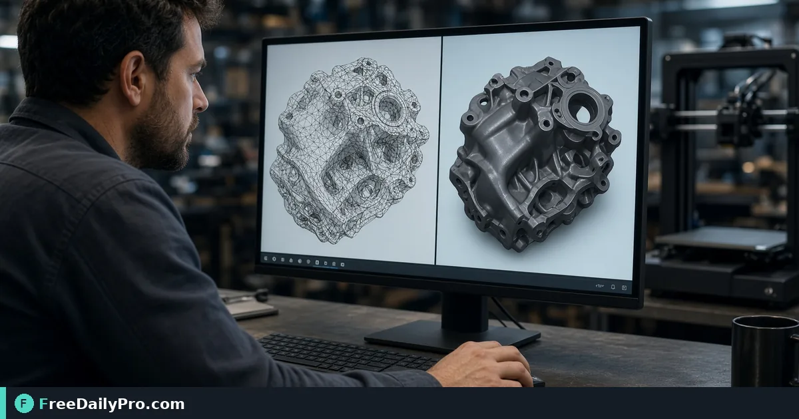

*A practical Mesh 3d Viewer workflow for 3D prep*

[FreeDailyPro.com](https://www.freedailypro.com) -- When 3D prep packets bounce, the root is often failed prints from unchecked meshes. [Mesh 3d Viewer](https://www.freedailypro.com/tool/mesh-3d-viewer) is the step that turns that mess into a checked result for inspect an STL mesh for holes before print, built for developers among FreeDailyPro's 200+ professional tools.

The clip below walks through Mesh 3d Viewer on a realistic task that matches inspect an STL mesh for holes before print for case 48.

{{youtube ajU8DQk_IcQ | How to View & Inspect 3D Mesh Files}}

## Why Mesh 3d Viewer belongs in this 3D prep path

This article trains one job only for mesh-3d-viewer (guide 48): inspect an STL mesh for holes before print. Readers are developers. When mesh-3d-viewer output looks wrong, first re-check whether the goal was "a visual pass that flags obvious mesh issues" and whether inputs used anchors near STL, inspect, holes. The failure mode to refuse on pass 48 is sending a mesh to print without a look.

Success on Mesh 3d Viewer means a finished artifact you can defend in 3D prep: a visual pass that flags obvious mesh issues. Practical anchors for this case sit around STL, inspect, holes. If those anchors are missing for inspect an STL mesh for holes before print, stop before you burn a trial usage on half-ready data for mesh-3d-viewer.

## What to stage before opening Mesh 3d Viewer

Write a one-line done definition for mesh-3d-viewer that matches "a visual pass that flags obvious mesh issues" before guide step 48. Stage every input Mesh 3d Viewer will consume for inspect an STL mesh for holes before print so the browser pass is intentional for developers. Note any destination rules that can reject a mesh-3d-viewer export in 3D prep after case 48.

Keep neighbor tools only for real blockers after Mesh 3d Viewer on inspect an STL mesh for holes before print: [STL Ascii Binary Converter](https://www.freedailypro.com/tool/stl-ascii-binary-converter). Browse the [3d tools](https://www.freedailypro.com/category/3d-tools) category when a related step is required after the mesh-3d-viewer pass for a visual pass that flags obvious mesh issues. Queue mesh-3d-viewer runs so each of the 10 trial usages hits ready inputs for inspect an STL mesh for holes before print rather than placeholders.

## Steps on Mesh 3d Viewer for case 48

1. Define the done line for this 3D prep run of mesh-3d-viewer: a visual pass that flags obvious mesh issues.
2. Collect inputs for the job on Mesh 3d Viewer: inspect an STL mesh for holes before print.
3. Load Mesh 3d Viewer at https://www.freedailypro.com/tool/mesh-3d-viewer for developers.
4. Type production values with anchors near STL, inspect, holes for inspect an STL mesh for holes before print.
5. Apply once; confirm you did not hit sending a mesh to print without a look on the mesh-3d-viewer output.
6. Download or copy with a name that includes `mesh-3d-viewer` and today's date for case 48.
7. Inspect the way developers will receive the 3D prep packet (second device if relevant).
8. Store settings so a teammate can repeat the mesh-3d-viewer path for inspect an STL mesh for holes before print next week.

## Recheck cadence for 3D prep on mesh-3d-viewer

After any process change in 3D prep, re-run one golden case through [Mesh 3d Viewer](https://www.freedailypro.com/tool/mesh-3d-viewer) for inspect an STL mesh for holes before print (label it golden-48-mesh-3d-viewer). Golden cases for mesh-3d-viewer beat memory when developers rotate on this workflow. Teach a teammate by having them complete inspect an STL mesh for holes before print while you only watch for skipped verification of "a visual pass that flags obvious mesh issues" on mesh-3d-viewer.

Store the golden-48-mesh-3d-viewer inputs next to the mesh-3d-viewer export so next month's operator can prove a visual pass that flags obvious mesh issues without guessing anchors near STL, inspect, holes.

## Inputs that look fine but break mesh-3d-viewer

- Values for Mesh 3d Viewer copied from chat with hidden characters that shift STL, inspect, holes on case 48.
- Files named generically (download, IMG_####) with no `mesh-3d-viewer` or project tag for inspect an STL mesh for holes before print.
- Mixing demo placeholders with production rows in the same mesh-3d-viewer session aimed at a visual pass that flags obvious mesh issues.
- Assuming last week's portal cap still applies to today's mesh-3d-viewer export for developers.
- Using the wrong unit or as-of date so sending a mesh to print without a look becomes invisible until handoff in 3D prep.

Clean those before blaming Mesh 3d Viewer. Most mesh-3d-viewer rework in 3D prep for inspect an STL mesh for holes before print starts upstream of the FreeDailyPro page on guide 48.

## Communication template after a mesh-3d-viewer run

Subject: Mesh 3d Viewer result for [project] on [date] — case 48

Body: Goal was a visual pass that flags obvious mesh issues. Inputs used anchors STL, inspect, holes. Known risk avoided: sending a mesh to print without a look. File name includes `mesh-3d-viewer`. Please confirm within one business day if developers standards need a second pass on inspect an STL mesh for holes before print.

Short messages prevent reread loops when 3D prep packets from Mesh 3d Viewer move between people on case 48.

## Worked numbers for this mesh-3d-viewer case

The primary job for guide 48 is inspect an STL mesh for holes before print. Anchors near STL, inspect, holes shape the first pass on Mesh 3d Viewer. After one careful Mesh 3d Viewer run aimed at a visual pass that flags obvious mesh issues, the output should be close enough to ship if sending a mesh to print without a look was blocked for developers. Document the mesh-3d-viewer settings so coverage works when someone who owns 3D prep is out next week.

On a weak mesh-3d-viewer pass that still shows signs of sending a mesh to print without a look, change a single factor tied to STL, inspect, holes and re-run so you know what fixed it for inspect an STL mesh for holes before print. That method keeps Mesh 3d Viewer from feeling like guesswork for developers on case 48.

## Edge cases in 3D prep for Mesh 3d Viewer

- Destinations may re-encode mesh-3d-viewer exports for inspect an STL mesh for holes before print—download the stored copy when a portal allows and re-check a visual pass that flags obvious mesh issues on case 48.
- Two Mesh 3d Viewer outputs named download (1) is how wrong packets ship; rename with `mesh-3d-viewer` immediately for developers.
- Odd inputs confuse operators more than the Mesh 3d Viewer UI; inspect anchors (STL, inspect, holes) before blaming the tool on inspect an STL mesh for holes before print.
- Locale, units, or formatting can shift meaning after mesh-3d-viewer even when the UI reported success toward a visual pass that flags obvious mesh issues in 3D prep.
- Policy for developers still applies after a technical success on mesh-3d-viewer for case 48 in 3D prep.

## Mistakes that waste a day on Mesh 3d Viewer

- Skipping the success line (a visual pass that flags obvious mesh issues) and only eyeballing the mesh-3d-viewer result for inspect an STL mesh for holes before print on case 48.
- Leaving sample data in a Mesh 3d Viewer run that later gets sent as real to developers in 3D prep.
- Chaining five tools when Mesh 3d Viewer alone would finish: inspect an STL mesh for holes before print.
- Overwriting the only master input while exporting from mesh-3d-viewer during inspect an STL mesh for holes before print.
- Ignoring size, format, or length caps until the final Mesh 3d Viewer click fails against a visual pass that flags obvious mesh issues.
- Ignoring the known failure mode for this mesh-3d-viewer path: sending a mesh to print without a look.

## Limits of Mesh 3d Viewer

Mesh 3d Viewer performs the job described on its tool page for 3D prep, especially inspect an STL mesh for holes before print in guide 48. The live page does what the controls show—nothing mystical beyond that for a visual pass that flags obvious mesh issues. FreeDailyPro places mesh-3d-viewer among 200+ professional tools beside related utilities in 3d tools when developers need a follow-on step after sending a mesh to print without a look is blocked.

## FAQ for Mesh 3d Viewer (case 48)

**What is the primary job this guide covers for mesh-3d-viewer?** inspect an STL mesh for holes before print.
**What does success look like for developers?** a visual pass that flags obvious mesh issues.
**What failure mode should I refuse on Mesh 3d Viewer?** sending a mesh to print without a look.
**Which anchors should I write down first for inspect an STL mesh for holes before print?** STL, inspect, holes.
**Who is the audience for the mesh-3d-viewer export?** developers working in 3D prep.
**What if the live page looks different for Mesh 3d Viewer?** Follow the live FreeDailyPro controls; this article is a workflow for inspect an STL mesh for holes before print, not a frozen screenshot of case 48.
**Can I skip verification for a simple mesh-3d-viewer run?** No—3D prep packets fail when sending a mesh to print without a look slips through on inspect an STL mesh for holes before print.
**When should I open a second tool after Mesh 3d Viewer?** Only after Mesh 3d Viewer fails a real check for inspect an STL mesh for holes before print, then consider [STL Ascii Binary Converter](https://www.freedailypro.com/tool/stl-ascii-binary-converter).

## Handoff and naming for mesh-3d-viewer

Name Mesh 3d Viewer outputs like `client-or-project-mesh-3d-viewer-YYYY-MM-DD.ext` (adapt extension) for inspect an STL mesh for holes before print. Put goal (a visual pass that flags obvious mesh issues), operator, and settings in the ticket that links the mesh-3d-viewer file so developers can audit anchors near STL, inspect, holes for case 48. That legend prevents replay confusion next month when someone reopens the 3D prep packet about sending a mesh to print without a look.

Open the mesh-3d-viewer export once on a second device or clean profile before you declare a visual pass that flags obvious mesh issues done for inspect an STL mesh for holes before print. Next week a teammate should re-run the same Mesh 3d Viewer path for inspect an STL mesh for holes before print without a chat archaeology session on case 48.

## Quality bar for Mesh 3d Viewer

A success line for mesh-3d-viewer must be observable: a visual pass that flags obvious mesh issues on the concrete job inspect an STL mesh for holes before print (guide 48). Poetic goals do not survive audit in 3D prep for developers. Store success and failure lines on a card named for Mesh 3d Viewer—include sending a mesh to print without a look as the explicit refuse list and anchors STL, inspect, holes.

With 200+ professional tools on FreeDailyPro, finish the 3D prep packet for inspect an STL mesh for holes before print before exploring neighbors after Mesh 3d Viewer. Resist tool tourism; open a second utility only after the primary mesh-3d-viewer export fails a real check against a visual pass that flags obvious mesh issues on case 48.

## Mini case in 3D prep using Mesh 3d Viewer

Scenario 48: inspect an STL mesh for holes before print. Operator opens Mesh 3d Viewer, uses anchors near STL, inspect, holes, and writes "a visual pass that flags obvious mesh issues" on a sticky note before the first click. They refuse sending a mesh to print without a look, export with `mesh-3d-viewer` in the filename, and send the short handoff template to developers. Result: one closed loop for 3D prep instead of three re-exports around inspect an STL mesh for holes before print.

## When to stop and when to continue with Mesh 3d Viewer

Stop when the live tool page cannot perform a required specialist step for inspect an STL mesh for holes before print—do not invent features for mesh-3d-viewer in 3D prep on case 48. Continue when inputs are clean, anchors (STL, inspect, holes) are written, and "a visual pass that flags obvious mesh issues" is still the target for developers. Extra tools are for blockers in 3D prep, not entertainment; keep the Mesh 3d Viewer path short for inspect an STL mesh for holes before print.

## Pairing without scope creep after Mesh 3d Viewer

Do not chain five utilities for curiosity after Mesh 3d Viewer finishes inspect an STL mesh for holes before print—chain two only when a portal rejects the first export aimed at a visual pass that flags obvious mesh issues. Neighbors such as [STL Ascii Binary Converter](https://www.freedailypro.com/tool/stl-ascii-binary-converter) exist to unblock 3D prep, not to decorate the ticket for developers. A tool-specific card for mesh-3d-viewer that lists sending a mesh to print without a look and STL, inspect, holes beats a generic ops checklist every time on case 48.

## Field notes specific to mesh-3d-viewer

Camera-roll or generic download filenames hide intent; rename before the serious Mesh 3d Viewer pass for inspect an STL mesh for holes before print on case 48. Trust only the controls on the live mesh-3d-viewer page for 3D prep; do not invent hidden modes that "should" exist for a visual pass that flags obvious mesh issues. Generic SOPs miss sharp edges like sending a mesh to print without a look; keep a one-page card for Mesh 3d Viewer alone with anchors STL, inspect, holes and the job line inspect an STL mesh for holes before print.

Policy for developers still applies after technical success on mesh-3d-viewer for inspect an STL mesh for holes before print. Locale and unit mistakes around STL, inspect, holes remain the top silent errors for Mesh 3d Viewer when the work is inspect an STL mesh for holes before print in 3D prep on case 48.

## Closing next step for Mesh 3d Viewer

Run one real case through Mesh 3d Viewer with production inputs for inspect an STL mesh for holes before print, not placeholders for case 48. Finish against the written success line (a visual pass that flags obvious mesh issues)—not a hopeful glance at a filename from mesh-3d-viewer. Open [Mesh 3d Viewer](https://www.freedailypro.com/tool/mesh-3d-viewer) when you are ready to execute inspect an STL mesh for holes before print for developers in 3D prep.

Which part of the Mesh 3d Viewer workflow for inspect an STL mesh for holes before print still feels unclear for your team? We read mesh-3d-viewer feedback on the [contact page](https://www.freedailypro.com/contact).
