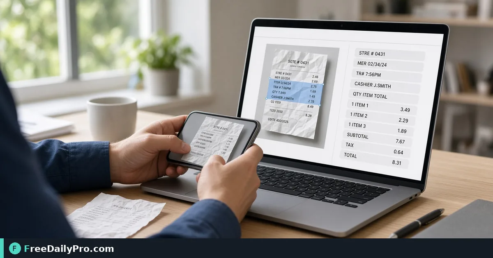

*A practical OCR Tool workflow for scan digitization*

[FreeDailyPro.com](https://www.freedailypro.com) -- Operators in scan digitization waste hours when the first pass is hours of retyping from paper photos. [OCR Tool](https://www.freedailypro.com/tool/ocr-tool) is the step that turns that mess into a checked result for extract text from a scanned receipt photo, built for small business among FreeDailyPro's 200+ professional tools.

The clip below walks through OCR Tool on a realistic task that matches extract text from a scanned receipt photo for case 46.

{{youtube Q1WWHH9P0-8 | How to Extract Text from Image OCR |}}

## Why OCR Tool belongs in this scan digitization path

This article trains one job only for ocr-tool (guide 46): extract text from a scanned receipt photo. Readers are small business. When ocr-tool output looks wrong, first re-check whether the goal was "copyable text from the receipt image" and whether inputs used anchors near receipt photo, text extract. The failure mode to refuse on pass 46 is retyping every line from a blurry scan.

Success on OCR Tool means a finished artifact you can defend in scan digitization: copyable text from the receipt image. Practical anchors for this case sit around receipt photo, text extract. If those anchors are missing for extract text from a scanned receipt photo, stop before you burn a trial usage on half-ready data for ocr-tool.

## What to stage before opening OCR Tool

Write a one-line done definition for ocr-tool that matches "copyable text from the receipt image" before guide step 46. Stage every input OCR Tool will consume for extract text from a scanned receipt photo so the browser pass is intentional for small business. Note any destination rules that can reject a ocr-tool export in scan digitization after case 46.

Keep neighbor tools only for real blockers after OCR Tool on extract text from a scanned receipt photo: [Zip Unzip](https://www.freedailypro.com/tool/zip-unzip), [Csv Converter](https://www.freedailypro.com/tool/csv-converter), [Meme Generator](https://www.freedailypro.com/tool/meme-generator). Browse the [file tools](https://www.freedailypro.com/category/file-tools) category when a related step is required after the ocr-tool pass for copyable text from the receipt image. Queue ocr-tool runs so each of the 10 trial usages hits ready inputs for extract text from a scanned receipt photo rather than placeholders.

## Steps on OCR Tool for case 46

1. Restate the done line for this scan digitization run of ocr-tool: copyable text from the receipt image.
2. Stage inputs for the job on OCR Tool: extract text from a scanned receipt photo.
3. Open OCR Tool at https://www.freedailypro.com/tool/ocr-tool for small business.
4. Enter production values with anchors near receipt photo, text extract for extract text from a scanned receipt photo.
5. Run once; confirm you did not hit retyping every line from a blurry scan on the ocr-tool output.
6. Export or copy with a name that includes `ocr-tool` and today's date for case 46.
7. Spot-check the way small business will receive the scan digitization packet (second device if relevant).
8. Archive settings so a teammate can repeat the ocr-tool path for extract text from a scanned receipt photo next week.

## Recheck cadence for scan digitization on ocr-tool

After any process change in scan digitization, re-run one golden case through [OCR Tool](https://www.freedailypro.com/tool/ocr-tool) for extract text from a scanned receipt photo (label it golden-46-ocr-tool). Golden cases for ocr-tool beat memory when small business rotate on this workflow. Teach a teammate by having them complete extract text from a scanned receipt photo while you only watch for skipped verification of "copyable text from the receipt image" on ocr-tool.

Store the golden-46-ocr-tool inputs next to the ocr-tool export so next month's operator can prove copyable text from the receipt image without guessing anchors near receipt photo, text extract.

## Inputs that look fine but break ocr-tool

- Values for OCR Tool copied from chat with hidden characters that shift receipt photo, text extract on case 46.
- Files named generically (download, IMG_####) with no `ocr-tool` or project tag for extract text from a scanned receipt photo.
- Mixing demo placeholders with production rows in the same ocr-tool session aimed at copyable text from the receipt image.
- Assuming last week's portal cap still applies to today's ocr-tool export for small business.
- Using the wrong unit or as-of date so retyping every line from a blurry scan becomes invisible until handoff in scan digitization.

Clean those before blaming OCR Tool. Most ocr-tool rework in scan digitization for extract text from a scanned receipt photo starts upstream of the FreeDailyPro page on guide 46.

## Communication template after a ocr-tool run

Subject: OCR Tool result for [project] on [date] — case 46

Body: Goal was copyable text from the receipt image. Inputs used anchors receipt photo, text extract. Known risk avoided: retyping every line from a blurry scan. File name includes `ocr-tool`. Please confirm within one business day if small business standards need a second pass on extract text from a scanned receipt photo.

Short messages prevent reread loops when scan digitization packets from OCR Tool move between people on case 46.

## Worked numbers for this ocr-tool case

The primary job for guide 46 is extract text from a scanned receipt photo. Anchors near receipt photo, text extract shape the first pass on OCR Tool. After one careful OCR Tool run aimed at copyable text from the receipt image, the output should be close enough to ship if retyping every line from a blurry scan was blocked for small business. Document the ocr-tool settings so coverage works when someone who owns scan digitization is out next week.

On a weak ocr-tool pass that still shows signs of retyping every line from a blurry scan, change a single factor tied to receipt photo, text extract and re-run so you know what fixed it for extract text from a scanned receipt photo. That method keeps OCR Tool from feeling like guesswork for small business on case 46.

## Edge cases in scan digitization for OCR Tool

- Destinations may re-encode ocr-tool exports for extract text from a scanned receipt photo—download the stored copy when a portal allows and re-check copyable text from the receipt image on case 46.
- Two OCR Tool outputs named download (1) is how wrong packets ship; rename with `ocr-tool` immediately for small business.
- Odd inputs confuse operators more than the OCR Tool UI; inspect anchors (receipt photo, text extract) before blaming the tool on extract text from a scanned receipt photo.
- Locale, units, or formatting can shift meaning after ocr-tool even when the UI reported success toward copyable text from the receipt image in scan digitization.
- Policy for small business still applies after a technical success on ocr-tool for case 46 in scan digitization.

## Mistakes that waste a day on OCR Tool

- Skipping the success line (copyable text from the receipt image) and only eyeballing the ocr-tool result for extract text from a scanned receipt photo on case 46.
- Leaving sample data in a OCR Tool run that later gets sent as real to small business in scan digitization.
- Chaining five tools when OCR Tool alone would finish: extract text from a scanned receipt photo.
- Overwriting the only master input while exporting from ocr-tool during extract text from a scanned receipt photo.
- Ignoring size, format, or length caps until the final OCR Tool click fails against copyable text from the receipt image.
- Ignoring the known failure mode for this ocr-tool path: retyping every line from a blurry scan.

## Limits of OCR Tool

OCR Tool performs the job described on its tool page for scan digitization, especially extract text from a scanned receipt photo in guide 46. The live page does what the controls show—nothing mystical beyond that for copyable text from the receipt image. FreeDailyPro places ocr-tool among 200+ professional tools beside related utilities in file tools when small business need a follow-on step after retyping every line from a blurry scan is blocked.

## FAQ for OCR Tool (case 46)

**What is the primary job this guide covers for ocr-tool?** extract text from a scanned receipt photo.
**What does success look like for small business?** copyable text from the receipt image.
**What failure mode should I refuse on OCR Tool?** retyping every line from a blurry scan.
**Which anchors should I write down first for extract text from a scanned receipt photo?** receipt photo, text extract.
**Who is the audience for the ocr-tool export?** small business working in scan digitization.
**What if the live page looks different for OCR Tool?** Follow the live FreeDailyPro controls; this article is a workflow for extract text from a scanned receipt photo, not a frozen screenshot of case 46.
**Can I skip verification for a simple ocr-tool run?** No—scan digitization packets fail when retyping every line from a blurry scan slips through on extract text from a scanned receipt photo.
**When should I open a second tool after OCR Tool?** Only after OCR Tool fails a real check for extract text from a scanned receipt photo, then consider [Zip Unzip](https://www.freedailypro.com/tool/zip-unzip), [Csv Converter](https://www.freedailypro.com/tool/csv-converter), [Meme Generator](https://www.freedailypro.com/tool/meme-generator).

## Handoff and naming for ocr-tool

Name OCR Tool outputs like `client-or-project-ocr-tool-YYYY-MM-DD.ext` (adapt extension) for extract text from a scanned receipt photo. Put goal (copyable text from the receipt image), operator, and settings in the ticket that links the ocr-tool file so small business can audit anchors near receipt photo, text extract for case 46. That legend prevents replay confusion next month when someone reopens the scan digitization packet about retyping every line from a blurry scan.

Open the ocr-tool export once on a second device or clean profile before you declare copyable text from the receipt image done for extract text from a scanned receipt photo. Next week a teammate should re-run the same OCR Tool path for extract text from a scanned receipt photo without a chat archaeology session on case 46.

## Quality bar for OCR Tool

A success line for ocr-tool must be observable: copyable text from the receipt image on the concrete job extract text from a scanned receipt photo (guide 46). Poetic goals do not survive audit in scan digitization for small business. Store success and failure lines on a card named for OCR Tool—include retyping every line from a blurry scan as the explicit refuse list and anchors receipt photo, text extract.

With 200+ professional tools on FreeDailyPro, finish the scan digitization packet for extract text from a scanned receipt photo before exploring neighbors after OCR Tool. Resist tool tourism; open a second utility only after the primary ocr-tool export fails a real check against copyable text from the receipt image on case 46.

## Mini case in scan digitization using OCR Tool

Scenario 46: extract text from a scanned receipt photo. Operator opens OCR Tool, uses anchors near receipt photo, text extract, and writes "copyable text from the receipt image" on a sticky note before the first click. They refuse retyping every line from a blurry scan, export with `ocr-tool` in the filename, and send the short handoff template to small business. Result: one closed loop for scan digitization instead of three re-exports around extract text from a scanned receipt photo.

## When to stop and when to continue with OCR Tool

Stop when the live tool page cannot perform a required specialist step for extract text from a scanned receipt photo—do not invent features for ocr-tool in scan digitization on case 46. Continue when inputs are clean, anchors (receipt photo, text extract) are written, and "copyable text from the receipt image" is still the target for small business. Extra tools are for blockers in scan digitization, not entertainment; keep the OCR Tool path short for extract text from a scanned receipt photo.

## Pairing without scope creep after OCR Tool

Do not chain five utilities for curiosity after OCR Tool finishes extract text from a scanned receipt photo—chain two only when a portal rejects the first export aimed at copyable text from the receipt image. Neighbors such as [Zip Unzip](https://www.freedailypro.com/tool/zip-unzip), [Csv Converter](https://www.freedailypro.com/tool/csv-converter), [Meme Generator](https://www.freedailypro.com/tool/meme-generator) exist to unblock scan digitization, not to decorate the ticket for small business. A tool-specific card for ocr-tool that lists retyping every line from a blurry scan and receipt photo, text extract beats a generic ops checklist every time on case 46.

## Field notes specific to ocr-tool

Camera-roll or generic download filenames hide intent; rename before the serious OCR Tool pass for extract text from a scanned receipt photo on case 46. Trust only the controls on the live ocr-tool page for scan digitization; do not invent hidden modes that "should" exist for copyable text from the receipt image. Generic SOPs miss sharp edges like retyping every line from a blurry scan; keep a one-page card for OCR Tool alone with anchors receipt photo, text extract and the job line extract text from a scanned receipt photo.

Policy for small business still applies after technical success on ocr-tool for extract text from a scanned receipt photo. Locale and unit mistakes around receipt photo, text extract remain the top silent errors for OCR Tool when the work is extract text from a scanned receipt photo in scan digitization on case 46.

## Closing next step for OCR Tool

Run one real case through OCR Tool with production inputs for extract text from a scanned receipt photo, not placeholders for case 46. Finish against the written success line (copyable text from the receipt image)—not a hopeful glance at a filename from ocr-tool. Open [OCR Tool](https://www.freedailypro.com/tool/ocr-tool) when you are ready to execute extract text from a scanned receipt photo for small business in scan digitization.

Which part of the OCR Tool workflow for extract text from a scanned receipt photo still feels unclear for your team? We read ocr-tool feedback on the [contact page](https://www.freedailypro.com/contact).
