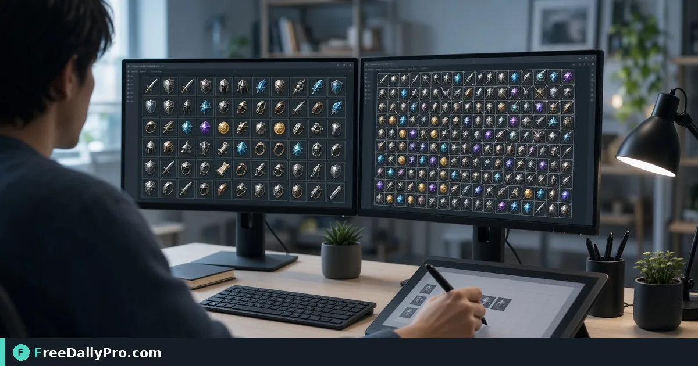

*A practical Sprite Sheet Tool workflow for game UI assets*

[FreeDailyPro.com](https://www.freedailypro.com) -- Reviews in game UI assets light up when someone shipped many HTTP requests for tiny icons. [Sprite Sheet Tool](https://www.freedailypro.com/tool/sprite-sheet-tool) is the step that turns that mess into a checked result for pack icon frames into a sprite sheet for a game UI, built for developers among FreeDailyPro's 200+ professional tools.

The clip below walks through Sprite Sheet Tool on a realistic task that matches pack icon frames into a sprite sheet for a game UI for case 50.

{{youtube zmLP5t8sXPo | How to Make & Split Sprite Sheets Online}}

## Why Sprite Sheet Tool belongs in this game UI assets path

This article trains one job only for sprite-sheet-tool (guide 50): pack icon frames into a sprite sheet for a game UI. Readers are developers. When sprite-sheet-tool output looks wrong, first re-check whether the goal was "a sprite sheet with consistent frame size" and whether inputs used anchors near frames, sheet, frame size. The failure mode to refuse on pass 50 is loading dozens of separate icon files at runtime.

Success on Sprite Sheet Tool means a finished artifact you can defend in game UI assets: a sprite sheet with consistent frame size. Practical anchors for this case sit around frames, sheet, frame size. If those anchors are missing for pack icon frames into a sprite sheet for a game UI, stop before you burn a trial usage on half-ready data for sprite-sheet-tool.

## What to stage before opening Sprite Sheet Tool

Write a one-line done definition for sprite-sheet-tool that matches "a sprite sheet with consistent frame size" before guide step 50. Stage every input Sprite Sheet Tool will consume for pack icon frames into a sprite sheet for a game UI so the browser pass is intentional for developers. Note any destination rules that can reject a sprite-sheet-tool export in game UI assets after case 50.

Keep neighbor tools only for real blockers after Sprite Sheet Tool on pack icon frames into a sprite sheet for a game UI: [Emoji Picker](https://www.freedailypro.com/tool/emoji-picker), [Emoji Unicode Converter](https://www.freedailypro.com/tool/emoji-unicode-converter), [Avatar Builder](https://www.freedailypro.com/tool/avatar-builder). Browse the [animation tools](https://www.freedailypro.com/category/animation-tools) category when a related step is required after the sprite-sheet-tool pass for a sprite sheet with consistent frame size. Queue sprite-sheet-tool runs so each of the 10 trial usages hits ready inputs for pack icon frames into a sprite sheet for a game UI rather than placeholders.

## Steps on Sprite Sheet Tool for case 50

1. Pin the done line for this game UI assets run of sprite-sheet-tool: a sprite sheet with consistent frame size.
2. Assemble inputs for the job on Sprite Sheet Tool: pack icon frames into a sprite sheet for a game UI.
3. Bring up Sprite Sheet Tool at https://www.freedailypro.com/tool/sprite-sheet-tool for developers.
4. Key in production values with anchors near frames, sheet, frame size for pack icon frames into a sprite sheet for a game UI.
5. Trigger once; confirm you did not hit loading dozens of separate icon files at runtime on the sprite-sheet-tool output.
6. Pull or copy with a name that includes `sprite-sheet-tool` and today's date for case 50.
7. Cross-check the way developers will receive the game UI assets packet (second device if relevant).
8. Retain settings so a teammate can repeat the sprite-sheet-tool path for pack icon frames into a sprite sheet for a game UI next week.

## Recheck cadence for game UI assets on sprite-sheet-tool

After any process change in game UI assets, re-run one golden case through [Sprite Sheet Tool](https://www.freedailypro.com/tool/sprite-sheet-tool) for pack icon frames into a sprite sheet for a game UI (label it golden-50-sprite-sheet-tool). Golden cases for sprite-sheet-tool beat memory when developers rotate on this workflow. Teach a teammate by having them complete pack icon frames into a sprite sheet for a game UI while you only watch for skipped verification of "a sprite sheet with consistent frame size" on sprite-sheet-tool.

Store the golden-50-sprite-sheet-tool inputs next to the sprite-sheet-tool export so next month's operator can prove a sprite sheet with consistent frame size without guessing anchors near frames, sheet, frame size.

## Inputs that look fine but break sprite-sheet-tool

- Values for Sprite Sheet Tool copied from chat with hidden characters that shift frames, sheet, frame size on case 50.
- Files named generically (download, IMG_####) with no `sprite-sheet-tool` or project tag for pack icon frames into a sprite sheet for a game UI.
- Mixing demo placeholders with production rows in the same sprite-sheet-tool session aimed at a sprite sheet with consistent frame size.
- Assuming last week's portal cap still applies to today's sprite-sheet-tool export for developers.
- Using the wrong unit or as-of date so loading dozens of separate icon files at runtime becomes invisible until handoff in game UI assets.

Clean those before blaming Sprite Sheet Tool. Most sprite-sheet-tool rework in game UI assets for pack icon frames into a sprite sheet for a game UI starts upstream of the FreeDailyPro page on guide 50.

## Communication template after a sprite-sheet-tool run

Subject: Sprite Sheet Tool result for [project] on [date] — case 50

Body: Goal was a sprite sheet with consistent frame size. Inputs used anchors frames, sheet, frame size. Known risk avoided: loading dozens of separate icon files at runtime. File name includes `sprite-sheet-tool`. Please confirm within one business day if developers standards need a second pass on pack icon frames into a sprite sheet for a game UI.

Short messages prevent reread loops when game UI assets packets from Sprite Sheet Tool move between people on case 50.

## Worked numbers for this sprite-sheet-tool case

The primary job for guide 50 is pack icon frames into a sprite sheet for a game UI. Anchors near frames, sheet, frame size shape the first pass on Sprite Sheet Tool. After one careful Sprite Sheet Tool run aimed at a sprite sheet with consistent frame size, the output should be close enough to ship if loading dozens of separate icon files at runtime was blocked for developers. Document the sprite-sheet-tool settings so coverage works when someone who owns game UI assets is out next week.

On a weak sprite-sheet-tool pass that still shows signs of loading dozens of separate icon files at runtime, change a single factor tied to frames, sheet, frame size and re-run so you know what fixed it for pack icon frames into a sprite sheet for a game UI. That method keeps Sprite Sheet Tool from feeling like guesswork for developers on case 50.

## Edge cases in game UI assets for Sprite Sheet Tool

- Destinations may re-encode sprite-sheet-tool exports for pack icon frames into a sprite sheet for a game UI—download the stored copy when a portal allows and re-check a sprite sheet with consistent frame size on case 50.
- Two Sprite Sheet Tool outputs named download (1) is how wrong packets ship; rename with `sprite-sheet-tool` immediately for developers.
- Odd inputs confuse operators more than the Sprite Sheet Tool UI; inspect anchors (frames, sheet, frame size) before blaming the tool on pack icon frames into a sprite sheet for a game UI.
- Locale, units, or formatting can shift meaning after sprite-sheet-tool even when the UI reported success toward a sprite sheet with consistent frame size in game UI assets.
- Policy for developers still applies after a technical success on sprite-sheet-tool for case 50 in game UI assets.

## Mistakes that waste a day on Sprite Sheet Tool

- Skipping the success line (a sprite sheet with consistent frame size) and only eyeballing the sprite-sheet-tool result for pack icon frames into a sprite sheet for a game UI on case 50.
- Leaving sample data in a Sprite Sheet Tool run that later gets sent as real to developers in game UI assets.
- Chaining five tools when Sprite Sheet Tool alone would finish: pack icon frames into a sprite sheet for a game UI.
- Overwriting the only master input while exporting from sprite-sheet-tool during pack icon frames into a sprite sheet for a game UI.
- Ignoring size, format, or length caps until the final Sprite Sheet Tool click fails against a sprite sheet with consistent frame size.
- Ignoring the known failure mode for this sprite-sheet-tool path: loading dozens of separate icon files at runtime.

## Limits of Sprite Sheet Tool

Sprite Sheet Tool performs the job described on its tool page for game UI assets, especially pack icon frames into a sprite sheet for a game UI in guide 50. The live page does what the controls show—nothing mystical beyond that for a sprite sheet with consistent frame size. FreeDailyPro places sprite-sheet-tool among 200+ professional tools beside related utilities in animation tools when developers need a follow-on step after loading dozens of separate icon files at runtime is blocked.

## FAQ for Sprite Sheet Tool (case 50)

**What is the primary job this guide covers for sprite-sheet-tool?** pack icon frames into a sprite sheet for a game UI.
**What does success look like for developers?** a sprite sheet with consistent frame size.
**What failure mode should I refuse on Sprite Sheet Tool?** loading dozens of separate icon files at runtime.
**Which anchors should I write down first for pack icon frames into a sprite sheet for a game UI?** frames, sheet, frame size.
**Who is the audience for the sprite-sheet-tool export?** developers working in game UI assets.
**What if the live page looks different for Sprite Sheet Tool?** Follow the live FreeDailyPro controls; this article is a workflow for pack icon frames into a sprite sheet for a game UI, not a frozen screenshot of case 50.
**Can I skip verification for a simple sprite-sheet-tool run?** No—game UI assets packets fail when loading dozens of separate icon files at runtime slips through on pack icon frames into a sprite sheet for a game UI.
**When should I open a second tool after Sprite Sheet Tool?** Only after Sprite Sheet Tool fails a real check for pack icon frames into a sprite sheet for a game UI, then consider [Emoji Picker](https://www.freedailypro.com/tool/emoji-picker), [Emoji Unicode Converter](https://www.freedailypro.com/tool/emoji-unicode-converter), [Avatar Builder](https://www.freedailypro.com/tool/avatar-builder).

## Handoff and naming for sprite-sheet-tool

Name Sprite Sheet Tool outputs like `client-or-project-sprite-sheet-tool-YYYY-MM-DD.ext` (adapt extension) for pack icon frames into a sprite sheet for a game UI. Put goal (a sprite sheet with consistent frame size), operator, and settings in the ticket that links the sprite-sheet-tool file so developers can audit anchors near frames, sheet, frame size for case 50. That legend prevents replay confusion next month when someone reopens the game UI assets packet about loading dozens of separate icon files at runtime.

Open the sprite-sheet-tool export once on a second device or clean profile before you declare a sprite sheet with consistent frame size done for pack icon frames into a sprite sheet for a game UI. Next week a teammate should re-run the same Sprite Sheet Tool path for pack icon frames into a sprite sheet for a game UI without a chat archaeology session on case 50.

## Quality bar for Sprite Sheet Tool

A success line for sprite-sheet-tool must be observable: a sprite sheet with consistent frame size on the concrete job pack icon frames into a sprite sheet for a game UI (guide 50). Poetic goals do not survive audit in game UI assets for developers. Store success and failure lines on a card named for Sprite Sheet Tool—include loading dozens of separate icon files at runtime as the explicit refuse list and anchors frames, sheet, frame size.

With 200+ professional tools on FreeDailyPro, finish the game UI assets packet for pack icon frames into a sprite sheet for a game UI before exploring neighbors after Sprite Sheet Tool. Resist tool tourism; open a second utility only after the primary sprite-sheet-tool export fails a real check against a sprite sheet with consistent frame size on case 50.

## Mini case in game UI assets using Sprite Sheet Tool

Scenario 50: pack icon frames into a sprite sheet for a game UI. Operator opens Sprite Sheet Tool, uses anchors near frames, sheet, frame size, and writes "a sprite sheet with consistent frame size" on a sticky note before the first click. They refuse loading dozens of separate icon files at runtime, export with `sprite-sheet-tool` in the filename, and send the short handoff template to developers. Result: one closed loop for game UI assets instead of three re-exports around pack icon frames into a sprite sheet for a game UI.

## When to stop and when to continue with Sprite Sheet Tool

Stop when the live tool page cannot perform a required specialist step for pack icon frames into a sprite sheet for a game UI—do not invent features for sprite-sheet-tool in game UI assets on case 50. Continue when inputs are clean, anchors (frames, sheet, frame size) are written, and "a sprite sheet with consistent frame size" is still the target for developers. Extra tools are for blockers in game UI assets, not entertainment; keep the Sprite Sheet Tool path short for pack icon frames into a sprite sheet for a game UI.

## Pairing without scope creep after Sprite Sheet Tool

Do not chain five utilities for curiosity after Sprite Sheet Tool finishes pack icon frames into a sprite sheet for a game UI—chain two only when a portal rejects the first export aimed at a sprite sheet with consistent frame size. Neighbors such as [Emoji Picker](https://www.freedailypro.com/tool/emoji-picker), [Emoji Unicode Converter](https://www.freedailypro.com/tool/emoji-unicode-converter), [Avatar Builder](https://www.freedailypro.com/tool/avatar-builder) exist to unblock game UI assets, not to decorate the ticket for developers. A tool-specific card for sprite-sheet-tool that lists loading dozens of separate icon files at runtime and frames, sheet, frame size beats a generic ops checklist every time on case 50.

## Field notes specific to sprite-sheet-tool

Camera-roll or generic download filenames hide intent; rename before the serious Sprite Sheet Tool pass for pack icon frames into a sprite sheet for a game UI on case 50. Trust only the controls on the live sprite-sheet-tool page for game UI assets; do not invent hidden modes that "should" exist for a sprite sheet with consistent frame size. Generic SOPs miss sharp edges like loading dozens of separate icon files at runtime; keep a one-page card for Sprite Sheet Tool alone with anchors frames, sheet, frame size and the job line pack icon frames into a sprite sheet for a game UI.

Policy for developers still applies after technical success on sprite-sheet-tool for pack icon frames into a sprite sheet for a game UI. Locale and unit mistakes around frames, sheet, frame size remain the top silent errors for Sprite Sheet Tool when the work is pack icon frames into a sprite sheet for a game UI in game UI assets on case 50.

## Closing next step for Sprite Sheet Tool

Run one real case through Sprite Sheet Tool with production inputs for pack icon frames into a sprite sheet for a game UI, not placeholders for case 50. Finish against the written success line (a sprite sheet with consistent frame size)—not a hopeful glance at a filename from sprite-sheet-tool. Open [Sprite Sheet Tool](https://www.freedailypro.com/tool/sprite-sheet-tool) when you are ready to execute pack icon frames into a sprite sheet for a game UI for developers in game UI assets.

Which part of the Sprite Sheet Tool workflow for pack icon frames into a sprite sheet for a game UI still feels unclear for your team? We read sprite-sheet-tool feedback on the [contact page](https://www.freedailypro.com/contact).
