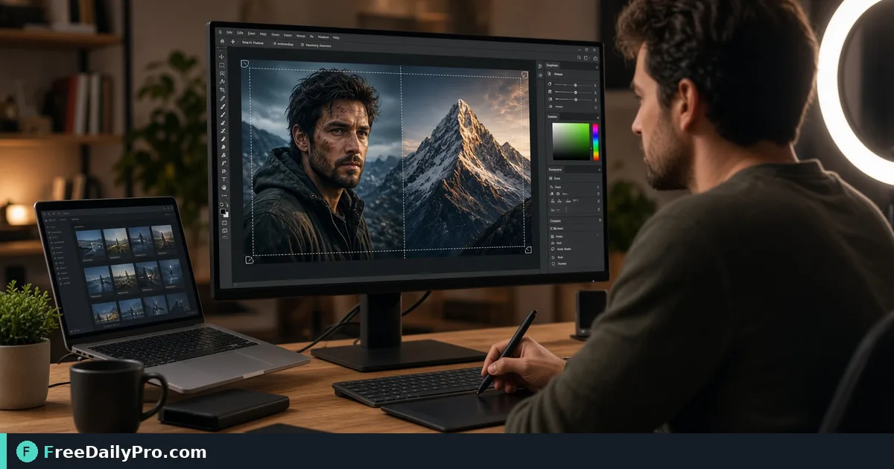

*A practical Yt Thumbnail workflow for YouTube packaging*

[FreeDailyPro.com](https://www.freedailypro.com) -- The usual YouTube packaging bottleneck is not talent—it is cropped-off faces on YouTube cards. [Yt Thumbnail](https://www.freedailypro.com/tool/yt-thumbnail) is the step that turns that mess into a checked result for size a custom YouTube thumbnail to platform needs, built for content writers among FreeDailyPro's 200+ professional tools.

The clip below walks through Yt Thumbnail on a realistic task that matches size a custom YouTube thumbnail to platform needs for case 47.

{{youtube lDBgQDbgHmY | How to Download YouTube Thumbnails Online | FreeDailyPro.com}}

## Why Yt Thumbnail belongs in this YouTube packaging path

This article trains one job only for yt-thumbnail (guide 47): size a custom YouTube thumbnail to platform needs. Readers are content writers. When yt-thumbnail output looks wrong, first re-check whether the goal was "a thumbnail file that matches the expected frame" and whether inputs used anchors near 16:9-ish, face, title area. The failure mode to refuse on pass 47 is uploading a square image that gets cropped badly.

Success on Yt Thumbnail means a finished artifact you can defend in YouTube packaging: a thumbnail file that matches the expected frame. Practical anchors for this case sit around 16:9-ish, face, title area. If those anchors are missing for size a custom YouTube thumbnail to platform needs, stop before you burn a trial usage on half-ready data for yt-thumbnail.

## What to stage before opening Yt Thumbnail

Write a one-line done definition for yt-thumbnail that matches "a thumbnail file that matches the expected frame" before guide step 47. Stage every input Yt Thumbnail will consume for size a custom YouTube thumbnail to platform needs so the browser pass is intentional for content writers. Note any destination rules that can reject a yt-thumbnail export in YouTube packaging after case 47.

Keep neighbor tools only for real blockers after Yt Thumbnail on size a custom YouTube thumbnail to platform needs: [Zip Unzip](https://www.freedailypro.com/tool/zip-unzip), [Csv Converter](https://www.freedailypro.com/tool/csv-converter), [Meme Generator](https://www.freedailypro.com/tool/meme-generator). Browse the [file tools](https://www.freedailypro.com/category/file-tools) category when a related step is required after the yt-thumbnail pass for a thumbnail file that matches the expected frame. Queue yt-thumbnail runs so each of the 10 trial usages hits ready inputs for size a custom YouTube thumbnail to platform needs rather than placeholders.

## Steps on Yt Thumbnail for case 47

1. Write the done line for this YouTube packaging run of yt-thumbnail: a thumbnail file that matches the expected frame.
2. Gather inputs for the job on Yt Thumbnail: size a custom YouTube thumbnail to platform needs.
3. Launch Yt Thumbnail at https://www.freedailypro.com/tool/yt-thumbnail for content writers.
4. Fill production values with anchors near 16:9-ish, face, title area for size a custom YouTube thumbnail to platform needs.
5. Execute once; confirm you did not hit uploading a square image that gets cropped badly on the yt-thumbnail output.
6. Save or copy with a name that includes `yt-thumbnail` and today's date for case 47.
7. Verify the way content writers will receive the YouTube packaging packet (second device if relevant).
8. Log settings so a teammate can repeat the yt-thumbnail path for size a custom YouTube thumbnail to platform needs next week.

## Recheck cadence for YouTube packaging on yt-thumbnail

After any process change in YouTube packaging, re-run one golden case through [Yt Thumbnail](https://www.freedailypro.com/tool/yt-thumbnail) for size a custom YouTube thumbnail to platform needs (label it golden-47-yt-thumbnail). Golden cases for yt-thumbnail beat memory when content writers rotate on this workflow. Teach a teammate by having them complete size a custom YouTube thumbnail to platform needs while you only watch for skipped verification of "a thumbnail file that matches the expected frame" on yt-thumbnail.

Store the golden-47-yt-thumbnail inputs next to the yt-thumbnail export so next month's operator can prove a thumbnail file that matches the expected frame without guessing anchors near 16:9-ish, face, title area.

## Inputs that look fine but break yt-thumbnail

- Values for Yt Thumbnail copied from chat with hidden characters that shift 16:9-ish, face, title area on case 47.
- Files named generically (download, IMG_####) with no `yt-thumbnail` or project tag for size a custom YouTube thumbnail to platform needs.
- Mixing demo placeholders with production rows in the same yt-thumbnail session aimed at a thumbnail file that matches the expected frame.
- Assuming last week's portal cap still applies to today's yt-thumbnail export for content writers.
- Using the wrong unit or as-of date so uploading a square image that gets cropped badly becomes invisible until handoff in YouTube packaging.

Clean those before blaming Yt Thumbnail. Most yt-thumbnail rework in YouTube packaging for size a custom YouTube thumbnail to platform needs starts upstream of the FreeDailyPro page on guide 47.

## Communication template after a yt-thumbnail run

Subject: Yt Thumbnail result for [project] on [date] — case 47

Body: Goal was a thumbnail file that matches the expected frame. Inputs used anchors 16:9-ish, face, title area. Known risk avoided: uploading a square image that gets cropped badly. File name includes `yt-thumbnail`. Please confirm within one business day if content writers standards need a second pass on size a custom YouTube thumbnail to platform needs.

Short messages prevent reread loops when YouTube packaging packets from Yt Thumbnail move between people on case 47.

## Worked numbers for this yt-thumbnail case

The primary job for guide 47 is size a custom YouTube thumbnail to platform needs. Anchors near 16:9-ish, face, title area shape the first pass on Yt Thumbnail. After one careful Yt Thumbnail run aimed at a thumbnail file that matches the expected frame, the output should be close enough to ship if uploading a square image that gets cropped badly was blocked for content writers. Document the yt-thumbnail settings so coverage works when someone who owns YouTube packaging is out next week.

On a weak yt-thumbnail pass that still shows signs of uploading a square image that gets cropped badly, change a single factor tied to 16:9-ish, face, title area and re-run so you know what fixed it for size a custom YouTube thumbnail to platform needs. That method keeps Yt Thumbnail from feeling like guesswork for content writers on case 47.

## Edge cases in YouTube packaging for Yt Thumbnail

- Destinations may re-encode yt-thumbnail exports for size a custom YouTube thumbnail to platform needs—download the stored copy when a portal allows and re-check a thumbnail file that matches the expected frame on case 47.
- Two Yt Thumbnail outputs named download (1) is how wrong packets ship; rename with `yt-thumbnail` immediately for content writers.
- Odd inputs confuse operators more than the Yt Thumbnail UI; inspect anchors (16:9-ish, face, title area) before blaming the tool on size a custom YouTube thumbnail to platform needs.
- Locale, units, or formatting can shift meaning after yt-thumbnail even when the UI reported success toward a thumbnail file that matches the expected frame in YouTube packaging.
- Policy for content writers still applies after a technical success on yt-thumbnail for case 47 in YouTube packaging.

## Mistakes that waste a day on Yt Thumbnail

- Skipping the success line (a thumbnail file that matches the expected frame) and only eyeballing the yt-thumbnail result for size a custom YouTube thumbnail to platform needs on case 47.
- Leaving sample data in a Yt Thumbnail run that later gets sent as real to content writers in YouTube packaging.
- Chaining five tools when Yt Thumbnail alone would finish: size a custom YouTube thumbnail to platform needs.
- Overwriting the only master input while exporting from yt-thumbnail during size a custom YouTube thumbnail to platform needs.
- Ignoring size, format, or length caps until the final Yt Thumbnail click fails against a thumbnail file that matches the expected frame.
- Ignoring the known failure mode for this yt-thumbnail path: uploading a square image that gets cropped badly.

## Limits of Yt Thumbnail

Yt Thumbnail performs the job described on its tool page for YouTube packaging, especially size a custom YouTube thumbnail to platform needs in guide 47. The live page does what the controls show—nothing mystical beyond that for a thumbnail file that matches the expected frame. FreeDailyPro places yt-thumbnail among 200+ professional tools beside related utilities in file tools when content writers need a follow-on step after uploading a square image that gets cropped badly is blocked.

## FAQ for Yt Thumbnail (case 47)

**What is the primary job this guide covers for yt-thumbnail?** size a custom YouTube thumbnail to platform needs.
**What does success look like for content writers?** a thumbnail file that matches the expected frame.
**What failure mode should I refuse on Yt Thumbnail?** uploading a square image that gets cropped badly.
**Which anchors should I write down first for size a custom YouTube thumbnail to platform needs?** 16:9-ish, face, title area.
**Who is the audience for the yt-thumbnail export?** content writers working in YouTube packaging.
**What if the live page looks different for Yt Thumbnail?** Follow the live FreeDailyPro controls; this article is a workflow for size a custom YouTube thumbnail to platform needs, not a frozen screenshot of case 47.
**Can I skip verification for a simple yt-thumbnail run?** No—YouTube packaging packets fail when uploading a square image that gets cropped badly slips through on size a custom YouTube thumbnail to platform needs.
**When should I open a second tool after Yt Thumbnail?** Only after Yt Thumbnail fails a real check for size a custom YouTube thumbnail to platform needs, then consider [Zip Unzip](https://www.freedailypro.com/tool/zip-unzip), [Csv Converter](https://www.freedailypro.com/tool/csv-converter), [Meme Generator](https://www.freedailypro.com/tool/meme-generator).

## Handoff and naming for yt-thumbnail

Name Yt Thumbnail outputs like `client-or-project-yt-thumbnail-YYYY-MM-DD.ext` (adapt extension) for size a custom YouTube thumbnail to platform needs. Put goal (a thumbnail file that matches the expected frame), operator, and settings in the ticket that links the yt-thumbnail file so content writers can audit anchors near 16:9-ish, face, title area for case 47. That legend prevents replay confusion next month when someone reopens the YouTube packaging packet about uploading a square image that gets cropped badly.

Open the yt-thumbnail export once on a second device or clean profile before you declare a thumbnail file that matches the expected frame done for size a custom YouTube thumbnail to platform needs. Next week a teammate should re-run the same Yt Thumbnail path for size a custom YouTube thumbnail to platform needs without a chat archaeology session on case 47.

## Quality bar for Yt Thumbnail

A success line for yt-thumbnail must be observable: a thumbnail file that matches the expected frame on the concrete job size a custom YouTube thumbnail to platform needs (guide 47). Poetic goals do not survive audit in YouTube packaging for content writers. Store success and failure lines on a card named for Yt Thumbnail—include uploading a square image that gets cropped badly as the explicit refuse list and anchors 16:9-ish, face, title area.

With 200+ professional tools on FreeDailyPro, finish the YouTube packaging packet for size a custom YouTube thumbnail to platform needs before exploring neighbors after Yt Thumbnail. Resist tool tourism; open a second utility only after the primary yt-thumbnail export fails a real check against a thumbnail file that matches the expected frame on case 47.

## Mini case in YouTube packaging using Yt Thumbnail

Scenario 47: size a custom YouTube thumbnail to platform needs. Operator opens Yt Thumbnail, uses anchors near 16:9-ish, face, title area, and writes "a thumbnail file that matches the expected frame" on a sticky note before the first click. They refuse uploading a square image that gets cropped badly, export with `yt-thumbnail` in the filename, and send the short handoff template to content writers. Result: one closed loop for YouTube packaging instead of three re-exports around size a custom YouTube thumbnail to platform needs.

## When to stop and when to continue with Yt Thumbnail

Stop when the live tool page cannot perform a required specialist step for size a custom YouTube thumbnail to platform needs—do not invent features for yt-thumbnail in YouTube packaging on case 47. Continue when inputs are clean, anchors (16:9-ish, face, title area) are written, and "a thumbnail file that matches the expected frame" is still the target for content writers. Extra tools are for blockers in YouTube packaging, not entertainment; keep the Yt Thumbnail path short for size a custom YouTube thumbnail to platform needs.

## Pairing without scope creep after Yt Thumbnail

Do not chain five utilities for curiosity after Yt Thumbnail finishes size a custom YouTube thumbnail to platform needs—chain two only when a portal rejects the first export aimed at a thumbnail file that matches the expected frame. Neighbors such as [Zip Unzip](https://www.freedailypro.com/tool/zip-unzip), [Csv Converter](https://www.freedailypro.com/tool/csv-converter), [Meme Generator](https://www.freedailypro.com/tool/meme-generator) exist to unblock YouTube packaging, not to decorate the ticket for content writers. A tool-specific card for yt-thumbnail that lists uploading a square image that gets cropped badly and 16:9-ish, face, title area beats a generic ops checklist every time on case 47.

## Field notes specific to yt-thumbnail

Camera-roll or generic download filenames hide intent; rename before the serious Yt Thumbnail pass for size a custom YouTube thumbnail to platform needs on case 47. Trust only the controls on the live yt-thumbnail page for YouTube packaging; do not invent hidden modes that "should" exist for a thumbnail file that matches the expected frame. Generic SOPs miss sharp edges like uploading a square image that gets cropped badly; keep a one-page card for Yt Thumbnail alone with anchors 16:9-ish, face, title area and the job line size a custom YouTube thumbnail to platform needs.

Policy for content writers still applies after technical success on yt-thumbnail for size a custom YouTube thumbnail to platform needs. Locale and unit mistakes around 16:9-ish, face, title area remain the top silent errors for Yt Thumbnail when the work is size a custom YouTube thumbnail to platform needs in YouTube packaging on case 47.

## Closing next step for Yt Thumbnail

Run one real case through Yt Thumbnail with production inputs for size a custom YouTube thumbnail to platform needs, not placeholders for case 47. Finish against the written success line (a thumbnail file that matches the expected frame)—not a hopeful glance at a filename from yt-thumbnail. Open [Yt Thumbnail](https://www.freedailypro.com/tool/yt-thumbnail) when you are ready to execute size a custom YouTube thumbnail to platform needs for content writers in YouTube packaging.

Which part of the Yt Thumbnail workflow for size a custom YouTube thumbnail to platform needs still feels unclear for your team? We read yt-thumbnail feedback on the [contact page](https://www.freedailypro.com/contact).
