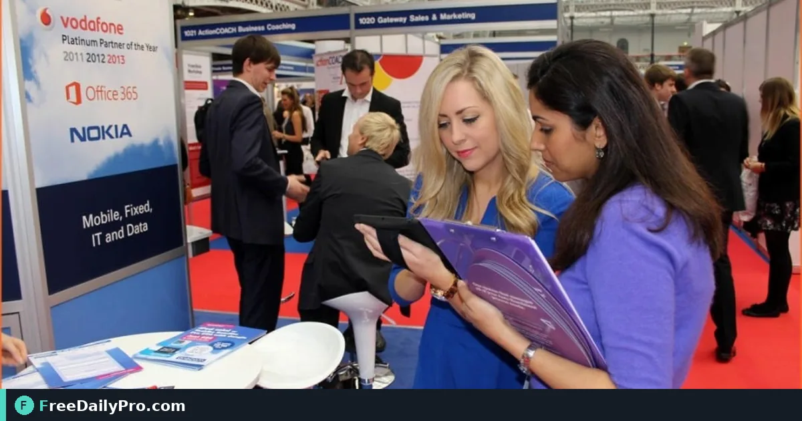

*Scan or type a visitor, mark Hot Warm or Cold, flag follow-up, and download CSV for the CRM*

[FreeDailyPro.com](https://www.freedailypro.com) -- The aisle is loud, the visitor has forty seconds, and a paper form will not get typed tonight. Northwind Components staffs Booth 214 at Midwest Product Expo 2027 and needs a phone flow that captures a lead in about ten seconds, scores interest, and exports cleanly to the CRM. Booth Leads in [Event Suite](https://www.freedailypro.com/tool/event-suite) Premium is that flow.

This post trains one job: open the booth link, capture a visitor, mark Hot, Warm, or Cold, tick **Follow up after the event**, add a short note, avoid duplicates, and download CSV.

## What Booth Leads is

Booth Leads is the exhibitor app at `/apps/booth/<link>`. Each exhibitor gets a private link from the organiser. Capture options: scan a badge or contact QR, or type name, company, email, phone, and interest. Mark Hot, Warm, or Cold. Tick **Follow up after the event**. Add a note. The app warns when the same person is added twice. Tap a lead to edit. Download all leads as CSV for CRM or mail merge.

Offline first: leads stay on the phone and send when back online. Privacy: leads belong to that exhibitor's link. The organiser sees counts, not who the leads are.

## Worked example: Booth 214, day one afternoon

Staffer Elena Ruiz greets visitor Chris Patel (Patel Packaging Co.).

1. Elena opens Booth Leads for Booth 214 on the company phone.
2. She scans Chris's badge QR; fields fill where the badge encodes them; she types interest "corrugated shippers Q3".
3. Marks **Warm**, ticks **Follow up after the event**, note: "Wants pallet rates by Friday."
4. Two hours later a colleague starts typing Chris again; the app warns of a duplicate; they open the existing lead and add a second note instead.
5. Friday morning Elena downloads CSV and imports to the CRM with columns for score and follow-up flag.

Organisers still track booth fees and inventory in planners such as [Event Budget Planner](https://www.freedailypro.com/tool/event-budget-planner) and [Event Checklist Planner](https://www.freedailypro.com/tool/event-checklist-planner). Lead capture does not replace those. More in [event tools](https://www.freedailypro.com/category/event-tools).

## Steps: exhibitor setup and capture

1. Organiser creates a booth link labelled for your booth number in Event Suite Premium.
2. Open the booth link on the duty phone; add to home screen.
3. Capture a practice lead with fake data and delete or edit it so staff see the fields once.
4. On a real visitor, prefer scan first; fall back to type when the badge has no QR.
5. Always set Hot, Warm, or Cold before you move to the next handshake.
6. Use **Follow up after the event** only when someone on your team owns the next email.
7. When the hall Wi-Fi drops, keep capturing; confirm upload when signal returns.
8. End of day: download CSV to a laptop you control; do not email the raw file to a shared public inbox.

## Common mistakes on the booth floor

- One shared booth link across three unrelated brands, mixing leads and ownership.
- Leaving score blank so the CRM import is useless on Monday.
- Capturing personal email only and never the company name.
- Ignoring the duplicate warning and creating three half-complete records.
- Promising the visitor a same-day proposal the CSV process cannot support.

## Limits and good to know

- Organiser caps: published event up to 2 MB, up to 60 links per event, up to 50 published events.
- Do not promise capture speed for every device or lighting condition; typing is the backup.
- Leads are not visible to the organiser person-by-person—only counts.
- Revoke or rotate a booth link if a phone is lost.
- iPhone and Android home-screen install steps both work; say both in staff training.

## From CSV to Monday follow-up

Decide column mapping before the show: name, company, email, phone, interest, score, follow-up flag, notes, captured-at. That mapping is a sales ops task, not something Event Suite invents for your CRM. Booth Leads gives you the export; your team owns the pipeline rules.

## Staff briefing card (copy for Booth 214)

Tape this next to the phone charger:

1. Open Booth Leads icon, not the guest app.
2. Scan first; type only if the badge has no code.
3. Score every lead before the visitor leaves the carpet.
4. Duplicate warning means edit, not a second record.
5. End of day: CSV to the laptop, then lock the phone.

Elena also keeps a paper tally of Hot leads only, in case the phone dies mid-aisle. The paper tally is a backup count, not a second CRM. When the phone revives, she reconciles notes into the existing digital leads instead of retyping names from memory.

## Scoring rubric Northwind actually uses

- **Hot:** budget and timeline stated, asked for a quote this week.
- **Warm:** clear use case, no date yet, open to a sample.
- **Cold:** browsing, student project, or competitor walkthrough.

Without a shared rubric, three staffers mark the same visitor three different ways and Monday's CRM filter fails. Write the rubric once in the exhibitor packet so temporary staff do not invent their own.

## Video script

**Video title:** How to Capture Booth Leads in Ten Seconds with Event Suite | FreeDailyPro

1. On screen: Booth link home screen icon. Spoken: "Open your Booth Leads link from Event Suite Premium on the duty phone."
2. On screen: Scan badge. Spoken: "Scan the visitor badge or contact QR when you can."
3. On screen: Typed fields. Spoken: "Or type name, company, email, phone, and interest in a few seconds."
4. On screen: Hot Warm Cold. Spoken: "Mark Hot, Warm, or Cold before the next handshake."
5. On screen: Follow up after the event tick. Spoken: "Tick Follow up after the event when someone owns the next email."
6. On screen: Duplicate warning. Spoken: "If the same person appears twice, edit the existing lead instead of creating another."
7. On screen: Download CSV. Spoken: "Download CSV for your CRM or mail merge when the day ends."
8. On screen: Event Suite. Spoken: "That is booth capture without paper piles."

## Closing

Ten-second capture is a trained habit plus a private booth link. Set the link up from [Event Suite](https://www.freedailypro.com/tool/event-suite), rehearse one fake lead, then work the aisle.

Need an organiser view for many booth links, or a door-check pairing guide? Contact [https://www.freedailypro.com/contact](https://www.freedailypro.com/contact).
