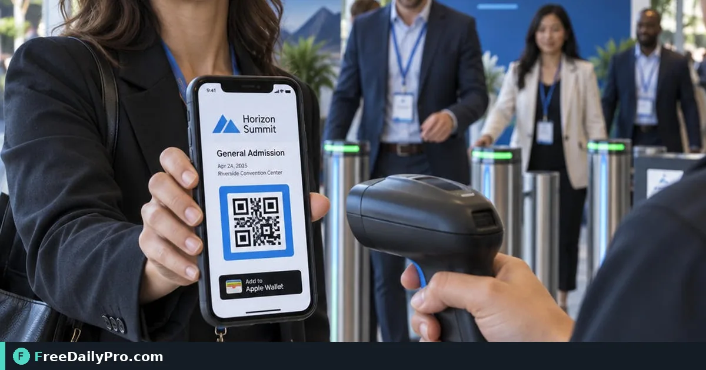

*Set up Door Check, scan passes, handle Already in, and sync two doors after offline queues*

[FreeDailyPro.com](https://www.freedailypro.com) -- The loading dock has no usable Wi-Fi and the 9:00 a.m. wave is already in the queue. Door lead Marcus Holt needs a phone that still validates passes when the signal drops, then sends check-ins when the network returns. Door Check in [Event Suite](https://www.freedailypro.com/tool/event-suite) Premium is built for that floor reality.

This guide covers one job: set up the door link, scan or search, read results such as Valid and Already in, run two doors without double entry, and trust the offline queue. Screens use those exact result labels.

## What Door Check is

Door Check lives at `/apps/door/<link>`. Staff open a private link (add to home screen if they want). After the first load, the guest list and the key that checks passes sit on the phone, so scanning works with no signal. Check-ins queue locally and upload when back online. Every door's check-ins merge, so two doors do not admit the same guest twice.

Results you will see on screen:

- **Valid**
- **Already in** (with the time)
- **Declined**
- **Not on the list**
- **Not a pass for this event**

A running count stays visible. The door link shows the guest list, so give it only to door staff.

## Worked example: two doors at Hall B

Marcus runs Door A (main lobby). Samira runs Door B (exhibitor freight). Both use the same published Expo event. Guest Jordan Lee presents the My pass QR at Door A at 8:52 a.m.

1. Marcus opens Door Check, grants camera permission, scans Jordan's screen.
2. Result: **Valid**. Count ticks up.
3. At 9:10 a.m. Jordan tries Door B after a coffee run. Samira scans: **Already in** with 8:52 a.m.
4. Mid-morning the lobby signal dies. Marcus keeps scanning; results still resolve from the on-phone list. When signal returns, queued check-ins upload and merge.

Keep the master list tidy upstream with [Guest List Tracker](https://www.freedailypro.com/tool/guest-list-tracker). For timing the door open waves, [Event Day Schedule](https://www.freedailypro.com/tool/event-day-schedule) still helps floor managers. Category hub: [event tools](https://www.freedailypro.com/category/event-tools).

## Steps: door staff setup

1. Organiser publishes the event in Event Suite Premium and copies the door link (not the guest link).
2. Door lead opens the door link on the duty phone and adds it to the home screen.
3. Confirm the guest list length matches the registration export before doors open.
4. Allow camera access. Practice one scan on a sample pass and one Search by name.
5. Brief staff on the five result labels, especially **Already in** and **Not a pass for this event**.
6. If a code will not scan, use the Search box; do not invent a manual override story for the guest.
7. After offline periods, keep the app open on signal until the queue finishes sending.
8. At shift change, do not post the door link in a public channel; rotate the link if it leaked.

## Common mistakes at the door

- Sharing the door QR on social media because it "looks official."
- Ignoring **Already in** and waving people through on a smile.
- Closing the browser mid-offline queue so pending check-ins never leave the device.
- Using a personal phone without a charged battery pack on a two-hour queue.
- Promising guests that every camera and lighting condition will scan; train Search as the backup.

## Limits and good to know

- Published event up to 2 MB (roughly 20,000 guests). Up to 50 published events and 60 links per event.
- Do not promise results, door throughput, or universal camera success.
- iPhone: Share → Add to Home Screen. Android: browser menu → Install app.
- Organiser can revoke or rotate the door link at any time.
- Premium is required for the event apps. Both plans include 1 GB storage; Premium adds apps, guest email with RSVP, and optional Twilio texts.

## Two-door discipline

Agree which door owns re-entry questions. Door Check already blocks a second **Valid** after the first check-in, but staff still need a human script for lost phones and name mismatches. Write that script on a paper card taped to the podium.

## Shift card for Door A

- Phone charged to 100%, battery pack in the podium drawer
- Door Check icon only—no guest or booth icons on this handset
- First action at 8:00: open app on Wi-Fi, confirm list count matches registration export
- Script for **Already in**: "You checked in at [time]. Need a re-entry stamp? See the floor lead."
- Script for **Not on the list**: "Step to registration help, do not queue behind scanners."

Marcus initials the shift card so the next lead knows the morning smoke test ran. That habit catches a stale door link after an overnight rotate.

## Video script

**Video title:** How to Check Guests In at the Door With Event Suite | FreeDailyPro

1. On screen: Door link open on phone. Spoken: "Open the Door Check link from Event Suite Premium on the duty phone."
2. On screen: Camera scan of pass QR. Spoken: "Scan the guest pass QR or search by name if the camera struggles."
3. On screen: Valid result. Spoken: "Valid means admit once and the count moves up."
4. On screen: Already in with time. Spoken: "Already in shows the earlier check-in time so a second door does not double admit."
5. On screen: Airplane mode scanning. Spoken: "With no signal, scans still resolve from the list on the phone."
6. On screen: Queue syncing. Spoken: "When signal returns, queued check-ins upload and merge across doors."
7. On screen: Search box. Spoken: "If a code will not scan, use Search instead of guessing."
8. On screen: Event Suite. Spoken: "That is Door Check for a live floor."

## Closing

Door calm comes from a rehearsed phone path, not from hoping the lobby Wi-Fi holds. Put Door Check on the duty devices from [Event Suite](https://www.freedailypro.com/tool/event-suite) before the first wave arrives.

If you need a one-page door brief template or a booth-lead capture guide next, say so at [https://www.freedailypro.com/contact](https://www.freedailypro.com/contact).
