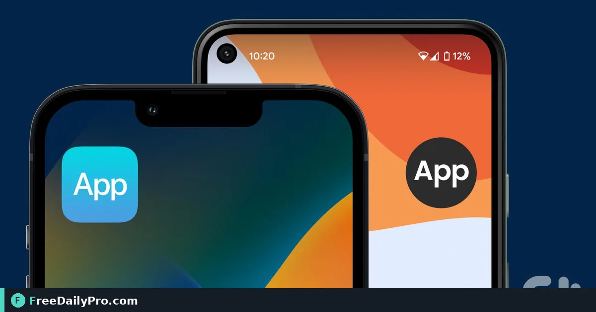

*Add Event Guide, Door Check, or Booth Leads to the home screen, use offline, and pick up updates*

[FreeDailyPro.com](https://www.freedailypro.com) -- Safari tabs get lost under boarding passes; Chrome tabs get cleared overnight. Guests, door staff, and booth crews need icons on the home screen that still open when the hall signal dies. The Event Suite Premium apps install as links you add to the home screen—no store listing required.

This guide covers one job: install Event Guide, Door Check, or Booth Leads on iPhone and Android, understand offline last-copy behaviour, and know how updates arrive after the organiser presses **Update**. Primary workspace: [Event Suite](https://www.freedailypro.com/tool/event-suite).

## What you are installing

Nothing downloads from an app store. The person opens a private link on the phone and uses the browser's **Add to Home Screen** or **Install app** action. After the first successful load, the apps work with no signal using the last copy, and they refresh when the site is updated (on open, and about once a minute while open).

App roles:

- **Event Guide** (blue calendar-and-check feel): guests — `/apps/guest/…`
- **Door Check** (teal scan-and-check feel): door staff — `/apps/door/…`
- **Booth Leads** (orange contact-card feel): exhibitors — `/apps/booth/…`

## Worked example: three phones, one show

- Guest Jordan: Event Guide guest link
- Door lead Marcus: Door Check door link
- Booth staff Elena: Booth Leads booth link for 214

Each person installs only the link that matches their role. Jordan should never receive the door link. Elena should never post her booth link on the public social feed.

Planning backups can still live in [Event Day Schedule](https://www.freedailypro.com/tool/event-day-schedule) and [Event Checklist Planner](https://www.freedailypro.com/tool/event-checklist-planner). Install steps are about the phone icons. More tools: [event tools](https://www.freedailypro.com/category/event-tools).

## Steps on iPhone

1. Open the private link in Safari (not an in-app browser inside a social app if you can avoid it).
2. Tap Share.
3. Tap **Add to Home Screen**.
4. Edit the name if needed (for example "Expo Guest" or "Door B") and add.
5. Open from the new icon once on Wi-Fi so the first full load completes.
6. Toggle airplane mode and reopen to confirm the last copy still appears.
7. After the organiser changes the programme and presses **Update**, open the icon again and wait for the refresh.

## Steps on Android

1. Open the private link in Chrome (or the site browser your company standardises).
2. Open the browser menu.
3. Tap **Install app** or **Add to Home screen** (wording varies by browser version).
4. Confirm the icon name for the role.
5. Launch once online, then test airplane mode.
6. If Install is missing, use Add to Home screen; both give a one-tap icon for show day.
7. Reopen after organiser updates to pull the new snapshot.

## Common mistakes during install training

- Sending the link only inside an Instagram in-app browser that blocks Add to Home Screen.
- Installing the guest link on door phones "just to test," then using it at the door by mistake.
- Skipping the first online load, so offline mode has nothing cached.
- Expecting store-style push notifications for every News item; treat News as something guests open.
- Promising every Android skin shows identical menu labels; show a screenshot for your device fleet.

## Limits and good to know

- Say both iPhone and Android steps in every staff email.
- Do not promise camera behaviour, install prompts on locked-down corporate phones, or offline perfection before the first load.
- Organiser revoke still matters: a stopped link shows a message; last copy behaviour follows the app rules in the product brief.
- Up to 60 links per event—do not mint extras as a substitute for clear role training.
- Premium unlocks the apps; Event Suite and Event Suite Premium each include 1 GB of account storage for projects.

## Updates without reinstalling

When Priya moves a session and presses **Update**, Jordan does not reinstall. Opening Event Guide pulls the new programme. If a link was rotated, the old icon points at a stopped or outdated link—send the new URL and have them add a fresh icon.

## Training plan for show week

Monday: send role-specific links only (guest, door, or booth).

Tuesday: five-minute video call where each lead installs on the duty phone and shows the icon on camera.

Wednesday: airplane-mode drill for door and booth phones.

Thursday: organiser presses a harmless News **Update**; everyone reopens and confirms the new line.

Friday: spare phones charged, labels on cases ("Door A", "Booth 214"), and a paper card with install steps at registration for guests who want Event Guide on their own devices.

Corporate phones that block Add to Home Screen need an IT exception before show week, not at 7:55 a.m. on day one. Put that request in the same checklist you use for badge printers.

## Guest-facing install blurb (short)

"Open the guest link in Safari or Chrome. On iPhone: Share, then Add to Home Screen. On Android: menu, Install app or Add to Home screen. Open once on Wi-Fi. Your pass lives under My pass."

Paste that blurb into the confirmation email under the link itself so guests are not hunting a separate FAQ.

## Video script

**Video title:** How to Install the Event Apps on iPhone and Android | FreeDailyPro

1. On screen: Safari open on guest link. Spoken: "Open your private Event Suite app link in the phone browser."
2. On screen: iPhone Share sheet. Spoken: "On iPhone, tap Share, then Add to Home Screen."
3. On screen: Android menu Install app. Spoken: "On Android, open the browser menu and tap Install app or Add to Home screen."
4. On screen: Home screen icons. Spoken: "Name the icon for the role: guest, door, or booth."
5. On screen: First load on Wi-Fi. Spoken: "Open once online so the first copy is fully loaded."
6. On screen: Airplane mode. Spoken: "With no signal, the last copy still opens after that first load."
7. On screen: Organiser Update. Spoken: "When the organiser presses Update, reopen the app to refresh."
8. On screen: Event Suite. Spoken: "That is install and offline use without an app store."

## Closing

Home-screen icons beat buried SMS links at 8:55 a.m. Train install before show week, using the real links from [Event Suite](https://www.freedailypro.com/tool/event-suite).

Need a printable install card for registration packets? Ask at [https://www.freedailypro.com/contact](https://www.freedailypro.com/contact).
