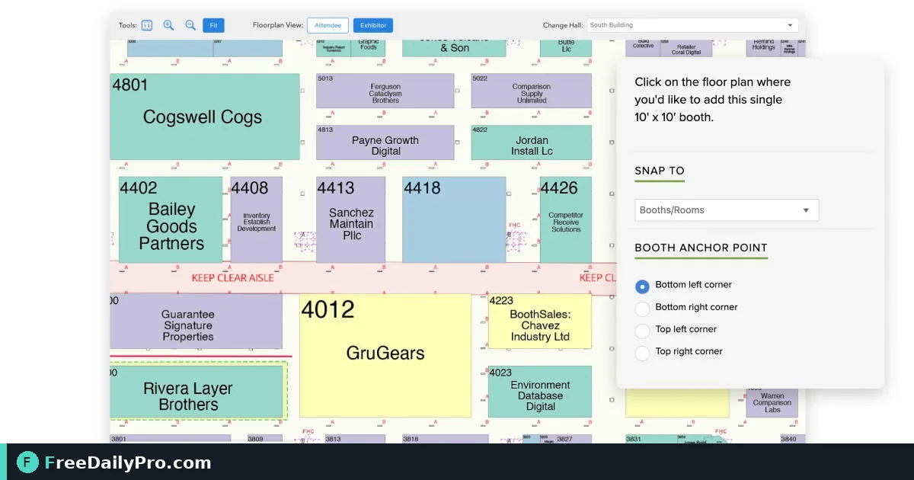

*Create booth links, watch lead counts, stop a leaked link, and keep exhibitor data separated*

[FreeDailyPro.com](https://www.freedailypro.com) -- On a sold-out floor, one shared capture spreadsheet becomes an ownership fight by Thursday. Priya Nair needs each exhibitor at Midwest Product Expo 2027 to capture leads under their own link, while she only sees counts and can stop a link that leaked. That organiser workflow lives in [Event Suite](https://www.freedailypro.com/tool/event-suite) Premium.

This guide covers one job: create one booth link per exhibitor, label it clearly, monitor counts, revoke or rotate a problem link, and keep guest and door links separate from booth links.

## Why one link per exhibitor

Booth Leads stores leads on the exhibitor's private link. Organisers see how many leads exist, not the contact rows. That split protects exhibitors and keeps your show ops out of their CRM data. A single mega-link for the whole hall breaks that model and mixes competitors' visitors.

## Worked example: Hall C booth map

Priya publishes the Expo event, then adds booth links:

| Label | Who receives the link |
|---|---|
| Booth 214 — Northwind Components | Elena Ruiz |
| Booth 218 — Lakeside Labels | Omar Haddad |
| Booth 220 — ClearPath Robotics | Dana Cho |

She sends each link in a short email the week before the show, with a one-page how-to and the rule: do not forward to other booths. During day one she watches counts rise for 214 and 218; 220 stays at zero, so she texts Dana to confirm the home-screen shortcut opened.

Budget and load-in still sit in [Event Budget Planner](https://www.freedailypro.com/tool/event-budget-planner) and [Event Checklist Planner](https://www.freedailypro.com/tool/event-checklist-planner). Link ops do not replace those planners. Hub: [event tools](https://www.freedailypro.com/category/event-tools).

## Steps: organiser booth-link desk

1. Publish the event in Event Suite Premium so booth links can be created against the snapshot.
2. Add one booth link per contracted exhibitor; put booth number and brand in the label.
3. Cap practice: open each link once yourself and capture a test lead you will tell them to delete.
4. Send links through a channel you control; never print all booth QR codes on one public poster.
5. On show morning, confirm a sample of exhibitors can open their link offline after first load.
6. Mid-day, review counts only—do not ask staff to screenshot stranger emails into your chat.
7. If a phone is stolen or a link was forwarded off-brand, **stop (revoke)** or **replace (rotate)** that link and send the new URL only to the right booth.
8. After the show, remind exhibitors to download CSV before you delete the published event.

## Common mistakes on floor ops

- Reusing one booth link for a pavilion of ten small brands.
- Posting booth QR codes on the public floor map PDF.
- Treating organiser count dashboards as a substitute for exhibitor CRM discipline.
- Deleting the published event before exhibitors export CSV.
- Mixing door staff into booth links so guest-list visibility and lead capture blur together.

## Limits and good to know

- Up to 60 links per event and 50 published events; plan link count against booth sell-out.
- Published event size up to 2 MB (roughly 20,000 guests on the door list—not the same as lead rows).
- No automatic expiry of event data: it stays until you delete it, Premium ends, or the account is deleted. The shared ceiling is 1 GB across saved projects, published events, check-ins, and leads.
- Both plans include 1 GB storage; Premium is what unlocks the apps.
- Do not promise lead volume or sales outcomes.

## Stop, rotate, delete—when to use each

- **Stop (revoke):** link must die immediately; phones show a stopped message and keep last local copy only where applicable.
- **Rotate (replace):** issue a fresh link to the same booth after a leak; update their home screen.
- **Delete published event:** end-of-life for the whole snapshot; tell exhibitors before you do it.

## Pre-show exhibitor packet (what Priya sends)

Each contracted booth receives:

- Their private booth link and QR
- A half-page Booth Leads how-to
- The scoring rubric the show recommends (Hot / Warm / Cold)
- The CSV column list her ops team prefers for post-show reports
- A sentence on privacy: organisers see counts only

She does not put guest or door links in that packet. Role separation is easier to keep when the wrong QR never appears in the wrong PDF.

## Mid-show triage when counts look wrong

If Booth 220 still shows zero leads at 2 p.m., Priya checks three causes in order: link never opened, phone on the wrong Wi-Fi captive portal, or staff capturing into a personal notes app instead of Booth Leads. She walks the booth once with a spare charged handset that already has the link installed, rather than debating over chat. That visit usually fixes the issue faster than another email.

When a booth reports "our leads disappeared," she asks whether they still have the same home-screen icon after a link rotate. Rotated links need a new icon; old icons point at a stopped address.

## Video script

**Video title:** How to Run One Link per Exhibitor with Event Suite | FreeDailyPro

1. On screen: Published event with Add booth link. Spoken: "In Event Suite Premium, add one booth link for each exhibitor."
2. On screen: Label Booth 214. Spoken: "Label every link with booth number and brand."
3. On screen: Email to exhibitor. Spoken: "Send each link privately with a short how-to."
4. On screen: Counts only. Spoken: "Watch lead counts as the organiser, not the contact rows."
5. On screen: Revoke control. Spoken: "If a link leaks, stop or rotate it and send the new URL only to that booth."
6. On screen: Separate guest and door links. Spoken: "Keep guest and door links out of exhibitor channels."
7. On screen: CSV reminder. Spoken: "Tell exhibitors to download CSV before you delete the published event."
8. On screen: Event Suite. Spoken: "That is floor link control without mixing CRM data."

## Closing

Trade-show calm is mostly clear ownership. One booth link per exhibitor, counts for you, contacts for them—set that up in [Event Suite](https://www.freedailypro.com/tool/event-suite) before load-in.

Questions about multi-hall layouts or door-plus-booth runbooks? Reach us at [https://www.freedailypro.com/contact](https://www.freedailypro.com/contact).
