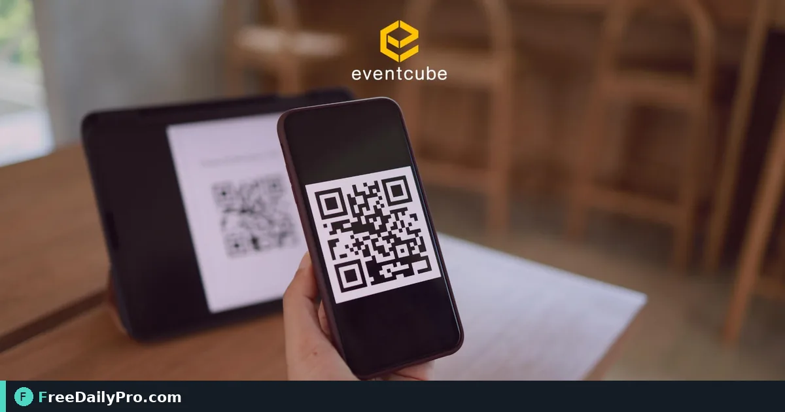

*Snapshot the plan, create guest and door links, and ship QR codes in one pass*

[FreeDailyPro.com](https://www.freedailypro.com) -- The plan looks finished on the laptop, but the floor still runs on group chats and printed sheets. Priya Nair, ops lead for Midwest Product Expo 2027 in Columbus, Ohio, needs one published snapshot her guests can open on their phones without creating accounts. [Event Suite](https://www.freedailypro.com/tool/event-suite) on Event Suite Premium is the workspace that turns that plan into guest, door, and booth links with QR codes.

This guide covers one job only: press **Publish event**, share the guest link and QR, then press **Update** after a programme change. It is written for event planners and small-business organisers among FreeDailyPro's 200+ professional tools.

## Why publish is a different step from saving

Saving a project keeps your working file. Publishing freezes a snapshot the apps can read: details, programme, announcements, and the guest list door staff will see. Until you publish, phones have nothing stable to open.

Priya's Expo runs 12–13 May 2027 at the Greater Columbus Convention Center. She already has rooms, speakers, and a draft guest list in Event Suite. The miss she refuses is texting a half-finished schedule the night before day one.

> Tip: Publish only when the programme and venue block are good enough to put on a phone. You can Update later.

## Worked example: Midwest Product Expo 2027

Sample organisers and values you can copy into a practice project:

- Organiser: Priya Nair, Regional Ops
- Event: Midwest Product Expo 2027
- Venue: Greater Columbus Convention Center, Columbus, OH
- Time zone: America/New_York
- Days: 12–13 May 2027
- Guests on the door list for day one: about 420 badge holders

Related planning tools she already used for the same project: [Event Checklist Planner](https://www.freedailypro.com/tool/event-checklist-planner) for the pre-publish task list, and [Event Day Schedule](https://www.freedailypro.com/tool/event-day-schedule) for a printable cue sheet backup. Browse [event tools](https://www.freedailypro.com/category/event-tools) when you need a sibling planner next to Event Suite.

## Steps: publish and share the guest app

1. Open [Event Suite](https://www.freedailypro.com/tool/event-suite) on Event Suite Premium and open the Expo project.
2. Confirm event name, venue, address, time zone, and programme days match the printed brief.
3. Press **Publish event**. Wait until the screen shows a guest link and a door link.
4. Open the guest link on your own phone first. Check the Now, Programme, and Venue tabs before you share widely.
5. Copy the guest link and download or display its QR code for registration desks and confirmation emails.
6. Give the door link only to door staff. It shows the guest list, so treat it like a badge list, not a public poster.
7. For each exhibitor who needs lead capture, add one booth link and label it with the booth number (for example Booth 214 — Northwind Components).
8. After any real change to programme, rooms, or announcements, press **Update** so open apps pick up the new snapshot (on open, and about once a minute while open).

## What guests and staff receive

Guests open a private link under `/apps/guest/…`. No store install and no login: they can add the page to the home screen if they want. Door staff open `/apps/door/…`. Exhibitors open `/apps/booth/…`. You can stop (revoke) or replace (rotate) any link at any time, and you can delete the published event when the show is over.

## Common mistakes on publish day

- Publishing before the venue address and time zone are correct, so "Open map" and Now/Next show the wrong clock.
- Posting the door link on a public page because it "looks like the guest link."
- Changing rooms in the draft project and assuming phones update without pressing **Update**.
- Creating one shared booth link for every exhibitor instead of one link per booth.
- Skipping the personal smoke test of the guest link on a real phone.

## Limits and good to know

- A published event can be up to 2 MB (roughly 20,000 guests). Up to 50 published events and 60 links per event.
- Up to 300 programme items and 100 announcements.
- Both Event Suite ($29.99 a month) and Event Suite Premium ($49.99 a month) include 1 GB of account storage. Premium adds the three event apps, email to guests with RSVP links and scheduled reminders, and optional text reminders through your own Twilio account.
- Billing is monthly; first-time accounts get a 7-day trial, and there is no day pass option.
- Do not promise door speed or that every phone camera will scan every code. Tell staff to use Search when a code will not scan.

## After a programme change

When speaker B moves from Ballroom A to Room 12, edit the programme in Event Suite, press **Update**, then open the guest app on a spare phone and confirm the Programme tab shows Room 12. If a link was shared too widely, rotate it and send the new QR only to the right people.

## Video script

**Video title:** How to Publish Your Event and Share the Guest App with Event Suite | FreeDailyPro

1. On screen: Event Suite project for Midwest Product Expo. Spoken: "Open your Event Suite Premium project and check the venue and time zone."
2. On screen: Publish event button. Spoken: "Press Publish event to freeze a snapshot phones can open."
3. On screen: Guest link and QR. Spoken: "Copy the guest link and share its QR with attendees."
4. On screen: Door link highlighted. Spoken: "Keep the door link for staff only because it shows the guest list."
5. On screen: Add booth link. Spoken: "Add one booth link per exhibitor, labelled by booth number."
6. On screen: Phone showing guest app Venue tab. Spoken: "Open the guest link on your phone and check Venue and Programme before you send it out."
7. On screen: Update button after a room change. Spoken: "After any change, press Update so open apps refresh."
8. On screen: FreeDailyPro Event Suite. Spoken: "That is publish, share, and update in Event Suite Premium."

## Closing

Publish is the line between a private plan and a phone-ready show. Run the steps once on a small rehearsal guest list, then publish for the real Expo roster. Start from [Event Suite](https://www.freedailypro.com/tool/event-suite) when you are ready to ship the guest app.

If you want a follow-up walkthrough for door offline queues or booth CSV exports, tell us what you need next at [https://www.freedailypro.com/contact](https://www.freedailypro.com/contact).
