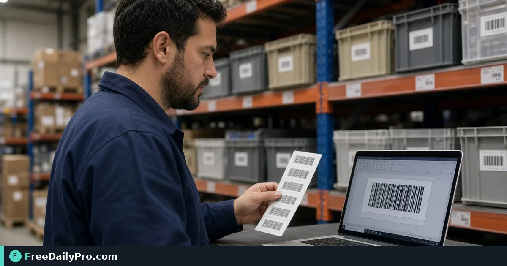

*Build Code 128, UPC-A, EAN-13, or Code 39 labels you can download as PNG or SVG*

[FreeDailyPro.com](https://www.freedailypro.com) -- Bin F12 still has a handwritten SKU that scanners refuse. Lena Brooks manages a 90-SKU parts closet for a Richmond field-service team and needs Code 128 labels that scan on the first try. [Barcode Generator](https://www.freedailypro.com/tool/barcode-generator) builds real, scannable codes—Code 128, EAN-13, EAN-8, UPC-A, Code 39, or ITF-14—from a number or text value, downloadable for inventory, packaging, or shipping.

One job: pick the symbology your scanner expects, encode the value, download PNG (with optional description) or SVG, print a test strip, scan, then roll out. For operators among FreeDailyPro's 200+ professional tools.

## Choose the format your hardware already speaks

- **Code 128:** flexible alphanumeric warehouse SKUs
- **UPC-A / EAN-13 / EAN-8:** retail catalog numbers with check digits
- **Code 39:** older industrial scanners
- **ITF-14:** carton-level codes

Guessing the wrong symbology wastes label stock. Read the scanner manual or scan a known-good vendor label first.

## Worked example: parts closet relabel

- SKU pattern: `NB-F12-0442` → Code 128
- Description line on PNG: `Northwind bracket 0442`
- Print: 2×1 in thermal labels, quiet zones intact

Nearby tools when you also need phone-era codes: [Custom QR](https://www.freedailypro.com/tool/custom-qr) for URL/QR hybrids on shelf talkers, and [Bulk QR](https://www.freedailypro.com/tool/bulk-qr) when you generate many QR payloads at once. Category: [qr tools](https://www.freedailypro.com/category/qr-tools).

## Steps on Barcode Generator

1. List SKUs in a spreadsheet with the symbology column filled.
2. Open [Barcode Generator](https://www.freedailypro.com/tool/barcode-generator).
3. Select the barcode format that matches scanners on the floor.
4. Enter the value exactly (case and check digits matter for retail formats).
5. Optionally add a human-readable description for the PNG download.
6. Download PNG for quick print tests; use SVG when the print shop needs vectors.
7. Print one label, scan with the same hardware staff use daily.
8. Only after a clean scan, print the full sheet and apply labels left-to-right per aisle map.

## Quiet zones and print quality

Barcodes fail more from cramped margins and low contrast than from "bad software." Keep quiet zones clear, avoid glossy glare under warehouse LEDs, and do not shrink a Code 128 until bars merge.

## Common mistakes

- Using UPC-A for internal SKUs that never had a GS1 number.
- Typing an EAN-13 value with a wrong check digit and blaming the printer.
- Putting the only copy of the SKU map inside a personal notes app.
- Laminating over the bars with a reflective pouch.
- Mixing Code 39 and Code 128 on the same shelf without training scanners.

## Limits and good to know

- Generates standard linear barcodes listed on the tool page—confirm retail enrollment separately if you sell on major marketplaces.
- PNG includes optional description text; SVG omits that description layer.
- Test on production scanners, not only phone apps.
- Trial usages apply to file downloads under the site's Professional Tools rules.
- Do not promise every smartphone camera equals a laser warehouse scanner.

## Handoff to contractors

When a temp crew applies labels, give them a one-page sheet: symbology, sample image, "if it does not scan, stop and find Lena." That beats a weekend of silent mis-picks.

## GS1 and internal SKUs

Retail UPC/EAN numbers are managed identifiers. Internal Code 128 SKUs can be your own scheme, but do not print a made-up UPC-A and expect marketplace compliance. Lena's closet uses internal Code 128 only; e-commerce packs that need UPC go through their catalog team.

## Test matrix before a full print run

Print three sizes (100%, 90%, 80% width) on the real label stock. Scan each with:

- The handheld warehouse scanner
- The counter scanner
- One staff phone app as a weak secondary check

If the handheld fails at 80%, ban that size. Quiet zones and bar width matter more than tiny fonts under the code.

## FAQ-style notes

**SVG or PNG?** SVG for print vendors who recolor or scale; PNG for quick office printers and description text.
**Unicode in Code 128?** Stick to the character set your scanners accept; test odd symbols.
**Damaged labels?** Reprint rather than handwriting over bars.

## Mapping SKUs to bins

Lena's sheet columns: bin, SKU, symbology, barcode value, last scan test date, label reprint count. After each quarterly inventory, any SKU with failed scans gets a reprint before counts start. That habit costs minutes and saves hours of recount.

## Contractor and vendor labels

When a vendor ships cartons with their ITF-14, do not cover those bars if receiving still needs them. Apply your internal Code 128 on a second face of the bin. Dual labels beat over-sticking.

If a vendor PDF includes barcodes as low-resolution screenshots, regenerate from the numeric value instead of reprinting the blurry image.

## Quarterly drill

Once a quarter Lena pulls ten random bins, scans each label, and logs pass/fail. Any fail triggers reprint of that SKU and its neighbors in the same print batch (same ribbon and stock), because thermal print quality often degrades as a set.

Document the drill date on the SKU sheet. Auditors ask for process; a dated drill log is process.

## Ribbon and stock notes

Thermal ribbons that are near empty print grey bars that look fine to eyes and fail scanners. Replace ribbon at the first pale batch, not after a failed inventory count. Keep a small stock of the same label size so reprints match the original quiet-zone layout.

## Closing

Inventory accuracy starts when the label scans. Generate, test on real hardware, then print the run.

Create codes at [Barcode Generator](https://www.freedailypro.com/tool/barcode-generator).

Need a bulk labeling worksheet template or QR+barcode shelf talker layout? Contact [https://www.freedailypro.com/contact](https://www.freedailypro.com/contact).
