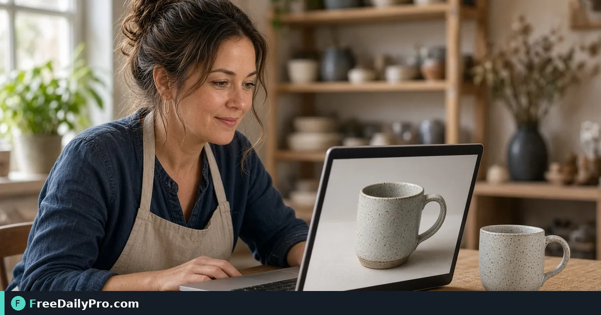

*Combine clarity, contrast, color-cast fixes, and upscaling on a single product shot*

[FreeDailyPro.com](https://www.freedailypro.com) -- The mug is fine in real life; the listing photo looks like dishwater. Sam Rivera runs a small ceramics shop out of Asheville and needs twelve catalog shots clearer before a weekend market push. [Image Quality Enhancer](https://www.freedailypro.com/tool/image-quality-enhancer) applies real pixel-level sharpening, contrast/clarity, automatic color-cast correction, shadow brightening, and literal upscaling—entirely in the browser.

One job only: pick the issues that apply, enhance, compare before/after, then hand off to resize or compress for the storefront. Built for web designers and small shops among FreeDailyPro's 200+ professional tools.

## What it is good at

This is not a full retouch suite. It targets the common "old photo/scan looks dull, make it clearer" request: soft focus, flat contrast, color cast, dark shadows, and low pixel count. Files stay on your device for this tool's processing path.

## Worked example: twelve mug shots

- Camera roll JPEGs ~1200 px on the long edge, indoor mixed lighting
- Goal: clearer texture on glaze, less yellow cast, gentle upscale toward 1600 px for the theme
- Fail to refuse: oversharpen halos that scream "filter"

Next steps often use [Resize Crop](https://www.freedailypro.com/tool/resize-crop) for square crops and [Compress Image](https://www.freedailypro.com/tool/compress-image) for storefront weight limits. See [image tools](https://www.freedailypro.com/category/image-tools).

## Steps on Image Quality Enhancer

1. Copy originals to a working folder; never overwrite camera roll files in place.
2. Open [Image Quality Enhancer](https://www.freedailypro.com/tool/image-quality-enhancer).
3. Upload one hero shot first (not all twelve) to learn settings.
4. Tick only the issues you see: soft detail, flat contrast, color cast, dark shadows, low resolution.
5. Run enhance and toggle before/after at 100% on the glaze rim and logo stamp.
6. If halos appear, untick sharpening strength paths and keep contrast/cast fixes only.
7. Download the enhanced file with a clear name (`mug03_enh.webp` or JPG as offered).
8. Batch the remaining eleven with the same issue ticks once the hero looks honest.

## Order of operations for storefronts

Enhance → crop/resize to theme → compress to target KB. Reversing that order often recompresses twice and muddies detail you just recovered.

## Common mistakes

- Enhancing a screenshot of a screenshot.
- Upscaling a 400 px image to banner size and expecting print sharpness.
- Leaving warm tungsten cast on purpose "for mood" when the brand guide requires neutral white.
- Saving over the RAW or near-RAW original.
- Skipping compress and shipping 6 MB hero images to mobile buyers.

## Limits and good to know

- Pixel adjustments and upscaling help clarity; they do not invent missing product features.
- Extreme ISO noise may look worse if oversharpened—test one frame.
- Browser memory limits apply on huge camera files; downsize extremes first if the tab stalls.
- File-based tools share the 10 trial usages daily allowance on Professional Tools.
- Privacy path: processing is designed to stay on-device for this enhancer; still treat customer photos carefully on shared computers.

## Market table card tip

For printed table cards, enhance, then export a version sized to the print shop's PPI request. Do not use the web-compressed file for a 5×7 card.

## Lighting beats software—but software still helps

If every shot is under a yellow bulb, fix the lamp before you enhance twenty frames. Image Quality Enhancer can reduce cast, yet consistent daylight or a cheap softbox saves more listings than any single toggle.

Sam now shoots a gray card reference on the first frame of each session so cast correction has a fair baseline.

## Before/after acceptance bar

Approve an enhance only if:

- Glaze texture is clearer without crispy halos
- Brand logo edges stay clean
- White backgrounds remain neutral for the theme
- File still compresses to the store's KB budget after resize

If any bar fails, dial back ticks rather than stacking every enhancement.

## FAQ-style notes

**Does it remove backgrounds?** No—use a dedicated background tool if you need cutouts.
**Raw files?** Convert to JPG/PNG/WebP the enhancer accepts first.
**Batch?** Tune on one hero, then repeat settings intentionally; do not assume one click fixes mixed lighting sets.

## Color management quick rules for small shops

Shoot JPEG in a consistent white balance. Avoid mixing phone portraits with DSLR raw-converted files in one enhance batch without checking white separately. When the theme expects pure white (#FFFFFF) cutouts, enhance before background removal so edge noise is lower going into the cutout tool.

Sam labels enhanced files `_enh` and store-ready files `_web` so ads managers do not pull the wrong derivative into Meta uploads.

## When to stop enhancing

If the product is damaged and the photo hides a crack, do not enhance into false advertising. Honesty beats clarity. The enhancer is for capture limits, not for rewriting physical condition.

## Storefront checklist after enhance

- Square crop matches theme ratio
- Long edge meets minimum pixel rule in the theme docs
- Compressed size under the theme's recommended KB
- Filename includes SKU
- Alt text written in the catalog, not guessed by the theme

Running enhance without this checklist just creates prettier files that still break layout or SEO fields.

## Phone versus dedicated camera

Phone shots can enhance well if focus locked on the product, not the background. Tap to focus on the logo or handle, then shoot. Burst three frames and enhance the sharpest only—enhancing a soft frame never recovers true focus.

## Closing

Dull listings under-sell good product. Enhance one hero honestly, lock the checklist, then run the set.

Start with [Image Quality Enhancer](https://www.freedailypro.com/tool/image-quality-enhancer).

Want a crop+compress checklist for a specific theme? Ask at [https://www.freedailypro.com/contact](https://www.freedailypro.com/contact).
