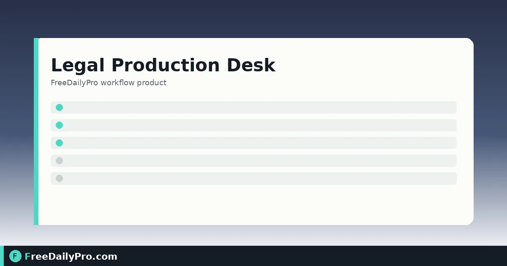

*Running ranges, privilege log, and cover letter in one browser desk*

[FreeDailyPro.com](https://www.freedailypro.com) -- Elena Vargas is assembling a first-round document production for a commercial dispute in Charlotte, North Carolina. Counsel wants running Bates numbers, stamped PDFs in a clean ZIP, a production log, a privilege log for withheld material, and a cover letter—without shipping the client’s files to a random cloud stamp service. [Legal Production Desk](https://www.freedailypro.com/tool/legal-production-desk) is the browser desk built for that handoff: ranges, one-click stamping into a ZIP, logs, and letter.

This guide covers one job only: take an ordered set of PDFs from “final to produce” to a stamped production package with an honest privilege list.

## Why the desk sits after redaction

The desk does not redact. Redact first with [Redact PDF](https://www.freedailypro.com/tool/redact-pdf), then attach the redacted file to its row. Use [Compare PDF](https://www.freedailypro.com/tool/compare-pdf) when two versions might have drifted, and [Document Assembler](https://www.freedailypro.com/tool/document-assembler) when exhibits still need to be collated before numbering. Category hub: [business tools](https://www.freedailypro.com/category/business-tools).

## Worked example: first production set, Charlotte NC

- Matter label: Vargas // Northbridge Supply — RFPD Set 1
- Bates prefix: NBS
- Start number: 000001
- Digits: 6
- Produce: 42 PDFs (contracts, emails already printed to PDF, redacted attachments)
- Withhold: 5 attorney-client items (no Bates; privilege log only)
- Legend on cover letter: CONFIDENTIAL — ATTORNEYS’ EYES ONLY (example only)

Elena’s done definition: ZIP builds without page-count errors, privilege log has date/author/recipients/description for every withhold, cover letter matches the legend counsel approved.

## Steps on Legal Production Desk

1. Open [Legal Production Desk](https://www.freedailypro.com/tool/legal-production-desk) on the monthly plan (first-time trial window; cancel from the link under the tool).
2. Set Bates prefix, starting number, and digit width before you drop files.
3. Drop PDFs to list them with page counts, or add rows by hand and attach each PDF with the paperclip control.
4. Order rows in the sequence the production should read. Numbers follow row order.
5. Mark each row as produce or withhold. Withheld rows get no Bates numbers; they appear on the withheld list and privilege log instead.
6. For withheld or redacted items, fill date, author, recipients, and a general description for the privilege log—enough for the log, not a waiver essay.
7. Confirm page counts read from the files match the list. Protected PDFs may need unlocking before the desk can open them.
8. Draft or check the cover letter. Add a legend such as CONFIDENTIAL when counsel wants one on the package.
9. When the list is final—not while still shuffling—press **Build production ZIP**. The desk stamps every produced and redacted document with the running numbers and places files in a folder with the logs.
10. Use Back up to save lists to your own device if the session will continue later. Closing the tab clears the lists on the desk.

## What withheld really means

Withheld documents are not handed over, so they receive no Bates stamp. Set a document back to produce and the numbers below it shift. That is why order and finality matter: renumbering mid-ZIP is how production sets get inconsistent.

## Common mistakes

- Building the ZIP before the last insert, then discovering ranges under a late exhibit no longer match the log.
- Attaching unredacted files and hoping the stamp step hides text—it does not.
- Leaving privilege log fields empty for a withhold because “we will fix the log later.”
- Assuming the desk decides what a court or agency requires—it does not; counsel decides production rules.
- Forgetting that page counts must match before ZIP build.
- Treating FreeDailyPro single-tool trial usages as a substitute for the Legal Production Desk subscription.

## Limits and good to know

- Legal Production Desk is $29.99 a month with a 7-day trial the first time. Access continues to the end of the paid month after cancel.
- It stamps and packages; it does not redact, merge, OCR scans, or give legal advice.
- Everything runs in the browser. PDFs are stamped on your device; nothing is uploaded or stored on FreeDailyPro servers for this workflow.
- Page counts come from the files and must match the list before the ZIP can be built.
- Confirm production format, confidentiality legends, and privilege categories with counsel for the matter and jurisdiction.

## Pairing tools for a clean set

Typical pre-desk path: scan or collect → redact sensitive pages → assemble multi-page exhibits → desk for Bates + ZIP. Keep [Redact PDF](https://www.freedailypro.com/tool/redact-pdf) and the desk in different browser windows so you never stamp the wrong file.

## Production log hygiene

Elena exports the production log and privilege log into the matter folder the same day the ZIP is built. File names include the Bates prefix and the date so later supplements do not overwrite set 1. If a second production set is needed, she starts a new desk session with a new starting number rather than editing the old ZIP by hand.

When opposing counsel questions a range, the log rows and the stamped file names should tell the same story. That is the reason the desk refuses to build until page counts match: silent mismatches create hours of reconciliation.

## Exhibit labels versus Bates

Some teams stamp exhibits with a separate exhibit label and also apply Bates numbers. Legal Production Desk focuses on the running production numbers and package. If you still need a human-readable exhibit sticker on the first page, complete that step before or after the desk, but keep a single ordered list so numbers do not fight each other.

## FAQ

**Does stamping upload my PDFs?**
No. Stamping runs in the browser on your device.

**Why did a withhold get no number?**
Because it is not produced. Produce it if it should be numbered; otherwise keep it on the privilege log only.

**Can I renumber after ZIP?**
If you add or remove rows, ranges below the change shift. Rebuild only when the ordered list is final.

## Closing next step

A production set is a logistics job with legal consequences. Order first, redact first, then stamp once. Open [Legal Production Desk](https://www.freedailypro.com/tool/legal-production-desk) when the PDF rows are ready and counsel has approved prefix, legend, and withhold categories.

If you need a shorter exhibit-only stamp path or a privilege-log template next, ask at [https://www.freedailypro.com/contact](https://www.freedailypro.com/contact).
