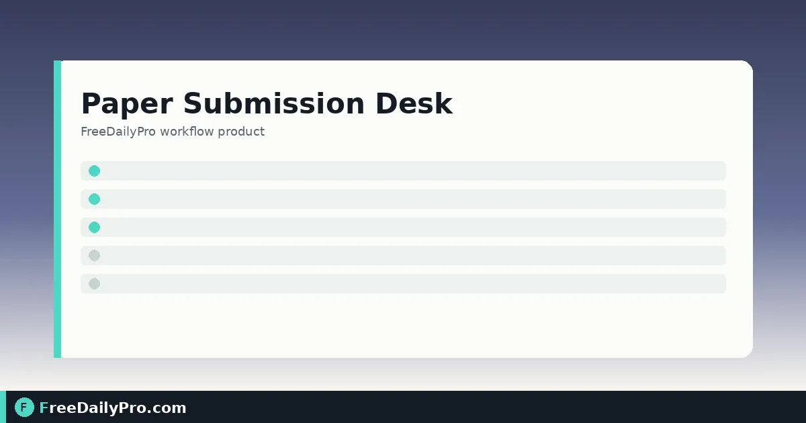

*Limits checklist, ORCID format check, cover letter, and title page*

[FreeDailyPro.com](https://www.freedailypro.com) -- Dr. Samir Okonkwo is ready to submit a methods paper from a lab at a state university in Raleigh, North Carolina. The journal’s author instructions set a hard abstract limit, keyword rules, and a corresponding-author block. What usually breaks the upload is not the science—it is a mistyped ORCID, an over-long abstract, or a cover letter that claims approvals nobody ticked. [Paper Submission Desk](https://www.freedailypro.com/tool/paper-submission-desk) checks the details you enter against the limits you copy from the journal, then builds a submission pack.

This guide covers one job only: turn “manuscript is done” into “submission pack is honest and complete.”

## What the desk does and does not do

It checks title, abstract, keywords, authors, ORCID iD format (including check digit), DOI format, and declarations against limits you type. It writes a cover letter and title page that only state the declarations you tick. It does not format the full manuscript, judge the science, look up whether a DOI exists, or invent journal rules.

Sibling tools: [Word Counter](https://www.freedailypro.com/tool/word-counter) for main-text length, [Citation Generator](https://www.freedailypro.com/tool/citation-generator) for reference drafts, [Paper Format Checker](https://www.freedailypro.com/tool/paper-format-checker) for .docx margin and font checks. Category: [college tools](https://www.freedailypro.com/category/college-tools).

## Worked example: methods paper, Raleigh NC

- Journal limits (entered from author instructions): abstract ≤ 250 words; keywords 3–6; max 8 authors listed on title page for this journal’s rule set (example only)
- Paper title: “A Bench Protocol for Low-Volume ELISA Calibration”
- Corresponding author: S. Okonkwo with ORCID entered carefully
- Declarations to tick only if true: originality, all authors approved, ethics covered if applicable, conflicts declared, funding acknowledged, data availability statement included
- Optional cover-letter note: why the paper suits this methods section

Done definition: checklist shows no “Fix” items Samir still agrees with, and the ZIP contains PDF + text cover letter + text title page.

## Steps on Paper Submission Desk

1. Open the journal’s instructions for authors in one window and [Paper Submission Desk](https://www.freedailypro.com/tool/paper-submission-desk) in another.
2. Copy limits into the desk: abstract word max, keyword rules, any other fields the form offers. Leave a box empty if the journal has no limit.
3. Enter title, abstract, keywords (separate with ; or ,), main text word count from your editor, and authors with ORCID iDs.
4. Paste reference DOIs one per line if you want format checks on them.
5. Tick only true declarations. The cover letter will state only what you tick.
6. Optionally add the editor’s name and a short “why this journal” note for the cover letter.
7. Read the checklist. Fix anything marked Fix—empty abstract, missing corresponding author, ORCID format failure, DOI format failure, over-limit abstract.
8. Download the submission pack (ZIP: PDF with cover letter, title page, and checklist; cover letter as text; title page as text).
9. Use Back up if you will continue later; closing the tab erases entries on the desk.
10. Submit through the journal’s system using the pack as the front-matter source of truth.

## ORCID and DOI checks

The desk checks format. For ORCID it also checks the check digit, which catches many typing errors. It does not query registries to prove an ID exists. If format fails, fix the string before you upload anywhere else.

## Common mistakes

- Guessing journal limits instead of copying them from the current author instructions.
- Ticking “all authors approved” before the last co-author replied.
- Pasting an ORCID with a missing digit and ignoring the format flag.
- Expecting the desk to reformat the manuscript body or restyle references.
- Uploading the manuscript file into the desk—the desk takes details, not the full manuscript file.
- Reusing last journal’s limits for a new target journal.

## Limits and good to know

- Limits are the ones you type because journals differ and change instructions; the journal’s own guidelines always win.
- Cover letter content is driven by your ticks—it will not invent ethics or originality claims you did not confirm.
- Everything runs in the browser; entries erase when the tab closes unless you Back up.
- Among FreeDailyPro’s 200+ professional tools, this desk is the submission front-matter checklist, not a full typesetting suite.
- 10 trial usages apply to file-based professional tools per site rules; confirm the desk’s own access notes on its page for any plan requirements.

## Team handoff

Samir exports the ZIP, drops it in the lab drive, and asks the corresponding author to re-read the declarations page before the journal portal upload. The text cover letter is easy to paste into portals that want plain text.

## Co-author ORCID pass

Before the final download, Samir sends each co-author a one-line request: confirm the ORCID string character-for-character. Format checks catch many errors, but a wrong-yet-valid-format ORCID still points at the wrong person. The desk cannot see the registry; humans still own identity.

## Portal paste order

Many journals want the cover letter in a text box and the title page as a separate upload. The ZIP’s text files exist for that. Samir pastes the text cover letter first, then uploads the PDF pack only if the portal asks for a single combined front-matter file. Reading the portal labels once saves a rejected submission.

## FAQ

**Does it know my journal’s rules automatically?**
No. You enter limits from the author instructions so checks stay accurate when rules change.

**Will the cover letter over-claim?**
No. It states only the declarations you tick.

**Is the manuscript uploaded?**
No. You enter title, abstract, and details—not the full manuscript file.

## Closing next step

Submission day is a checklist day. Open [Paper Submission Desk](https://www.freedailypro.com/tool/paper-submission-desk), copy live journal limits, clear every Fix, then download the pack before you touch the portal.

Need a lab-specific declaration set or a multi-journal limit sheet next? [https://www.freedailypro.com/contact](https://www.freedailypro.com/contact).
