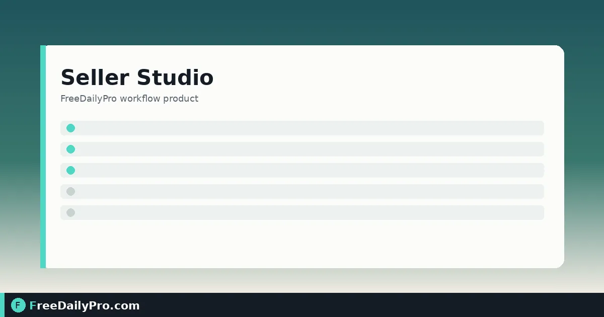

*Check photos, titles, tags, and profit after fees before you list*

[FreeDailyPro.com](https://www.freedailypro.com) -- Maya Chen runs a nine-SKU candle line on Etsy from a workshop in Austin, Texas. Before every seasonal drop she used three tabs: a photo folder, a fee spreadsheet, and a sticky note of title character limits. Something always slipped—an image under the marketplace minimum, a title that looked fine until paste day, or a price that lost money after fees. [Seller Studio](https://www.freedailypro.com/tool/seller-studio) is the launch board that holds photo checks, title and tag checks, a shop audit, price finder, and profit after fees in one project.

This guide covers one job only: prepare a batch of products so each row is ready to list—or clearly blocked—before you touch the marketplace UI.

## Why a launch board beats three tabs

A single product is easy to check by hand. A batch of twelve is where silent misses hide. Seller Studio does not publish listings or connect to your shop. You type the details, run the board checks, and download what you need. Photos are resized in the browser and only leave your machine as a ZIP you choose to save.

Sibling calculators still help when you want a one-line math check: [Marketplace Fee Calculator](https://www.freedailypro.com/tool/marketplace-fee-calculator), [Profit Margin Calculator](https://www.freedailypro.com/tool/profit-margin-calculator), and [Shipping Cost Estimator](https://www.freedailypro.com/tool/shipping-cost-estimator). Browse [ecommerce tools](https://www.freedailypro.com/category/ecommerce-tools) when you need a related step outside the board.

## Worked example: Autumn candle drop, Austin TX

- Seller: Maya Chen, Northloop Candle Co.
- Marketplace for photo guidance: Etsy
- Target margin: 35% of selling price
- Fees entered from Etsy’s fee page: percentage + fixed fee per sale (Maya’s numbers—copy yours from the live fee page)
- Shipping she pays: $4.80 average for the small box
- Products in this batch: 6 SKUs (three scents × two sizes)

Maya’s done definition: every row either shows ready for listing or names the single fix still open (photo, title, tag, or price).

## Steps on Seller Studio

1. Open [Seller Studio](https://www.freedailypro.com/tool/seller-studio) and confirm the plan access you need (monthly product with a first-time trial window; cancel anytime from the link under the tool).
2. Enter marketplace and payment fees from the marketplace’s own fee page—not from memory. Leave a box empty only if it does not apply.
3. Set the target margin as a percent of price. Remember this tool uses margin (profit ÷ price), not markup (profit ÷ cost).
4. Pick the marketplace guidance for photo sizes so bulk resize matches published listing rules.
5. Add the first product: listing title, tags, price, cost, shipping you pay, and the photo set for that SKU.
6. Read the board: title and tag limit checks, photo size status, and profit after fees at the current price.
7. Use the price finder when a row is underwater: it works out the lowest price that still leaves your typed margin after cost, shipping, and fees, then lets you copy it into the product.
8. Repeat for each SKU. Treat 100% ready as “limits clear,” not “wording perfect”—still read the title once.
9. Download the photo ZIP and any export you need for your listing day checklist. Use Back up if you will continue later on the same device.
10. Only then open Etsy (or your marketplace) and list from the verified board—not from the sticky note.

## How profit is worked out

Profit on the board uses only the figures you typed: price, minus cost, minus shipping you pay, minus the percentage and fixed fee you entered. It does not invent ad spend, tax, or currency swings beyond what you include. If a row looks wrong, re-open the marketplace fee page and re-enter fees before blaming the product.

## Common mistakes before list day

- Entering last year’s fee percentage after a marketplace update.
- Confusing margin with markup and aiming for the wrong number.
- Skipping shipping you pay, so “cheap” SKUs look profitable until the box leaves the shop.
- Resizing photos in a random app without matching the marketplace’s published size guidance.
- Expecting Seller Studio to publish or sync listings—it does not connect to the shop.
- Treating a green title check as proof the copy converts; limits only catch length and format rules.

## Limits and good to know

- Seller Studio is a monthly workflow product ($29.99 a month with a 7-day trial the first time). You keep access through the end of the paid month if you cancel.
- It does not publish listings or connect to a marketplace API.
- Title and tag checks follow Etsy’s limits when you select that marketplace guidance; photo sizes follow published guidance for the marketplace you pick—confirm current rules on the marketplace’s help pages.
- Profit uses only the fee percentage and fixed fee you type. Ad spend and tax are only included if you put them into the numbers yourself.
- Photos stay on your device; resizing runs in the browser. Nothing is uploaded or stored on FreeDailyPro servers for this board.
- Sitewide Professional Tool trial usages (10 trial usages on single-task tools) do not replace the Seller Studio subscription.

## Shop audit view

Once several products sit on the board, use the audit view to see which SKUs are ready, which fail photo rules, and which price below cost after fees. Maya’s rule: no listing day starts until zero red price rows and zero under-size photo rows remain.

## After the batch goes live

When fees change mid-season, re-open the board, update the fee line once, and re-check the whole batch before you discount. Pair a deep fee-only recalculation with [Seller Pricing Desk](https://www.freedailypro.com/tool/seller-pricing-desk) if you want a pure pricing sheet without the photo and title lanes.

## FAQ

**Does Seller Studio upload my photos?**
No. Checks and resizing run in the browser. You download a ZIP when you want files on disk.

**Can it push to Etsy or Shopify?**
No. It is a launch board and checklist, not a channel connector.

**What if my marketplace is not Etsy?**
Enter the fees from that marketplace’s fee page and pick the photo guidance that matches its published rules. Always re-confirm those rules on the marketplace site.

## Closing next step

A batch that survives the board is cheaper than a batch that fails on list day. Open [Seller Studio](https://www.freedailypro.com/tool/seller-studio), enter live fees once, then clear one SKU at a time until the audit shows ready.

If you want a walkthrough for a non-Etsy marketplace or a multi-channel fee sheet next, say so at [https://www.freedailypro.com/contact](https://www.freedailypro.com/contact).
