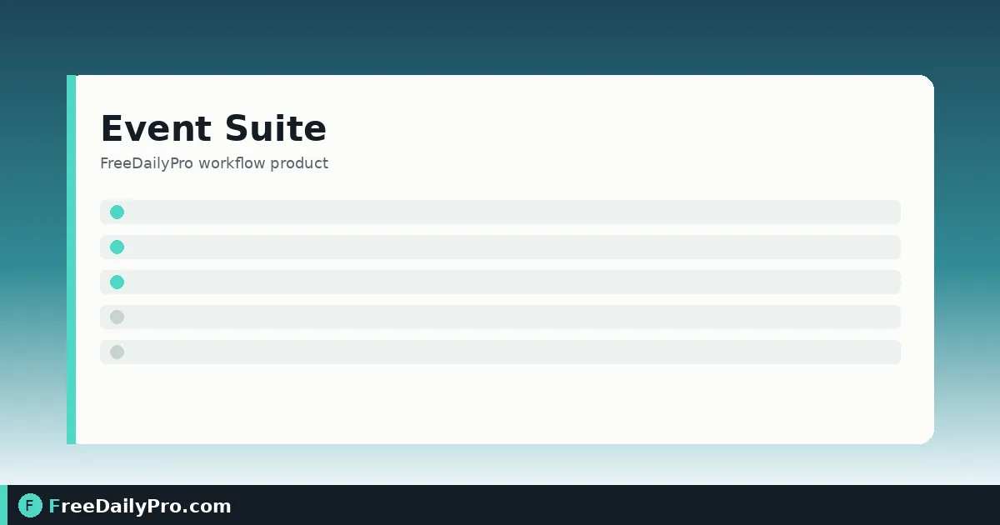

*Starter plan, thirteen products, save once—and publish apps on Premium*

[FreeDailyPro.com](https://www.freedailypro.com) -- Priya Nair plans Midwest Product Expo 2027 in Columbus, Ohio. Last year the guest list lived in a spreadsheet, the budget in another, and the running order in a third—each slightly wrong by show week. [Event Suite](https://www.freedailypro.com/tool/event-suite) is the workflow product that puts planning in one shared project: pick an event type, add a starter plan, and use thirteen products that all see the same guests, sessions, quotes, and costs.

This guide covers one job only: stand up a real project from empty to “saved and usable,” including when Premium publish apps enter the picture.

## What Event Suite is

One subscription for planning any event—wedding, birthday, corporate event, conference, exhibition, fundraiser, or other. You choose the type, optionally add a starter plan (checklist, budget split, running order counted from your event date), then open the products you need. They share one project, so a guest entered once can flow into invitations, seating, dietary, and rooming without retyping.

Standalone planners still help for single tasks: [Event Checklist Planner](https://www.freedailypro.com/tool/event-checklist-planner), [Event Budget Planner](https://www.freedailypro.com/tool/event-budget-planner), [Guest List Tracker](https://www.freedailypro.com/tool/guest-list-tracker). Category: [event tools](https://www.freedailypro.com/category/event-tools).

## Plans and storage (current facts)

- Event Suite: $29.99 a month, billed monthly, 7-day trial the first time, includes 1 GB of account storage to save and reopen projects.
- Event Suite Premium: $49.99 a month. Adds the three event apps (Event Guide, Door Check, Booth Leads), email to guests with RSVP links and scheduled reminders, and optional text reminders through your own Twilio account.
- No day pass for Event Suite. Cancelling keeps access to the end of the paid month; download copies before data is erased when Premium ends or the account is deleted.
- Organization plans on Professional Tools can include Event Suite (not Premium) for teams.

## Worked example: Midwest Product Expo 2027

- Organiser: Priya Nair
- Type: exhibition / trade show
- Venue: Greater Columbus Convention Center, Columbus, OH
- Dates: 12–13 May 2027
- Time zone: America/New_York
- Starter plan: yes—checklist, budget split, running order from event date
- Save target: project file each night + account save under the 1 GB ceiling

Done definition: project opens tomorrow with guests, budget lines, and programme rooms still linked—not three files that disagree.

## Steps: first session on Event Suite

1. Open [Event Suite](https://www.freedailypro.com/tool/event-suite) and sign in with the subscription you need.
2. Choose the event type that matches the job (exhibition for Priya).
3. Add the starter plan if you want a checklist, budget split, and running order to edit. Treat those as typical examples, not mandatory rules.
4. Enter event name, venue, address, dates, and time zone before deep guest work.
5. Open the products you need—guest list, programme, budget, vendors—knowing they share the project.
6. Save the project file at the end of the session, or save to your account (1 GB shared storage on both plans).
7. On Premium, when the plan is stable enough for phones, press **Publish event** to create guest, door, and booth links for the installable apps. Press **Update** after real programme changes.
8. If you work with a team, review whether an organization plan is cheaper per seat than individual subscriptions.

## Starter plan without cargo cult

The checklist, budget, and running order are starting points. Delete lines that do not apply. Add lines your venue requires. The failure mode is treating the sample as a compliance document.

## Premium publish in one paragraph

Premium’s Publish event freezes a snapshot apps can read. Guests open Event Guide; door staff open Door Check; each exhibitor gets a Booth Leads link. Details of those apps are covered in the Event Suite Premium app guides already on the blog. This post’s job is the shared project that feeds them.

## Common mistakes

- Closing the tab without saving a project file or account save.
- Building guests in a side spreadsheet “just for now” and never pasting them into the suite.
- Publishing apps before venue address and time zone are correct.
- Assuming the sitewide $1 day pass covers Event Suite—it does not; Event Suite is its own subscription.
- Expecting live ticket sales platforms or multi-device staff systems to be fully replaced without dedicated ticketing software alongside it.

## Limits and good to know

- Work stays in the browser tab unless you save a project file or save to account storage (1 GB).
- Starter plans are examples. Your event rules come from your contracts and venue.
- Premium apps, guest email, RSVP, and Twilio texts follow the Premium data and messaging rules (organiser responsibility for consent; Twilio on the organiser’s account).
- Do not promise door speed or camera success on every phone; use search when a pass will not scan.
- Among FreeDailyPro’s 200+ professional tools, Event Suite is the multi-product event workspace; single event planners remain available without the suite subscription.

## Session hygiene

Priya’s rule: save before lunch, save before leaving, open only the project file that has yesterday’s date in the name. Account save is the cross-device safety net under 1 GB.

## FAQ

**Is Event Suite included in the $4.99 tools plan?**
No. It is a separate monthly product (or via organization plans as described on pricing).

**Do I need Premium on day one?**
Only if you need the phone apps, guest email/RSVP, or Twilio texts. Planning products run on Event Suite with storage on both plans.

**Where do files live?**
In the tab until you save. Account storage holds what you choose to keep, up to 1 GB, until you delete it or the plan/account ends.

## Closing next step

One shared project beats three disagreeing files. Open [Event Suite](https://www.freedailypro.com/tool/event-suite), pick the event type, load a starter plan you will edit, and save before you close the tab.

If you want a wedding-only starter walkthrough or a Premium publish dry run next, write to [https://www.freedailypro.com/contact](https://www.freedailypro.com/contact).
