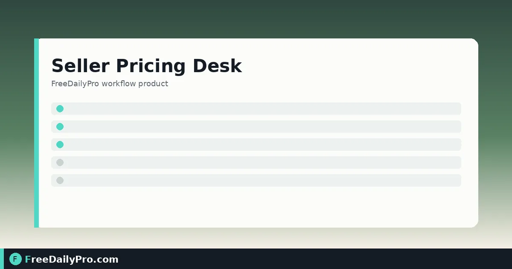

*See real profit at today’s price and the price that hits your margin*

[FreeDailyPro.com](https://www.freedailypro.com) -- Jordan Blake sells leather cable organizers on Etsy and Shopify from a garage studio in Denver, Colorado. Last quarter a “good” $28 price quietly lost money after marketplace fees, payment fees, and the shipping Jordan actually pays. [Seller Pricing Desk](https://www.freedailypro.com/tool/seller-pricing-desk) is the sheet that prices each product so a sale leaves the margin you want after those costs—and shows what the current price really earns.

This guide covers one job only: rebuild a small catalog’s prices from live fee numbers, not from last year’s gut feel.

## Margin, not markup

Margin is profit as a share of the selling price. Markup is profit as a share of your cost. A product that costs $10 and sells for $20 has a 50% margin and a 100% markup. Seller Pricing Desk uses margin. If you aim for “30%” without saying which, you will set the wrong price.

Related one-off checks: [Marketplace Fee Calculator](https://www.freedailypro.com/tool/marketplace-fee-calculator), [Profit Margin Calculator](https://www.freedailypro.com/tool/profit-margin-calculator), [Break-Even Calculator](https://www.freedailypro.com/tool/break-even-calculator). Category: [ecommerce tools](https://www.freedailypro.com/category/ecommerce-tools).

## Worked example: eight SKUs, Denver CO

- Seller: Jordan Blake, Ridge Line Goods
- Currency: USD
- Target margin: 32% of price
- Fees: copied from the marketplace fee page and payment provider fee page the morning of the pricing session
- Round price up to: $0.00 (Jordan rounds to whole dollars after the tool suggests)
- Sample SKU: “Compact Cable Tray — Black”
  - Cost: $9.40
  - Shipping Jordan pays: $3.25
  - Current list price: $28.00

Done definition: every SKU has a suggested price that hits 32% after fees, and a note of profit or loss at the old price.

## Steps on Seller Pricing Desk

1. Open [Seller Pricing Desk](https://www.freedailypro.com/tool/seller-pricing-desk).
2. Enter marketplace percentage and fixed fee, payment percentage and fixed fee, and any ad cost you want included for a typical sale—from the providers’ own pages, not memory.
3. Set target margin (% of price) and rounding rule.
4. Add each product: cost, shipping you pay, current price.
5. Read the suggested price (lowest price that leaves your margin after the fees you entered) and the profit at the current price.
6. When a row loses money, fix shipping and fees first; many “bad prices” are incomplete cost lines.
7. Download Excel or CSV when the sheet is ready for your pricing meeting. One download counts as one use on file-based tracking where applicable.
8. Use Back up if you need to continue later; closing the tab erases the list from the desk.

## Why the suggested price can look “high”

Fees take a cut of the selling price. To keep a fixed share of that price as profit, the list price must rise by more than the fee alone. The desk solves that exactly from your inputs. If the number surprises you, re-check fee percentages before cutting margin.

## Common mistakes

- Leaving fees blank and wondering why the tool “won’t guess” (fees change by seller type, country, and category).
- Using markup math while typing a margin target.
- Ignoring packaging and the fixed fee per order.
- Pricing only one channel’s fees while selling on two.
- Expecting the desk to calculate sales tax or your hourly labor—it does not.
- Never re-running the sheet after a marketplace fee update.

## Limits and good to know

- Fees are never pre-filled; you copy them from the marketplace and payment pages so results match your account type.
- The tool prices one sale at a time. It is not a multi-unit volume model or a full P&L.
- It does not convert currencies or file tax returns.
- Entries stay in the browser tab and are erased when you close it; use Back up for your own copy.
- Among FreeDailyPro’s 200+ professional tools, this desk is the multi-SKU fee-aware pricer; single calculators remain available for quick checks.
- Non-file calculators on the site are unlimited for everyone; file downloads still follow the site’s trial usage rules where they apply.

## When to re-run the sheet

Re-run when the marketplace publishes a fee change, when carrier rates move shipping you pay, or when you add paid ads as a per-sale cost. Jordan re-runs the sheet the morning after any email titled “fee update.”

## Channel fees side by side

Jordan keeps two fee blocks in a notes app: Etsy and Shopify payments. On pricing day he loads one channel’s fees, downloads the CSV, clears the desk, then loads the other channel. Comparing the two CSVs shows which SKUs only work on one channel at the target margin.

If a SKU only clears margin on Shopify, he either raises the Etsy price or stops promoting that SKU on Etsy until fees move. The desk does not make that business call; it only makes the arithmetic visible.

## Ads as a per-sale cost

When Jordan runs promoted listings, he estimates an average ad cost per order for the month and enters it with the other fees. That is rough, but it is better than pretending ads are free. If the month’s ad rate changes a lot, he re-runs the sheet with the new average.

## FAQ

**Why are no fees filled in?**
Because marketplaces change fees often. Your live fee page is the source of truth.

**Can I price many products at once?**
Yes—add each as a line, then download Excel or CSV.

**Is my list stored on FreeDailyPro?**
No. It lives in the tab until you close it unless you Back up to your device.

## Closing next step

Price is not a vibe; it is arithmetic after fees. Open [Seller Pricing Desk](https://www.freedailypro.com/tool/seller-pricing-desk), paste today’s fees, and clear one SKU at a time until every row hits the margin you can live with.

For a full launch board that also checks photos and titles, use [Seller Studio](https://www.freedailypro.com/tool/seller-studio). Questions about a two-channel fee sheet? [https://www.freedailypro.com/contact](https://www.freedailypro.com/contact).
