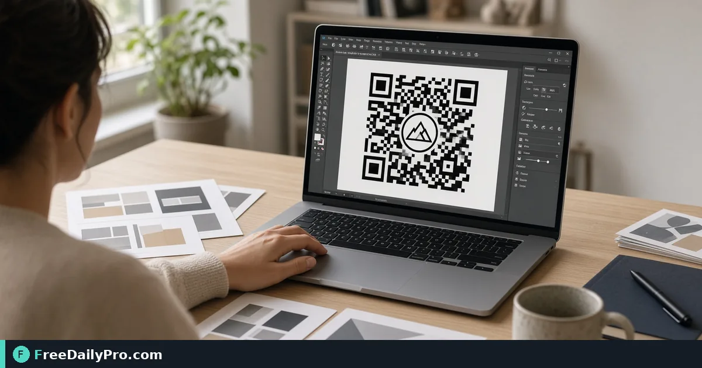

*High-contrast dots, corner styles, and PNG or SVG download that still scans*

[FreeDailyPro.com](https://www.freedailypro.com) -- Priya Shah needs table-tent QR codes for a pop-up shop in Brooklyn that match brand teal without failing when customers scan under warm lights. [Custom QR](https://www.freedailypro.com/tool/custom-qr) is a styled QR maker: dot and corner shapes, solid or gradient colors, optional center logo, download PNG up to 2,000 px or SVG.

This guide covers one job only: design one branded code, keep contrast high, test-scan, then print.

## Style without killing the scan

Low contrast is the usual failure. Keep strong contrast between foreground and background. A logo that covers too much of the center can also hurt scans—size the logo conservatively and test on a real phone.

Bulk jobs: [Bulk QR](https://www.freedailypro.com/tool/bulk-qr). Verify: [QR Scanner](https://www.freedailypro.com/tool/qr-scanner). Linear codes: [Barcode Generator](https://www.freedailypro.com/tool/barcode-generator). Category: [qr tools](https://www.freedailypro.com/category/qr-tools).

## Worked example: pop-up table tent, Brooklyn NY

- Payload: https URL to the day’s menu (HTTPS, short path)
- Brand: dark teal modules on white background
- Logo: small center mark under ~20% of module area (test required)
- Download: SVG for print vendor; PNG 1000 px for social preview
- Done definition: three phones scan in under two seconds under store lighting

## Steps on Custom QR

1. Decide the exact URL or text payload. Prefer short stable URLs.
2. Open [Custom QR](https://www.freedailypro.com/tool/custom-qr).
3. Enter the payload.
4. Choose dot and corner shapes that still read as a clear matrix.
5. Set foreground/background with high contrast. Watch for contrast warnings.
6. Optionally add a logo image; keep it small enough that modules remain readable.
7. Pick download size (300–2000 px) for PNG, or SVG for scale-independent print.
8. Download PNG and/or SVG.
9. Print a one-off on plain paper at 100% scale; scan with two different phones.
10. Only then send the SVG to the print shop for table tents.

## PNG vs SVG

PNG is fine for screens and quick proofs. SVG is better when the print vendor will recolor or scale. If you only have PNG, do not upscale a small export for a large poster—regenerate at a higher pixel size instead.

## Common mistakes

- Teal on gray “for mood” that fails outdoors.
- Giant logo covering the quiet zone and center.
- Tracking parameters that change every day without reprinting codes.
- Printing at “fit to page” and shrinking quiet zones.
- Skipping a physical scan test and discovering failure on opening night.
- Using a URL that redirects through three trackers and times out on venue Wi-Fi.

## Limits and good to know

- Design choices can affect reliability if contrast is low—the tool may warn; respect the warning.
- Gradient corner behavior follows the tool’s rendering; always scan-test final art.
- Among FreeDailyPro’s 200+ professional tools, Custom QR is the brand-styled single code path; Bulk QR handles many payloads at once.
- File downloads follow Professional Tools trial usage rules where applicable.

## Field test protocol

Priya scans with iPhone, Android, and a staff device at the actual table height. If any device fails, she increases contrast or shrinks the logo before reprinting fifty tents.

## Quiet zones on print

Leave empty margin around the code. Table tents that crop the quiet zone fail more often than codes with slightly boring design. Ask the print shop for a 0.25 inch clear border minimum around the matrix.

## Campaign hygiene

Use a dedicated short URL per campaign so you can retire the code without breaking old posters still on walls. Changing the destination behind a short link is safer than reprinting overnight.

## Gradient and corner checks

If you use gradient colors on modules, scan-test more aggressively—some phone cameras struggle with low-contrast gradients. Solid dark modules on white still win for outdoor posters. Corner shapes are cosmetic until they reduce finder-pattern clarity; when in doubt, keep corners classic and express brand in color and logo only.

## Indoor vs outdoor stock

Laminated outdoor signs can glare. Matte stock and larger physical size (without shrinking quiet zones) beat glossy mini-codes on glass doors.

## One payload, many sizes

Export a large PNG for posters and a smaller PNG for email signatures from the same design session so module geometry matches. Do not redesign colors between sizes or you will own two codes that look related but behave differently under scan tests.

## Staff training

Show staff the exact printed sample that passed scan tests so they do not replace it with a low-contrast phone screenshot of the code.

## FAQ

**Will a logo break scanning?**
It can if too large or contrast is weak. Test every design.

**PNG or SVG?**
SVG for print vendors; PNG for quick digital use at a chosen pixel size.

**Why a contrast warning?**
Foreground and background are too close—fix or darken modules.

## Closing next step

Brand is useless if the code will not open. Open [Custom QR](https://www.freedailypro.com/tool/custom-qr), keep contrast high, test-scan, then print.

Need a bulk menu of unique table codes next? [https://www.freedailypro.com/contact](https://www.freedailypro.com/contact).
