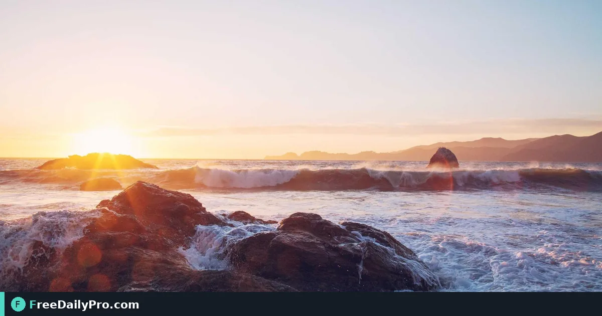

*Style dots, corners, and gradients so the code matches the campaign—not a plain black square*

[FreeDailyPro.com](https://www.freedailypro.com) -- A plain black QR on a teal poster looks like an afterthought. Avery Kim, campaign lead for a Charleston coffee brand, needs landing-page codes that match bag packaging: rounded dots, brand teal-to-navy gradient, and a small cup logo in the center. [Custom QR Code](https://www.freedailypro.com/tool/custom-qr) styles dots and corners, solid or gradient colours, and an optional centre logo, then downloads PNG (up to 2,000 px) or SVG.

One job: enter content, set style and colours, add a logo only when quiet space allows, download, print a test, scan with real phones, then ship art. For marketers and small shops among FreeDailyPro's 200+ professional tools.

## Why custom beats the default generator

[QR Generator](https://www.freedailypro.com/tool/qr-generator) is fine for quick tests. Custom QR is for pieces that sit next to brand guidelines. Error correction rises to the strongest level automatically when a logo is present so scanners still recover data under ink and glare.

## Worked example: bag hang-tag

- URL: `https://northwind.example/spring-blend` (replace with your real link)
- Dot style: rounded; corners: rounded
- Colours: teal (#0D9488) to navy gradient on white
- Logo: simple monochrome cup icon, small
- Output: SVG for the print shop, PNG 1200 px for social mockups

When Avery needs fifty unique URLs, she switches to [Bulk QR](https://www.freedailypro.com/tool/bulk-qr). Category hub: [qr tools](https://www.freedailypro.com/category/qr-tools).

## Steps on Custom QR Code

1. Open [Custom QR Code](https://www.freedailypro.com/tool/custom-qr).
2. Paste the final URL or text (no staging domains you will delete next week).
3. Pick dot style and corner style that match the brand system.
4. Set colours; enable gradient only when contrast against the background stays high.
5. Optionally add a centre logo; keep it small so modules remain readable.
6. Download SVG for print or PNG for digital placements.
7. Print at intended size on real stock; scan with three phone models staff actually use.
8. Archive the source settings (URL, hex values, logo file name) next to the art file.

## Contrast and quiet zone rules that save reprints

Dark modules on light ground still scan best. Light-on-dark can work with high contrast and larger size, but test twice. Never crop the quiet zone to "fit" a tight card. If the design needs a full-bleed photo, place the code in a solid white inset, not on busy beans.

## Common mistakes

- Dropping a full-color photo logo that paints over too many modules.
- Using brand gold on kraft that fails under warehouse LEDs.
- Linking to a URL shortener that changes owners next quarter.
- Skipping the three-phone scan test after the creative director "tightened" the layout.
- Exporting a 200 px PNG for a 4-inch print.

## Limits and good to know

- Strongest error correction engages when a logo is present—still test on target phones.
- PNG max size on the tool page is up to 2,000 px; SVG scales for print.
- File downloads count toward Professional Tools trial usage when applicable.
- Decorative styles never replace a correct payload; double-check the decoded URL.
- This is a styled QR maker, not a bulk engine—use Bulk QR for lists.

## Handoff to the printer

Send SVG + a one-page note: final URL, minimum print width, quiet-zone requirement, and "scan sample before full run." That note prevents a 5,000-piece batch of pretty dead codes.

## Field check at the café counter

Tape one printed hang-tag at the register. Ask three customers to scan before you approve the full carton print. If any fail, increase size or drop the logo before you blame the tool.

## Logo size test matrix

Print three sizes of the same code: logo at 10%, 15%, and 20% of module area (visually). Scan each under indoor LED, window light, and phone flashlight. Keep the largest logo that still scans 3/3. Avery archives that percentage in the brand kit so freelancers stop "making the logo bigger for impact."

## Gradient caution

Gradients look premium on screen and muddy in cheap toner. If the print shop uses economy CMYK, prefer solid brand teal modules on white. Save the gradient PNG for Instagram stories and email headers where screens handle blends cleanly.

## Campaign URL hygiene

Use final production URLs with HTTPS. Avoid marketing links that still 302 through three trackers if those trackers expire. If you must track, use a stable first-party redirect you control. Document UTM parameters in the same sheet as the art so analytics and creative stay aligned.

## Accessibility and alternate entry

Not everyone will scan. Put the short URL in 9–10 pt type under the code on packaging. That single line saves support tickets when a phone camera fails in bright sun.

## Production checklist Avery runs

1. Payload equals live URL
2. SVG + PNG both exported
3. Three-phone scan pass
4. Quiet zone intact in final layout PDF
5. Printer brief attached
6. Source hex + logo file archived

## FAQ-style notes

**Can I use a photo logo?** Only if simplified; full photos usually break modules.
**Black-only?** Still valid and often safest for outdoor posters.
**Does styling change the data?** No—only appearance and scannability.

## Retail shelf vs table tent

Shelf hang-tags need smaller codes with aggressive quiet zones; table tents can run larger modules for older phones. Design two art sizes from the same SVG rather than scaling a tiny PNG up. Avery keeps a "minimum module width" note from the printer so freelancers stop exporting Instagram-sized squares for packaging.

## Closing

Build the styled code in [Custom QR Code](https://www.freedailypro.com/tool/custom-qr), scan it hard, then approve print.

If you need help choosing logo size for packaging stock, message [https://www.freedailypro.com/contact](https://www.freedailypro.com/contact).
