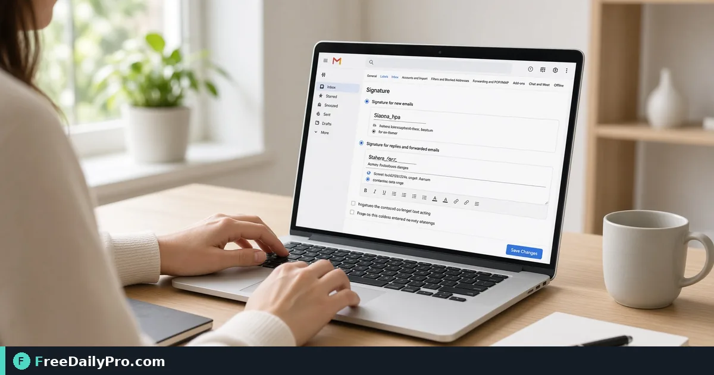

*Name, role, links, and optional logo URL—built in the browser and pasted into settings*

[FreeDailyPro.com](https://www.freedailypro.com) -- Luis Ortega starts a new customer success role in Phoenix and needs a tidy signature that works in Gmail today and Outlook on the company laptop tomorrow. [Email Signature Generator](https://www.freedailypro.com/tool/email-signature-generator) builds a clean signature with name, role, contact details, and links, ready to paste into Gmail, Outlook, Apple Mail, or other clients.

This guide covers one job only: build a short signature, paste it correctly, and verify it on phone and desktop before clients see it.

## What to include (and leave out)

Keep name, role, one phone number, and one or two links. The tool is not a place for long legal disclaimers your company may require separately, and it does not install the signature into your client for you. Logo works if it is already online—paste an `https` image URL; images only on your computer often fail for recipients.

Related: [Resume Builder](https://www.freedailypro.com/tool/resume-builder) for the career package, [Business Card](https://www.freedailypro.com/tool/business-card) for print contact design. Category: [business tools](https://www.freedailypro.com/category/business-tools).

## Worked example: new role setup, Phoenix AZ

- Name + title: Customer Success Lead
- Phone: direct mobile only
- Links: company site + LinkedIn
- Logo: company HTTPS CDN URL
- Done definition: test email to self looks correct on iPhone Mail and desktop Gmail

## Steps on Email Signature Generator

1. Open [Email Signature Generator](https://www.freedailypro.com/tool/email-signature-generator).
2. Enter name, role, phone, email, and links you actually want public.
3. Optional: paste logo web address starting with `https`.
4. Preview and copy the signature.
5. **Gmail:** Settings → See all settings → Signature → create → paste.
6. **Outlook (web):** Settings → Mail → Compose and reply → Email signature → paste.
7. Send a test to yourself and open it on your phone.
8. Fix spacing or missing logo URL, then update the client again.
9. If you use multiple accounts, set the signature per account deliberately.
10. Save a plain-text backup of your details so a client wipe does not erase institutional knowledge.

## Why clients render signatures differently

Email programs handle styling differently. This generator uses plain tables and inline styles for wider support—not fancy web CSS. Slight differences across Gmail and Outlook are normal; the test send is the source of truth.

## Common mistakes

- Hosting the logo only on a local disk path.
- Four social icons, a banner ad, and a confidentiality novel in the signature.
- Pasting into the compose window once instead of into Settings (it never sticks).
- Using tracking short links that break in corporate filters.
- Skipping the phone test where most clients read first.

## Limits and good to know

- Built in the browser; nothing you type is uploaded or stored by FreeDailyPro for this tool.
- Does not push settings into Gmail/Outlook automatically.
- Does not host logo files.
- Among FreeDailyPro’s 200+ professional tools, this is the paste-ready signature builder.
- Company legal blocks may still need a second block mandated by counsel—follow internal policy.

## Team consistency

HR sometimes issues a one-line format guide (title style, phone format, approved links). Luis matches that guide so customer threads do not look like five different companies.

## Mobile-first review

Most clients read on phones. If the signature looks fine on desktop but stacks awkwardly on mobile, remove a line or shorten the title. Prefer fewer fields over a perfect desktop mock that breaks on a five-inch screen.

## Multiple signatures

Sales sometimes needs a short external signature and a longer internal one. Create two signatures in Gmail if the product allows, and train yourself which one is default. Accidental internal-only links in customer mail look unprofessional.

## When you change jobs

Update the signature the same day as the offer acceptance public announcement—not a week later. Old company names in footers are a trust problem.

## Legal blocks

If counsel mandates a confidentiality footer, add it in the client per policy. The generator keeps the human contact block clean; legal text may live in a separate mandatory snippet your IT pushes.

## Hiring and contractor accounts

Contractors on personal Gmail still need a clear company role line if they email customers. Spell out the company name in the role field when the domain is not corporate. Ambiguous signatures create payment and trust confusion.

## Dark mode check

Some phones invert colors. Send a test and view in dark mode. If the logo vanishes on dark backgrounds, choose a logo asset with padding or a version that stays visible.

## Calendar and auto-reply consistency

If your out-of-office reply still shows the old job title, update it the same day as the signature. Clients notice mismatches between signature and auto-reply more than you think.

## Link hygiene

Use full https links to the company site and professional profile. Avoid three tracking redirects that corporate filters strip into broken anchors.

## FAQ

**Gmail path?** Settings → See all settings → Signature → paste.

**Outlook path?** Settings → Mail → Compose and reply → Email signature → paste.

**Logo from my desktop?** Prefer an HTTPS URL; local-only images often fail for others.

## Closing next step

A signature is small and highly visible. Build it once, paste it into settings, and verify on the phone you actually use.

Open [Email Signature Generator](https://www.freedailypro.com/tool/email-signature-generator).

Need a department-wide signature template checklist? [https://www.freedailypro.com/contact](https://www.freedailypro.com/contact).
