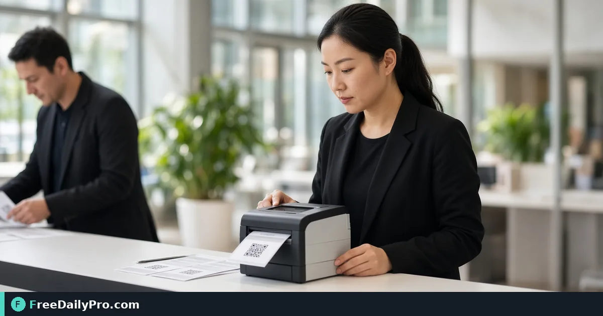

*Letter or A4 badge sheets, guest names, and door-ready QR when guests come from your project*

[FreeDailyPro.com](https://www.freedailypro.com) -- Priya Nair needs 180 badges for Midwest Product Expo registration in Columbus by Friday. Typing names into a slide deck will fail the schedule. [Name Badge Maker](https://www.freedailypro.com/tool/name-badge-maker) prints badges on insert or label sheets (US Letter or A4) with event name, person name, organisation, role, and an optional QR pass that door check can read offline when guests come from the project.

This guide covers one job only: print accurate badges on the correct sheet grid, with optional QR, without “Fit to page” disasters.

## Sheet types that matter

- Name badge inserts, 6 per sheet, 4×3 in (Avery 5392 and equivalents, US Letter)
- Large labels/badges, 8 per sheet (Avery L7165 and equivalents, A4)
- My own grid if your pack differs—measure the sheet

Print at **100% / Actual size**, never Fit to page. Test on plain paper and hold against a real sheet first. Thin outlines help on plain paper; skip outlines on insert sheets that already have cut guides.

## Names and QR passes

Guests can come from your project list or a typed list (`Name | Organisation | Role` per line). Typed badges have no QR pass—use project guests when you need QR for door check. Extra blank badges cover walk-ins (event band, no name). “Start at badge” helps finish a part-used sheet.

Guest list: [Guest List Tracker](https://www.freedailypro.com/tool/guest-list-tracker). Shared project: [Event Suite](https://www.freedailypro.com/tool/event-suite). Standalone QR design: [Custom QR](https://www.freedailypro.com/tool/custom-qr). Category: [event tools](https://www.freedailypro.com/category/event-tools).

## Worked example: expo registration, Columbus OH

- Sheet: Avery 5392 style, 6-up Letter
- Source: project guests confirmed for day 1
- QR pass: on for door check offline
- Blanks: 15 walk-ins
- Done definition: sample sheet aligns with insert holes; three random QR pass door tests succeed

## Steps on Name Badge Maker

1. Finalize the guest list (spelling, organisation, role).
2. Open [Name Badge Maker](https://www.freedailypro.com/tool/name-badge-maker).
3. Choose project guests or paste typed lines.
4. Set event name on the badge band.
5. Pick the sheet grid that matches the pack in your hand—or measure for custom grid.
6. Enable QR pass only when guests are project guests and door staff will scan them.
7. Add blank badges for walk-ins if needed.
8. Download the PDF.
9. Print one test page at 100% on plain paper; align to a real insert sheet.
10. Run the full print on badge stock; keep a reprint PDF for no-shows who arrive late.

## Common mistakes

- Fit to page, shifting every name off the insert.
- Wrong Avery template for the stock in the box.
- Expecting QR on typed-only names.
- Skipping the plain-paper alignment test.
- Uploading guest lists to random design sites against privacy policy—this tool keeps names in the browser.

## Limits and good to know

- Names and PDFs are made in the browser; nothing is uploaded or kept unless you save a project file.
- Not a full plastic card embosser workflow.
- Among FreeDailyPro’s 200+ professional tools, this is the event badge print path with optional QR.
- Door QR success still depends on print contrast and scanner practice—test on the actual door device.

## Registration desk kit

Priya packs: badge stock, spare printer, plain test paper, markers for blanks, and a printed “100% scale only” sticky on the printer. Walk-in blanks prevent whiteboard name chaos.

## Spelling triage

Send a “name check” email 48 hours before print. People notice misspelled names on badges more than almost any other detail. Fix the guest list before you burn badge stock.

## Lanyard and clip logistics

Badges without clips still fail the guest experience. Pack clips and spare lanyards in the same box as the printed sheets. Registration staff should not hunt the supply closet during doors.

## Partial sheet printing

When a sheet is half used, “Start at badge” saves stock. Document which sheet number you stopped on so the next volunteer does not reprint names 1–3 again.

## Privacy at the printer

Do not leave guest PDFs on a hotel business-center computer. Download, print, delete local copies, and log out. Browser-side generation still produces a file on disk once you save the PDF.

## Day-of reprint station

Keep a laptop with the badge PDF and a small label printer or spare sheet stock at registration. When a badge is wrong, reprint one name instead of handwritten sticky notes that look unofficial in photos.

## Role line usefulness

Roles like Speaker, Exhibitor, Staff help networking and security. Keep them short. Long role strings wrap into unreadable badges.

## FAQ

**QR on every badge?** Only project guests get QR passes; typed lines do not.

**Walk-ins?** Add blank badges; fill names by hand.

**Are names uploaded?** No—browser-side unless you save a project.

## Closing next step

Badges are a logistics product. Match the sheet, print at 100%, test QR if you use it, then run the full set.

Open [Name Badge Maker](https://www.freedailypro.com/tool/name-badge-maker).

Need a door-check + badge dry run checklist? [https://www.freedailypro.com/contact](https://www.freedailypro.com/contact).
