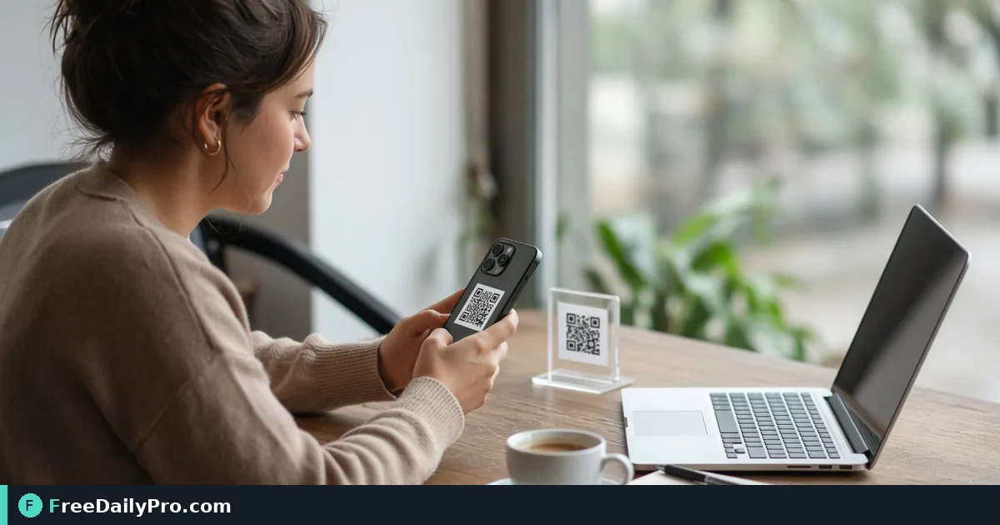

*Decode a live scan or a photo, open real links carefully, and save the result as text*

[FreeDailyPro.com](https://www.freedailypro.com) -- Before a product launch, Maya Torres needs to prove every printed QR on shelf tags and table tents opens the right HTTPS page—not a draft short link from last spring. [QR & Barcode Scanner](https://www.freedailypro.com/tool/qr-scanner) reads codes with the device camera or an uploaded image, shows the decoded payload, and turns real links into something you can open, copy, download as text, or share.

This guide covers one job only: verify or read a code reliably, understand warnings, and keep a record of what was scanned.

## Camera path and upload path

Live camera scanning uses a JavaScript decoder rather than relying on one browser’s native barcode API, so behavior is designed to stay consistent in Chrome, Safari, and Firefox once camera permission is granted. If access is denied, fix the browser site permission and reload—do not assume the tool is broken.

Upload path: drop a photo of the code. Sharp, well-lit, mostly frontal images decode; blurry or heavily angled shots fail more often. Files over about 50 MB may be slow or hit browser memory.

Create codes with [Custom QR](https://www.freedailypro.com/tool/custom-qr) or [Bulk QR](https://www.freedailypro.com/tool/bulk-qr); linear product codes with [Barcode Generator](https://www.freedailypro.com/tool/barcode-generator). Category: [qr tools](https://www.freedailypro.com/category/qr-tools).

## Worked example: shelf-tag proof, Austin TX

- Codes: 12 shelf QR + 4 table-tent QR from the spring campaign
- Method: camera on the phone for in-store tags; upload photos for outdoor tent shots taken at noon
- Done definition: every code opens the correct product page on HTTPS; shortener warnings investigated; results copied into a proof sheet

## Steps on QR & Barcode Scanner

1. Open [QR & Barcode Scanner](https://www.freedailypro.com/tool/qr-scanner) on the device you will use on the floor.
2. Allow camera access if you need live scan; pick the rear camera for paper tags when available.
3. Hold steady until the payload appears, or upload a sharp photo instead.
4. Read the decoded text carefully—confirm host, path, and campaign parameters.
5. If the result is a web address, email, phone, or SMS link, use the clickable open control only after you trust the destination.
6. Use Copy for the clipboard, Download .txt for a file archive, or Share on mobile when you need to send the payload to a teammate.
7. Log the badge/tag ID next to the payload in your proof spreadsheet.
8. Re-print or re-generate any code that opens a wrong or dead URL before the full carton ships.

## Link warnings that are advice, not a lock

Two cases are commonly flagged: plain `http` (not encrypted) and known shorteners where the final destination is hidden. The warning is advice; the link can still open if you click it. For campaign proof, prefer expanding shorteners yourself and storing the final HTTPS URL in the proof sheet.

Wi-Fi login payloads and contact cards decode as structured text—use them for setup, not as a substitute for IT-approved network onboarding when policy requires it.

## Common mistakes

- Approving art from a blurry phone photo of a QR on a glossy screen.
- Ignoring `http` warnings on customer-facing tags.
- Scanning one sample and assuming the whole bulk ZIP is correct.
- Using a staging domain still live on printed stock.
- Forgetting to revoke camera permission on a shared kiosk after the shift.

## Limits and good to know

- Scanning stays in the browser tab; results are not uploaded to FreeDailyPro for storage.
- Large image uploads can stress memory—crop to the code when possible.
- Among FreeDailyPro’s 200+ professional tools, this is the decode side of the QR/barcode set.
- File downloads follow Professional Tools trial usage rules where they apply.
- It does not replace a dedicated industrial scanner for high-volume warehouse lines.

## Proof sheet habit

Maya’s sheet has columns: SKU, code type, payload, HTTPS ok, shortener flag, phone models tested, pass/fail. Three phones beat one. Failures go back to design before print.

## Field lighting

Warehouse LEDs and outdoor sun both break low-contrast branded codes. If camera scan fails but a high-contrast black-on-white reprint works, the payload was fine—the art was not.

## Warehouse versus retail floor

Warehouse codes often sit on stretch wrap under fluorescent light; retail tags sit at eye level under warm LEDs. Test both environments if your campaign spans them. A code that scans at the desk can fail on the floor when plastic glare overpowers the modules.

## Bulk proof pairing

When codes come from Bulk QR, keep `index.csv` open while you scan. Mark pass/fail on the CSV row itself so reprints target only failed lines. Do not regenerate the entire ZIP because one URL was wrong.

## Team handoff

If marketing owns art and ops owns floor proof, ops should return a short list of failing payloads with photos of the physical tags. That closes the loop faster than “some codes don’t work.”

## FAQ

**Camera denied?** Fix site permissions for the camera, then reload the tool page.

**Can I open the link directly?** Yes when it is a real link type—still read the host first.

**Save the result?** Copy, Download .txt, or Share depending on the device.

## Closing next step

Do not ship codes you have never decoded. Open [QR & Barcode Scanner](https://www.freedailypro.com/tool/qr-scanner), scan every unique payload, and archive the proof sheet before the printer’s full run.

Need a bulk proof workflow tied to index.csv? [https://www.freedailypro.com/contact](https://www.freedailypro.com/contact).
