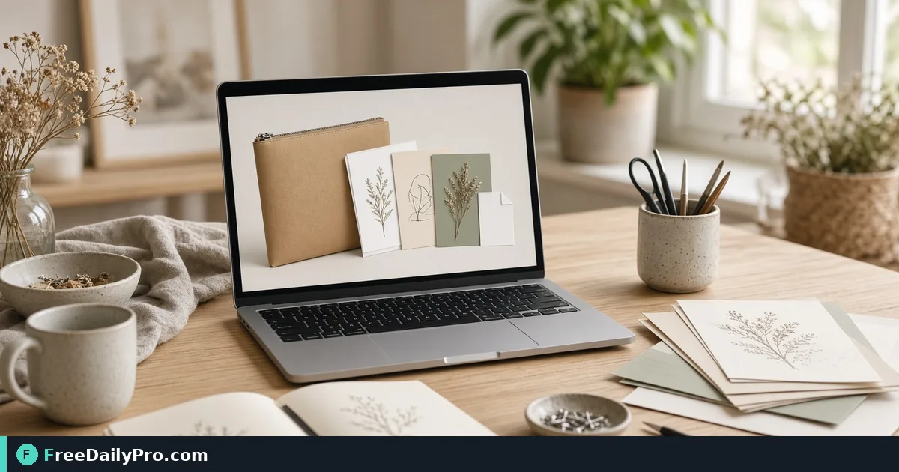

*Product files, LICENSE.txt, how-to note, and optional 2000px square cover—built in the browser*

[FreeDailyPro.com](https://www.freedailypro.com) -- Avery Kim sells planner printables and needs one tidy ZIP: files, license, how-to note—not five loose attachments buyers get lost in. [Digital Download Packager](https://www.freedailypro.com/tool/digital-download-packager) packs printables, templates, or fonts into one ZIP with a license and how-to-use note, and can make a 2000 px square cover image for the listing.

This guide covers one job only: ship a clear buyer package and a listing cover without uploading product files to a server.

## What goes in the ZIP

Your files, optional `LICENSE.txt` with the wording you choose, and optional `README.txt` listing files plus your how-to note. You can toggle license, README, and related options per the tool UI. Name files clearly—buyers see those names.

**License is a plain template, not legal advice.** Change it to match what you allow; have it reviewed if terms matter.

Fees after packaging: [Marketplace Fee Calculator](https://www.freedailypro.com/tool/marketplace-fee-calculator), [Profit Margin Calculator](https://www.freedailypro.com/tool/profit-margin-calculator). Category: [business tools](https://www.freedailypro.com/category/business-tools).

## Worked example: wedding menu printable set

- Files: 3 PDFs + 1 font note
- License: personal and small business use (edited to match Avery’s shop policy)
- README: print at 100%, paper weight tip, contact email
- Cover: 2000 px square from the tool for the shop thumbnail
- Done definition: open ZIP on a second computer; buyer path is obvious in under a minute

## Steps on Digital Download Packager

1. Finalize product files with clear names (`01_Menu_Letter.pdf`, not `finalFINAL2.pdf`).
2. Open [Digital Download Packager](https://www.freedailypro.com/tool/digital-download-packager).
3. Drop files (over ~200 MB may stress browser memory).
4. Enter product name, seller/contact (email or shop link).
5. Choose license wording; preview; edit to match real permissions.
6. Write how-to-use notes (main file first).
7. Download ZIP.
8. Optionally make a 2000 px square cover image for the listing.
9. Open the ZIP yourself before uploading to the marketplace.
10. Note marketplace file-count/size limits if the tool warns—confirm current platform caps.

## Marketplace size and count warnings

Some marketplaces limit how many digital files a listing holds and how large each can be. Tool warnings use commonly published figures—**check the platform’s current limits**. Split products if needed rather than shipping a huge multi-product archive that confuses buyers.

## Common mistakes

- Treating the license template as lawyer-approved without edits.
- Vague file names so buyers open the wrong PDF first.
- Skipping the self-open test of the ZIP.
- Putting commercial-resale rights in marketing copy but personal-use only in LICENSE.txt.
- Uploading the working folder instead of the packaged ZIP.

## Limits and good to know

- ZIP and cover image build in the browser; files not uploaded; nothing kept after close.
- Among FreeDailyPro’s 200+ professional tools, this is the digital-product packaging path.
- Not a full DRM or license-enforcement system.
- File-heavy runs follow trial usage rules on Professional Tools where applicable.

## Versioning downloads

`MenuSet_v1.2.zip` with a changelog line in README. When you fix a typo, bump the version so support knows what the buyer has.

## Support deflection

A good README cuts “how do I open this?” tickets. Include software needed (e.g., PDF reader), print scale, and your contact. Put the main PDF first in the note.

## Cover image use

The 2000 px square is for listings—not a substitute for lifestyle photos. Use it as the clean product icon; still shoot real mockups for the gallery.

## Personal vs commercial license clarity

If you sell a commercial license as an upgrade, package two SKUs or two ZIPs with different LICENSE.txt files. Mixing permissions in one download creates refund disputes.

## File order inside the ZIP

Put `README.txt` and `LICENSE.txt` at the top level, not buried in subfolders. Buyers on phones struggle with nested archives. Main creative files can live in a `files/` subfolder if you explain that in the README.

## Fonts and licensing

If the ZIP includes fonts, your license must match the font foundry rules—not only your printable terms. When in doubt, link to the font license instead of redistributing a font you cannot share.

## Pre-listing QA checklist

1. Open ZIP on Windows and Mac if you can
2. Open every PDF
3. Confirm license matches listing description
4. Confirm cover square is sharp
5. Confirm shop contact works

## Refunds and package proof

Keep the exact ZIP hash or export date for each version you sold. When a buyer claims “files missing,” compare versions instead of arguing from memory.

## Thumbnail vs full cover

Marketplace thumbnails crush detail. After generating the 2000 px square, view it at 200 px wide. If the product title is unreadable, simplify the cover art before listing.

## FAQ

**Is the license legal advice?** No—template only.

**What is in the ZIP?** Your files + optional LICENSE + README.

**Are files uploaded?** No—browser-side package.

## Closing next step

Package once, test once, list once. Open [Digital Download Packager](https://www.freedailypro.com/tool/digital-download-packager), build the ZIP and cover, then upload with confidence.

Need a fee + margin pass for a new printable SKU? [https://www.freedailypro.com/contact](https://www.freedailypro.com/contact).
