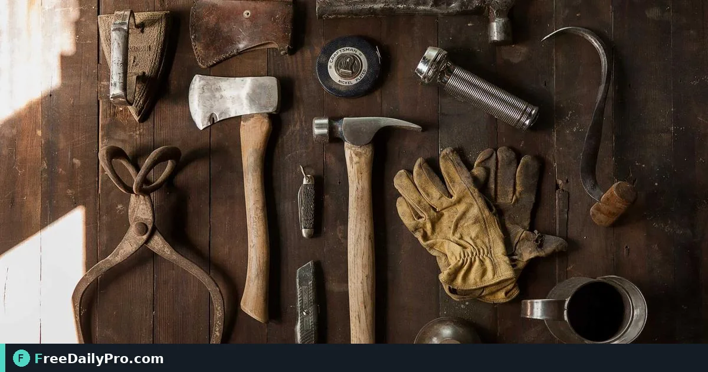

*Batch-size listing images to marketplace guidance, on white, with warnings for shots that are too small*

[FreeDailyPro.com](https://www.freedailypro.com) -- Your product shots look fine on the phone, but Etsy, eBay or Amazon each want different pixel sizes, and a too-small original cannot be magically enlarged. [Listing Photo Pack](https://www.freedailypro.com/tool/listing-photo-pack) sizes product photos for Etsy, eBay, Amazon, a typical real-estate listing size, your own site or a custom size—in one go—with notes on anything too small.

This guide covers one job only: pick the marketplace, drop photos, generate white-backed JPEGs at recommended sizes, and fix undersized shots at the camera—not in software. Cut busy backgrounds first with [Remove Background](https://www.freedailypro.com/tool/remove-background), convert phone HEIC with [HEIC to JPG](https://www.freedailypro.com/tool/heic-to-jpg) if needed, and lighten portals with [Compress Image](https://www.freedailypro.com/tool/compress-image). Category: [ecommerce tools](https://www.freedailypro.com/category/ecommerce-tools).

## Downscale only, never fake resolution

A photo is only ever made smaller. If the original is below the marketplace recommendation, it stays as-is and the tool warns you. Etsy and eBay sizes follow their help pages (checked October 2026); Amazon follows widely published guidance because Seller Central often needs a login—verify in your seller account. Custom sizes cover your own shop. Each output is a fresh JPEG on white; transparent areas become white. EXIF such as GPS is not kept because pixels are redrawn.

## Worked example: handmade ceramics on Etsy

Nia shoots ten pot photos on a phone. Two are under the recommended long edge. She removes busy table backgrounds, runs Listing Photo Pack for Etsy, downloads the ZIP, and re-shoots the two flagged images closer with more light. Trial batches allow up to 5 photos per use; paid plans lift that batch limit.

## Steps on Listing Photo Pack

1. Open [Listing Photo Pack](https://www.freedailypro.com/tool/listing-photo-pack).
2. Choose Etsy, eBay, Amazon, real-estate style, own site or Custom.
3. Convert HEIC masters to JPG first if required.
4. Remove busy backgrounds when the marketplace expects white.
5. Drop up to the batch size allowed on your plan (trial: up to 5 per use).
6. Click Make listing photos.
7. Read size notes and undersize warnings.
8. Download individually or as a ZIP.
9. Re-shoot any undersized images; do not upscale blur.
10. Upload to the marketplace and archive the ZIP with SKU names.

## Common mistakes

- Stretching a 600 px image to “meet” a 2000 px guideline.
- Leaving cluttered backgrounds when the channel expects white.
- Mixing portrait and landscape inconsistently across a variation set.
- Ignoring GPS privacy on phone photos (this tool redraws without EXIF, but your masters may still hold it).
- Uploading the unprocessed phone originals after preparing a clean pack.

## Limits and good to know

It places photos on white but does not cut the product out—use Remove Background first. Among FreeDailyPro’s 200+ professional tools this pack is for marketplace prep, not full studio retouching. Trial usage: up to 5 photos per use as one trial usage; paid plans remove that batch cap. Always confirm live marketplace rules.

## Edge cases

Real-estate listing size: use the real-estate option for MLS-style dimensions when appropriate. Multi-channel sellers: run once per channel rather than forcing one size everywhere. Jewelry close-ups: watch minimum detail—re-shoot rather than enlarge.

## Naming convention

SKU-angle-size.jpg (for example mug-blue-front-etsy.jpg) keeps packs searchable six months later when you reopen ads.

## Channel differences in practice

Etsy buyers often tolerate lifestyle scenes; Amazon main images usually demand product-only on white. eBay sits between, depending on category norms. Run Listing Photo Pack once per channel instead of forcing a single compromise size. Keep a “masters” folder of full-resolution edited images and a “channel packs” folder of outputs so you can regenerate when a marketplace changes its help page. Re-check sizes periodically—the October 2026 references on the tool page can age, and Seller Central rules shift.

## Variation image consistency

For colour or size variations, shoot on the same background and distance so Listing Photo Pack outputs look like a set. Marketplaces rank listings higher when the gallery feels coherent rather than randomly cropped.

## Main image versus gallery

Marketplaces treat the first image as the catalogue face—usually product-only on white. Lifestyle shots belong later in the gallery. Run Listing Photo Pack for the main image size, then again for secondary sizes only if a channel demands different pixel boxes. Keep a checklist per SKU: main, alternate angle, scale reference, lifestyle.

## Too-small warnings are a gift

When the tool flags an undersized original, schedule a reshoot instead of submitting soft images. Soft main images lower conversion more than a one-day listing delay.

Before a big catalogue upload, process a pilot of five SKUs end-to-end: shoot, remove background if needed, Listing Photo Pack, upload, and check the live listing crop. Only then batch the rest. Pilots catch channel-specific crop quirks cheaper than fixing 200 live listings.

Store the ZIP of each channel pack under sku/channel/date so ads teams can grab known-good images without re-exporting from phones.

## Colour accuracy notes

Marketplace JPEG recompression can shift colours slightly. Shoot and edit in a consistent white-balance workflow before Listing Photo Pack, because the pack sizes and flattens to JPEG on white—it is not a colour-managed print pipeline. For brand-critical colour, include a note in your studio SOP about lighting and a grey card.

## Next step

Marketplace photo rules are boring until a listing is suppressed for size. Open [Listing Photo Pack](https://www.freedailypro.com/tool/listing-photo-pack), pick the channel, and download a pack that matches the guide—not a guess.

Which marketplace size presets should we add next? Tell FreeDailyPro on [the contact page](https://www.freedailypro.com/contact).
