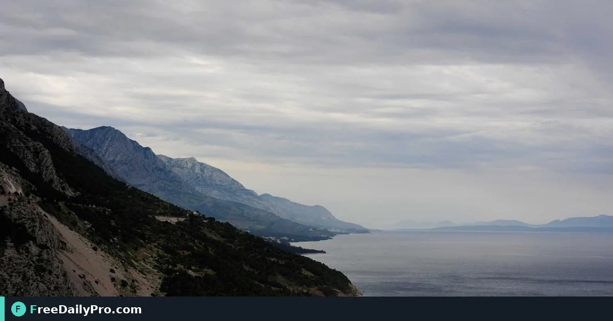

*Cut one picture into equal tiles for profile grids, multi-sheet posters or puzzle pieces*

[FreeDailyPro.com](https://www.freedailypro.com) -- You designed one wide banner, but the Instagram profile grid needs nine tiles that reassemble into that banner when posted in the right order. [Image Splitter](https://www.freedailypro.com/tool/image-splitter) cuts a picture into a grid of equal tiles with no gaps or overlaps, supports Instagram posting order, and downloads every tile together as a ZIP.

This guide covers one job only: choose rows and columns, preview the cut lines, export PNG or JPEG tiles, and post in the numbered order the tool provides. Prep canvas sizes with [Social Media Formatter](https://www.freedailypro.com/tool/social-media-formatter), lighten files with [Compress Image](https://www.freedailypro.com/tool/compress-image), and clean subjects first with [Remove Background](https://www.freedailypro.com/tool/remove-background) when needed. Category: [image tools](https://www.freedailypro.com/category/image-tools).

## Instagram order is opposite to intuition

Instagram shows the newest post at the top-left of the profile grid. When you tick the Instagram order option, files are named post01, post02 and so on from the bottom-right tile toward the top-left so that posting in number order builds the picture correctly. Without that option, tiles follow a simple left-to-right, top-to-bottom reading order better for posters and puzzles. Tiles cover the whole image; if dimensions do not divide evenly, some tiles differ by at most one pixel.

## Worked example: 3×3 product grid

A candle brand designs a 3240×3240 master. They split 3 rows × 3 columns with Instagram order on, export PNG for sharpness, then compress slightly for upload. They post post01 first through post09. The profile grid reassembles the master. For a window poster, they instead use 2×2 JPEG tiles and print each on letter paper.

## Steps on Image Splitter

1. Open [Image Splitter](https://www.freedailypro.com/tool/image-splitter).
2. Drop a high-resolution master image.
3. Choose rows and columns or a preset (for example 3×3).
4. Check the preview lines; adjust if a face or logo sits on a cut.
5. Enable Instagram order when the destination is a profile grid.
6. Choose PNG for quality/transparency or JPEG for smaller files.
7. Click Split and download the ZIP of all tiles.
8. Unzip and verify post01… names if using Instagram order.
9. Upload/post in the numbered sequence.
10. Archive the master and the ZIP together for future campaigns.

## Common mistakes

- Posting tiles in visual left-to-right order on Instagram so the grid scrambles.
- Cutting a low-resolution image into many tiles that look soft on retina screens.
- Leaving important text across a tile boundary.
- Choosing 20×20 on a huge photo and exhausting device memory.
- Using JPEG for graphics that needed transparent PNG edges.

## Limits and good to know

Maximum 20 rows and 20 columns, and never more tiles than pixels across the image. Processing is local in the browser—pictures are not uploaded for storage. Among FreeDailyPro’s 200+ professional tools this one is built for grid and multi-sheet layouts. Where downloads count toward the daily allowance, expect 10 trial usages for image splitter, then a day pass or monthly options when you need more.

## Edge cases

Panoramas: more columns than rows. Puzzle parties: print tiles with light crop marks outside the tool if needed. Carousel ads: different platforms order tiles differently—do not assume Instagram rules apply.

## Design tip before you split

Keep faces and logos inside a single tile when possible. Soft gradients hide seams better than one-pixel lines that sit on a cut.

## Planning the master canvas

Design the master at a resolution that divides cleanly by your grid. For a 3×3 Instagram-style grid, a square master at 3240×3240 (or another multiple of 3) keeps tile sizes even. Keep safe margins inside each future tile so text is not clipped by the platform’s thumbnail crop. Soft backgrounds hide seams; hard vertical lines on cut boundaries advertise the split. Export PNG tiles when type is involved; switch to JPEG only when file size is the bottleneck and edges are photographic.

## Scheduling the nine posts

If you use a scheduler, queue post01 through post09 with short gaps so the grid builds in order without overnight scrambling. Do not interleave unrelated posts mid-build or the mosaic breaks.

## Accessibility of grid posts

Each tile may be viewed alone in a feed before the profile grid is seen. Avoid putting essential text only on a seam. Alt text on each post should describe that tile, not only “part of grid.” When the mosaic is decorative, say so in the first caption.

## Non-Instagram uses

Classroom posters, shop window multi-sheet prints and puzzle fundraisers all use the same split. For print, prefer PNG or high-quality JPEG and test one tile at 100% scale before committing ink to all nine.

Brand colours that sit on cut lines can flicker when tiles load at different times. Prefer soft gradients across seams. If you must place a logo, keep it wholly inside one centre tile.

After posting, visit the profile grid on a phone—desktop previews lie about spacing. If one tile looks darker, re-export that tile from the master rather than editing only the upload, so the archived ZIP still matches live.

## Next step

One master image can become a grid that still reads as one story. Open [Image Splitter](https://www.freedailypro.com/tool/image-splitter), set the grid, enable Instagram order when you need it, and download the ZIP.

Would safe-zone guides for faces on tile edges help your grids? Message FreeDailyPro at [contact](https://www.freedailypro.com/contact).
