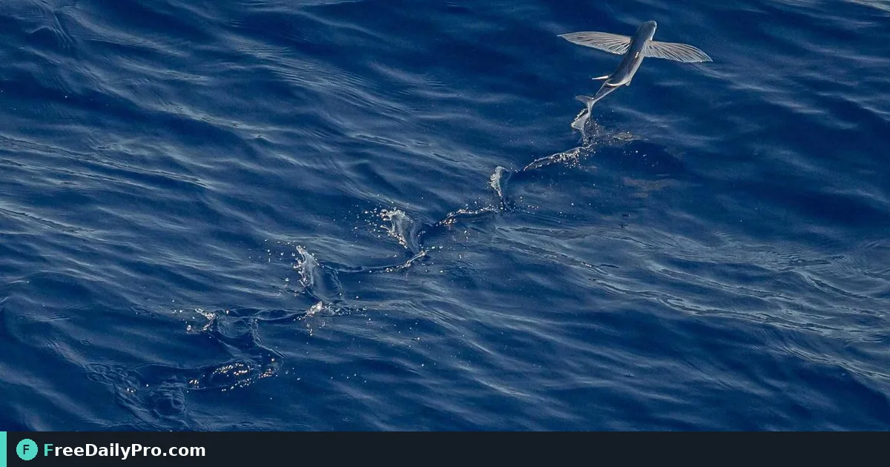

*Reverse picture and sound on short clips for rewind and loop looks*

[https://www.freedailypro.com](https://www.freedailypro.com) -- A clean reverse of a pour, a door close, or a skate trick sells the effect better than a canned filter pack. [Reverse Video](https://www.freedailypro.com/tool/reverse-video) helps you reverse a short video so picture and sound play backwards.

This guide covers one job only: reverse a short video so picture and sound play backwards.

## What the tool does

Plays a video backwards, picture and sound. Good for short effects, loops and rewind clips. Output is MP4. Everything runs in the browser after the processing engine downloads once. Length is limited because frames must fit in memory—about 16 seconds at 720p and 30 fps, less at higher resolutions; 480p allows longer. Sound is reversed too—mute first if you want reverse picture only with silence.

Related tools: [Mute Video](https://www.freedailypro.com/tool/mute-video), [Trim Video](https://www.freedailypro.com/tool/trim-video), [Compress Video](https://www.freedailypro.com/tool/compress-video). Category: [video tools](https://www.freedailypro.com/category/video-tools).

## Worked example

Product pour shot: 6-second 720p clip reversed for a ‘rewind the spill’ social post; muted first so reverse audio does not distract.

Done definition for play video clip backwards for effects: one clear export, settings noted, and no second conflicting copy in Downloads.

## Steps

1. Trim to a short segment first if the master is long.
2. Optionally mute if reverse audio is unwanted.
3. Open Reverse Video.
4. Drop the short clip.
5. Choose resolution options if offered (480p for longer clips).
6. Run reverse and download the MP4.
7. Preview end-to-end—start and end frames matter for loops.
8. Compress only if the platform caps size.
9. Name the file with effect and date.
10. Keep the forward master for other cuts.

## Common mistakes

- Feeding a 3-minute 4K file and wondering why memory fails.
- Leaving reverse audio on dialogue clips.
- Looping a reverse that does not match at the seam.
- Losing the forward master.
- Expecting cinema-grade optical flow on extreme motion.

## Limits and good to know

Short clips only; memory-bound. Sound reverses with picture. Browser engine required.

Among FreeDailyPro’s 200+ professional tools, Reverse Video is the focused path for this scenario. When play video clip backwards for effects exports count toward trial usage, batch downloads instead of exporting after every tiny tweak (10 trial usages, then day pass or monthly options when relevant).

## Mute then reverse

For silent reverse motion, mute first, then reverse. That avoids eerie reverse speech.

## Length strategy

If you need 30 seconds of reverse, reverse several short shots and edit them together offline.

## Loop craft

For seamless loops, reverse then crossfade with the forward take in your editor—not only reverse alone.

## Resolution trade

Drop to 480p in the tool when you need a longer reverse and delivery is social-first.

## Legal clips

Only reverse footage you have rights to publish—effects do not change copyright.

## Archive naming

Store the final file as `play-video-clip-backwards-for-effects-YYYY-MM-DD-v1` plus a one-line note of settings so a reprint does not restart from guesswork.

## Field practice for play video clip backwards for effects

Run the happy path once on a clean browser profile before the day that matters: open the tool, use a sample or a throwaway file, export one artifact, and open that file on a second device. Ten minutes of play video clip backwards for effects rehearsal catches missing downloads and format mismatches better than another meeting.

For play video clip backwards for effects, appoint one export owner when two people share the work. Two play video clip backwards for effects exports in Downloads are how teams print the wrong version on the day that matters.

## Contingency notes unique to this workflow

Write three lines before you rely on play video clip backwards for effects in production: (1) backup device that can open the project or file, (2) offline copy on USB or drive if the network fails, (3) named human who can finish the steps if you are unavailable. For play video clip backwards for effects, a contingency written after failure is a story; one written before is operations.

If trial usage applies to play video clip backwards for effects exports, batch downloads instead of exporting after every tiny edit. Adjusting play video clip backwards for effects inputs on screen is usually cheap; repeated downloads burn the 10 trial usages before a day pass or monthly option becomes relevant.

## Quality bar

If the play video clip backwards for effects output looks wrong, fix the source and re-run rather than hand-editing until the export drifts. Hand-edited play video clip backwards for effects outputs create two truths. Re-export play video clip backwards for effects so every consumer sees the same artifact.

Name play video clip backwards for effects files with the ISO date and a version suffix. Store a one-line settings note beside the play video clip backwards for effects file so you can reproduce this exact output.

## Handoff sentence

Close play video clip backwards for effects work with one sentence: export name, full filename, open items. Nobody should hunt chat to continue play video clip backwards for effects.

## FAQ

**Length limit?** Roughly 16s at 720p/30; less at higher res; 480p allows more.

**Sound?** Yes, reversed—mute first if unwanted.

**Output?** MP4.

## Closing next step

Open [Reverse Video](https://www.freedailypro.com/tool/reverse-video) and run the steps on your real file or project data.

Need a short reverse-effect shot list for product video? [https://www.freedailypro.com/contact](https://www.freedailypro.com/contact).
