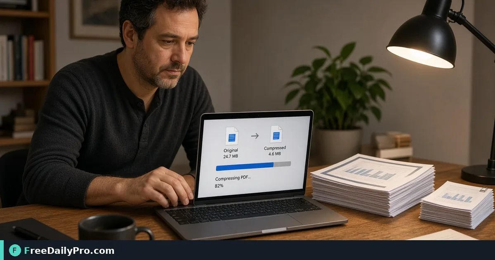

*Hit a 2 MB portal limit in your browser, preview quality, then download*

[FreeDailyPro.com](https://www.freedailypro.com) -- A job portal caps uploads at 2 MB. Your proposal sits at 9 MB. The last thing you want is another PDF-site registration that ties your email to every document you process while a deadline clock runs.

[Compress PDF](https://www.freedailypro.com/tool/compress-pdf) is explicit about the model that matters here: files never stored, runs on your device, and you can start without signing up for a trial. Across FreeDailyPro’s 200+ professional tools you get 10 trial usages a day. When a folder of scans needs clearing in one sitting, take a Day Pass for 24 hours of unlimited professional-tool use, or move to monthly if compression is part of every workday.

This article covers one job: shrink a PDF—or hit a named size—without creating an account first.

Watch the brief walkthrough below, then use Target size when a portal posts a hard limit.

{{youtube XZDDliVHrLY | Compress PDF to target size}}

## Account walls versus 10 trial usages

Many remote compressors use accounts as metering and remarketing. The friction is more than annoyance: it links your identity to the titles of files you process.

FreeDailyPro meters differently. Trial usages apply across professional tools, then an optional Day Pass or subscription. You are not forced to register before you learn whether the quality is acceptable on a real file. That matches how people decide: try the actual PDF first, then pay only if the workflow sticks.

## Compression modes on the live tool

The Compress PDF page offers several ways to shrink a file. Align your expectations with the buttons you will see:

- **Recommended** — aims for a substantial reduction by tidying structure and shrinking pictures only as needed.
- **Balanced** — reduces embedded pictures to a screen-friendly resolution while leaving text, links, bookmarks, and form fields alone.
- **Smallest** — more aggressive picture reduction for the smallest on-screen-acceptable file.
- **Target size** — you set a limit such as under 2 MB; the tool shrinks pictures as little as possible to fit. If pictures alone cannot reach the limit, it can offer a last-step option that turns pages into pictures, with the tradeoff that text may no longer be selectable.

Always read the on-page explanation for the mode you pick. After compression, FreeDailyPro shows a comparison so you can judge quality before download. If a setting cannot make the file meaningfully smaller, the tool tells you rather than inventing a success that wastes a step.

## How to hit a portal’s 2 MB or 5 MB limit

1. Open [Compress PDF](https://www.freedailypro.com/tool/compress-pdf).
2. Drop the PDF (or use Several files when you have a small batch).
3. Choose Target size and enter the portal’s limit.
4. Compress and inspect page previews.
5. If you still miss the limit, ask whether you need every page. Trim unused sheets with [Remove PDF Pages](https://www.freedailypro.com/tool/remove-pdf-pages) or pull a slice with [Extract PDF](https://www.freedailypro.com/tool/extract-pdf), then compress again.
6. Download only when the preview is acceptable.

Rename the export so you do not overwrite the full-resolution master. Keep both files until the portal confirms acceptance.

## Text-heavy exports versus photo-heavy scans

A digitally exported report with embedded fonts and vector text may already be compact. Compression that only re-encodes pictures will not invent savings that are not there. The tool’s own guidance notes that text-only PDFs often cannot get much smaller.

Scans and photo-heavy decks are the opposite: they often shrink dramatically because the bulk is image data. That is where Balanced, Smallest, or Target size shine.

If your “PDF” is really a pile of phone photos, build it cleanly first, then compress. When several finished PDFs must become one packet before the size check, merge with [Merge PDF](https://www.freedailypro.com/tool/merge-pdf), then return to Compress PDF.

## Batch: several files, one setting

The Compress PDF UI includes a Several files path for applying the same setting across multiple PDFs. Trial caps still apply; paid plans raise limits. Check the live page for the current trial batch size before you assume a whole folder will finish under one usage.

For mixed image folders rather than PDFs, use the image tools in the same toolkit instead of forcing everything through a PDF compressor.

## When compression is the wrong first step

- You need fewer pages, not smaller pixels → remove or extract pages first.
- You need editable text from a scan → convert or run OCR on the right tool, then revisit size.
- You need sensitive strings gone forever → redaction is a different job; shrinking pictures is not redaction.
- You need one packet from many files → [Merge PDF](https://www.freedailypro.com/tool/merge-pdf) first, then compress.

Browse the wider set under [PDF Tools](https://www.freedailypro.com/category/pdf-tools) when the next step is split, watermark, or page numbers.

## Practical scenarios

**Client proposal packet.** Cover letter, pricing, and case study arrive as three PDFs. Merge in order, then compress if email rejects the size.

**Field scans.** Phone photos become a PDF, then need Target size so the field team can send over mobile data.

**Month-end invoice folder.** Several files, one setting via Several files, Day Pass if trial usages run out mid-folder.

**Policy-constrained laptop.** Approved software lists are narrow. Browser tools that keep processing on your device for labeled jobs remain usable when remote converters are blocked. Confirm badges on the tool page before you process sensitive files.

## Privacy notes tied to the tool page

Compress PDF carries the same privacy badges as other core PDF tools: files never stored, runs on your device. Session artifacts are not kept as a file archive for later retrieval on that model.

Stay precise in practice:

- Say browser or on-device processing when the tool page says so.
- Do not claim offline immortality unless you have tested that specific tool after disconnecting.
- Developers API usage has a different story (in-memory server processing, not stored)—do not conflate API calls with the browser tool claims in this article.

## Trial, Day Pass, and monthly

- Trial: 10 trial usages a day—enough to learn which mode hits your portal limit.
- Day Pass: unlimited for 24 hours when oversized PDFs arrive in a burst.
- Monthly: best when compress and merge are daily habits.

Open [Compress PDF](https://www.freedailypro.com/tool/compress-pdf) with the exact file the portal rejected. Pick Target size, preview, download, and keep the high-quality original until acceptance is confirmed.

Which size limit trips you most often—email gateways, job portals, or client share links? Share the constraint on the [contact page](https://www.freedailypro.com/contact) so we can document that path next.
