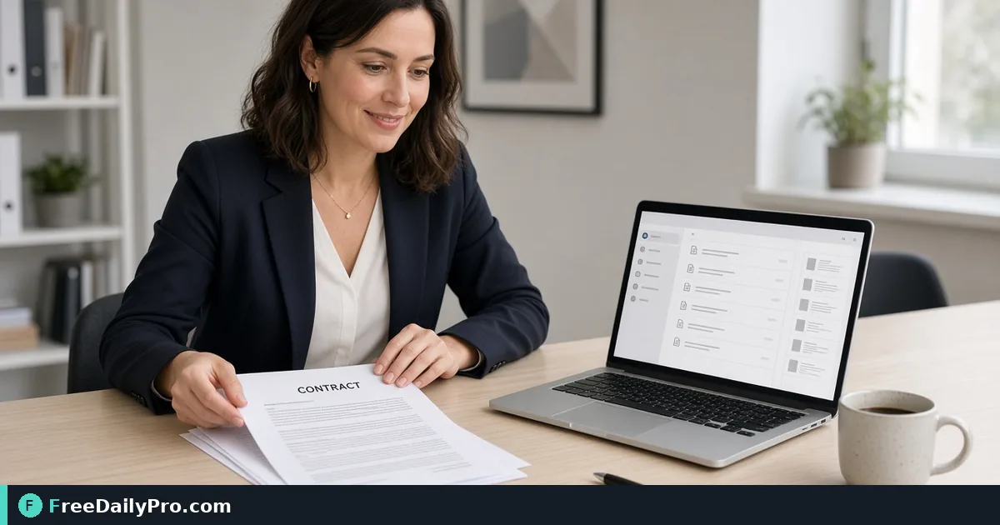

*Combine contracts, scans, and attachments on your device—reorder before you commit*

[FreeDailyPro.com](https://www.freedailypro.com) -- Three email attachments, two phone scans, and a cover sheet still need to become one PDF before the filing deadline. Many merge sites ask you to send every page to a server you have never audited. When the packet includes a signed agreement or a customer invoice, that step is the risk.

[Merge PDF](https://www.freedailypro.com/tool/merge-pdf) is built for the opposite model: combine files in your browser. The live tool page states that files are never stored and that the merge runs on your device. You can start a trial without creating an account. Across FreeDailyPro’s 330+ professional tools you get 10 trial uses per day, then a Day Pass or monthly plan when you need an unlimited day.

This guide is for the person who already knows the job and refuses the upload step.

The short clip below walks through combining files and setting order before download.

{{youtube 0FjbjU4eDVw | Merge PDFs in the browser}}

## Why local merge matters for legal and HR packets

Upload-based converters are convenient because a remote machine has spare CPU. They become a problem the moment an NDA, a client policy, or your own judgment says those bytes should not leave the laptop.

Common pain points with remote merge tools:

- Temporary storage lasts longer than the progress bar suggests.
- An account wall creates a trail of document titles tied to your email.
- Company networks block the domain as file transfer or unapproved software.
- After the merge you still need to compress or split—each step another remote hop.

Local merging does not erase every limit. Very large batches can stress device memory. Password-protected files still need the password. The threat model still changes: the working copy stays in the tab you control.

On the Merge PDF page, FreeDailyPro states the merge happens entirely in your browser so nothing is uploaded to a server for that process. If you are approving tools for a team, open your browser’s network panel once with a sample file and confirm what you expect to see.

## How to combine PDFs on FreeDailyPro

1. Open [Merge PDF](https://www.freedailypro.com/tool/merge-pdf).
2. Drop every PDF into the drop zone, or browse to select multiple files.
3. Confirm each file appears as its own card in the list.
4. Drag cards to set the final order, or use the up and down controls on a trackpad.
5. Optionally enter a page range on a card (for example `1-3,5`) when you only need part of a source file.
6. Optionally enable the blank-page option when each source document must start on a front side for duplex printing.
7. Click merge, wait for the browser to assemble pages, then download the combined PDF.

Your originals remain on disk. The tool builds a new file from page copies. Naming follows the first file by default—rename after download like any other export.

> Tip: Fix order before you merge. Re-running a remote merge just to move one exhibit is how people waste an afternoon.

## Reorder, page ranges, and duplex blanks

Most merge failures are order mistakes, not software failures. People combine first, notice page 17 belongs after the appendix, then start over. On FreeDailyPro you fix order before you commit.

Page ranges help when one attachment is a forty-page packet and you only need the signature block plus one exhibit. Typing `1-3,5` on that card keeps the output focused and usually smaller.

Duplex blank pages sound niche until the office printer insists on front and back. If each source file must begin on a physical front side, the blank-page option saves a trip through a desktop editor.

If you need to reorder or rotate individual pages after the combine step, use [Organize PDF](https://www.freedailypro.com/tool/organize-pdf). Merge solves “many files.” Organize solves “pages inside one file.”

## Merge, then compress for email and portal caps

Merging does not shrink files. A 12 MB scan plus an 8 MB deck becomes a larger packet. Email gateways and government portals still reject oversized attachments.

A workflow that matches real work:

1. Merge with [Merge PDF](https://www.freedailypro.com/tool/merge-pdf).
2. Open [Compress PDF](https://www.freedailypro.com/tool/compress-pdf).
3. Start with Recommended, or choose Target size when the portal says “under 2 MB.”
4. Compare original and result page by page before you download.

Both tools’ live pages describe on-device processing with files never stored. That two-step path beats uploading the same packet to two different websites.

When you only need a slice of the finished packet as its own file, use [Split PDF](https://www.freedailypro.com/tool/split-pdf) instead of emailing the whole stack. Browse more options under [PDF Tools](https://www.freedailypro.com/category/pdf-tools).

## Privacy checklist before you trust a “local” claim

Use this checklist when you evaluate Merge PDF—or any similar claim:

- The tool page shows badges such as Files never stored and Runs on your device (Merge PDF does).
- About copy states the merge happens in the browser without uploading to a server for that process.
- You are not forced through a login wall to attempt a trial.
- Very large files may be slow or memory-heavy because the work is local—that tradeoff is disclosed on the page.
- Password-protected PDFs are unlocked in the browser when you provide the password; re-protect the result separately if needed.

FreeDailyPro’s broader platform notes that most professional tools run in the browser and that the few server-side tools are labeled. Always read the individual tool page before you promise a client that nothing ever leaves the laptop.

## When Organize or Split is the better next click

- You merged five weekly reports, then need the summary page moved to the front → [Organize PDF](https://www.freedailypro.com/tool/organize-pdf).
- You need only pages 4–9 as a new PDF without changing the master → [Split PDF](https://www.freedailypro.com/tool/split-pdf).
- The combined file is still too large for email → [Compress PDF](https://www.freedailypro.com/tool/compress-pdf).

Keeping merge, organize, split, and compress as separate intents keeps each job honest: one clear task, real controls, clear links.

## Trial uses, Day Pass, and when monthly fits

Start here: [Merge PDF](https://www.freedailypro.com/tool/merge-pdf).

- Trial: 10 trial uses per day across professional tools—enough for most one-off packets.
- Day Pass: unlimited professional-tool use for 24 hours when month-end produces a stack of combines.
- Monthly: sensible when merge and compress are daily habits.

Among FreeDailyPro’s 330+ professional tools, Merge PDF is the focused path for turning many files into one packet without a remote upload step for that job. Open the tool with a non-sensitive sample first if you are approving it for a team, then run the real packet once you trust the result.

What merge workflow would you like us to document next for your team—page ranges, duplex packets, or a merge-then-compress checklist? Tell us on the [contact page](https://www.freedailypro.com/contact).
