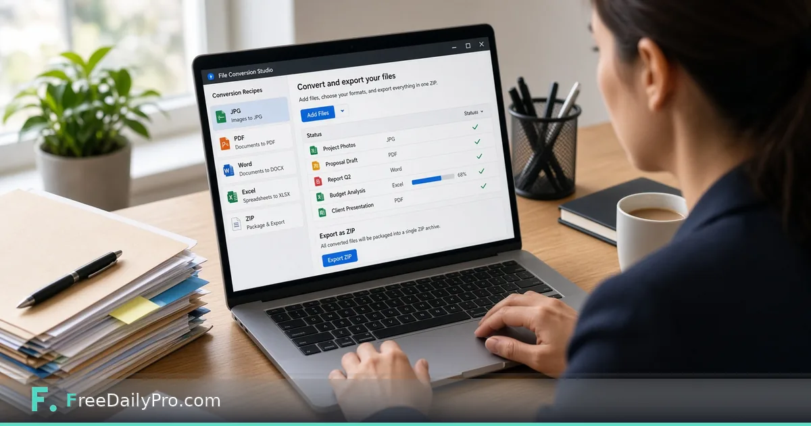

*Drop a mixed folder, set a recipe per file type, and export a ZIP with a results report*

[FreeDailyPro.com](https://www.freedailypro.com) -- Elena Vos runs a four-person research office in Portland, Oregon. Every Friday she gathers a client delivery folder: site photos in HEIC, a scanned PDF pack, two Word drafts, an Excel cost table, and one short screen recording. Opening a different converter for each type used to cost her half the afternoon. [File Conversion Studio](https://www.freedailypro.com/tool/file-conversion-studio) is the workflow product that turns that mixed folder into one job with saved recipes, a quality panel, custom file names, a ZIP, and a results report.

This guide covers one job only: convert a whole delivery folder in a single browser pass without bouncing between single-file tools.

## Studio vs one-file converters

[Universal File Converter](https://www.freedailypro.com/tool/universal-file-converter) is right when you need one file—or a short batch—turned into another format. The Studio is for a whole job. You drop a folder of mixed files, set a rule for each kind, and it converts, renames, and zips with a results report. You can save those rules as a recipe and reuse them next Friday.

Single-purpose helpers still sit next to it when you only need one lane: [Convert Image](https://www.freedailypro.com/tool/convert-image) for a handful of photos, [Convert Video](https://www.freedailypro.com/tool/convert-video) for one clip. Browse [file tools](https://www.freedailypro.com/category/file-tools) when you need a sibling step outside a full Studio run.

## Worked example: Friday client packet, Portland

- Operator: Elena Vos, research ops
- Folder on disk: `Client-A-2026-11-07` (photos, PDF, DOCX, XLSX, one WebM)
- Recipe name she will save: Client delivery – standard
- Picture rule: HEIC/PNG/JPG → JPG, quality she can re-check on the quality panel
- Document rule: Word and Excel → PDF where the client asked for read-only delivery
- Video rule: WebM → MP4 when the portal requires it
- Output: one ZIP plus results report

Done means every required file either converted cleanly or is listed in the report with a clear skip reason—not a silent miss.

## Steps in File Conversion Studio

1. Open [File Conversion Studio](https://www.freedailypro.com/tool/file-conversion-studio) and confirm plan access (monthly workflow product; first-time accounts get a 7-day trial; cancel any time from the link under the tool).
2. Add the mixed folder—or the individual files—so every type you care about is visible.
3. For each file kind, choose only formats that kind can really become. Pictures list image targets; Office and PDF list their own; audio and video list media targets.
4. Set rename patterns if the client wants consistent delivery names (project code, date, sequence).
5. Use the quality panel where pictures or media need a sanity check before you commit the full run.
6. Start the conversion. Watch status per file rather than assuming a green folder means every item finished.
7. Export the ZIP of converted files and open the results report. Note any refused or skipped items.
8. Save the recipe so next week’s folder reuses the same rules instead of re-picking formats from memory.
9. Keep the project file on your device if you will continue later—nothing is stored on FreeDailyPro servers for this Studio.

## What formats the Studio actually covers

Live product scope includes pictures (JPG, PNG, WebP, HEIC, GIF, BMP, TIFF, SVG), PDF, Word, Excel, CSV, PowerPoint, HTML, Markdown, text, audio, and video. Each kind only offers targets it can really produce. If a target is missing from the list, do not invent a path—use a different source or a specialist tool.

## Common mistakes on bulk day

- Treating Universal File Converter and the Studio as the same product and expecting folder recipes on a one-file tool.
- Forcing video over 200 MB; the Studio refuses those, and large media already warn before a heavy start. Use Stop if a conversion is thrashing your machine.
- Assuming audio and video will batch as fast as photos. Media convert one file at a time in the browser and must hold the whole file in memory.
- Skipping the results report and mailing a ZIP that still contains a failed item.
- Expecting cloud storage of recipes. Recipes are small settings files you save on your own device.

## Limits and good to know

- File Conversion Studio is a monthly workflow product at $29.99 a month with a 7-day trial the first time. Access continues through the end of the paid month if you cancel.
- Files are read and converted in your browser. Nothing is sent to a server for storage. Closing the tab clears the working set; save recipes and exports yourself.
- Videos over 200 MB are refused. Large media can be slow—plan around that.
- Sitewide Professional Tool trial wording (10 trial usages on single-task tools) does not replace this subscription.
- FreeDailyPro also offers 200+ professional tools for one-off jobs outside the Studio.

## When to stay on single-file tools

If Elena only needs one HEIC turned into JPG, she opens Convert Image and is done in a minute. If the whole Friday packet is mixed, she opens the Studio, loads the Client delivery recipe, and ships one ZIP. That split keeps simple jobs fast and bulk jobs honest.

## Recipe library habits that save Fridays

Elena keeps three recipes only: Client delivery – standard, Photo archive – long-term JPG, and Portal video – MP4 only. More than five recipes became a junk drawer. Each recipe name includes the outcome, not the client name, so she can reuse them across accounts without renaming every week.

When a new file type appears—say a rare TIFF set—she updates the Client delivery recipe once, runs a five-file pilot, then saves. She never edits a recipe mid-run on a live client folder; she duplicates it to `… – pilot` first.

## Quality panel discipline

The quality panel is not a gallery for fun. Elena opens it when:

- a photo will appear in a printed appendix,
- a chart-heavy PDF must stay readable after image re-encode,
- a video will be watched full-screen by the client.

If the panel looks soft, she adjusts settings and reconverts that file only instead of re-running the whole folder. The results report still lists the reconvert so she has a trail.

## FAQ

**Do my files leave my computer?**
For File Conversion Studio, conversion runs in the browser. FreeDailyPro does not store the files. Save your ZIP and recipes yourself.

**Can it convert a 4 GB video?**
No. Files over 200 MB are refused for video, and large media are slow even under that cap because the browser holds the whole file in memory.

**Is the Studio part of the 10 trial usages on Professional tools?**
No. It is a monthly workflow product with its own 7-day trial the first time. Professional single-task tools still show 10 trial usages a day on their own pages.

## Closing next step

A delivery folder should leave your desk once, not eight times through eight converters. Open [File Conversion Studio](https://www.freedailypro.com/tool/file-conversion-studio), build one recipe that matches your real packet, and keep the results report next to the ZIP you send.

What folder pattern do you run every week that still needs a recipe—say so at [https://www.freedailypro.com/contact](https://www.freedailypro.com/contact).
