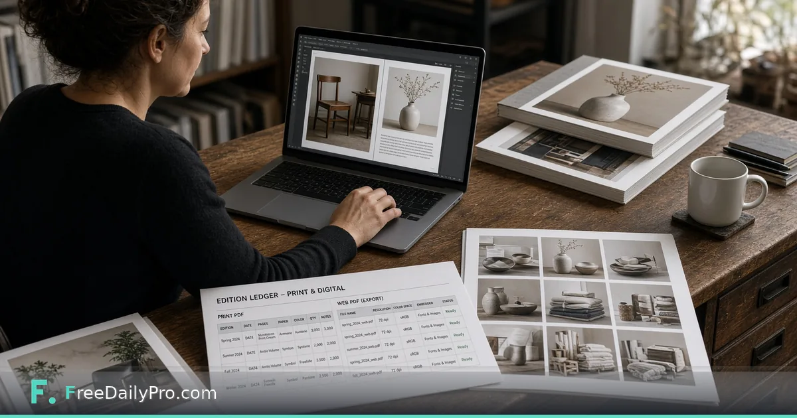

*Track editions, keep a shared brand, export print PDF and web PDF for each issue*

[FreeDailyPro.com](https://www.freedailypro.com) -- Sofia Martel edits a seasonal home-goods catalog for a small brand in Providence, Rhode Island. Spring and fall editions used to live as four folders, two brand decks, and a printer e-mail chain that always lost the trim note. [Print and Publication Studio](https://www.freedailypro.com/tool/print-publication-studio) is the workflow product for a publication project—an issue or catalog series—with a shared brand, an edition ledger, and a print PDF plus web PDF in one export.

This guide covers one job only: register an edition, attach the PDFs you already made, and export print and web files without losing series history.

## Studio does not replace the page makers

[Catalog Maker](https://www.freedailypro.com/tool/catalog-maker), [Magazine Maker](https://www.freedailypro.com/tool/magazine-maker), and [Document Assembler](https://www.freedailypro.com/tool/document-assembler) stay separate and keep their own look. The Studio wraps them: it keeps the series, the editions, and the brand, and turns the PDFs you made into one print file and one web file. It does not invent catalog pages for you.

Browse [design tools](https://www.freedailypro.com/category/design-tools) when you need one-off layout help outside a multi-edition series.

## Worked example: Hearth & Rail Spring 2026

- Editor: Sofia Martel
- Series: Hearth & Rail seasonal catalog
- Edition: Spring 2026
- Page PDFs: cover, product spreads, back matter from Catalog Maker and Assembler
- Need: print PDF with trim margin for the press; lighter web PDF for the site and sales team
- Brand: shared colours and logo already set on the series

Done means both exports exist, the ledger shows Spring 2026 as shipped, and Fall can start from the same series shell.

## Steps in Print and Publication Studio

1. Open [Print and Publication Studio](https://www.freedailypro.com/tool/print-publication-studio) and create or open the series project.
2. Confirm the shared brand on the series so every edition inherits the same identity.
3. Add a new edition row in the ledger (name, date, notes you will still understand in six months).
4. Bring the page PDFs from Catalog Maker, Magazine Maker, Document Assembler, or your design tool—Studio does not draw the pages.
5. Set trim margin for the print PDF so press output keeps full page size plus the margin you choose.
6. Export print PDF and web PDF. The web PDF is the lighter screen copy with page numbers and smaller size.
7. Save the project file on your device. Nothing is stored on FreeDailyPro servers.
8. Archive the two PDFs with the ledger date in the filename before you mail the printer.

## Print PDF vs web PDF

The print PDF keeps full page size and adds the trim margin you choose. The web PDF is built for screens: lighter, numbered, easier to e-mail. Shipping only the web file to a press is a classic fail; shipping only the print file to the sales team wastes bandwidth.

## Common mistakes in multi-edition work

- Expecting the Studio to replace Catalog Maker page design.
- Changing brand colours on one edition without updating the series brand.
- Forgetting trim margin and discovering it on press day.
- Overwriting last season’s export names so Spring and Fall collide in cloud storage.
- Skipping the ledger so nobody knows which file was “final final.”

## Limits and good to know

- Print and Publication Studio is $29.99 a month with a 7-day trial the first time. Cancel any time; access lasts through the paid month.
- Catalog Maker, Magazine Maker, and Document Assembler remain separate tools.
- Project files stay on your device.
- FreeDailyPro offers 200+ professional tools; use them for one-off PDF fixes outside the series workflow.

## Series hygiene Sofia enforces

One series project per brand catalog line. One ledger row per edition. Print and web filenames both include edition code. Printer e-mail always attaches print PDF and a one-line trim note copied from the Studio settings she used.

## Press checklist Sofia keeps next to the export

Before she books press time, Sofia opens the ledger row and ticks four items she wrote herself: print PDF page count matches the web PDF page count, trim note matches the printer’s last confirmation e-mail, brand colours match the Brand Pack used for that edition, and the filename includes the edition code. She prints that checklist once and sticks it beside her monitor. The Studio export is fast; the mistake is booking a press slot on a file that still carries last season’s trim. A two-minute checklist beats a reprint invoice.

## Working with outside designers

Sofia sometimes receives spreads as PDF from a contractor. She still registers them as an edition in the Studio so the ledger, brand, and dual export stay consistent. The contractor never needs a Studio login; they deliver pages, she packs the series.

## Web PDF for sales, print PDF for press

Sales gets the web PDF the morning after export. Press gets the print PDF with trim notes. Sofia refuses to send “the same file” to both. When marketing asks for a lighter deck, she points them at the web export already in the ledger folder.

## FAQ

**Does the Studio design catalog pages?**
No. You bring PDFs from Catalog Maker, Magazine Maker, Document Assembler, or your own tool. The Studio plans, packs, and tracks editions.

**What is the difference between print and web PDF?**
Print keeps full page size and your trim margin. Web is lighter for screens with page numbers.

**Where is the project kept?**
In a file on your device. FreeDailyPro does not store it on a server.

## Edition ledger as the single source of truth

Sofia treats the ledger the way a warehouse treats a SKU list. Every edition has a row before any PDF is attached. When a contractor e-mails “final_v3_REAL.pdf”, she refuses to rename it on disk until the row exists with edition code, intended ship date, and a short note about who approved the spreads. That discipline means Fall never overwrites Spring in cloud search because both exports carry the ledger code in the filename.

If marketing asks for “last season’s web PDF,” she answers with the ledger date, not a scavenger hunt through e-mail. The Studio is not a file browser; it is the place the series history is forced to stay honest.

## Trim margin conversations with the printer

Press day fails when trim is assumed. Sofia copies the trim margin she set in Print and Publication Studio into the printer e-mail every time, even when the printer already has a standing instruction. When the printer updates their spec sheet, she updates the series default and re-exports rather than hoping the old PDF “is close enough.” The Studio does not convert to CMYK and does not check colour profiles, so colour conversation stays with the printer; her job is page size, order, and paired exports.

## Fall restart from the same series shell

When Fall starts, Sofia does not create a new series. She opens the Hearth & Rail series, adds a Fall row, and reuses the shared brand. Cover art changes; brand colours do not, unless leadership approves a series-level update. That keeps Spring and Fall visually related without merging files.

## When not to use the Studio

One-off flyer PDFs do not need an edition ledger. A single brochure without a series does not either. The Studio earns its keep when the same brand will ship multiple issues and someone will later ask which file was final. If you only need a one-time catalog layout, start in [Catalog Maker](https://www.freedailypro.com/tool/catalog-maker) and skip the Studio until the second issue is real.

## Scenario: contractor late, press booked

Two days before press, the product-spread contractor delivers late pages. Sofia still registers the edition first, attaches what she has, exports a draft web PDF for internal review, and holds the print PDF until the missing spreads arrive. The ledger notes “awaiting spreads 4–5.” When the final PDFs land, she replaces attachments, re-exports both outputs, and updates the note to “shipped.” The history of the delay stays in the ledger instead of in chat.

## FAQ (expanded)

**Can the Studio invent catalog pages from a manuscript Word file?**
No. Bring finished page PDFs from Catalog Maker, Magazine Maker, Document Assembler, or your design tool.

**Does the web PDF include page numbers?**
Yes. The web export is the lighter screen copy with page numbers. The print export keeps full page size plus your trim margin and is meant for press.

**What if my issue is huge?**
Very large PDFs sit in browser memory. Split a massive issue into ordered parts before attach, then export. The Studio is not a press-proof colour engine.

**Who should own the series project file?**
One editor owns the series file on a backed-up company drive. Contractors deliver pages; they do not need Studio access.

## Closing next step

A catalog series needs a ledger as much as it needs pretty spreads. Open [Print and Publication Studio](https://www.freedailypro.com/tool/print-publication-studio), register the next edition, and export both PDFs before you book press time.

If you want a pairing guide for Catalog Maker layouts into Studio next, ask at [https://www.freedailypro.com/contact](https://www.freedailypro.com/contact).
