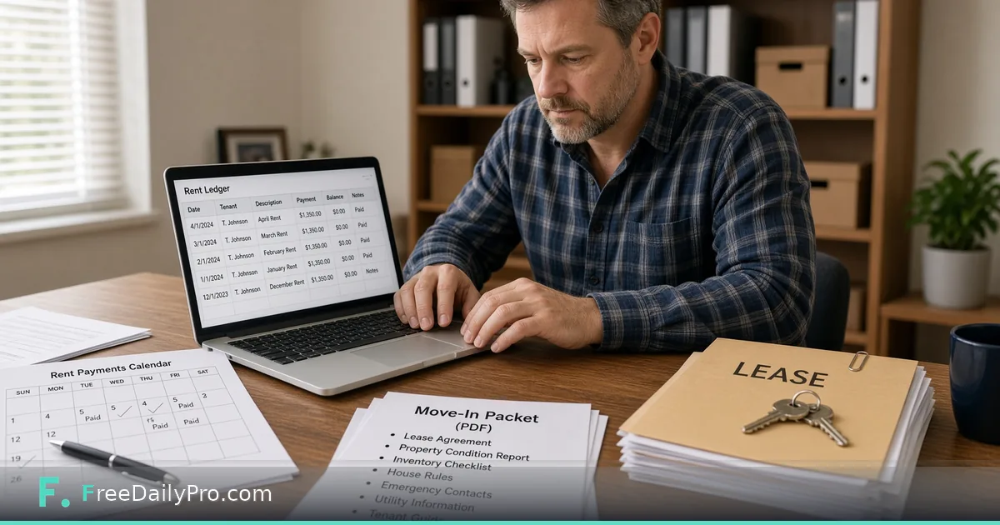

*Property and tenant records, rent ledger with receipts, notice calendar, and move-in packets*

[FreeDailyPro.com](https://www.freedailypro.com) -- Carla Nguyen owns three small multi-family buildings in Sacramento, California. She used to track rent in a spreadsheet, notices in a calendar app, and move-in paperwork in a paper folder that never matched. [Landlord Desk](https://www.freedailypro.com/tool/landlord-desk) is the workflow product for US landlords that keeps property and tenant records, a rent ledger with receipts, a notice calendar, and a move-in or move-out packet ZIP—on your device, not as legal advice.

This guide covers one job only: set up a unit, keep the ledger honest, and export the packet you actually hand a new tenant.

## What the desk is—and is not

Landlord Desk is record-keeping for US rental practice: dollars, security deposits, and common US notice habits. It is **not** legal advice. Notice periods, deposit rules, and late-fee limits differ by state and city. Check the rules where the property sits, or ask a lawyer, before you rely on a date or a figure.

Related document tools still help for one-off forms: [Lease Agreement Generator](https://www.freedailypro.com/tool/lease-agreement-generator) when you need a draft agreement layout, and [Invoice Generator](https://www.freedailypro.com/tool/invoice-generator) when a tenant needs a standalone bill outside the desk receipt flow. Browse [business tools](https://www.freedailypro.com/category/business-tools) for sibling office steps.

## Worked example: Unit 2B, Oak Street duplex

- Landlord: Carla Nguyen
- Property: 814 Oak Street, Sacramento, CA (two units)
- Tenant on 2B: T. Johnson
- Rent: $1,350 due on the first
- Deposit on file: recorded in the tenant card
- Need this week: April rent receipt, calendar mark for a 30-day item she must act on, and a move-in packet ZIP for a new applicant on 1A

Done means ledger balance matches cash she actually received, and the packet list matches what she will put in the envelope.

## Steps in Landlord Desk

1. Open [Landlord Desk](https://www.freedailypro.com/tool/landlord-desk) and confirm plan access (monthly workflow product; 7-day trial the first time; cancel from the link under the tool).
2. Add the property and its units with addresses you would put on a notice.
3. Add each tenant with lease start and end dates, rent amount, and deposit figures.
4. Record charges and payments in the ledger. Print or download a receipt for each payment you accept.
5. Put action dates on the notice calendar—what you must do by which day—not wishes.
6. Build a move-in or move-out packet ZIP when the unit turns. Include only documents you actually use (agreement copy, condition report, house rules, contacts, utilities).
7. Save the project file on your device. Tenant details live in that file; nothing is stored on FreeDailyPro servers. Closing the tab clears the page if you did not save.
8. Re-open next month from the saved file instead of rebuilding units from memory.

## Receipts, calendar, packets

The ledger is the source of truth for who paid what. Receipts are evidence for the tenant and for you. The calendar is a local reminder surface—it does **not** e-mail or text tenants. The packet ZIP is the hand-off bundle for move-in or move-out day, not a court filing system.

## Common mistakes landlords make in software

- Treating desk wording as a substitute for state notice forms.
- Skipping save, then losing tenant details when the tab closes.
- Recording rent as paid before the funds clear.
- Building a packet with outdated house rules still inside the ZIP.
- Expecting automatic reminders to tenants—the desk shows what is due soon; it does not send messages.

## Limits and good to know

- Landlord Desk is $29.99 a month with a 7-day trial the first time. Cancel any time; access lasts through the paid month.
- Built for US rental practice. Ledger maths work anywhere, but packet wording is US-oriented.
- Not legal advice. Not a messaging platform.
- Files never stored on FreeDailyPro servers for this desk; your project file is yours to protect.
- FreeDailyPro also offers 200+ professional tools for adjacent document jobs.

## Month-end routine

Carla’s close: open the ledger for each unit, match deposits to bank rows, issue any missing receipts, check the calendar for the next 14 days, and only then update her tax folder. When a unit turns, she rebuilds the packet from the current templates instead of photocopying last year’s stack.

## Deposit and late-fee notes without playing lawyer

Carla records deposit amounts and dates in the tenant card so she can answer “what did we collect?” in seconds. She does **not** let the desk invent lawful late-fee math for California or any other state. When a fee is allowed, she types the figure she already confirmed with counsel or a local association guide. The ledger stores the charge; it does not justify it.

## Move-out day packet

For move-out she builds a packet ZIP that includes the condition form she actually uses, a deposit accounting worksheet she fills offline, and return-of-keys notes. She keeps a paper copy in the unit file cabinet as well—software is not a backup for a flood. The desk packet is the clean digital twin she e-mails when a tenant requests records.

## FAQ

**Does Landlord Desk send rent reminders to tenants?**
No. The calendar shows what is due soon. It does not send e-mail or text.

**Is this legal advice?**
No. It is record-keeping for US landlords. Notice and deposit rules vary by place; verify before you act.

**Where do tenant details live?**
In a project file on your device. Nothing is stored on FreeDailyPro servers. Save before you close the tab.

## Closing next step

A rental file that only lives in your head will fail on turnover day. Open [Landlord Desk](https://www.freedailypro.com/tool/landlord-desk), enter one property completely, and export one real receipt and one packet before the next first-of-month rush.

If you want a state-specific checklist layout next, ask at [https://www.freedailypro.com/contact](https://www.freedailypro.com/contact)—and still verify local law before you use any date.
