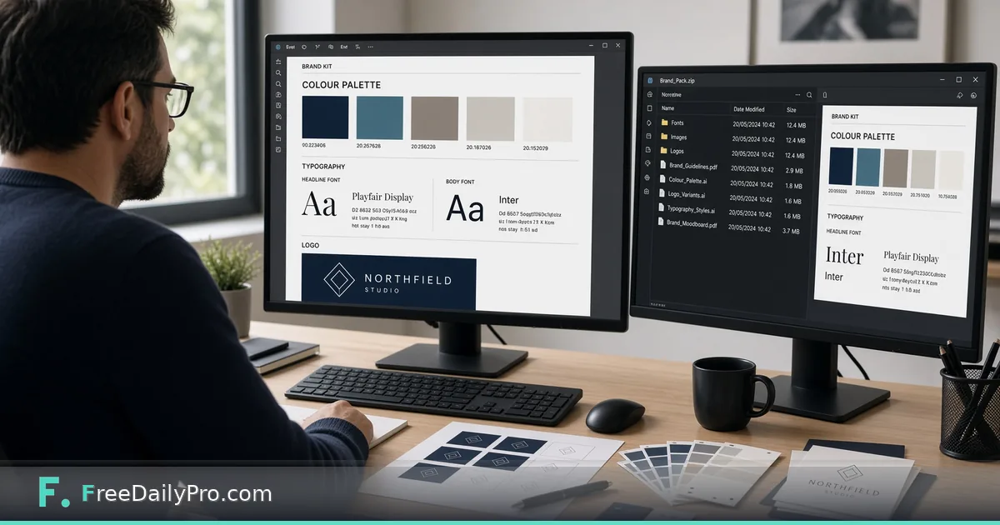

*One brand project for colours, fonts and logo—plus a Brand Pack ZIP and contrast check*

[FreeDailyPro.com](https://www.freedailypro.com) -- Noah Reed is launching Northfield Studio, a two-person interiors practice in Minneapolis. He has a logo mark, a navy he likes, and a pile of half-finished cards and social sizes that still disagree on fonts. [Brand Studio](https://www.freedailypro.com/tool/brand-studio) is the workflow product that holds one brand project—name, colours, fonts, logo—runs contrast checks, builds a Brand Pack ZIP, and keeps a change log so the next export matches the last one.

This guide covers one job only: turn a working brand project into a Brand Pack you can hand to makers and freelancers without retyping hex codes.

## Brand Studio vs Brand Kit

[Brand Kit](https://www.freedailypro.com/tool/brand-kit) is the Premium maker that starts from one colour or a logo and produces a starter palette, contrast checks, font pairing, brand sheet PDF, and a brand file design makers can load. Brand Studio keeps the whole brand project, checks colour pairs, builds the Brand Pack ZIP in one go, and logs what you changed. Many teams use Brand Kit to explore, then Brand Studio to run the living project.

Related makers that open on-brand when the brand file is present include [Business Card](https://www.freedailypro.com/tool/business-card) and [Brochure Flyer Maker](https://www.freedailypro.com/tool/brochure-flyer-maker). Browse [design tools](https://www.freedailypro.com/category/design-tools) when you need a sibling layout step.

## Worked example: Northfield Studio brand pack

- Brand name: Northfield Studio
- Tagline: Rooms with quiet light
- Primary: deep navy; secondary and accent chosen after contrast review
- Fonts: a serif for headlines and a clean sans for body
- Logo: SVG mark plus a simplified monogram for small sizes
- Outputs needed today: brand guide PDF, business card PDF, social-size cards, e-mail signature, CSS of colours, brand file, QR, and a manifest with sizes and checksums

Done means Noah can send one ZIP and a short note: “use these files; do not invent a fifth blue.”

## Steps in Brand Studio

1. Open [Brand Studio](https://www.freedailypro.com/tool/brand-studio) and load a Business Profile or a saved project, or type the brand name, tagline, and colours by hand.
2. Add the logo files you actually use—full lockup and any mono version for dark backgrounds.
3. Set fonts for headline and body. Prefer pairings you can install on print day, not decorative faces no one else owns.
4. Run contrast checks on the colour pairs you will put on text. Fix pairs that fail before you design cards around them.
5. Review the change log after each edit so a teammate can see what moved since last week.
6. Build the Brand Pack ZIP. Confirm the pack lists the guide PDF, card PDF, social sizes, signature, CSS, brand file, QR, and manifest.
7. Save the project file on your device. Brand Studio does not store the brand on FreeDailyPro servers.
8. Open Business Card or Brochure Flyer Maker with the brand file loaded and verify the first layout already shows the correct colours.

## What is inside the Brand Pack

Live product content includes a brand guide PDF, a business card PDF, social-size cards, an e-mail signature, a CSS file of your colours, your brand file, a QR code, and a manifest that lists each file with size and checksum. Use the manifest when you hand the ZIP to a contractor so both sides can confirm nothing was dropped.

## Common mistakes on brand day

- Shipping a pack with a pretty primary that fails contrast on white text.
- Keeping Brand Kit and Brand Studio projects out of sync so makers load an older brand file.
- Treating the Brand Pack as cloud storage. It is a ZIP you download and own.
- Expecting Brand Studio to redesign logos; it applies the brand project, it does not invent a new mark.
- Skipping the change log and arguing about “which navy was final” two weeks later.

## Limits and good to know

- Brand Studio is a monthly workflow product at $29.99 a month with a 7-day trial the first time. Cancel any time from the link under the tool; access lasts through the paid month.
- Brand lives in a file on your device. Nothing is stored on FreeDailyPro servers.
- It writes to the same brand file Brand Kit and the design makers read, and can align with your Business Profile so cards, flyers, banners, menus, and invitations open already on-brand.
- Brand Kit remains a separate Premium application with its own trial model (2 trial usages a day on Premium apps).
- FreeDailyPro lists 200+ professional tools beyond this Studio.

## Hand-off to freelancers

Noah zips the Brand Pack, adds one sentence about the monogram-on-dark rule, and stops sending five Slack images of “almost the right blue.” When a freelancer asks for CSS tokens, the pack already has them.

## Contrast before creativity

Noah used to pick colours because they “felt calm.” Then a printer proof showed grey body text failing on the cream background. Brand Studio’s contrast checks forced a fix before another order. His rule now: no card export until every text pair he actually uses passes the check he cares about for that size.

He still explores freely in Brand Kit when he wants five alternate palettes. Only the winner graduates into Brand Studio as the living project.

## Change log as a teammate

When a contractor asks “did the accent change?”, Noah opens the change log instead of scrolling Slack. The log will not replace a design review, but it ends arguments about which ZIP was final. He exports the Brand Pack only after the log shows the intended edits and nothing else.

## FAQ

**Where is my brand stored?**
In a project file on your device. FreeDailyPro does not keep a server copy of your brand for Brand Studio.

**What is in the Brand Pack ZIP?**
A brand guide PDF, business card PDF, social-size cards, e-mail signature, CSS of colours, brand file, QR code, and a manifest with sizes and checksums.

**How does pricing work?**
Brand Studio is $29.99 a month with a 7-day trial the first time. Cancel any time from the link under the tool and keep access through the paid month. Brand Kit is a separate Premium application with its own trial model.

## Closing next step

A brand that only lives in someone’s head will drift. Open [Brand Studio](https://www.freedailypro.com/tool/brand-studio), finish contrast on the pairs you print, and download one Brand Pack ZIP before the next card order.

Need a walkthrough for loading this pack into a specific maker next—tell us at [https://www.freedailypro.com/contact](https://www.freedailypro.com/contact).
